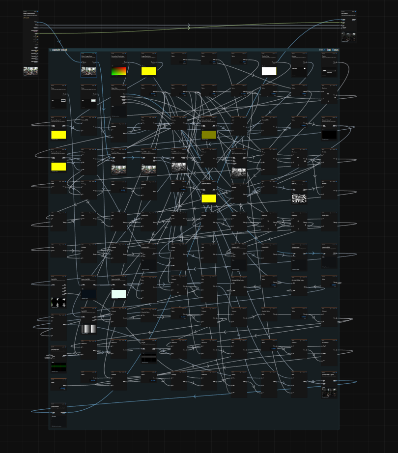

# MasterSelects

A browser-based video editor for video, audio, motion graphics, and 3D. Build a
multitrack edit, connect effects in a node graph, and use the in-app AI agent to
work on the timeline. Editing and rendering run locally with React, TypeScript,
WebGPU, and WebCodecs.

[Open the editor](https://www.masterselects.com/) · [Documentation](https://www.masterselects.com/docs/) · [Discord](https://discord.com/invite/K8dApzG3XC) · [Report an issue](https://github.com/Sportinger/MasterSelects/issues)

[](docs/images/node-graph-overview.png)

*Build effects from connected nodes with live previews. Explore the [Node Workspace](docs/Features/Node-Workspace.md).*

## What you can make

| Workspace | Highlights |
| --- | --- |
| **Video** | Multitrack editing, nested compositions, proxies, multicam, speed changes, and Premiere Pro sequence import. |
| **Nodes & effects** | Editable image, color, geometry, and 3D graphs with typed connections, live previews, reusable groups, and animated controls. |
| **Audio** | Waveforms, mixing, recording, effects, stem separation, beat-based editing, and a score editor. |
| **Motion** | Text, shapes, captions, keyframes, masks, tracking, and rigged stick figures. |
| **3D** | Models, lights, cameras, Gaussian splats, particle simulations, woven curves, and optional path tracing. |
| **AI** | Timeline editing through the in-app agent, plus image and video generation in AI Studio. |

Explore the [feature guide](docs/Features/README.md),
[Node Workspace](docs/Features/Node-Workspace.md), [Weave](docs/Features/Weave.md),
[Flock](docs/Features/Flock-Clips.md), and [AI Studio](docs/Features/AI-Studio.md).
The [3D Scan workspace](docs/Features/3D-Scan.md) reconstructs scenes from photos
or video and can show a training splat directly on the timeline.

## Try it

Open [masterselects.com](https://www.masterselects.com/), import a clip, and drag
it onto the timeline. Press **Space** to play, **C** to cut, and **Ctrl/Cmd+S**
to save. See the [keyboard shortcuts](docs/Features/Keyboard-Shortcuts.md).

Projects [save continuously](docs/Features/Project-Persistence.md) with branching
history. Save waits for pending content and workspace changes to reach storage;
named versions are separate from Save.

Use Chrome or Edge on desktop to get started. Hosted AI and media generation
use external services and may require credits; local AI features may download
models on first use. MasterSelects is under active development, so keep backups
of important projects. See [Linux GPU troubleshooting](docs/Features/Linux-Mesa-GPU.md)
for platform-specific rendering constraints.

## Run locally

Install the Node.js version in [`.node-version`](.node-version), then run:

```bash
git clone https://github.com/Sportinger/MasterSelects.git
cd MasterSelects
npm ci
npm run dev
```

Open **http://localhost:5173**. Hosted login, credits, and AI services need the
full development stack and separate service configuration. Maintainers with the
private kernel checkout can use `npm run dev:full`; the hosted kernel is maintained
separately from this repository.

External coding agents can connect to the authenticated local editor with
`npm run mcp`. See [AI bridge control](docs/Features/AI-Bridge-Control.md) for setup
and access boundaries. An optional [Native Helper](tools/native-helper/README.md)
provides desktop integrations, and an [Android development app](docs/Features/Android-App.md)
packages the editor for mobile testing.

## Contribute

I built MasterSelects because I wanted an editor I could shape around a project.
When a tool is missing, a coding agent can add an effect, control, or workflow;
you can try it in the same project and contribute it for others to use.

Focused pull requests, reproducible bug reports, and documentation improvements
are welcome. For larger features, open an issue first. Read [AGENTS.md](AGENTS.md)
for repository conventions and the [feature guide](docs/Features/README.md) for
architecture and workflows.

## License

MasterSelects is licensed under **AGPL-3.0-only**. Commercial use is permitted
under its terms. Videos and other ordinary media made with the editor do not
inherit its license. See [LICENSE](LICENSE), [LICENSING.md](LICENSING.md), and
[third-party notices](THIRD_PARTY_NOTICES.md).
