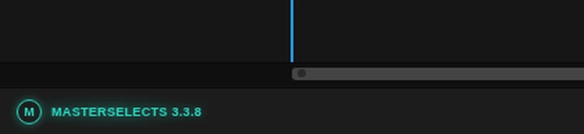

# App updates

When a new version of MasterSelects goes live while you are working, the editor tells you quietly and
updates with one click, without losing any work.

<figure class="docs-shot docs-shot--float-right">

<figcaption>A new version is ready: the brand in the bottom left glows.</figcaption>
</figure>

- **The brand glows.** "MasterSelects" with its version number, bottom left in the workspace bar,
  glows turquoise and slowly pulses. Hold the pointer over it to see which version is ready.
- **Click it to update.** The editor saves your project, waits for media that are still being copied
  into the project, then loads the new version. Your project opens again as you left it.
- **A running export is never interrupted.** The editor asks first: **Update after export** waits for
  the export and then updates, **Not now** keeps working on this version.
- **Click the brand to check now.** Without a new version, a click on the brand asks the server right
  away. A small note above it says **Checking…**, then **Up to date (3.4.1)** for about two seconds, or
  the brand starts glowing at once when a new version is there.

**Tip:** you do not have to update right away. The brand keeps glowing until you click it or reload
the page yourself.

## Options

**The glowing brand** – appears only when the server has a different version than the one you are
using. A second upload of the same version does not make it glow. With reduced motion turned on in your
system, it glows without pulsing. The keyboard reaches it with Tab like every other button.

**Check for updates** – the brand without a new version. Hold the pointer over it to see the running
version. A click checks at once, in any open MasterSelects tab, and every tab learns the answer. The note
above the brand reads:

| Note | Meaning |
|---|---|
| **Checking…** | The editor is asking the server. Clicking again does not ask twice. |
| **Up to date (3.4.1)** | You run the newest version. The note goes away after about two seconds. |
| **Check failed** | No connection, or the server sent no version info. The editor log says why. |
| **Update checks are off** | Update checks are turned off in this browser (see Technical details). |

When the check finds a new version, the brand glows right away and the next click updates as described
above. The note floats above the bar, so nothing in the bar moves. In a window narrower than 720 px the
brand is hidden until a new version is ready.

**Update after export / Not now** – shown only when you click the brand while an export runs. While the
editor waits or saves, the small window says what it is doing; **Cancel** stops waiting (a save that has
already started still finishes).

**On the phone** – the phone editor at `/m` shows a turquoise **Update** button with a circular arrow in
its top bar, next to the project name, as soon as a new version is ready. A tap does the same as the
brand: save, wait for copies and exports, then reload. **Settings → App → Check for update** checks
by hand and offers **Save and reload**. It is the same check as a click on the brand: a version it finds
also shows the **Update** button in the top bar and reaches the other tabs. The phone top bar shows no
version number (it holds the project name and the editing actions), so the version and the manual check
stay in Settings.

## Limits

- The editor looks for a new version about every five minutes while its tab is in front, and right away
  when you come back to the tab or your connection returns. A tab in the background does not check.
- With several MasterSelects tabs open in one browser, only one visible tab asks the server and tells the
  others, so every tab glows at the same time. When that tab is closed or goes to the background, another
  visible tab takes over.
- Without a connection it simply tries again later; a version it already found stays announced.
- If the project cannot be saved, the editor does not reload and tells you why.
- Work that has no project or browser recovery behind it is still guarded by the browser's own
  "Leave site?" question.

## Technical details

- **Version check** (`src/services/appUpdate/appUpdateCheck.ts`): fetches `/build-info.json?check=<time>`
  with `cache: 'no-store'`, every 5 minutes plus up to 60 s of jitter, and on `visibilitychange` (to
  visible) and `online`, at most once a minute for those events. A clean release is compared by its
  `releaseId` (version and commit), so redeploying the same commit is not an update; local builds fall
  back to `buildId`. An answer that is not JSON build info (dev server, SPA fallback) is "unknown", never
  an update. Failures are logged once per failure streak (`Logger.enable('AppUpdateCheck')`).
- **Check by hand** (`checkNow()` in `appUpdateCheck.ts`): a click on the brand (or the phone's **Check
  for update**) checks at once, past `UPDATE_CHECK_MIN_GAP_MS`, also in a tab that does not poll; it posts
  its `result` like every check, so all tabs publish the answer and the polling tab goes on from that check.
  A check that is already running is reused, and a repeat within `MANUAL_CHECK_REPEAT_MS` (2 s) of an
  answer gets that answer again, so a double click sends one request; after a failure the next click asks
  again. The answer is `current`, `available`, `failed` (`unreachable` or `no-build-info`) or `disabled`.
  Each failed manual check is logged as a warning (`Update check failed`); the brand shows its note for
  `MANUAL_CHECK_FEEDBACK_MS` (`useAppUpdateManualCheck` in `src/hooks/useAppUpdate.ts`). The brand is one
  `<button>` in both states, so keyboard focus stays on it when the check finds a version.
- **Several tabs** (`appUpdateTabs.ts`): only the visible tab holding the Web Lock
  `masterselects-app-update-leader` polls. A tab asks for the lock only while it is visible and releases it
  when it is hidden or stops, so a closed, hidden or frozen leader hands over to the next visible tab in the
  lock queue (no stealing); the new leader keeps the previous tab's rhythm. Every answer goes out on the
  BroadcastChannel `masterselects-app-update` as the served build (`version`, `buildId`, `releaseId`), and each
  tab compares it with the build it runs itself, so tabs of different versions stay correct. A tab that
  comes back or reconnects posts `check`; the leader checks unless any tab checked within the last minute,
  and otherwise re-sends its last answer (a tab that was frozen catches up). A new tab posts `hello` and gets
  the last answer. Without Web Locks or BroadcastChannel every tab checks on its own as before.
- **Dev server**: the check is off, because Vite serves no build info. `localStorage['ms.updateCheck.enabled'] = 'true'`
  turns it on there; `'false'` turns it off in a built editor. The flag also covers a click: with checks
  off the brand stays a button and says **Update checks are off** instead of asking the server, so a click
  never goes unanswered (the phone says "Update checks are off in this browser."). The dev server's own
  build has no release id, so it never reads as up to date; with the flag on, a click there says **Check
  failed** unless `/build-info.json` is routed.
- **Safe reload** (`updateReloadFlow.ts`, wired in `reloadForAppUpdate.ts`): asks while
  `isExporting` is set (or waits for it after **Update after export**), waits for
  `hasPendingProjectMediaCopies()` to clear, saves with `saveCurrentProject({ source: 'manual' })`
  (the browser recovery workspace is flushed with `flushEditorRepository()`), repeats when new copies or
  an export started during the save, then refreshes the HTTP cache entry of the page (`fetch` with
  `cache: 'reload'`), removes a leftover service worker (the app registers none) and calls
  `location.reload()`. Assets are content-hashed and deploys keep the assets of earlier releases
  (`deploy:retain-assets`), so the old tab keeps working until the reload.
- **UI**: `src/components/common/WorkspaceBarBrand.tsx` (desktop) and
  `src/components/mobileSkin/shell/PhoneUpdateButton.tsx` (phone) share `src/hooks/useAppUpdate.ts`.
  Colours are the `--update-available` tokens in `src/styles/tokens.css`; the pulse animates only the
  opacity of a glow layer.
- **Tests**: `tests/unit/appUpdateCheck.test.ts` (also the manual check: past the gap, one request per
  double click, reuse of a running check, failures, flag off), `tests/unit/appUpdateTabs.test.ts` (simulated
  tabs: one request, every tab glows, handover, fallback, a non-polling tab checking by hand and telling
  every tab), `tests/unit/workspaceBarBrand.test.tsx` (notes, timing, latest click wins, same button keeps
  focus, pointer blur), `tests/unit/phoneSettingsModel.test.ts`, `tests/unit/updateReloadFlow.test.ts` and
  the journey `tests/playwright/platform/app-update.spec.ts` (the plain brand says checks are off, keeps the
  bar in place, takes Tab and Enter with a focus ring, says **Check failed** without build info, then finds
  a routed newer release by click, glows, and a click checks that a change made just before survived the
  reload; a second case opens two editor tabs and checks one request and two glowing brands). The phone
  journey `tests/playwright/mobile/m3-settings.spec.ts` checks that Settings' check respects the flag and
  lights the top bar's Update button.
