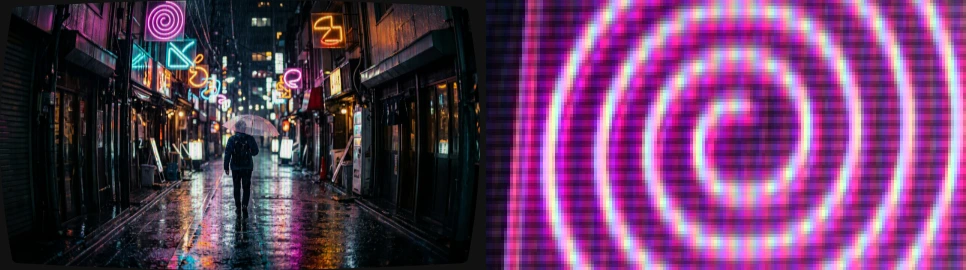
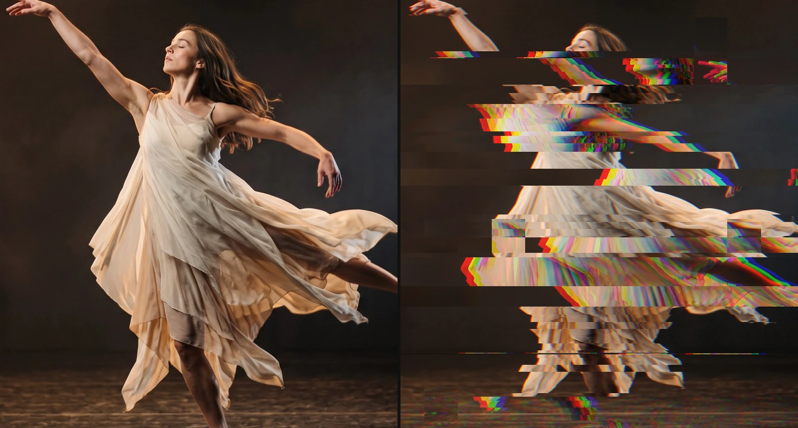
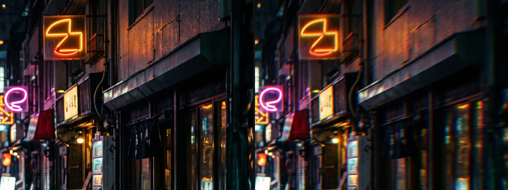
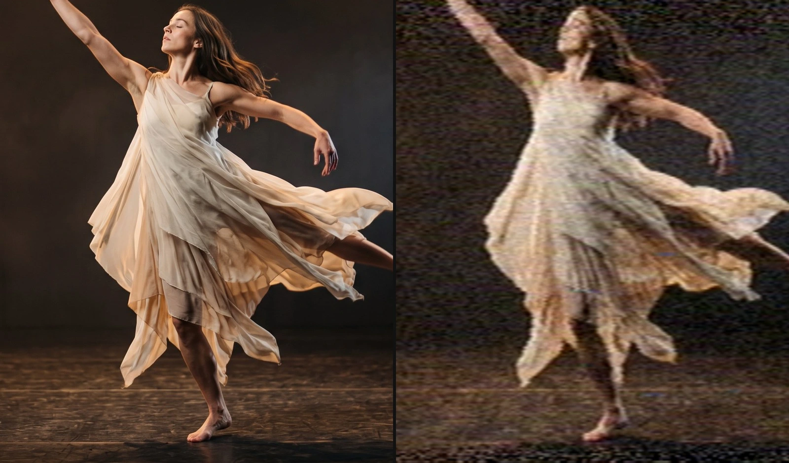
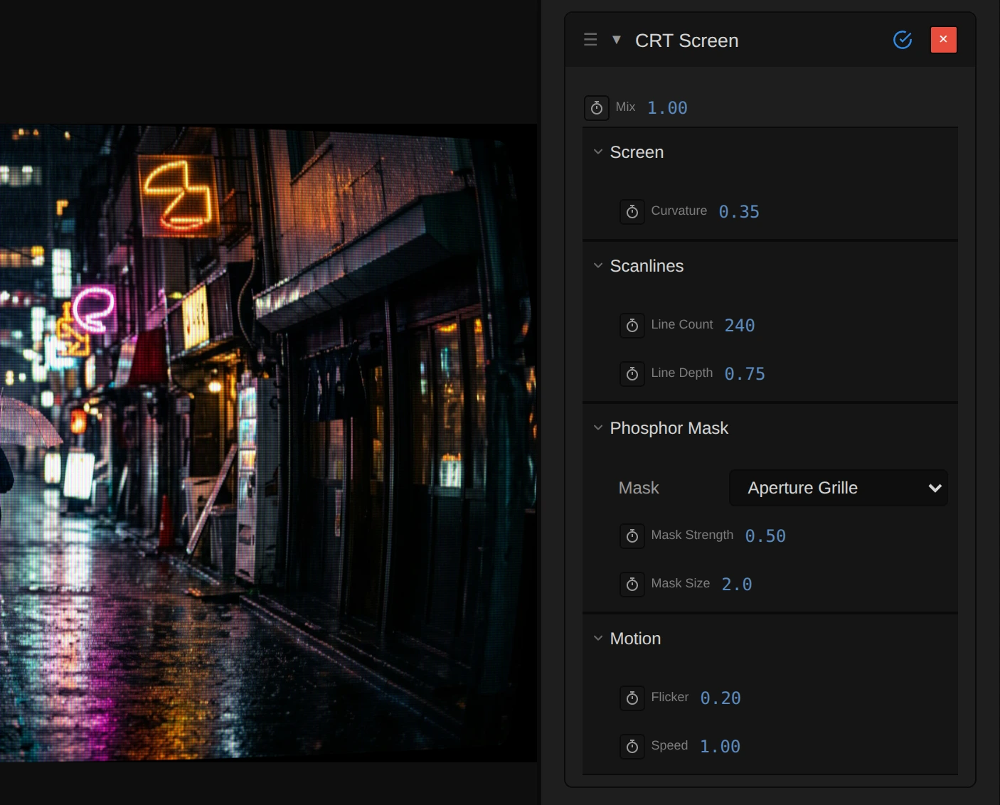
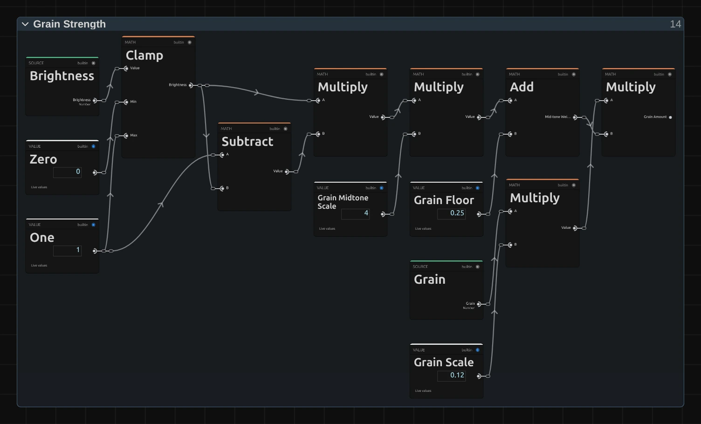

# Analog Effects

Ten effects that make a picture look as if it came through an old TV, a worn tape,
a film lens or a broken digital signal.
Add one in **Properties → Effects → + Add Effect**.

## The analog effects

### CRT Screen
<figure class="docs-shot docs-shot--float-right">

<figcaption>Left: original. Right: CRT Screen at its default settings, both enlarged 1.5×.</figcaption>
</figure>

Turns the picture into an old tube TV: glowing lines, a fine pattern of red, green
and blue stripes, and a curved screen with rounded corners. Bright parts glow
over the gaps between the lines, dark parts show them.
- **Line Count** – how many lines run down the picture. 240 is a classic TV; fewer lines look coarser.
- **Line Depth** – how dark the gaps between the lines are.
- **Curvature** – how much the screen bulges. 0 keeps the picture flat and fills the whole frame.
- **Mask** and **Mask Strength** – the stripe pattern of the screen: Aperture Grille (straight stripes) or Slot Mask (stripes with small breaks).

Tip: add Glow after it for the soft bloom of a real tube.

### Glitch
<figure class="docs-shot docs-shot--float-left">

<figcaption>Left: original. Right: Intensity 0.75, Density 0.45, one frame of a burst.</figcaption>
</figure>

A broken digital signal: rows of the picture tear sideways, blocks jump to the
wrong place and the colours split. It comes in short bursts, with clean frames
in between, and plays back the same way every time.
- **Intensity** – how far the picture tears and jumps.
- **Density** – how often it breaks up and how much of the frame breaks at once. At 1 it never stops.
- **Bands** – how many rows the picture tears into.
- **RGB Split** – how far red and blue slide apart.

Tip: Speed 0 freezes one glitch; change Seed for a different pattern.

### Film Prism
<figure class="docs-shot docs-shot--float-right">

<figcaption>Left: original. Right: Fringe 0.8, Grain 0.35, Lens shape.</figcaption>
</figure>

The look of film shot through a cheap lens or a glass prism: edges break into
soft rainbow fringes, and a fine, living film grain lies over the picture.
- **Fringe** – how far the colours split at edges.
- **Shape** – Lens: the fringes grow towards the corners. Prism: the same everywhere, in the direction of Prism Angle.
- **Grain** and **Grain Size** – how strong and how coarse the grain is.

Tip: Grain Speed 0 freezes the grain, for still images.

### Analog Signal Lab
<figure class="docs-shot docs-shot--float-left">

<figcaption>Left: original. Right: the Worn VHS Look.</figcaption>
</figure>

Sends the picture through a simulated PAL television chain – antenna, video tape
and tube TV – with real faults: noise, ghost images, rolling, colour that bleeds
and tracking errors. It is the most realistic analog look, and the deepest.
- **RF / Antenna Stage**, **VHS Stage** and **CRT Stage** – how strongly each part of the chain acts; 0 leaves it out.
- **Signal Strength** – weaker reception adds noise; very weak reception makes the picture roll.
- **Tracking Error** and **Tape Wear** – the typical faults of a worn VHS tape.

Tip: start from the Looks PAL Broadcast, Weak Antenna or Worn VHS and adjust from there.

The other six – Crystal Glass, Glass Dispersion, Holo, Ribbon Scan, Wave Lines and
Pixel Sort – are simpler pattern effects: glass facets, colour-split cells, a
hologram shimmer, wavy ribbons, line drawings and short sorted pixel runs.

**Saved projects:** CRT Screen, Glitch and Film Prism were rebuilt in this update.
Effects and custom Looks saved before it keep their earlier look and controls; add
the effect again for the new version. The built-in Looks CRT Memory, Data Glitch
and Prism Film use the new versions.

**Known limitations:** Pixel Sort only sorts runs of up to 16 pixels, so it makes a
fine streaky texture rather than long sorted streaks; Glass Dispersion's cells
change size with the frame resolution and Crystal Glass's facets stretch with the
frame shape; Holo's outlines get weaker at higher resolutions; Ribbon Scan smears
the frame edges; Analog Signal Lab turns very fine detail into strong colour dots,
so soften busy footage first.

## How the analog effects are built

<figure class="docs-shot">

<svg class="docs-shot-overlay" viewBox="0 0 1017 818" aria-hidden="true" focusable="false">
<defs><marker id="crt-screen-inspector-arrow" viewBox="0 0 10 10" refX="8" refY="5" markerWidth="5" markerHeight="5" orient="auto-start-reverse"><path d="M 0 0 L 10 5 L 0 10 Z" fill="#ffd54a" /></marker></defs>
<path class="docs-shot-arrow" d="M572 214 L656 214" marker-end="url(#crt-screen-inspector-arrow)" />
<circle class="docs-shot-number" cx="572" cy="214" r="18" /><text x="572" y="214" class="docs-shot-number-text">1</text>
<path class="docs-shot-arrow" d="M572 330 L656 330" marker-end="url(#crt-screen-inspector-arrow)" />
<circle class="docs-shot-number" cx="572" cy="330" r="18" /><text x="572" y="330" class="docs-shot-number-text">2</text>
<path class="docs-shot-arrow" d="M572 544 L656 544" marker-end="url(#crt-screen-inspector-arrow)" />
<circle class="docs-shot-number" cx="572" cy="544" r="18" /><text x="572" y="544" class="docs-shot-number-text">3</text>
<path class="docs-shot-arrow" d="M917 146 L917 62" marker-end="url(#crt-screen-inspector-arrow)" />
<circle class="docs-shot-number" cx="917" cy="146" r="18" /><text x="917" y="146" class="docs-shot-number-text">4</text>
</svg>

<figcaption>1 — Curvature: how much the screen bulges. 2 — Line Count: lines down the picture. 3 — Mask Strength: the red, green and blue stripes. 4 — Bypass, to compare with the original.</figcaption>
</figure>

CRT Screen, Glitch and Film Prism are small node graphs you can open and change.
Open the **Nodes** tab and pick the clip in its source list: the effect is a folded
card, and the › left of its title opens it (the [Blur page](./Effects-Blur.md#how-the-blur-effects-are-built)
shows where). Inside, every stage is a folder with its own ›. Changes apply to this
one effect. [Node Workspace](./Node-Workspace.md) shows how to add and connect nodes.

### The shared idea

<figure class="docs-shot docs-shot--graph">

<figcaption>Glitch opened in the Node Workspace (the Constants and Coordinates folders and the Output card left out).</figcaption>
</figure>

All three first decide **where** to read the picture, then **what light** to show.
In Glitch, **Burst Clock** decides when the signal breaks, **Torn Rows** and **Block
Copies** decide where, **Read Position & RGB Split** moves the three colour reads,
**Channel Reads** reads the picture there and **Channel Swap & Alpha** puts the colours
back together. CRT Screen bends the read position into a tube (**Tube Shape & Rim**),
Film Prism spreads it into seven reads along a rainbow (**Tap Positions**).

Sizes count against the frame (lines per picture height, pixels at 1080 lines), so
preview, export and 4K look the same. Every random choice comes from a **Random
(Integer Hash)** node keyed by position and time, so a frame looks the same every
time you play or scrub back to it.

### CRT Screen: the beam

<figure class="docs-shot docs-shot--graph">

<figcaption>One beam inside Scanline Beams: the brighter the line, the wider its beam.</figcaption>
</figure>

Each pixel adds the light of the two nearest lines; this is the weight of one of
them. **Luminance** of the line picks a beam width between **Scan Sigma Min** (dark
lines) and **Scan Sigma Max** (bright lines) in a **Mix** node, and **Exponential** of
−distance² ÷ (2 × width²) turns the distance to the line into a soft Gaussian beam.
That is why highlights fill the gaps and dark parts show the lines.

Remix: for thin, hard lines even in the highlights, select **Scan Sigma Max** and set
it from 0.42 to 0.25 in the node inspector; for soft lines that almost close, raise
**Scan Sigma Min** from 0.16 to 0.3. Both lines read the same two values.

### Glitch: bursts

<figure class="docs-shot docs-shot--graph">

<figcaption>The burst decision inside Burst Clock: one random roll per glitch state.</figcaption>
</figure>

Burst Clock counts glitch states, 12 × Speed per second of timeline. For each state,
**Random (Integer Hash)** rolls a number from the state and the Seed; **Greater
Than** compares the burst chance (**State Burst Base** + Density × **State Burst
Range**) with it, and **Switch** says glitch (1) or clean (0). The two **Multiply**
nodes scale that by Intensity and a random **Burst Strength**: the Burst Level every
other stage reads.

Remix: for a glitch that never pauses, select **State Burst Base** and set it from
0.2 to 1. At 0, Density alone decides, and Density 0 never glitches.

### Film Prism: grain in the mid-tones

<figure class="docs-shot docs-shot--graph">

<figcaption>Grain Strength: 4 · l · (1 − l) + 0.25, times Grain × 0.12, where l is the brightness.</figcaption>
</figure>

Real film grain shows most in the mid-tones. **Grain Strength** takes the brightness
of the fringed picture (**Luminance**, **Clamp**), forms 4 × l × (1 − l) with
**Subtract** and two **Multiply** nodes (1 in the mid-tones, 0 in pure black and
white), adds **Grain Floor** and scales the result by Grain × **Grain Scale**.

Remix: for grain that is equally strong in shadows and highlights, set **Grain
Midtone Scale** from 4 to 0 and **Grain Floor** from 0.25 to 1.

The fringe works the same way in **Spectrum Reads & Sum**: each of the seven reads
adds to red, green and blue with its own weight value (**Fringe Tap… Weight**), so
changing those weights changes the colours of the rainbow.

### Analog Signal Lab

Analog Signal Lab opens as a chain of large stage nodes (PAL Encode, RF Channel,
VHS Transport, Receiver Analysis, PAL Decode, Display Resolve). Bypass **RF
Channel** or **VHS Transport** there to leave that stage out entirely; the
**Display Resolve** group holds the editable tube: curvature, bloom, scanlines,
phosphor mask and flicker.

## Technical details

Notes for developers. The recipes live in `src/services/operators/crtScreenRecipe.ts`,
`glitchRecipe.ts` and `filmPrismRecipe.ts` (shared helpers in `analogRecipeBuilder.ts`);
formulas and history in [Effects: CRT Screen](./Effects.md#crt-screen) and
[Effects: Analog Signal Lab](./Effects.md#analog-signal-lab), nodes in
[Node Catalog](./Node-Catalog.md#random-nodes), compilation in
[Operator Graph Compiler](./Operator-Graph-Compiler.md).

- **Units.** CRT Line Count is lines per frame height; Mask Size and Film Prism's
  Grain Size are pixels at 1080 lines and scale with the frame height. Glitch Bands
  is the number of tear rows over the frame height, each split once at a random
  height; torn rows shift by up to 15 % of the width, thin slices
  by up to 2 %. Film Prism reaches ±1.5 % at Fringe 1: Lens scales about the frame
  centre, Prism shifts along Prism Angle (degrees, counter-clockwise from the right)
  in frame heights.
- **Sampling.** CRT Screen (3 reads per pixel) and Film Prism (7 reads) read a
  premultiplied `rgba16float` cache bilinearly, so cut-out edges keep their colour.
  Glitch reads the frame 3 times at texel centres and wraps around the edges, so it
  never blurs or invents colours. Glitch and Film Prism keep each channel's coverage.
- **Time.** Glitch changes 12 × Speed times per timeline second, Film Prism's grain
  24 × Grain Speed times; Speed 0 freezes either. Counters cycle (1024 states, 997
  grain frames) with a reseed, so hash keys stay small on long timelines. CRT flicker
  follows timeline time. Preview, scrubbing and export match.
- **Limits.** CRT lines closer than 2.25 px and mask stripes below 1 px fade out
  instead of aliasing. Values outside a control's range are clamped (or, for some
  Analog Signal Lab controls, used as given) and reported in the inspector and in
  agent tool results, as are Pixel Sort's Segment Size outside 4–16 and Threshold ≥ 1.
- **Zero strength.** CRT Mix 0, Glitch Intensity 0 and Film Prism Fringe 0 with
  Grain 0 leave every pixel unchanged.
- **Random nodes.** Glitch and Film Prism use `noise.hash2d-pcg.vec2` (Random
  (Integer Hash)); the older sine hash stays unchanged for other effects.
- **Stage folders.** The folders are presentation only (`effectPresentationPlans.ts`)
  and appear on the untouched recipe; a graph with your own folders keeps them.
- **Saved projects.** Effects and custom Looks saved before the rebuild keep their
  original graphs (`legacyCrtScreenGraph.ts`, `legacyGlitchGraph.ts`,
  `legacyFilmPrismGraph.ts`, pinned by `analogLegacyGraphs.ts`); add the effect again
  for the new version.
- **Analog Signal Lab** is a six-pass compute effect on a 360 × 288 PAL working
  raster, independent of the frame size; Pixel Sort is a compute effect with
  segments of at most 16 px.
- **Pictures on this page.** `scripts/effect-lab.mjs --pairs`,
  `scripts/effect-graph-shot.mjs` and `scripts/effect-editor-shot.mjs`, each with an
  `analog.json` manifest next to it (`scripts/effect-*-shots/`).

