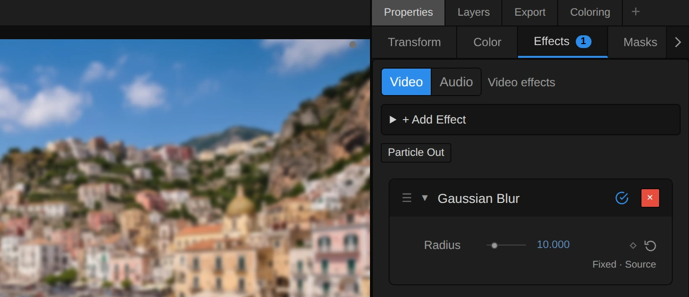
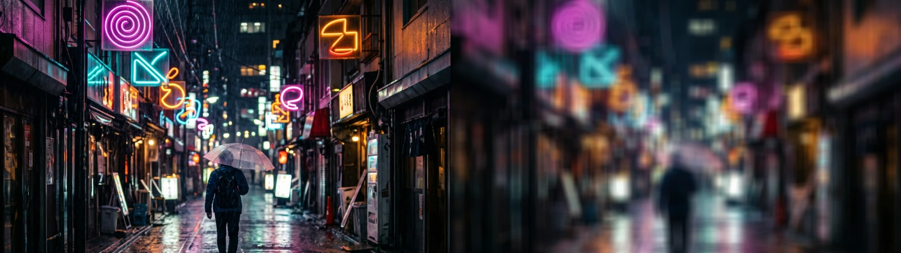
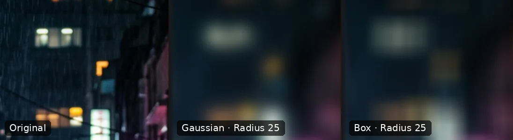
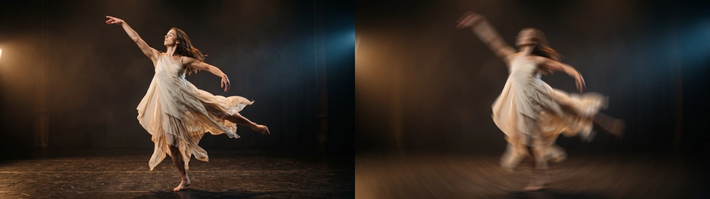
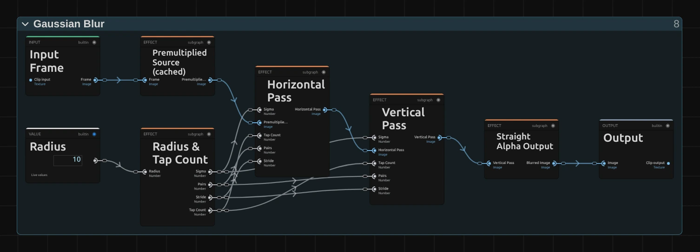
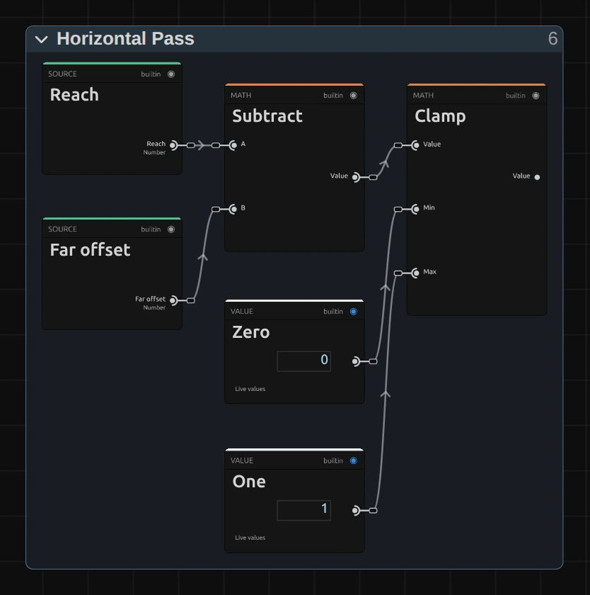
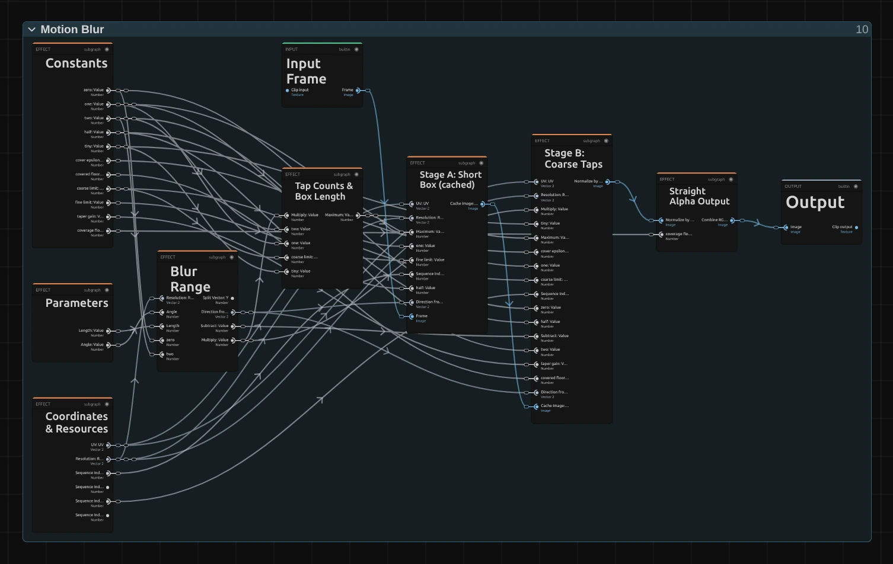
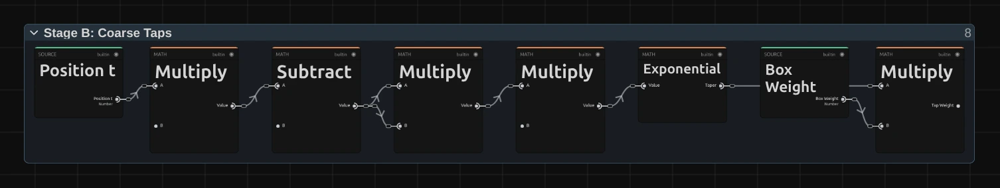
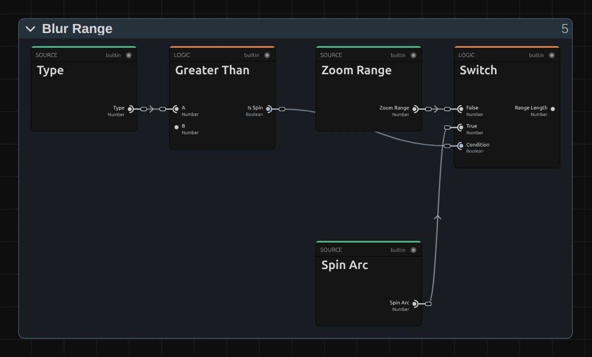

# Blur Effects

Five ways to soften a picture, from a gentle defocus to fast streaks of motion.
Add one in **Properties → Effects → + Add Effect**.

<figure class="docs-shot">

<svg class="docs-shot-overlay" viewBox="0 0 1017 497" aria-hidden="true" focusable="false">
<defs><marker id="gaussian-blur-inspector-arrow" viewBox="0 0 10 10" refX="8" refY="5" markerWidth="5" markerHeight="5" orient="auto-start-reverse"><path d="M 0 0 L 10 5 L 0 10 Z" fill="#ffd54a" /></marker></defs>
<path class="docs-shot-arrow" d="M664 184 L580 184" marker-end="url(#gaussian-blur-inspector-arrow)" />
<circle class="docs-shot-number" cx="664" cy="184" r="18" /><text x="664" y="184" class="docs-shot-number-text">1</text>
<path class="docs-shot-arrow" d="M436 394 L520 394" marker-end="url(#gaussian-blur-inspector-arrow)" />
<circle class="docs-shot-number" cx="436" cy="394" r="18" /><text x="436" y="394" class="docs-shot-number-text">2</text>
<path class="docs-shot-arrow" d="M882 412 L882 328" marker-end="url(#gaussian-blur-inspector-arrow)" />
<circle class="docs-shot-number" cx="882" cy="412" r="18" /><text x="882" y="412" class="docs-shot-number-text">3</text>
</svg>

<figcaption>1 — + Add Effect lists every effect. 2 — Radius. 3 — Bypass, to compare with the original.</figcaption>
</figure>

The GPU preview and the export show the same blur, and transparent edges (logos,
titles, keyed footage) fade out cleanly without a dark rim.

## The five blurs

### Gaussian Blur
<figure class="docs-shot docs-shot--float-right">

<figcaption>Left: original. Right: Radius 12.</figcaption>
</figure>

A smooth, even softening, like a lens out of focus. The standard choice for
backgrounds, transitions and anything that should simply look soft.
- **Radius** – how soft. 2–5 takes the edge off, 10 is clearly out of focus, 30 and more turns shapes into light.

Tip: animate Radius from 0 for a smooth focus pull.

### Box Blur
<figure class="docs-shot docs-shot--float-left">

<figcaption>Left: original. Right: Radius 25.</figcaption>
</figure>

Averages a square around every pixel. Shapes keep a slightly hard, graphic
edge, and small lights turn into flat squares instead of round glows.
- **Radius** – size of the square. Changes smoothly when animated.

Tip: for a natural defocus use Gaussian Blur; Box Blur is the graphic look.

<figure class="docs-shot">

<figcaption>The same street lamps, enlarged (Radius 10): Gaussian Blur makes soft round glows, Box Blur flat, blocky squares.</figcaption>
</figure>

### Motion Blur
<figure class="docs-shot docs-shot--float-right">

<figcaption>Left: original. Right: Length 0.03, horizontal.</figcaption>
</figure>

Smears the picture in one direction, as if the camera or the subject moved fast
during the exposure.
- **Length** – how far the streak reaches to each side, as a share of the picture width (of the height for vertical streaks). 0.03 is a quick move, 0.1 a fast pan.
- **Angle** – the direction: 0 is horizontal, 1.57 vertical (a quarter turn), 0.79 diagonal (45°).

Tip: keep Length small on faces; long streaks work best on lights and fabric.

### Radial Blur
<figure class="docs-shot docs-shot--float-left">

<figcaption>Left: original. Right: Spin, Amount 0.5.</figcaption>
</figure>

Blurs around a centre point. **Zoom** streaks the picture towards the centre and
leaves the middle sharp; **Spin** turns it in circles, like a rotating camera.
- **Type** – Zoom or Spin.
- **Amount** – strength. For Spin, 0.5 is a turn of about 10 degrees, 2 about 40.
- **Center X / Center Y** – where the sharp middle sits (0.5 / 0.5 is the centre of the picture).

Tip: put the centre on the performer to keep them sharp while the stage swirls.

### Zoom Blur
<figure class="docs-shot docs-shot--float-right">

<figcaption>Left: original. Right: Amount 0.3.</figcaption>
</figure>

Streaks the picture outward from a centre point, as if zooming in during the
exposure: a burst of speed.
- **Amount** – length of the streaks. 0.1 is subtle, 0.3 a clear zoom burst, 1 is extreme.
- **Center X / Center Y** – where the burst starts.

Tip: Radial Blur's Zoom type is the gentler, fading variant; Zoom Blur is the
strong, even burst.

## How the blur effects are built

<figure class="docs-shot docs-shot--float-right">

<svg class="docs-shot-overlay" viewBox="0 0 590 510" aria-hidden="true" focusable="false">
<defs><marker id="gaussian-blur-nodes-arrow" viewBox="0 0 10 10" refX="8" refY="5" markerWidth="5" markerHeight="5" orient="auto-start-reverse"><path d="M 0 0 L 10 5 L 0 10 Z" fill="#ffd54a" /></marker></defs>
<path class="docs-shot-arrow" d="M180 115 L180 31" marker-end="url(#gaussian-blur-nodes-arrow)" />
<circle class="docs-shot-number" cx="180" cy="115" r="18" /><text x="180" y="115" class="docs-shot-number-text">1</text>
<path class="docs-shot-arrow" d="M359 88 L275 88" marker-end="url(#gaussian-blur-nodes-arrow)" />
<circle class="docs-shot-number" cx="359" cy="88" r="18" /><text x="359" y="88" class="docs-shot-number-text">2</text>
<path class="docs-shot-arrow" d="M245 201 L245 285" marker-end="url(#gaussian-blur-nodes-arrow)" />
<circle class="docs-shot-number" cx="245" cy="201" r="18" /><text x="245" y="201" class="docs-shot-number-text">3</text>
</svg>

<figcaption>1 — the Nodes tab. 2 — pick the clip here (the tab starts on the whole Timeline). 3 — the › opens the effect.</figcaption>
</figure>

Every blur is a small node graph you can open and change. Open the **Nodes** tab
and pick the clip in its source list: the effect is a folded card, and the › left
of its title opens it. Inside, the same › opens each stage. Changes apply to this
one effect. [Node Workspace](./Node-Workspace.md) shows how to add and connect nodes.

### The shared idea

All five blurs follow one recipe: weigh each colour by its transparency
(**Premultiplied Source**), read neighbouring pixels (**Sample Image**), weigh each
read, add them up and divide by the total weight (**Sequence Reduce**, **Normalize
by Weight**), then restore normal transparency (**Straight Alpha Output**).
[Gaussian and Box Blur](#gaussian-blur-two-passes) do this along the rows, then
along the columns. [Motion, Radial and Zoom Blur](#motion-radial-and-zoom-blur-two-stages)
do it along a path, in short pieces first.

### Gaussian Blur: two passes

<figure class="docs-shot docs-shot--graph">

<figcaption>Gaussian Blur opened in the Node Workspace (the Constants and Coordinates folders and the Output card left out).</figcaption>
</figure>

**Radius & Tap Count** turns Radius into the width of the bell curve (**Sigma**)
and the number of reads (**Tap Count**, split into **Pairs** and a **Stride**).
**Horizontal Pass** blurs the rows of the **Premultiplied Source**, **Vertical
Pass** the columns of that result.

### Gaussian Blur: inside a pass

<figure class="docs-shot docs-shot--graph">

<figcaption>The Horizontal Pass, reduced to its recipe. Green cards come from elsewhere in the graph.</figcaption>
</figure>

1. **Pair Tap Offsets** lists where to read: the pixel and pairs of neighbours.
2. Two **Gaussian Falloff** nodes weigh each neighbour. They are the kernel.
3. **Merge Pair Weights** folds each pair into one read (a speed trick).
4. **Sample Image** reads, **Sequence Reduce** adds up, **Normalize by Weight**
   averages and **Cache Image** keeps the result for the vertical pass.

Remix: for a blur that stretches sideways, open **Vertical Pass**, **Multiply**
Sigma by a **Value** of 0.5 and plug the result into the Sigma input of both
**Gaussian Falloff** nodes.

### Box Blur: a different weight

<figure class="docs-shot docs-shot--float-right">

<figcaption>The far-texel weight in Box Blur: Subtract and Clamp, where Gaussian Blur has a Gaussian Falloff.</figcaption>
</figure>

Box Blur is the Gaussian graph with a different weight: every neighbour inside the
radius counts fully. Each pass weighs both texels of a pair with its own
**Subtract** → **Clamp** (like the two **Gaussian Falloff** nodes): Subtract
measures how far a read lies inside the **Reach**, and Clamp limits that to 0–1.

Remix: invent your own kernel here. Any math that turns the offset into a weight
of 0 or more works; change all four weights (near and far, both passes) the same way.

### Motion, Radial and Zoom Blur: two stages

<figure class="docs-shot docs-shot--graph">

<figcaption>Motion Blur (Constants, Coordinates and the Output card left out); Radial and Zoom Blur have the same stages.</figcaption>
</figure>

These blurs smear every pixel along a path: a line (Motion), a ray from the
centre (Zoom) or a circle (Spin). **Blur Range** works out the path from the
**Parameters**, and **Tap Counts & Box Length** decides how many short pieces the
path is cut into. **Stage A** averages one short piece and caches it; **Stage B**
reads the cache once per piece along the whole path, so a long streak needs dozens
of reads, not hundreds.

### Motion Blur: a soft taper

<figure class="docs-shot docs-shot--graph">

<figcaption>exp(−2 · (2t − 1)²): Exponential fades both ends of the streak; the last Multiply weighs each read with it.</figcaption>
</figure>

The white value cards (**Two**, **One**, **Taper Gain**) live in the effect's
**Constants** folder.

Remix: for an even streak, open **Stage B**, unplug **Exponential** from input A
of the last **Multiply** and plug a **Value** of 1 into A. Leave input B alone: it
carries the Box Weight.

Remix: select **Taper Gain** and set its value from −2 to −6 in the node inspector
for a shorter, harder streak.

### Radial Blur: Zoom or Spin

<figure class="docs-shot docs-shot--float-right">

<svg class="docs-shot-overlay" viewBox="0 0 590 559" aria-hidden="true" focusable="false">
<defs><marker id="radial-blur-type-arrow" viewBox="0 0 10 10" refX="8" refY="5" markerWidth="5" markerHeight="5" orient="auto-start-reverse"><path d="M 0 0 L 10 5 L 0 10 Z" fill="#ffd54a" /></marker></defs>
<path class="docs-shot-arrow" d="M295 22 L295 56" marker-end="url(#radial-blur-type-arrow)" />
<circle class="docs-shot-number" cx="295" cy="22" r="18" /><text x="295" y="22" class="docs-shot-number-text">1</text>
<path class="docs-shot-arrow" d="M478 22 L478 56" marker-end="url(#radial-blur-type-arrow)" />
<circle class="docs-shot-number" cx="478" cy="22" r="18" /><text x="478" y="22" class="docs-shot-number-text">2</text>
</svg>

<figcaption>1 — Greater Than turns Type into Is Spin. 2 — a Switch picks the Zoom or the Spin range.</figcaption>
</figure>

Inside **Blur Range**, **Greater Than** (1) turns Type into Is Spin (Type above
**Half**), and **Switch** nodes (2) pick the path: a ray for Zoom, a circle for Spin.

Remix: to always spin, plug a **Value** of 1 into input A of **Greater Than** (1);
every Switch (2) then picks Spin.

### Zoom Blur: an even burst

Zoom Blur has the same stages without a Type. At the same Amount it stretches
much further than Radial Blur's Zoom type, and every read counts the same.

Remix: to let the burst fade outward, open **Stage B** and find the **Multiply**
whose output is Tap Weight (its input A is fed by **One**). **Multiply** Position t
by a **Value** of 0.5, **Subtract** that from a **Value** of 1 (A = the Value 1,
B = the Multiply) and plug the result into that input A. This is exactly Radial
Blur's Zoom fade (1 − t/2).

## Technical details

Notes for developers. The contract lives in `src/effects/blur/blurSampling.ts`;
formulas and history in [Effects: editable blur kernels](./Effects.md#editable-blur-kernels),
nodes in [Node Catalog](./Node-Catalog.md), compilation in
[Operator Graph Compiler](./Operator-Graph-Compiler.md).

- **Units.** Radius is in pixels of a 1080p frame (its shorter side) and scales
  with the rendered size, so preview, export and 4K match; 3D layer-space effects
  count their layer's own resolution. Motion Length reaches
  Length × |(cos × width, sin × height)| to each side; Angle is the on-screen
  direction in radians (0–6.28). Radial and Zoom are relative to the frame.
- **Premultiplied source.** The frame is premultiplied into an `rgba16float`
  cache first; every filtered read after that is exact at alpha edges.
- **Separable kernels.** Gaussian and Box run a horizontal pass into an
  `rgba16float` cache, then a vertical pass: about 1.5 × Radius + 1 (Gaussian) or
  Radius + 2 (Box) reads per pass at 1080p. Gaussian uses sigma = Radius / 2, cut
  at 3 sigma.
- **Pair-merged taps.** One linear-filtered read covers two neighbouring texels
  at their weighted centre, exact for any weights. Up to 127 pairs per side;
  beyond that the pairs spread out, and the tool result and inspector say so.
- **Two stages.** About 2 × √(2 × streak px) reads per pixel (Stage A up to 256,
  Stage B up to 64); longer streaks are reported. Motion mirrors at the frame edge;
  Radial and Zoom clamp.
- **Zoom against Radial Zoom.** At Amount 0.3, Zoom Blur's streak is about five
  times Radial Zoom's.
- **Below 0.** Motion and Radial Blur leave the picture unchanged, and the
  inspector and tool results say so; Zoom Blur streaks inward.
- **Zero strength.** An unedited blur at 0 is skipped, so the picture passes
  through exactly; an edited graph always runs.
- **Saved projects.** Untouched old blur graphs upgrade automatically; edited
  graphs stay as saved. Older projects render with the new kernels: Gaussian is
  stronger at small radii and about 20 % softer at large ones, and a 4K project
  blurs twice as many pixels as before (Radius follows the frame size).
- **Software preview.** The worker software preview approximates: Gaussian and Box
  as a canvas blur, Motion, Radial and Zoom with up to 64 evenly spaced reads
  (longer streaks step; the `SoftwareBlur` log says so).
- **Pictures on this page.** `scripts/effect-graph-shot.mjs`,
  `scripts/effect-editor-shot.mjs` and `scripts/effect-lab.mjs --pairs`, each with a
  `blur.json` manifest next to it (`scripts/effect-*-shots/`).
