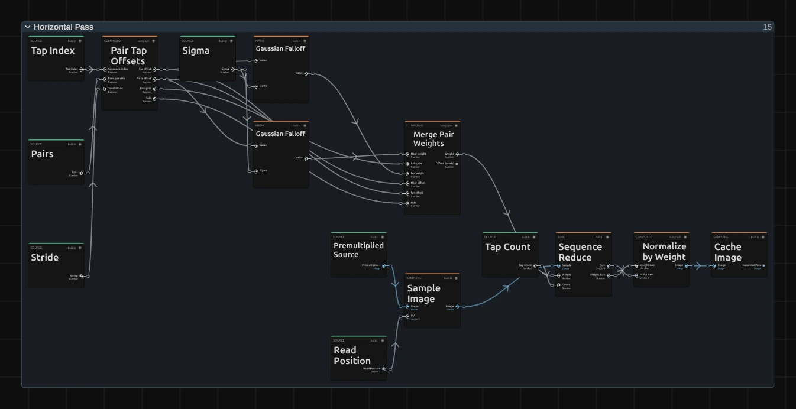
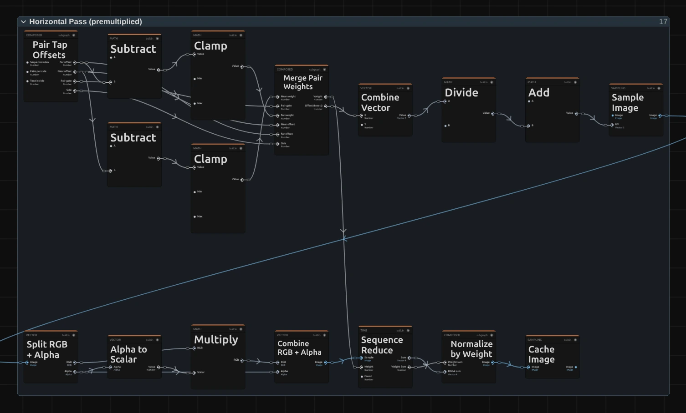
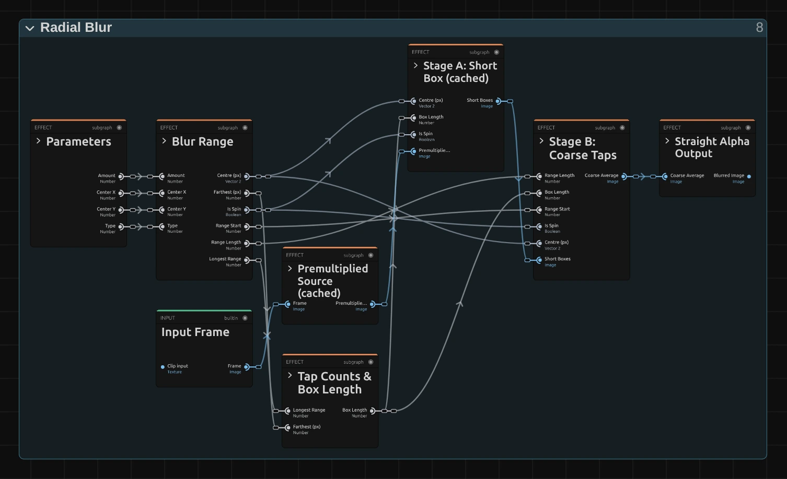
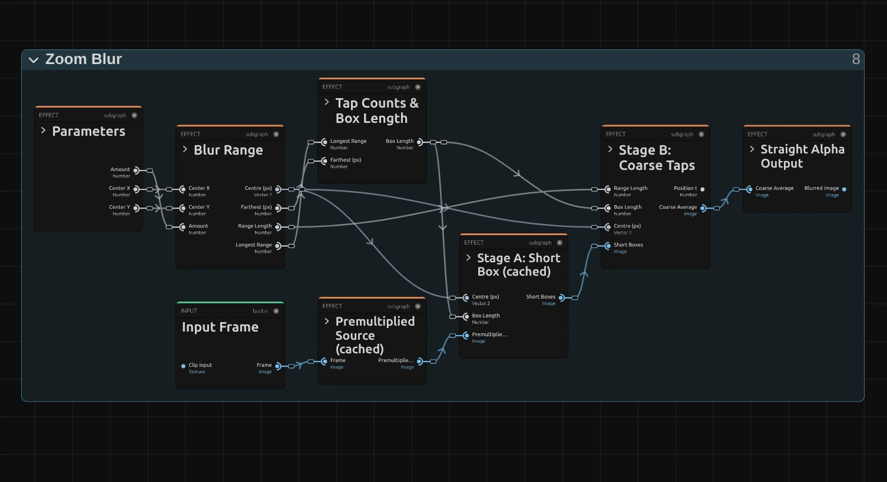
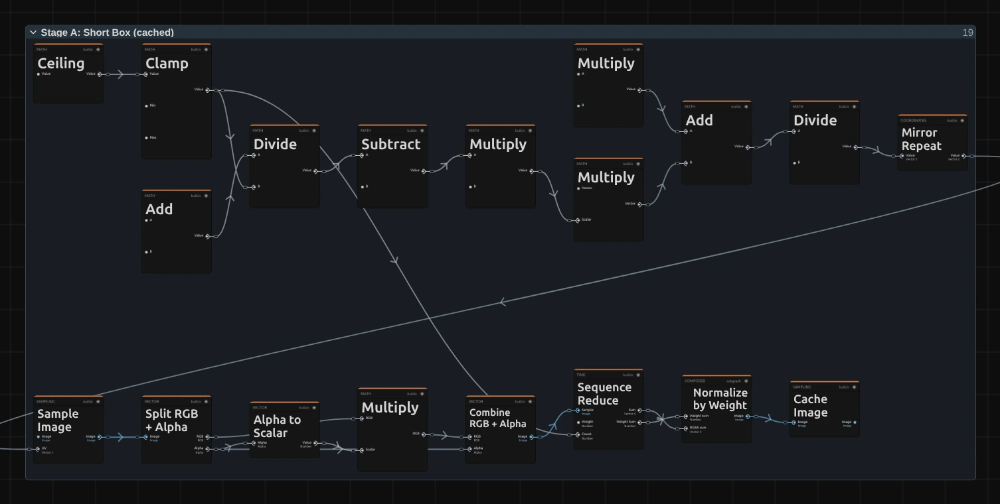

# Blur Effects

Five ways to soften a picture, from a gentle defocus to fast streaks of motion.

Every blur looks the same in the preview and in the export, and transparent
edges (logos, titles, keyed footage) fade out cleanly without a dark rim.

## The five blurs

### Gaussian Blur
<figure class="docs-shot docs-shot--float-right">

</figure>

A smooth, even softening, like a lens out of focus. The standard choice for
backgrounds, transitions and anything that should simply look soft.
- **Radius** – how soft. 2–5 takes the edge off, 10 is clearly out of focus, 30 and more turns shapes into light.

Tip: animate Radius from 0 for a smooth focus pull.

### Box Blur
<figure class="docs-shot docs-shot--float-left">

</figure>

Averages a square around every pixel. Softer shapes keep a slightly hard,
graphic edge, and bright lights turn into small squares instead of round glows.
- **Radius** – size of the square. Changes smoothly when animated.

Tip: for a natural defocus use Gaussian Blur; Box Blur is the graphic look.

### Motion Blur
<figure class="docs-shot docs-shot--float-right">

</figure>

Smears the picture in one direction, as if the camera or the subject moved fast
during the exposure.
- **Length** – how long the streaks are, as a share of the picture width (0.03 is a quick move, 0.1 a fast pan).
- **Angle** – the direction on screen, in radians: 0 is horizontal, 1.57 vertical, 0.79 diagonal.

Tip: keep Length small on faces; long streaks work best on lights and fabric.

### Radial Blur
<figure class="docs-shot docs-shot--float-left">

</figure>

Blurs around a centre point. **Zoom** streaks the picture towards the centre and
leaves the middle sharp; **Spin** turns it in circles, like a rotating camera.
- **Type** – Zoom or Spin.
- **Amount** – strength. For Spin, 0.5 is a turn of about 10 degrees, 2 about 40.
- **Center X / Center Y** – where the sharp middle sits (0.5 / 0.5 is the centre of the picture).

Tip: put the centre on the performer to keep them sharp while the stage swirls.

### Zoom Blur
<figure class="docs-shot docs-shot--float-right">

</figure>

Streaks the picture outward from a centre point, as if zooming in during the
exposure: a burst of speed.
- **Amount** – length of the streaks. 0.1 is subtle, 0.3 a clear zoom burst, 1 is extreme.
- **Center X / Center Y** – where the burst starts.

Tip: combine with a quick scale animation for a punch-in.

## How the blur effects are built

Every blur is a small node graph. The inspector shows its controls, the Node
Workspace the nodes behind them, and you can change those nodes.

<figure class="docs-shot">

<svg class="docs-shot-overlay" viewBox="0 0 1017 460" aria-hidden="true" focusable="false">
<defs><marker id="gaussian-blur-inspector-arrow" viewBox="0 0 10 10" refX="8" refY="5" markerWidth="5" markerHeight="5" orient="auto-start-reverse"><path d="M 0 0 L 10 5 L 0 10 Z" fill="#ffd54a" /></marker></defs>
<path class="docs-shot-arrow" d="M830 175 L830 91" marker-end="url(#gaussian-blur-inspector-arrow)" />
<circle class="docs-shot-number" cx="830" cy="175" r="18" /><text x="830" y="175" class="docs-shot-number-text">1</text>
<path class="docs-shot-arrow" d="M503 356 L587 356" marker-end="url(#gaussian-blur-inspector-arrow)" />
<circle class="docs-shot-number" cx="503" cy="356" r="18" /><text x="503" y="356" class="docs-shot-number-text">2</text>
<path class="docs-shot-arrow" d="M917 186 L917 270" marker-end="url(#gaussian-blur-inspector-arrow)" />
<circle class="docs-shot-number" cx="917" cy="186" r="18" /><text x="917" y="186" class="docs-shot-number-text">3</text>
</svg>

<figcaption>1 — Properties → Effects lists the effects of the selected clip. 2 — Radius, Gaussian Blur's one control. 3 — Bypass, to compare with the original.</figcaption>
</figure>

Each control is a node in the graph: **Radius** (2) is the white **Radius**
card in the Gaussian Blur graph below. To see the graph, select the clip and
open the **Nodes** tab next to **Media**. The effect appears as folders, one per
stage; the arrow on a folder card opens it. Changes apply to this one effect on
this clip.

### The common recipe

A blur replaces every pixel with a weighted average of its neighbours. All five
blurs build that average from the same few nodes:

<figure class="docs-shot">

<figcaption>Inside Gaussian Blur's Horizontal Pass. Top row: where to read and how much each read counts. Bottom row: reading, adding up, averaging.</figcaption>
</figure>

1. **Pair Tap Offsets** lists where to read: the pixel itself and pairs of
   neighbours, one step further out each time.
2. Two weight nodes, here **Gaussian Falloff**, decide how much each neighbour
   counts. They are the kernel: swap them and the blur changes character.
3. **Merge Pair Weights** folds each pair of neighbours into one read between
   them, which halves the work. **Sample Image** reads the picture there; the
   small math nodes around it turn the offset into a position and weigh the
   colour by its transparency, so transparent pixels cannot darken the result.
4. **Sequence Reduce** repeats this for every read and adds the samples up,
   **Normalize by Weight** divides by the total weight and **Cache Image** keeps
   the result for the next pass.

### Gaussian Blur: two passes

<figure class="docs-shot">

<figcaption>Gaussian Blur as it opens in the Node Workspace. Most cards are folders, one per stage; Input Frame, Radius and Output are single nodes.</figcaption>
</figure>

**Radius & Tap Count** turns the **Radius** into the width of the bell curve and
decides how many reads each pass needs. **Horizontal Pass** blurs along the
rows and caches the result, **Vertical Pass** blurs that along the columns.
Two short passes give the same picture as one big square of reads, at a
fraction of the cost. **Straight Alpha Output** restores normal transparency
and **Output** hands the picture back to the clip.

Remix: for a blur that stretches sideways, open **Vertical Pass** and give its
two **Gaussian Falloff** nodes a smaller **Sigma** (multiply it by a value
below 1). Larger values than the original would cut the bell curve off.

### Box Blur: a different weight

<figure class="docs-shot">

<figcaption>Box Blur's Horizontal Pass. Subtract and Clamp replace the Gaussian Falloff nodes; everything else is the same.</figcaption>
</figure>

Box Blur is the Gaussian graph with one change in both passes: every neighbour
inside the radius counts fully. **Subtract** measures how far a read lies
inside the radius and **Clamp** limits that to 0–1, so the outermost pixel
counts partly and an animated Radius grows smoothly.

Remix: this is the place to invent your own kernel. Any math nodes that turn
the offset into a weight of 0 or more work here; change both passes the same
way. The reads end just past the radius, so let the weight fall to 0 there.

### Motion, Radial and Zoom Blur: two stages

<figure class="docs-shot">

<figcaption>Motion Blur. Radial and Zoom Blur have the same stages.</figcaption>
</figure>

These blurs smear every pixel along a path: a straight line (Motion), a ray
from the centre (Zoom, Radial in Zoom mode) or a circle around it (Radial in
Spin mode). A long streak would need hundreds of reads per pixel, so they work
in two stages:

- **Blur Range** works out each pixel's path, from Angle and Length or from the
  centre and Amount.
- **Tap Counts & Box Length** cuts the longest path into equal short pieces.
- **Stage A: Short Box (cached)** averages every pixel over one short piece
  and caches the result.
- **Stage B: Coarse Taps** reads that cache once per piece along the whole
  path and averages the reads. A taper weight shapes the streak: Motion fades
  both ends softly, Radial Zoom fades along the streak, Spin and Zoom stay even.

Remix: in Motion Blur's **Stage B** the taper is the **Exponential** node. Plug
a **Value** of 1 into the **Multiply** it feeds instead, and the streak becomes
even.

<figure class="docs-shot docs-shot--float-right">

<svg class="docs-shot-overlay" viewBox="0 0 590 289" aria-hidden="true" focusable="false">
<defs><marker id="radial-blur-inspector-arrow" viewBox="0 0 10 10" refX="8" refY="5" markerWidth="5" markerHeight="5" orient="auto-start-reverse"><path d="M 0 0 L 10 5 L 0 10 Z" fill="#ffd54a" /></marker></defs>
<path class="docs-shot-arrow" d="M101 103 L185 103" marker-end="url(#radial-blur-inspector-arrow)" />
<circle class="docs-shot-number" cx="101" cy="103" r="18" /><text x="101" y="103" class="docs-shot-number-text">1</text>
<path class="docs-shot-arrow" d="M132 150 L216 150" marker-end="url(#radial-blur-inspector-arrow)" />
<circle class="docs-shot-number" cx="132" cy="150" r="18" /><text x="132" y="150" class="docs-shot-number-text">2</text>
<path class="docs-shot-arrow" d="M132 196 L216 196" marker-end="url(#radial-blur-inspector-arrow)" />
<circle class="docs-shot-number" cx="132" cy="196" r="18" /><text x="132" y="196" class="docs-shot-number-text">3</text>
</svg>

<figcaption>Radial Blur in the inspector. 1 — Type. 2 — Amount. 3 — Center X / Y.</figcaption>
</figure>

Radial Blur's controls enter the graph through its **Parameters** folder. In
**Blur Range**, a **Greater Than** test on **Type** (1) drives **Switch** nodes
that pick the path: a ray from the centre for Zoom, a circle around it for
Spin. **Amount** (2) sets how far the path reaches, **Center X / Y** (3) where
it is anchored.

Radial Blur and Zoom Blur graphs

<figure class="docs-shot">

<figcaption>Radial Blur. Blur Range switches between the Zoom and Spin paths.</figcaption>
</figure>

<figure class="docs-shot">

<figcaption>Zoom Blur.</figcaption>
</figure>

## Technical details

Notes for developers. The full contract lives in
`src/effects/blur/blurSampling.ts`; more in
[Effects: editable blur kernels](./Effects.md#editable-blur-kernels),
[Node Catalog](./Node-Catalog.md) and
[Operator Graph Compiler](./Operator-Graph-Compiler.md).

- **Units.** Radius is in pixels of a 1080p frame (its shorter side) and scales
  with the rendered size, so preview, export and 4K match. Motion Length is a
  share of the frame width; Radial and Zoom are relative to the frame.
- **Separable kernels.** Gaussian and Box run a horizontal pass into an
  `rgba16float` cache, then a vertical pass: about 0.75 × Radius (Gaussian) or
  Radius / 2 (Box) reads per pass at 1080p. Gaussian uses sigma = Radius / 2,
  cut at 3 sigma.
- **Pair-merged taps.** One linear-filtered read covers two neighbouring texels
  at their weighted centre, exact for any weights. A pass reads the centre plus
  up to 127 pairs per side; beyond that the pairs spread out instead of cutting
  the kernel short.
- **Two stages.** Every directional tap is T(u) of a translation, a log-scale or
  a rotation. Stage A averages a box of length h with reads at most one pixel
  apart (up to 256), Stage B reads it h apart (up to 64 reads), about
  2 × √(2 × streak length in px) reads per pixel. Motion mirrors at the frame
  edge; Radial and Zoom clamp.
- **Alpha.** Colour is premultiplied before averaging and divided back
  afterwards (Straight Alpha Output), so transparent surroundings never darken
  an edge.
- **Saved graphs.** An untouched saved copy of an old blur graph is replaced by
  the current recipe on load (`blurGraphUpgrade.ts`); edited graphs stay as
  saved. The old Samples parameters are hidden and have no effect.
- **Pictures.** Graph pictures come from the real Node Workspace canvas
  (`scripts/effect-graph-shot.mjs`), the inspector excerpts from the editor
  (`scripts/effect-editor-shot.mjs` with `scripts/effect-editor-shots/blur.json`);
  see [Effect graph pictures](./Effects.md#effect-graph-pictures).

### Stage A in full

<figure class="docs-shot">

<figcaption>Stage A of Motion Blur: the common recipe with an even weight, every read in the short box counts the same. Mirror Repeat folds reads at the frame edge back into the picture.</figcaption>
</figure>
