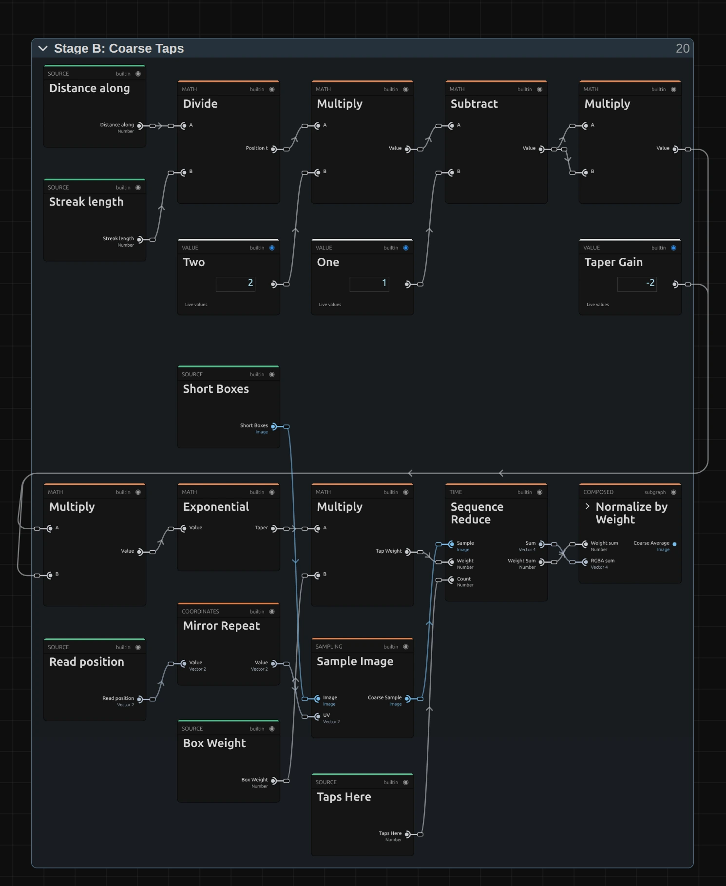
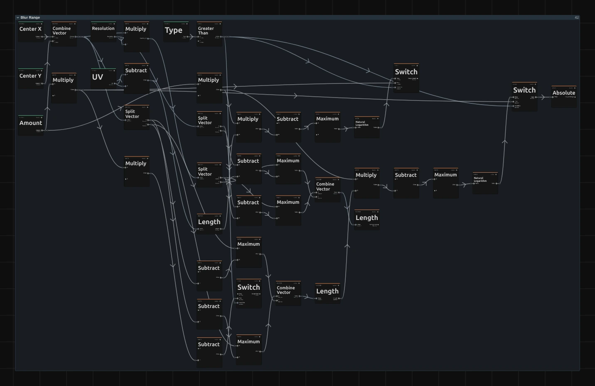

# Blur Effects

Five ways to soften a picture, from a gentle defocus to fast streaks of motion.
Add one in **Properties → Effects → + Add Effect**.

Each blur looks identical in the preview and the export, and transparent edges
(logos, titles, keyed footage) fade out cleanly without a dark rim.

## The five blurs

### Gaussian Blur
<figure class="docs-shot docs-shot--float-right">

<figcaption>Left: original. Right: Radius 12.</figcaption>
</figure>

A smooth, even softening, like a lens out of focus. The standard choice for
backgrounds, transitions and anything that should simply look soft.
- **Radius** – how soft. 2–5 takes the edge off, 10 is clearly out of focus, 30 and more turns shapes into light.

Tip: animate Radius from 0 for a smooth focus pull.

### Box Blur
<figure class="docs-shot docs-shot--float-left">

<figcaption>Left: original. Right: Radius 25.</figcaption>
</figure>

Averages a square around every pixel. Shapes keep a slightly hard, graphic
edge, and bright lights turn into flat squares instead of round glows.
- **Radius** – size of the square. Changes smoothly when animated.

Tip: for a natural defocus use Gaussian Blur; Box Blur is the graphic look.

<figure class="docs-shot">

<figcaption>The same lights, close up: Gaussian Blur makes round glows, Box Blur flat squares.</figcaption>
</figure>

### Motion Blur
<figure class="docs-shot docs-shot--float-right">

<figcaption>Left: original. Right: Length 0.03, horizontal.</figcaption>
</figure>

Smears the picture in one direction, as if the camera or the subject moved fast
during the exposure.
- **Length** – how far the streak reaches to each side, as a share of the picture width (of the height for vertical streaks). 0.03 is a quick move, 0.1 a fast pan.
- **Angle** – the direction on screen, in radians: 0 is horizontal, 1.57 (90°) vertical, 0.79 (45°) diagonal.

Tip: keep Length small on faces; long streaks work best on lights and fabric.

### Radial Blur
<figure class="docs-shot docs-shot--float-left">

<figcaption>Left: original. Right: Spin, Amount 0.5.</figcaption>
</figure>

Blurs around a centre point. **Zoom** streaks the picture towards the centre and
leaves the middle sharp; **Spin** turns it in circles, like a rotating camera.
- **Type** – Zoom or Spin.
- **Amount** – strength. For Spin, 0.5 is a turn of about 10 degrees, 2 about 40.
- **Center X / Center Y** – where the sharp middle sits (0.5 / 0.5 is the centre of the picture).

Tip: put the centre on the performer to keep them sharp while the stage swirls.

### Zoom Blur
<figure class="docs-shot docs-shot--float-right">

<figcaption>Left: original. Right: Amount 0.3.</figcaption>
</figure>

Streaks the picture outward from a centre point, as if zooming in during the
exposure: a burst of speed.
- **Amount** – length of the streaks. 0.1 is subtle, 0.3 a clear zoom burst, 1 is extreme.
- **Center X / Center Y** – where the burst starts.

Tip: Radial Blur's Zoom type is the gentler, fading variant; Zoom Blur is the
strong, even burst.

## How the blur effects are built

Every blur is a small node graph. The inspector shows its controls, the Node
Workspace shows the nodes behind them, and you can change those nodes.

<figure class="docs-shot">

<svg class="docs-shot-overlay" viewBox="0 0 1017 438" aria-hidden="true" focusable="false">
<defs><marker id="gaussian-blur-inspector-arrow" viewBox="0 0 10 10" refX="8" refY="5" markerWidth="5" markerHeight="5" orient="auto-start-reverse"><path d="M 0 0 L 10 5 L 0 10 Z" fill="#ffd54a" /></marker></defs>
<path class="docs-shot-arrow" d="M830 175 L830 91" marker-end="url(#gaussian-blur-inspector-arrow)" />
<circle class="docs-shot-number" cx="830" cy="175" r="18" /><text x="830" y="175" class="docs-shot-number-text">1</text>
<path class="docs-shot-arrow" d="M503 361 L587 361" marker-end="url(#gaussian-blur-inspector-arrow)" />
<circle class="docs-shot-number" cx="503" cy="361" r="18" /><text x="503" y="361" class="docs-shot-number-text">2</text>
<path class="docs-shot-arrow" d="M917 186 L917 270" marker-end="url(#gaussian-blur-inspector-arrow)" />
<circle class="docs-shot-number" cx="917" cy="186" r="18" /><text x="917" y="186" class="docs-shot-number-text">3</text>
</svg>

<figcaption>1 — Properties → Effects lists the effects of the selected clip. 2 — Radius, Gaussian Blur's one control (Fixed · Source: it can also be driven by a node). 3 — Bypass, to compare with the original.</figcaption>
</figure>

Each control is a node in the graph: **Radius** (2) is the white **Radius**
card in the Gaussian Blur graph below. To see the graph, select the clip and
open the **Nodes** tab (in the tab row Media · AI Studio · Nodes). The effect
appears as folders, one per stage; the arrow on a folder card opens it. Changes
apply to this one effect on this clip.

### Gaussian Blur: three short passes

<figure class="docs-shot docs-shot--graph">

<figcaption>Gaussian Blur as it opens in the Node Workspace, with the Constants and Coordinates & Resources folders left out of the picture. Ports are named after what they carry.</figcaption>
</figure>

A blur replaces every pixel with a weighted average of its neighbours. Gaussian
Blur does that in short steps, from left to right:

- **Premultiplied Source** weighs each colour by its transparency once and
  keeps the result, so transparent pixels can never darken an edge.
- **Radius & Tap Count** turns the Radius into the width of the bell curve
  (**Sigma**) and decides how many reads each pass needs.
- **Horizontal Pass** blurs along the rows, **Vertical Pass** blurs that along
  the columns. Two short passes give the same picture as one big square of reads,
  at a fraction of the cost.
- **Straight Alpha Output** restores normal transparency.

### Inside a pass

<figure class="docs-shot docs-shot--graph">

<figcaption>Gaussian Blur's Horizontal Pass. Green cards are values from outside the folder. Top row: where to read and how much each read counts. The long cable carries the read position to Sample Image at the start of the bottom row, which reads, adds up, averages and caches.</figcaption>
</figure>

1. **Pair Tap Offsets** lists where to read: the pixel itself and pairs of
   neighbours, one step further out each time.
2. Two **Gaussian Falloff** nodes decide how much each neighbour counts. They
   are the kernel: swap them and the blur changes character.
3. **Merge Pair Weights** folds each pair into one read (a speed trick, see
   Technical details). **Combine Vector**, **Divide** and **Add** turn the offset
   into a position in the picture.
4. **Sample Image** reads the premultiplied picture there, **Sequence Reduce**
   adds all reads up, **Normalize by Weight** divides by the total weight and
   **Cache Image** keeps the result for the vertical pass.

Remix: for a blur that stretches sideways, open **Vertical Pass** and give its
two **Gaussian Falloff** nodes a smaller **Sigma**: put a **Multiply** with a
value below 1 between the Sigma input and both falloffs. Values above 1 would
cut the bell curve off.

### Box Blur: a different weight

<figure class="docs-shot docs-shot--graph">

<figcaption>Box Blur's Horizontal Pass. Subtract and Clamp replace the Gaussian Falloff nodes; everything else is the same.</figcaption>
</figure>

Box Blur is the Gaussian graph with one change in both passes: every neighbour
inside the radius counts fully. **Subtract** measures how far a read lies
inside the **Reach** and **Clamp** limits that to 0–1, so the outermost pixel
counts partly and an animated Radius grows smoothly.

Remix: this is the place to invent your own kernel. Any math nodes that turn
the offset into a weight of 0 or more work here; change both passes the same
way. The reads end just past the radius, so let the weight fall to 0 there.

### Motion, Radial and Zoom Blur: two stages

<figure class="docs-shot docs-shot--graph">

<figcaption>Motion Blur with the Constants and Coordinates & Resources folders left out. Radial and Zoom Blur have the same stages.</figcaption>
</figure>

These blurs smear every pixel along a path: a straight line (Motion), a ray
from the centre (Zoom, Radial Zoom) or a circle around it (Radial Spin). A
long streak would need hundreds of reads per pixel, so they work in two stages:

- **Blur Range** works out each pixel's path, from Angle and Length or from the
  centre and Amount.
- **Tap Counts & Box Length** cuts the longest path into equal short pieces.
- **Stage A: Short Box (cached)** averages every pixel over one short piece and
  caches the result.
- **Stage B: Coarse Taps** reads that cache once per piece along the whole
  path and averages the reads. A taper weight shapes the streak: Motion fades
  both ends softly, Radial Zoom fades along the streak, Spin and Zoom Blur stay even.

<figure class="docs-shot docs-shot--graph">

<svg class="docs-shot-overlay" viewBox="0 0 1017 727" aria-hidden="true" focusable="false">
<defs><marker id="motion-blur-stage-b-arrow" viewBox="0 0 10 10" refX="8" refY="5" markerWidth="5" markerHeight="5" orient="auto-start-reverse"><path d="M 0 0 L 10 5 L 0 10 Z" fill="#ffd54a" /></marker></defs>
<path class="docs-shot-arrow" d="M595 705 L595 675" marker-end="url(#motion-blur-stage-b-arrow)" />
<circle class="docs-shot-number" cx="595" cy="705" r="18" /><text x="595" y="705" class="docs-shot-number-text">1</text>
<path class="docs-shot-arrow" d="M888 659 L804 659" marker-end="url(#motion-blur-stage-b-arrow)" />
<circle class="docs-shot-number" cx="888" cy="659" r="18" /><text x="888" y="659" class="docs-shot-number-text">2</text>
</svg>

<figcaption>Motion Blur's Stage B. 1 — Exponential, the soft taper. 2 — the Multiply that weighs each read with it.</figcaption>
</figure>

Remix: in Motion Blur's **Stage B** the taper is the **Exponential** node (1).
Connect a **Value** of 1 to the input of the **Multiply** (2) that Exponential
feeds, and the streak becomes even. Copy the same taper nodes into Zoom Blur's
Stage B to let its burst fade out.

### Radial Blur: Zoom or Spin

<figure class="docs-shot docs-shot--float-right">

<svg class="docs-shot-overlay" viewBox="0 0 590 343" aria-hidden="true" focusable="false">
<defs><marker id="radial-blur-inspector-arrow" viewBox="0 0 10 10" refX="8" refY="5" markerWidth="5" markerHeight="5" orient="auto-start-reverse"><path d="M 0 0 L 10 5 L 0 10 Z" fill="#ffd54a" /></marker></defs>
<path class="docs-shot-arrow" d="M22 139 L49 139" marker-end="url(#radial-blur-inspector-arrow)" />
<circle class="docs-shot-number" cx="22" cy="139" r="18" /><text x="22" y="139" class="docs-shot-number-text">1</text>
<path class="docs-shot-arrow" d="M22 186 L49 186" marker-end="url(#radial-blur-inspector-arrow)" />
<circle class="docs-shot-number" cx="22" cy="186" r="18" /><text x="22" y="186" class="docs-shot-number-text">2</text>
<path class="docs-shot-arrow" d="M22 233 L49 233" marker-end="url(#radial-blur-inspector-arrow)" />
<circle class="docs-shot-number" cx="22" cy="233" r="18" /><text x="22" y="233" class="docs-shot-number-text">3</text>
<path class="docs-shot-arrow" d="M22 281 L49 281" marker-end="url(#radial-blur-inspector-arrow)" />
<circle class="docs-shot-number" cx="22" cy="281" r="18" /><text x="22" y="281" class="docs-shot-number-text">4</text>
</svg>

<figcaption>Radial Blur in the inspector. 1 — Type. 2 — Amount. 3 — Center X. 4 — Center Y.</figcaption>
</figure>

Radial Blur's controls enter the graph through its **Parameters** folder.
**Type** (1) picks the path, **Amount** (2) how far it reaches, **Center X**
(3) and **Center Y** (4) where it is anchored. Inside **Blur Range** a
**Greater Than** test on Type drives **Switch** nodes that choose between a ray
from the centre (Zoom) and a circle around it (Spin).

<figure class="docs-shot docs-shot--graph">

<svg class="docs-shot-overlay" viewBox="0 0 1017 660" aria-hidden="true" focusable="false">
<defs><marker id="radial-blur-range-arrow" viewBox="0 0 10 10" refX="8" refY="5" markerWidth="5" markerHeight="5" orient="auto-start-reverse"><path d="M 0 0 L 10 5 L 0 10 Z" fill="#ffd54a" /></marker></defs>
<path class="docs-shot-arrow" d="M358 170 L358 86" marker-end="url(#radial-blur-range-arrow)" />
<circle class="docs-shot-number" cx="358" cy="170" r="18" /><text x="358" y="170" class="docs-shot-number-text">1</text>
<path class="docs-shot-arrow" d="M695 249 L695 165" marker-end="url(#radial-blur-range-arrow)" />
<circle class="docs-shot-number" cx="695" cy="249" r="18" /><text x="695" y="249" class="docs-shot-number-text">2</text>
</svg>

<figcaption>Radial Blur's Blur Range. 1 — Greater Than turns Type into Is Spin. 2 — one of the Switch nodes that pick the Zoom or the Spin range.</figcaption>
</figure>

### Zoom Blur

Zoom Blur has the same stages without a Type. Its **Blur Range** builds a ray
from the centre on a logarithmic scale (**Natural Logarithm** of 1 + 0.5 ×
Amount), so the short boxes of Stage A tile the streak exactly, and every read
in Stage B counts the same. That even weight, reaching outward, is why it is
stronger than Radial Blur's Zoom type for the same Amount.

## Technical details

Notes for developers. The contract lives in `src/effects/blur/blurSampling.ts`;
more in [Effects: editable blur kernels](./Effects.md#editable-blur-kernels),
[Node Catalog](./Node-Catalog.md) and
[Operator Graph Compiler](./Operator-Graph-Compiler.md).

- **Units.** Radius is in pixels of a 1080p frame (its shorter side) and scales
  with the rendered size, so preview, export and 4K match. Motion Length reaches
  Length × |(cos × width, sin × height)| to each side (the legacy length); the
  direction is the on-screen angle in pixels. Radial and Zoom are relative to the frame.
- **Premultiplied source.** The frame is premultiplied into an `rgba16float`
  cache first; every filtered read after that is exact at alpha edges.
- **Separable kernels.** Gaussian and Box run a horizontal pass into an
  `rgba16float` cache, then a vertical pass: about 1.5 × Radius + 1 (Gaussian) or
  Radius + 2 (Box) reads per pass at 1080p, i.e. 0.75 × Radius or Radius / 2
  pairs per side. Gaussian uses sigma = Radius / 2, cut at 3 sigma.
- **Pair-merged taps.** One linear-filtered read covers two neighbouring texels
  at their weighted centre, exact for any weights. Up to 127 pairs per side;
  beyond that the pairs spread out, and the tool result and inspector say so.
- **Two stages.** Every directional tap is T(u) of a translation, a log-scale or
  a rotation. Stage A averages a box of length h with reads at most one pixel
  apart (up to 256), Stage B reads it h apart (up to 64), about
  2 × √(2 × streak length in px) reads per pixel; longer streaks are reported.
  Negative amounts reverse the path as before. Motion mirrors at the frame edge;
  Radial and Zoom clamp.
- **Zero strength.** A blur at 0 is skipped, so the picture passes through exactly.
- **Saved projects.** Untouched old blur graphs load as the current recipe;
  edited graphs stay as saved (and show Samples again if they still read it).
  Looks change: small Gaussian radii are stronger (Radius 3 about 2.5×), large
  ones about 20 % softer, projects that are not 1080p scale with their size, and
  Samples no longer changes anything. Motion lengths stay; diagonal angles are
  now exact on screen.
