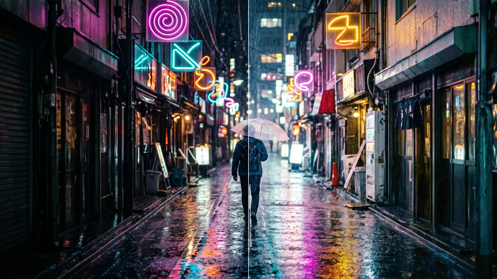
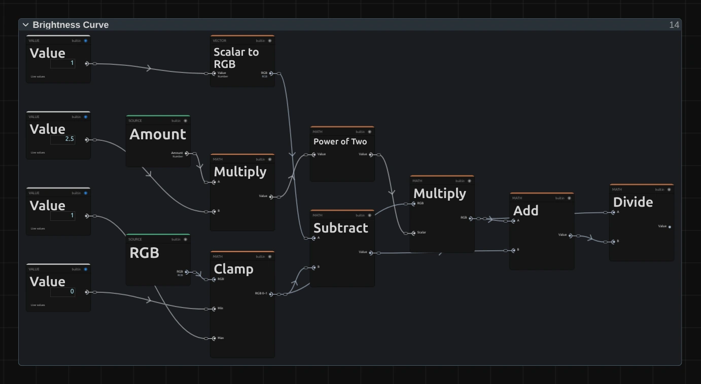

# Color Effects

Nine effects for light and colour, from a quick brightness fix to a complete
colour mood. Add one in **Properties → Effects → + Add Effect**.

Black stays black and white stays white unless you ask for it, colours keep their
shade when you push them, and the preview and the export look the same. Effects in
projects saved before October 2026 keep their earlier look; add the effect again to
get the new one.

## The nine color effects

### Brightness
<figure class="docs-shot docs-shot--float-right">

<figcaption>Left: original. Right: Amount 0.5.</figcaption>
</figure>

Makes the picture lighter or darker in the middle tones, while the deepest blacks
and the brightest whites stay where they are. No grey veil, no washed-out shadows.
- **Amount** – up to lighten, down to darken. 0.3 is a gentle lift, 1 is strong.

Tip: Brightness never burns out the brightest whites; for a camera-like change of light, use Exposure.

### Contrast
<figure class="docs-shot docs-shot--float-left">

<figcaption>Left: original. Right: Amount 1.4.</figcaption>
</figure>

Adds punch: shadows get deeper and highlights brighter, on a soft S-shaped curve,
so bright details roll off gently instead of burning out.
- **Amount** – 1 leaves the picture unchanged, 1.2–1.5 adds punch, below 1 the picture gets flatter, 0 is almost plain grey.

Tip: on dark scenes, 1.1–1.3 is usually enough.

### Exposure
<figure class="docs-shot docs-shot--float-right">

<figcaption>Left: original. Right: Exposure +1 EV.</figcaption>
</figure>

Works like the camera's exposure: it changes the amount of light. +1 doubles it,
−1 halves it. Bright areas can burn out, just as in a camera.
- **Exposure** – in camera stops (EV). ±0.3 is a small correction, ±1 a clear change.
- **Offset** – lifts or lowers everything by the same amount.
- **Gamma** – above 1 opens up the mid-tones, below 1 makes them heavier.

### Levels
<figure class="docs-shot docs-shot--float-left">

<figcaption>Left: original. Right: Output Black 0.12, Output White 0.92.</figcaption>
</figure>

The classic Levels from photo editing: you choose which tone becomes black, which
becomes white and how bright the middle is.
- **Input Black / Input White** – everything darker than Input Black becomes black, everything brighter than Input White becomes white. Moving them inward adds contrast.
- **Gamma** – above 1 brightens the mid-tones, below 1 darkens them.
- **Output Black / Output White** – raise the black or lower the white for a softer, faded film look.

Tip: setting Input Black and Input White to the same value gives a hard black-and-white threshold.

### Saturation
<figure class="docs-shot docs-shot--float-right">

<figcaption>Left: original. Right: Amount 1.6.</figcaption>
</figure>

Makes colours stronger or weaker. When you push it, every colour stops at the
strongest version the screen can show, so it keeps its shade instead of turning
into a flat block.
- **Amount** – 0 is black and white, 1 unchanged, 1.3–1.6 rich.

### Vibrance
<figure class="docs-shot docs-shot--float-left">

<figcaption>Left: original. Right: Amount 1.</figcaption>
</figure>

A gentler saturation: it strengthens pale colours a lot and strong colours only a
little, and it goes easy on skin tones. Good for faces.
- **Amount** – up for livelier colours, down for a muted look.

Tip: on people, use Vibrance instead of Saturation so skin does not turn orange.

### Temperature
<figure class="docs-shot docs-shot--float-right">

<figcaption>Left: original. Right: Temperature −0.6.</figcaption>
</figure>

White balance, like the camera setting: makes the light warmer or cooler. Blacks
stay black and the overall brightness stays the same.
- **Temperature** – positive is warmer (orange), negative cooler (blue). 0.2–0.3 is a correction, 0.6–1 a colour mood.
- **Tint** – positive towards magenta, negative towards green.

Tip: a little cool (−0.3 to −0.6) gives a moonlit or night-time mood.

### Hue Shift
<figure class="docs-shot docs-shot--float-left">

<figcaption>Left: original. Right: Shift 120°.</figcaption>
</figure>

Turns every colour around the colour wheel, so orange can become green and pink
yellow. Each colour keeps its brightness and strength, so an animated shift does
not flicker in brightness.
- **Shift** – in degrees, 0–360°. 180° gives the opposite colours; 360° is back to the original.

Tip: keyframe Shift from 0° to 360° for a smooth colour cycle.

### Invert
<figure class="docs-shot docs-shot--float-right">

<figcaption>Left: original. Right: Invert.</figcaption>
</figure>

Turns the picture into its negative: dark becomes light and every colour becomes
its opposite. Transparent areas stay transparent. Invert has no controls.

Tip: add Hue Shift at 180° after Invert to get roughly the original colours back with light and dark swapped.

Known limitations: on adjustment layers, Brightness, Contrast and Saturation can
still show their earlier, simpler look in some playback modes.

## How the color effects are built

Every color effect is a small node graph. The inspector shows its controls, the
Node Workspace shows the nodes behind them, and you can change those nodes.

<figure class="docs-shot">

<svg class="docs-shot-overlay" viewBox="0 0 1017 486" aria-hidden="true" focusable="false">
<defs><marker id="exposure-inspector-arrow" viewBox="0 0 10 10" refX="8" refY="5" markerWidth="5" markerHeight="5" orient="auto-start-reverse"><path d="M 0 0 L 10 5 L 0 10 Z" fill="#ffd54a" /></marker></defs>
<path class="docs-shot-arrow" d="M830 175 L830 91" marker-end="url(#exposure-inspector-arrow)" />
<circle class="docs-shot-number" cx="830" cy="175" r="18" /><text x="830" y="175" class="docs-shot-number-text">1</text>
<path class="docs-shot-arrow" d="M503 361 L587 361" marker-end="url(#exposure-inspector-arrow)" />
<circle class="docs-shot-number" cx="503" cy="361" r="18" /><text x="503" y="361" class="docs-shot-number-text">2</text>
<path class="docs-shot-arrow" d="M503 436 L587 436" marker-end="url(#exposure-inspector-arrow)" />
<circle class="docs-shot-number" cx="503" cy="436" r="18" /><text x="503" y="436" class="docs-shot-number-text">3</text>
<path class="docs-shot-arrow" d="M917 186 L917 270" marker-end="url(#exposure-inspector-arrow)" />
<circle class="docs-shot-number" cx="917" cy="186" r="18" /><text x="917" y="186" class="docs-shot-number-text">4</text>
</svg>

<figcaption>1 — Properties → Effects lists the effects of the selected clip. 2 — Exposure, in camera stops (the field shows EV). 3 — Gamma, for the mid-tones. 4 — Bypass, to compare with the original.</figcaption>
</figure>

Each control is a node in the graph: **Exposure** (2) is the **Exposure** card in
the Exposure (Stops) picture further down. To see the graph, select the clip and
open the **Nodes** tab (in the tab row Media · AI Studio · Nodes). The effect
appears as folders; the arrow on a folder card opens it. Changes apply to this
one effect on this clip.

In the number field you can type past the end of a slider, up to what the effect
can show (Exposure up to ±20 EV). If a keyframe, a node or the AI agent goes
further, the effect uses the limit and the inspector says so.

### One block between colour in and colour out

<figure class="docs-shot docs-shot--graph">

<figcaption>Brightness as it opens in the Node Workspace, with the Constants folder left out. Every color effect has this shape.</figcaption>
</figure>

All color effects share one simple shape:

- **Split RGB + Alpha** separates the colour from the transparency.
- **Parameters** holds the controls. Each one passes through a limit, so a
  typed-in extreme value cannot break the picture.
- One folder does the actual work: **Brightness Curve**, **Contrast Curve**,
  **Exposure (Stops)**, **White Balance**, **Saturation (Gamut-Safe)** or
  **Hue Rotate (OkLCh)**.
- **Combine RGB + Alpha** puts the untouched transparency back.

These six blocks are also in **right-click → Reusable Nodes** (category Color &
Mask), so you can drop, say, a Brightness Curve into any other image effect graph.

### Brightness: one number sets the strength

<figure class="docs-shot docs-shot--graph">

<figcaption>Brightness Curve. Amount × 2.5 goes through Power of Two to become the gain; Multiply, Add and Divide bend each colour channel with it.</figcaption>
</figure>

The curve brightens the dark-to-middle tones of each channel by the gain from
**Power of Two**, then **Divide** squeezes the result back so that 0 stays 0 and
1 stays 1. That is why Brightness has no grey veil and never clips. The **Value**
card showing **2.5** decides how many stops one unit of Amount is worth.

Remix: set that **2.5** to 1.25 and the whole slider becomes half as strong, for
finer control; set it to 4 for a harder push.

### Exposure and Temperature: working in light

<figure class="docs-shot docs-shot--graph">

<svg class="docs-shot-overlay" viewBox="0 0 1017 572" aria-hidden="true" focusable="false">
<defs><marker id="exposure-stops-arrow" viewBox="0 0 10 10" refX="8" refY="5" markerWidth="5" markerHeight="5" orient="auto-start-reverse"><path d="M 0 0 L 10 5 L 0 10 Z" fill="#ffd54a" /></marker></defs>
<path class="docs-shot-arrow" d="M358 22 L358 68" marker-end="url(#exposure-stops-arrow)" />
<circle class="docs-shot-number" cx="358" cy="22" r="18" /><text x="358" y="22" class="docs-shot-number-text">1</text>
</svg>

<figcaption>Exposure (Stops). 1 — Power of Two turns stops into a light factor: +1 becomes ×2.</figcaption>
</figure>

Screen colours are stored brighter than the light they stand for. **sRGB to
Linear** turns them back into amounts of light, **Multiply** changes the light by
the factor from **Power of Two** (1), and **Linear to sRGB** turns the result
back into screen colours. That is what makes +1 EV look like twice the light.

Temperature's **White Balance** folder uses the same two conversions, but
multiplies red, green and blue by different factors. Its **Value** card **0.6** is
the strength of one Temperature unit (in stops of red against blue).

Remix: for a twice as strong Exposure slider, put a **Multiply** with a
**Value** of 2 between the **Exposure** card and **Power of Two** (1).

### Hue Shift: turning only the hue

<figure class="docs-shot docs-shot--graph">

<svg class="docs-shot-overlay" viewBox="0 0 1017 535" aria-hidden="true" focusable="false">
<defs><marker id="hue-shift-rotate-arrow" viewBox="0 0 10 10" refX="8" refY="5" markerWidth="5" markerHeight="5" orient="auto-start-reverse"><path d="M 0 0 L 10 5 L 0 10 Z" fill="#ffd54a" /></marker></defs>
<path class="docs-shot-arrow" d="M492 22 L492 53" marker-end="url(#hue-shift-rotate-arrow)" />
<circle class="docs-shot-number" cx="492" cy="22" r="18" /><text x="492" y="22" class="docs-shot-number-text">1</text>
<path class="docs-shot-arrow" d="M700 243 L700 327" marker-end="url(#hue-shift-rotate-arrow)" />
<circle class="docs-shot-number" cx="700" cy="243" r="18" /><text x="700" y="243" class="docs-shot-number-text">2</text>
</svg>

<figcaption>Hue Rotate (OkLCh). 1 — Split Vector gives Lightness, Chroma (colour strength) and Hue. 2 — Combine Vector puts them back together.</figcaption>
</figure>

**RGB to OkLCh** describes every colour as lightness, colour strength (chroma)
and hue, in a colour space made to match how we see. Only the hue is changed:
**Add** adds the Shift and **Fraction** wraps it around the colour wheel. Lightness
and chroma go straight from **Split Vector** (1) to **Combine Vector** (2), so the
brightness cannot change.

Remix: for richer colours without any shift in hue, put a **Multiply** with a
**Value** of 1.3 on the Chroma cable between (1) and (2). Colours the screen cannot
show are cut off at the end, so stay below about 1.5.

### Vibrance: Saturation with a weight

<figure class="docs-shot docs-shot--graph">

<figcaption>The middle of the Vibrance graph. Muted-Colour Weight turns Amount into a per-pixel amount for the same Saturation (Gamut-Safe) block the Saturation effect uses.</figcaption>
</figure>

Vibrance reuses Saturation's block and only computes a different amount for every
pixel. **Hue & Saturation** measures each colour, **Muted-Colour Weight** gives
pale colours more of the Amount than strong ones, and **Skin Protection** lowers it
on skin-coloured hues.

Remix: to treat skin like every other colour, connect a **Value** of 1 to the
**Skin Weight** input of **Muted-Colour Weight**.

## Technical details

Notes for developers. The recipes live in `src/services/operators/colorEffectGraphs.ts`
(tuning in `COLOR_RECIPE`); formulas in
[Effects: editable color effect graphs](./Effects.md#editable-color-effect-graphs),
blocks in the [Node Catalog](./Node-Catalog.md) and the graph contract in the
[Operator Graph Compiler](./Operator-Graph-Compiler.md).

- **Range.** The effect chain carries 8-bit, display-referred colour; the recipes
  limit their input to 0–1, so there is no HDR headroom between effects.
- **Formulas.** Brightness `y = x·m / (x·m + 1 − x)`, `m = 2^(2.5·Amount)`;
  Contrast `x^c / (x^c + (1 − x)^c)` with slope `c` = Amount at mid-grey; Exposure
  `2^EV` in linear light with the exact sRGB transfer, then Offset and Gamma as
  before; Temperature 0.6 stops red against blue per unit, Tint 0.5 stops of
  green, normalised to keep Rec.709 luminance.
- **Saturation and Vibrance.** Rec.709 luma mix, stopped where the first channel
  reaches 0 or 1 (hue and luma stay). Vibrance weights Amount by `1 − S` (HSV) and
  spares up to 70 % on skin hues (Gaussian at 0.07 turns, about 25°, width 0.05).
- **Hue Shift.** Rotation in OkLCh; colours that leave sRGB are clamped per channel
  (no gamut mapping). Stored in turns: 0.25 is 90°, and keyframes and agent tools
  use turns; only the inspector shows degrees.
- **Render ranges.** Sliders cover the useful range; typed values render up to
  Brightness ±4, Contrast and Saturation 0–10, Vibrance −1 to 4, Exposure ±20 EV,
  Gamma 0.1–10 (Exposure and Levels), Temperature and Tint ±4. Beyond that the
  graph clamps, and the inspector, `addEffect`/`updateEffect` warnings and
  `listEffects` (`renderRange`) report it. Levels with equal input points is a hard
  threshold, swapped points give a negative.
- **Performance.** All recipes are per-pixel math without extra texture reads. A
  single color effect runs inside the composite pass; in a stack each one is its
  own pass. The worker software and export path evaluates the same graphs on the CPU.
- **Saved projects.** Effects keep the graph they were saved with, so projects from
  before the 2026-10 rebuild look as before (`legacyColorEffectGraphs.ts`).
- **Known gaps.** Adjustment layers on the worker GPU path still use the older 4×5
  colour matrix for Brightness, Contrast and Saturation. Exposure clips each channel
  hard, so strong +EV can shift hues in the highlights. Contrast pivots at fixed
  mid-grey, Levels has no per-channel mode, Temperature has no Kelvin scale.
