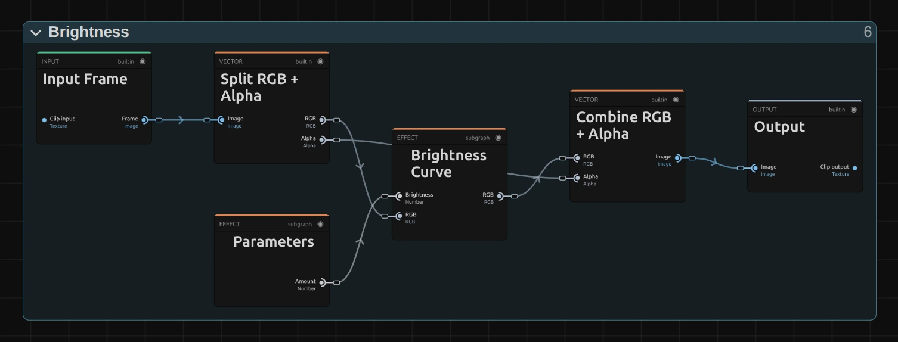

# Color & Tone

Light and colour, from a quick brightness fix to a complete colour mood, flat poster tones or pure
black and white. Add one in **Properties → Effects → + Add Effect** ([Using effects](./Effects.md#add-an-effect)).

<!-- docs-gallery: color -->

## Which one?

| I want… | Use |
|---|---|
| lighter or darker mid-tones, without a grey veil | [Brightness](./effects/brightness.md) |
| more or less light, like the camera's aperture | [Exposure](./effects/exposure.md) |
| more punch | [Contrast](./effects/contrast.md) |
| a faded print: lifted blacks, softer whites | [Contrast](./effects/contrast.md) below 1 (Faded Print), or [Levels](./effects/levels.md) for exact points (Matte Film) |
| exact black and white points | [Levels](./effects/levels.md) |
| stronger or weaker colours | [Saturation](./effects/saturation.md); on faces [Vibrance](./effects/vibrance.md) |
| warmer or cooler light | [Temperature](./effects/temperature.md) |
| different colours | [Hue Shift](./effects/hue-shift.md) |
| a negative | [Invert](./effects/invert.md) |
| a few flat tones | [Posterize](./effects/posterize.md) |
| pure black and white | [Threshold](./effects/threshold.md) |

## The shared idea

<figure class="docs-shot docs-shot--graph">

<figcaption>Brightness as it opens in the Nodes tab, with the Constants folder left out: the simplest colour effect, one working folder.</figcaption>
</figure>

Every colour effect is a small node graph of the same shape:

- **Split RGB + Alpha** separates the colour from the transparency.
- **Parameters** holds the controls. A control gets a limit where a typed-in extreme value could
  break the picture (Brightness, Contrast or a Gamma); a control where every value has a clear
  result, such as Exposure's Offset, the points of Levels or Hue Shift's Shift (past a full turn either way it
  simply goes round again), goes out as it is.
- One or more working stages do the actual work: one folder in Brightness (**Brightness Curve**)
  and Contrast (**Contrast Curve**), several in a row in Exposure (**Exposure (Stops)**, then
  **Offset & Gamma**) or Levels. Each effect page shows its stages under *Node setup*.
- **Combine RGB + Alpha** puts the untouched transparency back, in some effects after a
  **Clamp & Alpha** folder that keeps the colour between black and white.

[Invert](./effects/invert.md) is the smallest of them: it has no controls, one working folder
(**Invert RGB**) and needs no clamp, so its last folder is called **Alpha & Image**.

[Posterize](./effects/posterize.md) has the longest path: **Step Input**, **Hard Steps**, **Soft Steps**,
**Spread to 0–1** and **Colour & Alpha**, from what gets stepped to the colour it keeps.

[Threshold](./effects/threshold.md) splits after its **Brightness** folder: a **Hard Edge** and a
**Soft Edge** work side by side, and **Black & White** picks one of them.

Black stays black and white stays white unless you ask for it, and colours keep their shade when you
push them. The blocks **Brightness Curve**, **Contrast Curve**, **Exposure (Stops)**, **White
Balance**, **Saturation (Gamut-Safe)** and **Hue Rotate (OkLCh)** are also in **right-click →
Reusable Nodes** (category Color & Mask), so you can drop them into any other image effect graph.
How to open a graph: [The node setup](./Effects.md#the-node-setup).

## Technical details

Colour effects work on the 8-bit picture, from black to white, with no extra headroom between effects. You can type a value past the end of a slider up to what the effect can show; beyond that the card says which value it uses. Colour effects in projects saved before October 2026 keep the look they were saved with; add the effect again for the current one. One bug fix changes saved looks: a Contrast saved with Amount below 1 before this fix (with the October 2026 recipe) now fades evenly toward grey instead of breaking dark shadows into coloured blotches; from Amount 1 up it looks exactly as before.

Developer notes: [Effect system: Color & Tone notes](./Effect-System.md#color--tone-notes).
