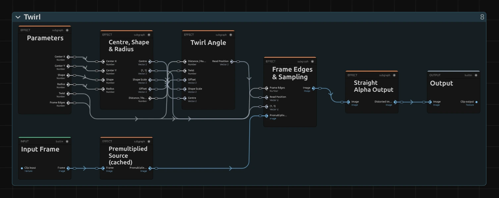
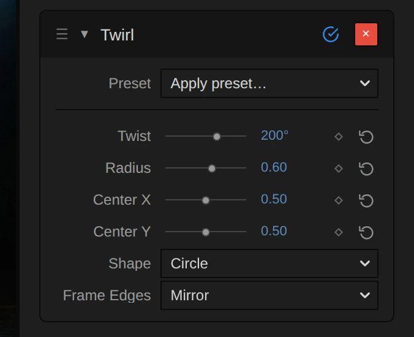

# Lens & Distort

Bend, swirl, fold or straighten the picture: playful lens looks, mirror patterns and corrections for
photos. Add one in **Properties → Effects → + Add Effect → Lens & Distort**
([Using effects](./Effects.md#add-an-effect)).

<!-- docs-gallery: distort -->

## Which one?

| Look | Use |
|---|---|
| a lens bump or a squeeze in one round area, the rest untouched | [Bulge & Pinch](./effects/bulge.md) |
| a swirl | [Twirl](./effects/twirl.md) |
| ripples, heat shimmer | [Wave](./effects/wave.md) |
| an ultra-wide round lens: the whole frame bends, the corners stay | [Fisheye Lens](./effects/fisheye.md) |
| a symmetric pattern | [Kaleidoscope](./effects/kaleidoscope.md) |
| a mirror image | [Mirror](./effects/mirror.md) |
| colour fringes, a glitch | [RGB Split](./effects/rgb-split.md) |
| glass, prism and foil | [Film Prism](./effects/film-prism.md), [Holo](./effects/holo.md), [Crystal Glass](./effects/crystal.md), [Glass Dispersion](./effects/glass-dispersion.md) |
| straight lines in a photo | [Lens Correction](./effects/lens-correction.md), then [Guided Perspective](./effects/guided-perspective.md) |
| a full frame after a correction | [AI Edge Fill](./effects/ai-edge-fill.md) |

## The shared idea

A distortion does not move pixels. Every pixel of the result asks: which spot of the original do I
show? Change that spot and the picture bends. Bulge & Pinch, Twirl, Wave, Kaleidoscope, Mirror and
RGB Split all work this way, and each is a small node graph you can open: select the clip, open the
**Nodes** tab and use the › on the effect's card, then on each folder
([The node setup](./Effects.md#the-node-setup)).

<figure class="docs-shot docs-shot--graph">

<figcaption>Twirl as it opens in the Node Workspace, with the Constants and Coordinates & Resources folders left out of the picture and cables routed around the cards.</figcaption>
</figure>

- **Centre, Shape & Radius** measures each pixel's **Offset** from the centre and its **Distance /
  Radius**: 0 in the middle, 1 at the edge of the area.
- The middle folder is the effect itself: **Twirl Angle**, **Bulge & Pinch Curve**, **Wave
  Displacement**, Kaleidoscope's **Wedge Fold** or Mirror's **Mirror Lines**. It turns the offset into
  a **Read Position**. Each effect page shows its folder.
- **Frame Edges & Sampling** reads the picture once at that position. **Premultiplied Source** and
  **Straight Alpha Output** around it keep transparent edges clean.

### Two shared controls

<figure class="docs-shot docs-shot--float-right docs-shot--detail">

<svg class="docs-shot-overlay" viewBox="0 0 590 479" aria-hidden="true" focusable="false">
<defs><marker id="distort-shared-controls-arrow" viewBox="0 0 10 10" refX="8" refY="5" markerWidth="5" markerHeight="5" orient="auto-start-reverse"><path d="M 0 0 L 10 5 L 0 10 Z" fill="#ffd54a" /></marker></defs>
<path class="docs-shot-arrow" d="M101 193 L161 193" marker-end="url(#distort-shared-controls-arrow)" />
<circle class="docs-shot-number" cx="101" cy="193" r="18" /><text x="101" y="193" class="docs-shot-number-text">1</text>
<path class="docs-shot-arrow" d="M23 420 L83 420" marker-end="url(#distort-shared-controls-arrow)" />
<circle class="docs-shot-number" cx="23" cy="420" r="18" /><text x="23" y="420" class="docs-shot-number-text">2</text>
</svg>

<figcaption>The Twirl card in Properties → Effects. 1 — Twist, in degrees. 2 — Frame Edges.</figcaption>
</figure>

- **Shape**: **Circle** keeps the area round on any picture. **Stretch to Frame** stretches it to the
  shape of the frame, an oval on a wide picture. Bulge & Pinch, Twirl and Kaleidoscope have it.
- **Frame Edges** decides what appears where a read lands past the edge of the picture, for example
  in a pinch or in waves along the border: **Mirror** reflects the picture, **Clamp** repeats the
  border pixels as streaks, **Transparent** leaves those places empty. Bulge & Pinch, Twirl, Wave,
  Kaleidoscope, Mirror and RGB Split have it; Fisheye Lens has its own, with Repeat as a fourth
  choice.

## Technical details

With **Shape: Circle**, circles stay round and the effect looks the same at every resolution. Angles show in degrees. Very strong settings can shimmer on fine detail; values the effect clamps are named below its card.

Developer notes: [Effect system: Lens & Distort notes](./Effect-System.md#lens--distort-notes).
