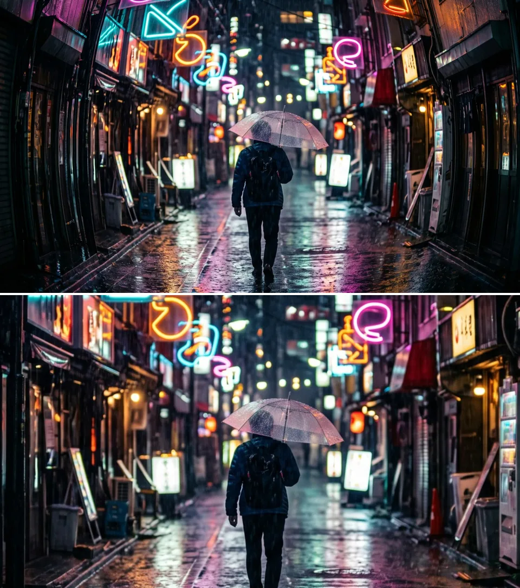

# Distort Effects

Effects that bend, swirl or straighten the picture: playful lens looks and
corrections for photos. Add one in **Properties → Effects → + Add Effect → Lens & Distort**.

Bulge & Pinch, Twirl, Wave and Fisheye Lens keep pictures with transparency
(titles, logos, keyed footage) free of a dark rim along their edges.

## Seven Lens & Distort effects

The **Lens & Distort** menu also holds Kaleidoscope, Mirror, RGB Split, Crystal,
Glass Dispersion, Film Prism and Holo; see [Effects](./Effects.md#current-effect-categories).

### Bulge & Pinch
<figure class="docs-shot docs-shot--float-right">

<figcaption>Top: original. Bottom: Amount 2, Radius 0.5.</figcaption>
</figure>

Magnifies a round area like a lens bump, or squeezes it together. The edge of
the area blends smoothly into the untouched picture.
- **Amount** – 1 changes nothing. Above 1 the middle is magnified that many times: 2 (the default) makes it twice as large. Below 1 pinches.
- **Radius** – size of the area, as a share of the picture height (the width in a portrait picture): 0.5 makes a circle as tall as the picture.
- **Center X / Center Y** – where the area sits (0.5 / 0.5 is the middle of the picture).

Tip: animate Amount from 1 to let the bump grow out of the picture. A pinch
larger than the picture reads beyond its edge: keep Radius at 0.5 or less in the
middle (the pinch then stays inside the frame), or use **Frame Edges:
Transparent** over a background layer.

### Twirl
<figure class="docs-shot docs-shot--float-left">

<figcaption>Top: original. Bottom: Twist 200°, Radius 0.6.</figcaption>
</figure>

Turns the picture around a centre point: strongest in the middle, fading out to
nothing at the edge of the area.
- **Twist** – how far the middle turns, in degrees. 45° is a soft swirl, 115° (the default) a clear one, 360° a full turn; negative values turn the other way.
- **Radius** – size of the area, as for Bulge & Pinch.
- **Center X / Center Y** – the centre of the swirl.

Tip: keyframe Twist from 0 up and back to 0 for a swirl transition.

### Wave
<figure class="docs-shot docs-shot--float-right">

<figcaption>Top: original. Bottom: the default settings.</figcaption>
</figure>

Ripples the picture with smooth waves, from a gentle ripple to a funhouse wobble.
The waves travel by themselves.
- **Horizontal Height / Vertical Height** – how far the picture moves, as a share of the picture (0.015 is 1.5 %). Horizontal Height moves the picture up and down in waves that run across it; Vertical Height moves it sideways.
- **Horizontal Waves / Vertical Waves** – how many waves fit across and down the picture.
- **Speed** – how fast the waves travel, in waves per second. 0 stands still, negative values run the other way.
- **Phase** – shifts the waves along, in degrees (useful with Speed 0).

Tip: small heights (0.005) with a slow Speed read as heat shimmer.

### Fisheye Lens
<figure class="docs-shot docs-shot--float-left">

<figcaption>Top: original. Bottom: the default settings.</figcaption>
</figure>

The rounded look of an ultra-wide fisheye lens: the middle comes closer and
straight lines bend towards the edges.
- **Strength** – 1 is the full fisheye, 0 no change, negative values bend the other way and flatten a fisheye picture.
- **Field of View** – how wide the imagined lens sees, in degrees: wider looks rounder.
- **Zoom** – below 1 shows more of the picture around the middle.
- **Lens Radius** – 1 or less shows the round image circle (1 is as tall as the picture).

Tip: Lens Radius 0.9 with **Outside Lens: Transparent** makes a round porthole.

### Lens Correction
<figure class="docs-shot docs-shot--float-right">

<figcaption>Top: simulated barrel distortion. Bottom: Remove Distortion −28, Scale 120.</figcaption>
</figure>

Repairs what a camera lens does to a photo or clip: bowed lines, coloured
fringes at contrast edges and dark corners.
- **Lens Profile** – the measured Canon EF 24–105mm f/4L IS USM, or Manual.
- **Remove Distortion** – negative values straighten lines that bow outward (wide angle), positive values lines that bow inward.
- **Red/Cyan Fringe and Blue/Yellow Fringe** – remove coloured edges.
- **Vignette Amount** – lifts dark corners (negative darkens them).

Tip: very strong correction leaves empty corners. Raise Scale to crop them, or
fill them on still photos with AI Edge Fill.

### Guided Perspective
<figure class="docs-shot docs-shot--float-left">

<figcaption>Top: the street with a simulated upward camera tilt. Bottom: corrected by Guided Perspective.</figcaption>
</figure>

Straightens buildings and walls that lean because the camera was tilted. On a
still photo (an image clip), choose **Edit guides** and draw lines along edges
that should be vertical (or horizontal), then **Apply**. Guides can be drawn on
still photos only.
- **Strength** – 100 is the full correction; lower values keep some of the lean, and lines stay straight.
- **Scale** – enlarges the result to crop the empty borders.

Tip: add it directly after Lens Correction and draw guides along long edges far apart.

### AI Edge Fill

Fills the empty borders that Lens Correction and Guided Perspective leave on a
still photo with an AI-generated continuation of the scene, so the frame is full
again. It uses the cloud AI service and its credits; see [AI Edge Fill](./Effects.md#ai-edge-fill).

### Known limitations

Very strong Twist, Wave with many tiny waves or a strong pinch can shimmer on
fine detail, and a very strong bulge looks soft, because each pixel is read once.

## How the distort effects are built

Bulge & Pinch, Twirl and Wave share their controls and their idea. Twirl shows
both best.

<figure class="docs-shot docs-shot--detail">

<svg class="docs-shot-overlay" viewBox="0 0 590 418" aria-hidden="true" focusable="false">
<defs><marker id="twirl-inspector-arrow" viewBox="0 0 10 10" refX="8" refY="5" markerWidth="5" markerHeight="5" orient="auto-start-reverse"><path d="M 0 0 L 10 5 L 0 10 Z" fill="#ffd54a" /></marker></defs>
<path class="docs-shot-arrow" d="M101 132 L161 132" marker-end="url(#twirl-inspector-arrow)" />
<circle class="docs-shot-number" cx="101" cy="132" r="18" /><text x="101" y="132" class="docs-shot-number-text">1</text>
<path class="docs-shot-arrow" d="M23 359 L83 359" marker-end="url(#twirl-inspector-arrow)" />
<circle class="docs-shot-number" cx="23" cy="359" r="18" /><text x="23" y="359" class="docs-shot-number-text">2</text>
</svg>

<figcaption>The Twirl card in Properties → Effects. 1 — Twist, in degrees. 2 — Frame Edges.</figcaption>
</figure>

- **Twist** (1) is the turn in the middle of the swirl, in degrees.
- **Shape**, just above Frame Edges: **Circle** keeps the area round on any
  picture. **Stretch to Frame** stretches it to the shape of the frame, an oval
  on a wide picture. Bulge & Pinch has the same choice.
- **Frame Edges** (2) decides what appears where the effect reaches past the
  edge of the picture, for example in a pinch or in waves along the border:
  **Mirror** reflects the picture, **Clamp** repeats the border pixels as
  streaks, **Transparent** leaves those places empty. All three effects have it.

### One idea: move where each pixel reads

<figure class="docs-shot docs-shot--graph">

<figcaption>Twirl as it opens in the Node Workspace, with the Constants and Coordinates & Resources folders left out of the picture and cables routed around the cards.</figcaption>
</figure>

A distortion does not move pixels. Every pixel of the result asks: which spot
of the original do I show? Change that spot and the picture bends. To see the
graph, select the clip and open the **Nodes** tab; the arrow on a folder card
opens it.

- **Centre, Shape & Radius** measures each pixel's **Offset** from the centre
  and its **Distance / Radius**: 0 in the middle, 1 at the edge of the area.
- The middle folder is the effect itself: **Twirl Angle**, **Bulge & Pinch
  Curve** or **Wave Displacement**. It turns the offset into a **Read Position**.
- **Frame Edges & Sampling** reads the picture once at that position.
  **Premultiplied Source** and **Straight Alpha Output** around it keep
  transparent edges clean.

Bulge & Pinch and Twirl differ only in the middle folder.

### Twirl: a turn that fades out

<figure class="docs-shot docs-shot--graph">

<svg class="docs-shot-overlay" viewBox="0 0 1017 449" aria-hidden="true" focusable="false">
<defs><marker id="twirl-angle-arrow" viewBox="0 0 10 10" refX="8" refY="5" markerWidth="5" markerHeight="5" orient="auto-start-reverse"><path d="M 0 0 L 10 5 L 0 10 Z" fill="#ffd54a" /></marker></defs>
<path class="docs-shot-arrow" d="M587 22 L587 79" marker-end="url(#twirl-angle-arrow)" />
<circle class="docs-shot-number" cx="587" cy="22" r="18" /><text x="587" y="22" class="docs-shot-number-text">1</text>
<path class="docs-shot-arrow" d="M907 22 L907 79" marker-end="url(#twirl-angle-arrow)" />
<circle class="docs-shot-number" cx="907" cy="22" r="18" /><text x="907" y="22" class="docs-shot-number-text">2</text>
</svg>

<figcaption>Twirl's Twirl Angle folder, with cables routed around the cards (the <strong>Avoid</strong> button in the Node Workspace toolbar). Green cards are values from outside the folder. 1 — the Multiply that squares the falloff. 2 — the Multiply that makes Turn Angle.</figcaption>
</figure>

**Minimum**, **Subtract** and the first **Multiply** (1) turn the distance into
a falloff: full strength in the middle, fading in a soft curve to nothing at the
edge of the area. The free dots on Minimum (B) and Subtract (A) hold the
constant 1, so together they compute (1 − min(distance, 1))². The second **Multiply** (2) scales it by **Twist** into the
**Turn Angle**. **Rotate UV** turns the offset by that angle, and **Divide** and
**Add** turn the result back into a position in the picture.

Remix: connect the output of **Subtract** straight to input **B** of the
Multiply (2), in place of the cable from Multiply (1). The turn then fades in a
straight line instead of a curve, and the swirl stays strong further out.

### Wave: two sine waves

<figure class="docs-shot docs-shot--graph">

<svg class="docs-shot-overlay" viewBox="0 0 1017 577" aria-hidden="true" focusable="false">
<defs><marker id="wave-displacement-arrow" viewBox="0 0 10 10" refX="8" refY="5" markerWidth="5" markerHeight="5" orient="auto-start-reverse"><path d="M 0 0 L 10 5 L 0 10 Z" fill="#ffd54a" /></marker></defs>
<path class="docs-shot-arrow" d="M418 527 L418 443" marker-end="url(#wave-displacement-arrow)" />
<circle class="docs-shot-number" cx="418" cy="527" r="18" /><text x="418" y="527" class="docs-shot-number-text">1</text>
<path class="docs-shot-arrow" d="M902 247 L902 163" marker-end="url(#wave-displacement-arrow)" />
<circle class="docs-shot-number" cx="902" cy="247" r="18" /><text x="902" y="247" class="docs-shot-number-text">2</text>
<path class="docs-shot-arrow" d="M253 554 L253 490" marker-end="url(#wave-displacement-arrow)" />
<circle class="docs-shot-number" cx="253" cy="554" r="18" /><text x="253" y="554" class="docs-shot-number-text">3</text>
</svg>

<figcaption>The up-and-down strand of Wave's Wave Displacement folder, with cables routed around the cards; the sideways strand and the Split Vector node are left out. Green cards are inputs: X and Y, the picture position from Split Vector, and values from outside the folder. 1 — Y. 2 — Sine. 3 — the Multiply that scales the wave by Horizontal Height.</figcaption>
</figure>

This strand moves the picture up and down. **Split Vector**, at the start of the
folder, splits each pixel's position into **X** and **Y** (1). X times
**Horizontal Waves** (and 2π, the free dot on the second Multiply) plus
**Phase** goes into a **Sine** (2); the **Multiply** (3) scales that wave by
**Horizontal Height**, and the last **Add** shifts Y by it. A second strand in
the same folder, left out here, does the same along Y with the vertical controls
and shifts X; **Combine Vector** joins both into the **Read Position**. Phase
grows with Speed over time, so the waves travel.

Remix, ripples that grow towards the bottom: add a **Multiply** node between the
**Sine** (2) and the Multiply (3), and connect the **Y** output of **Split
Vector** (the Y card (1) in the picture) to its second input. Y runs from 0 at
the top of the picture to 1 at the bottom, so the ripples are calm at the top
and strongest at the bottom, like a water surface.

### The other distort effects

Fisheye Lens is an editable graph too, in a single pass: **Lens Projection**,
**Frame Edges**, **Chromatic Aberration** and **Lens Resolve**, which averages
its edge samples. Lens Correction, Guided Perspective and AI Edge Fill are fixed
shaders with their own controls and have no node graph.

## Technical details

Notes for developers. The recipes live in
`src/services/operators/uvDistortRecipes.ts`; more in
[Effects: editable UV distortions](./Effects.md#editable-uv-distortions),
[Fisheye Lens](./Effects.md#fisheye-lens),
[Lens Correction](./Effects.md#lens-correction),
[Guided Perspective](./Effects.md#guided-perspective),
[Node Catalog](./Node-Catalog.md) and
[Operator Graph Compiler](./Operator-Graph-Compiler.md).

- **Formulas.** With p the offset from the centre and r = |p| / Radius:
  Bulge & Pinch reads p × exp(−β (1 − r²)²) for r < 1, with
  β = ln(max(Amount, 1)) − 0.95 × clamp(1 − Amount, 0, 1): above 1 the centre is
  magnified exactly Amount times, and a pinch stays above β = −1, so it never
  folds the picture. Twirl turns p by
  Twist × (1 − min(r, 1))² radians. Wave adds sin(2π × Horizontal Waves × x + φ) ×
  Horizontal Height to y, then sin(2π × Vertical Waves × y + φ) × Vertical Height
  to x, with φ = Phase (converted to radians) + 2π × Speed × time in seconds.
- **Units.** Shape Circle measures Radius in units of the shorter frame side
  (0.5 = half of it), so circles stay round and match at every resolution;
  Stretch to Frame measures each axis in its own 0–1 range. Twist is stored in
  radians (default 2, range ±4π); the inspector rows (also when Twist takes a
  node source) show degrees, while keyframe lanes, MIDI and tools use radians. Wave heights are fractions of the picture per axis, so
  equal values give different pixel shifts on a 16:9 frame.
- **Sampling.** The frame is premultiplied into an `rgba16float` cache, read
  with one bilinear sample at the read position and unpremultiplied: two passes,
  and transparent edges keep their colour. Frame Edges mirrors, clamps or clears
  samples outside the frame; Transparent fades over one source pixel by lowering
  alpha only. One sample per pixel means very strong Twist (above about 10 rad),
  dense waves and strong pinches alias; a bulge far beyond the slider (Amount 8
  magnifies the centre eight times) shows soft magnified pixels.
- **Worker CPU fallback.** Without WebGPU (software preview, worker-first export
  readback) the untouched recipes run as a hand-written pass with the same
  mapping, frame edges and premultiplied bilinear read, within 1/255 of the
  graph; edited graphs run through the graph interpreter.
- **Zero strength.** Amount 1, Twist 0 or both Wave heights 0 skip the built-in
  recipe, so the picture passes through exactly.
- **Fisheye Lens.** One pass with up to 8 samples per pixel. Each sample is
  premultiplied as it is read and the average is unpremultiplied, so lens and
  frame feathering lower coverage instead of darkening colour. With Chromatic
  Aberration, each channel's straight colour is taken from its own sample and
  premultiplied by the averaged alpha, so fringes across a cut-out never exceed
  the source colour. The worker CPU path matches. The hardware filter still mixes straight texels across a
  transparent edge inside the source (about one source pixel).
- **Lens Correction.** Beyond the radius where strong correction would fold the
  picture back, pixels stay transparent with a one-pixel soft edge and a
  warning. The fringe channels sample the clamped border, and the frame edge is
  anti-aliased. Cut-outs in the source are read with straight-alpha bilinear
  filtering, like any layer transform.
- **Guided Perspective.** Strength blends the normalized homography towards the
  identity, so lines stay straight at any value. A degenerate matrix gives a
  transparent frame and a warning instead of invalid pixels.
- **AI Edge Fill.** Missing or non-numeric placements fall back to finite values
  and a zero-area placement no longer divides by zero.
- **Warnings.** Clamped or degenerate values (Radius ≤ 0, negative Amount,
  unknown Shape or Frame Edges choices, out-of-range Fisheye values, Lens
  Correction folding at the active composition size, Guided Perspective limits)
  appear below the effect in the inspector, judged on the values at the
  playhead, and in the `addEffect` / `updateEffect` tool results.
- **Saved projects.** They open with their settings. Untouched Wave, Twirl and
  Bulge graphs, effects saved before effects owned a graph and effect presets
  saved with the earlier recipe load (or apply) as the current recipes with
  Stretch to Frame, Clamp and (Wave) Speed 0, so Wave and Twirl look as before;
  Bulge & Pinch gets the smooth curve. Untouched
  Fisheye graphs of the earlier recipe are recognized by a frozen fingerprint
  and load as the current one; edited graphs stay as saved. Guided Perspective
  below Strength 100 renders the straight-line blend.
