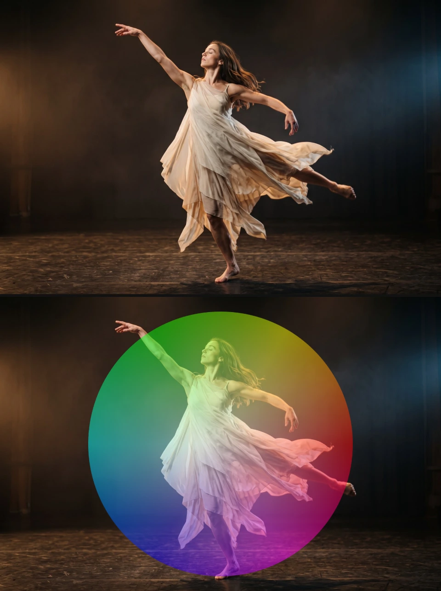

# Generate Effects

Six effects that make new pictures instead of changing the clip: a colour wheel, a
stage floor, a stick figure, a swarm, woven threads and raw computer memory.
Add one in **Properties → Effects → + Add Effect**: Color Wheel, Perspective Grid and
Stick Figure are under **Generate**, Flocking and Weave under **3D & Particles**,
Memory Leak under **Analog & Glitch**.

## The six generators

### Color Wheel
<figure class="docs-shot docs-shot--float-right">

<figcaption>Left: original. Right: Shape Disc, Mix 0.5.</figcaption>
</figure>

Paints a hue wheel: the colours go round the centre and grow stronger towards the
edge. Use it as a colour reference, a gel over the picture or a psychedelic background.
- **Shape** – Fill layer colours the whole layer (or only the inside of a shape layer); Disc draws a round wheel with a clean edge over the clip.
- **Hue Rotation** – turns the colours round, in degrees. **Spin** keeps them turning (degrees per second).
- **Saturation** and **Brightness** – how strong and how bright the colours are.
- **Mix** – how much of the clip shows through.

Tip: on a Blank clip, Disc gives a wheel on a transparent background.

### Perspective Grid
<figure class="docs-shot docs-shot--float-left">

<figcaption>Left half: original. Right half: Horizon 70 %, 16 columns, Row Density 4, Line Width 6 px, Opacity 1.</figcaption>
</figure>

A glowing floor grid that runs to a vanishing point and scrolls towards the viewer:
the classic retro stage floor. Lines stay crisp at any size and melt into an even
haze near the horizon instead of flickering.
- **Horizon** – where the floor ends, measured from the top of the picture.
- **Columns** and **Row Density** – how many lines; more rows make the floor look deeper.
- **Line Width** – thickness of the nearest lines, in pixels of a 1080p frame. Further away they get thinner, like lines painted on a floor.
- **Speed** – rows per second towards the viewer; negative values run away.
- **Blend** – Add makes glowing lines of light; Normal paints solid lines, which can also be dark.

Tip: put Horizon on the real floor line of the shot, then lower Opacity until the
grid sits on the stage.

### Stick Figure
<figure class="docs-shot docs-shot--float-right">

<figcaption>Left: original. Right: a posed figure, Facing Left, Head Ring, Scale 1.6.</figcaption>
</figure>

A posable stick figure for choreography sketches, storyboards and animated
characters. On a Blank clip only the figure shows.
- **Pose** – joint angles in degrees: shoulders and hips swing forward from hanging down, elbows and knees bend. The **Pose library** applies or keys whole poses.
- **Actions** – Walk, Run, Jump, Punch and more on the figure's own lane; they blend into each other.
- **Scale**, **Line Thickness**, **Head** (filled or ring) and **Color** – the look.
- **Ground** – Plant keeps the lowest point on the floor while the figure moves.

Tip: **Walk**, **Run** and **Idle** under Motion animate every joint in one click.

### Flocking
<figure class="docs-shot docs-shot--float-left">

<figcaption>Left: original. Right: preset Violet Filaments, 4 s in (editor preview).</figcaption>
</figure>

A swarm in 3D (birds, fish, krill, sparks) that moves by itself around the clip,
with real depth. Its behaviour is a node graph you can open and change.
- **Preset** – a starting swarm, from the calm Free Swarm to large showcase scenes.
- **Population**, **Behavior**, **Guidance**, **Appearance** and **Lines** – the controls the preset exposes in the effect card.
- **Open Nodes** – the whole graph, to add forces, paths or other looks.

Tip: more in [Flock Clips](./Flock-Clips.md).

### Weave
<figure class="docs-shot docs-shot--float-right">

<figcaption>Left: original. Right: the default Weave, 2.2 s in (editor preview).</figcaption>
</figure>

Woven fabric, yarn, ropes and knots, drawn as fine lit fibres in 3D. The default
is a knitted net that weaves itself in over the first seconds of the clip.
- The threads are a node graph: open the clip in the **Nodes** tab to change them.
- Values exposed from that graph appear in the effect card, ready to keyframe.

Tip: more in [Weave](./Weave.md).

### Memory Leak
<figure class="docs-shot docs-shot--float-left">

<figcaption>Left: original. Right: Block Width 128, Offset 1 MB, Per Frame Hold block (the bytes differ from session to session).</figcaption>
</figure>

Shows bytes the editor's video decoder left in memory as pixels: real data, not
noise, for databending glitches.
- **Feed Clip** – decodes two seconds of the clip, so its frames end up in that memory.
- **Block Width** – how many memory pixels fit across; fewer gives bigger blocks.
- **Bit Depth** – how bytes become colour: 8-bit, 16-bit or 32-bit float.
- **Per Frame** – hold the block, advance through memory, or jump each frame.
- **Freeze** – stores the current block in the project, so it looks the same in every session and in the export.

Tip: lower Mix to lay the glitch over the clip.

**Known limitations:** an unfrozen Memory Leak block changes from session to session;
Flocking and Weave need a moment to prepare their 3D scene before the preview shows them.

**Older projects:** Perspective Grid lines now keep their width on the floor and scale
with the picture size, so saved grids look the same along the front edge of a 1080p
frame and thinner towards the horizon. The other effects keep their look.

<!-- docs agent: middle and technical levels go here -->
