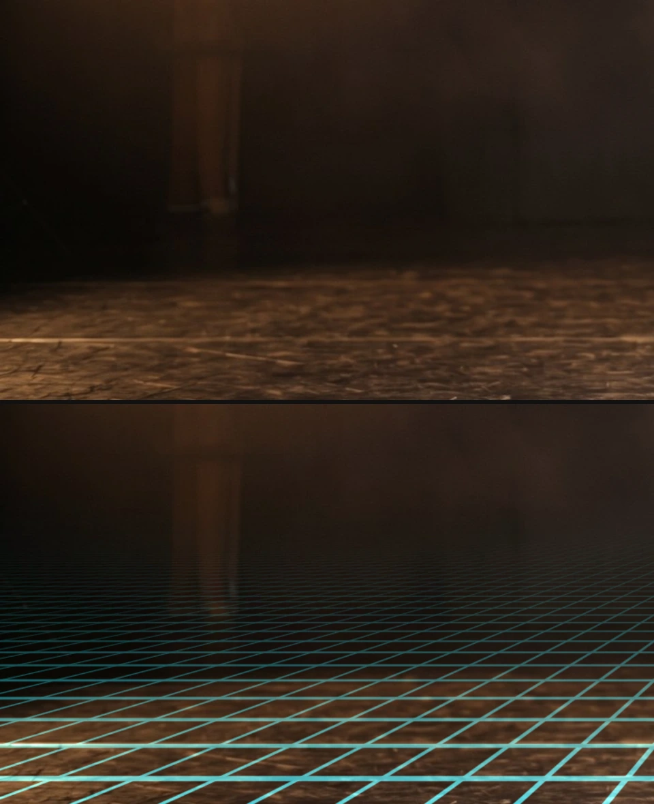
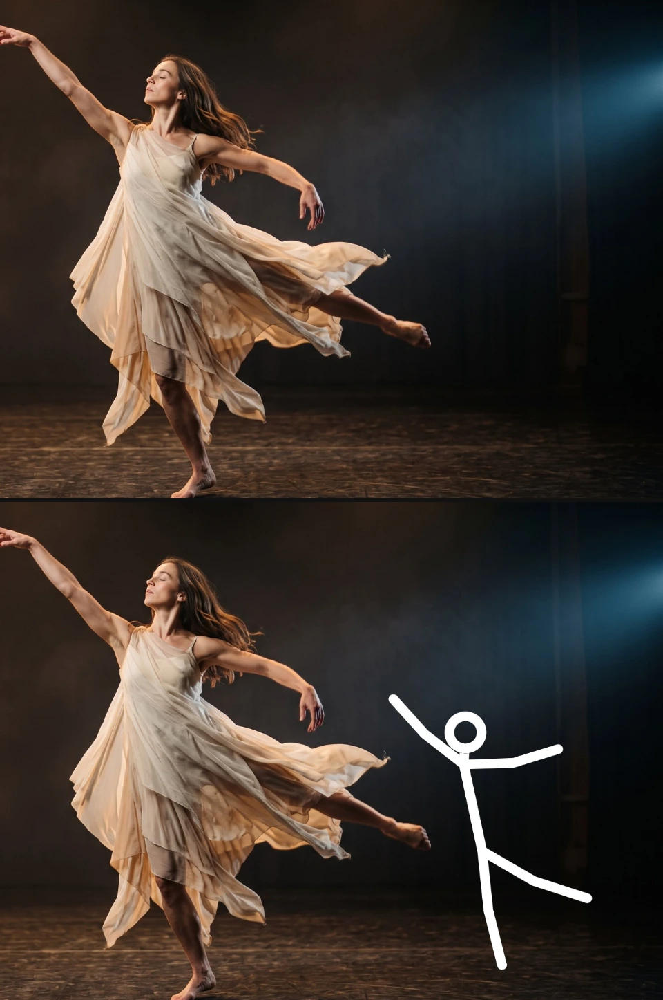
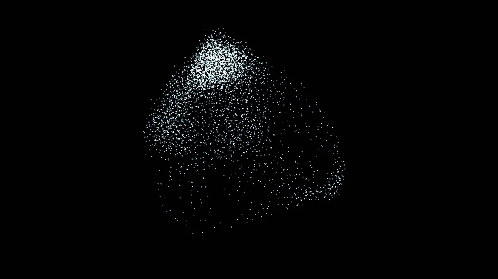
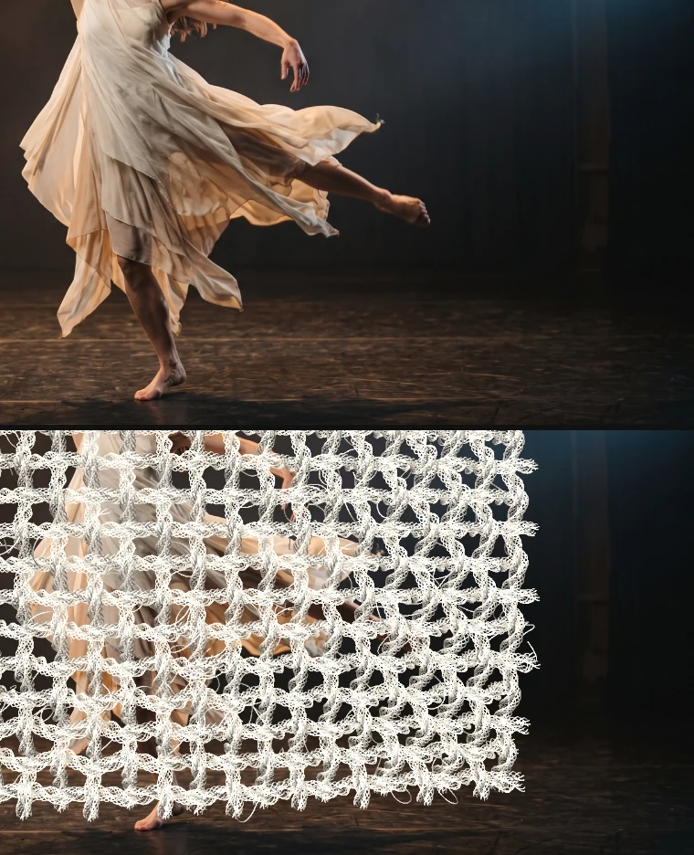
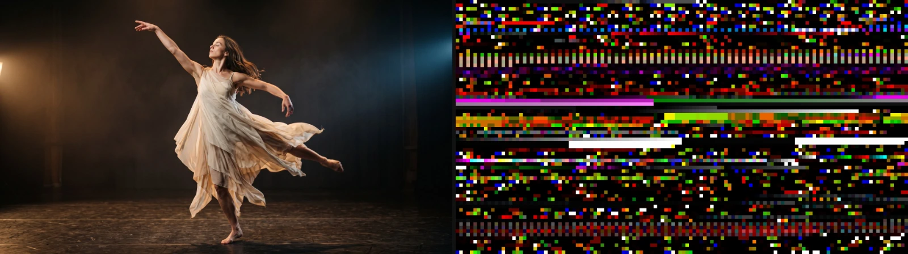
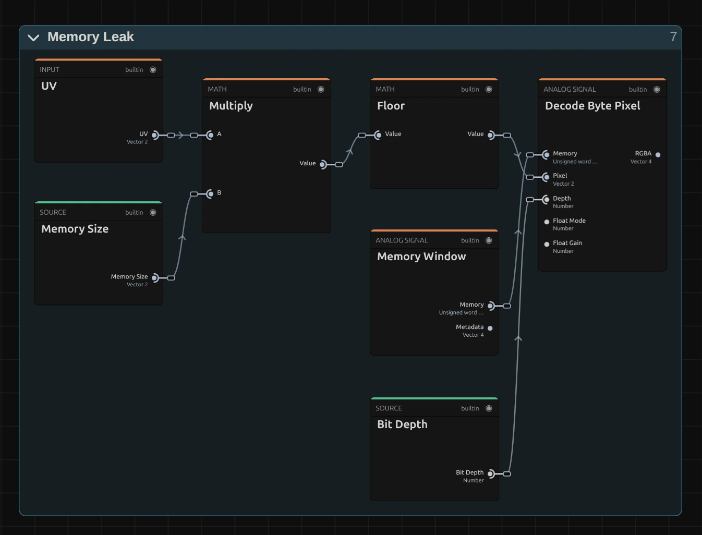
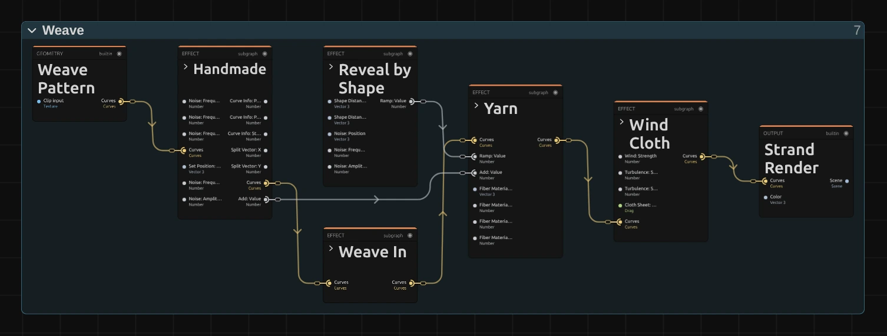

# Generate Effects

Six effects that make new pictures instead of changing the clip: a colour wheel, a
stage floor, a stick figure, a swarm, woven threads and raw computer memory.
Add one in **Properties → Effects → + Add Effect**: Color Wheel, Perspective Grid and
Stick Figure are under **Generate**, Flocking and Weave under **3D & Particles**,
Memory Leak under **Analog & Glitch**.

## The six generators

### Color Wheel
<figure class="docs-shot docs-shot--float-right">

<figcaption>Top: original. Bottom: the default Color Wheel (Disc, Radius 45 %) at Mix 0.5.</figcaption>
</figure>

Paints a hue wheel: the colours go round the centre and reach full strength at the
rim. Use it as a colour reference, a gel spot over the picture or a psychedelic background.
- **Shape** – Disc (the default) draws a round wheel with a clean edge over the clip; Fill layer colours the whole layer (or only the inside of a shape layer).
- **Radius**, **Center X** and **Center Y** – size and place of the disc, in % of the shorter side and of the layer.
- **Direction** – hues run counter-clockwise like the usual HSV wheel (red right, green at the top), or clockwise.
- **Hue Rotation** – turns the colours round, in degrees. **Spin** keeps them turning (degrees per second) and can be keyframed for a smooth speed-up.
- **Saturation**, **Brightness** and **Mix** – how strong and bright the colours are and how much of the clip shows through.

Tip: on a Blank clip, Disc gives a wheel on a transparent background.

### Perspective Grid
<figure class="docs-shot docs-shot--float-left">

<figcaption>Top: original. Bottom: Horizon 60 %, 16 Columns, Row Density 6, Line Width 10 px, Opacity 1.</figcaption>
</figure>

A glowing floor grid that runs to a vanishing point and scrolls towards the viewer:
the classic retro stage floor. Lines stay crisp at any size and melt into a soft
haze near the horizon instead of flickering.
- **Horizon** – where the floor ends, measured from the top of the picture.
- **Columns** and **Row Density** – how many lines; more rows make the floor look deeper.
- **Line Width** – thickness of the nearest lines, in pixels of a 1080p frame. **Lines** Thin with depth makes them thinner further away, like lines painted on a floor; Even width keeps every line equally thick.
- **Speed** – rows per second towards the viewer; negative values run away. Keyframe it to speed up or stop the floor smoothly.
- **Blend** – Add makes glowing lines of light; Normal paints solid lines, which can also be dark.

Tip: put Horizon on the real floor line of the shot, then lower Opacity until the
grid sits on the stage. The grid is drawn over everything in its layer; to keep a
performer in front, put the grid on a Blank clip above the shot and, on the track
above the grid, a copy of the shot masked to the performer.

### Stick Figure
<figure class="docs-shot docs-shot--float-right">

<figcaption>Top: original. Bottom: a posed figure, Facing Left, Head Ring, Scale 1.6.</figcaption>
</figure>

A posable stick figure for choreography sketches, storyboards and animated
characters. On a Blank clip only the figure shows. A new figure starts in an open
stance, arms away from the body and one foot forward.
- **Pose** – joint angles in degrees: shoulders and hips swing forward from hanging down, elbows and knees bend. The **Pose library** applies or keys whole poses.
- **Actions** – Walk, Run, Jump, Punch and more on the figure's own lane; they blend into each other.
- **Scale**, **Line Thickness**, **Head** (filled or ring) and **Color** – the look. A ring head keeps its opening however thick the lines are.
- **Ground** – Plant keeps the lowest point on the floor while the figure moves.

Tip: **Walk**, **Run** and **Idle** under Motion animate every joint in one click.

### Flocking
<figure class="docs-shot docs-shot--float-left">

<figcaption>Top: original. Bottom: preset Violet Filaments, 4 s in (editor preview, cropped to the swarm).</figcaption>
</figure>

A swarm in 3D (birds, fish, krill, sparks) that moves by itself around the clip,
with real depth. Its behaviour is a node graph you can open and change.
- **Preset** – a starting swarm, from the calm Free Swarm to large showcase scenes.
- **Population**, **Behavior**, **Guidance**, **Appearance** and **Lines** – the controls the preset exposes in the effect card.
- **Open Nodes** – the whole graph, to add forces, paths or other looks.

Tip: more in [Flock Clips](./Flock-Clips.md).

### Weave
<figure class="docs-shot docs-shot--float-right">

<figcaption>Top: original. Bottom: the default Weave at 6 s, when the cloth is finished (editor preview, cropped).</figcaption>
</figure>

Woven fabric, yarn, ropes and knots, drawn as fine lit fibres in 3D. The default
is a woven net that weaves itself in over the first seconds of the clip and then
hangs in front of it, bright white and nearly frame-filling.
- The threads are a node graph: open the clip in the **Nodes** tab to change them.
- Values exposed from that graph appear in the effect card, ready to keyframe.

Tip: more in [Weave](./Weave.md).

### Memory Leak
<figure class="docs-shot docs-shot--float-left">

<figcaption>Top: original. Bottom: Block Width 128, Offset 1 MB, Per Frame Hold block, without Feed Clip (the bytes differ from session to session).</figcaption>
</figure>

Shows bytes the editor's video decoder left in memory as pixels: real data, not
noise, for databending glitches.
- **Feed Clip** – decodes two seconds of the clip, so its frames end up in that memory.
- **Block Width** – how many memory pixels fit across; fewer gives bigger blocks.
- **Bit Depth** – how bytes become colour: 8-bit, 16-bit or 32-bit float.
- **Per Frame** – hold the block, advance through memory, or jump each frame.
- **Freeze** – stores the current block in the project, so it looks the same in every session and in the export.

Tip: lower Mix to lay the glitch over the clip.

**Known limitations:** an unfrozen Memory Leak block changes from session to session.
After adding Flocking or Weave the preview can show "Preparing 3D scene" for several
seconds before the swarm or the threads appear. The default Weave net covers most of
the picture.

**Older projects** keep their look: Perspective Grids saved before Lines existed keep
an even line width (Line Width 0 stays a hairline), Color Wheels saved before Shape
keep Fill layer with clockwise hues, and Stick Figures keep their saved pose. One
deliberate change: saved grid lines are now exact at 1080p output and scale with
other output sizes, so the preview matches the export.

## How the generate effects are built

<figure class="docs-shot docs-shot--float-right docs-shot--graph">

<svg class="docs-shot-overlay" viewBox="0 0 590 849" aria-hidden="true" focusable="false">
<defs><marker id="perspective-grid-inspector-arrow" viewBox="0 0 10 10" refX="8" refY="5" markerWidth="5" markerHeight="5" orient="auto-start-reverse"><path d="M 0 0 L 10 5 L 0 10 Z" fill="#ffd54a" /></marker></defs>
<path class="docs-shot-arrow" d="M58 186 L142 186" marker-end="url(#perspective-grid-inspector-arrow)" />
<circle class="docs-shot-number" cx="58" cy="186" r="18" /><text x="58" y="186" class="docs-shot-number-text">1</text>
<path class="docs-shot-arrow" d="M34 313 L118 313" marker-end="url(#perspective-grid-inspector-arrow)" />
<circle class="docs-shot-number" cx="34" cy="313" r="18" /><text x="34" y="313" class="docs-shot-number-text">2</text>
<path class="docs-shot-arrow" d="M79 355 L163 355" marker-end="url(#perspective-grid-inspector-arrow)" />
<circle class="docs-shot-number" cx="79" cy="355" r="18" /><text x="79" y="355" class="docs-shot-number-text">3</text>
<path class="docs-shot-arrow" d="M76 782 L160 782" marker-end="url(#perspective-grid-inspector-arrow)" />
<circle class="docs-shot-number" cx="76" cy="782" r="18" /><text x="76" y="782" class="docs-shot-number-text">4</text>
</svg>

<figcaption>The Perspective Grid card. 1 — Horizon: where the floor ends. 2 — Line Width of the nearest lines. 3 — Lines: thin with depth, or an even width. 4 — Blend: glowing (Add) or solid (Normal) lines.</figcaption>
</figure>

Every generator is driven from its card in **Properties → Effects**: sliders with
units (%, px, °), a ◇ to set keyframes and ↺ to reset. Values a generator cannot
draw, such as a Stick Figure scaled to 0 or standing outside the picture, are named
in the card instead of failing silently, in the same units as the rows.

**Three ways to build a picture:**

- **One fixed drawing:** Color Wheel, Perspective Grid and Stick Figure each draw
  their picture in a single built-in step. Everything you can change is in the card;
  there is no graph to open.
- **An image graph:** Memory Leak is a small node graph that turns bytes into
  pixels. You can open and rewire it like the effects on the other pages.
- **A 3D scene:** Weave and Flocking build threads or a swarm in the editor's 3D
  scene, above the clip. Their graphs work on curves and particles, not on pixels.

To open a graph, go to the **Nodes** tab and pick the clip in its source list; the
effect is a folded card, and the › left of its title opens it.
[Node Workspace](./Node-Workspace.md) shows how to add and connect nodes.

### Memory Leak: reading memory as pixels

<figure class="docs-shot docs-shot--graph">

<svg class="docs-shot-overlay" viewBox="0 0 1017 558" aria-hidden="true" focusable="false">
<defs><marker id="memory-leak-read-arrow" viewBox="0 0 10 10" refX="8" refY="5" markerWidth="5" markerHeight="5" orient="auto-start-reverse"><path d="M 0 0 L 10 5 L 0 10 Z" fill="#ffd54a" /></marker></defs>
<path class="docs-shot-arrow" d="M386 420 L386 336" marker-end="url(#memory-leak-read-arrow)" />
<circle class="docs-shot-number" cx="386" cy="420" r="18" /><text x="386" y="420" class="docs-shot-number-text">1</text>
<path class="docs-shot-arrow" d="M873 476 L873 392" marker-end="url(#memory-leak-read-arrow)" />
<circle class="docs-shot-number" cx="873" cy="476" r="18" /><text x="873" y="476" class="docs-shot-number-text">2</text>
</svg>

<figcaption>Where each pixel reads memory. 1 — Multiply scales the picture to the block of memory. 2 — Decode Byte Pixel turns the bytes into a colour. Green cards come from elsewhere in the graph; the inputs below Pixel are fed from the Bit Depth and Float Gain settings and left out here.</figcaption>
</figure>

**Memory Window** holds the block of memory that Block Width, Offset and Per Frame
choose. **Multiply** (1) stretches the picture's **UV** (0–1 across and down) to the
size of that block in memory pixels, **Floor** snaps it to whole memory pixels, and
**Decode Byte Pixel** (2) reads the bytes there as a colour, as the Bit Depth says.
After that a **Mix** lays the result over the clip.

Remix: for vertical stripes, put a **Split Vector** on **UV**, build a new UV with a
2-part **Combine Vector** (X from the split, Y from a **Value** of 0) and plug it into
input A of **Multiply** (1). Every row then shows the first row of memory, so the
picture becomes vertical stripes.

### Weave: a chain of thread groups

<figure class="docs-shot docs-shot--graph">

<figcaption>The default Weave graph as it opens in the Nodes tab (the Output card left out). Yellow cables carry the threads.</figcaption>
</figure>

**Weave Pattern** lays out the threads of a plain weave as curves. Each folded
group then changes those curves: **Handmade** makes them uneven, **Weave In** pulls
them in over the first seconds, **Yarn** twists fibres around them (**Reveal by
Shape** sets how thick), and **Wind Cloth** puts them on a sheet in the wind.
**Strand Render** draws the result as lit fibres.

Remix: switch a group off with **Byp**. The picture shows the groups folded; open one
with the › left of its title, and **Byp** sits near the right end of its title bar,
next to Focus (the group's section in the effect card has the same switch). Without
**Weave In** you see the finished cloth from the first frame, without **Wind Cloth** a
flat sheet, without **Yarn** the bare threads. More recipes, knots and ropes are in [Weave](./Weave.md); the swarm
graph of Flocking is described in [Flock Clips](./Flock-Clips.md#graph-model).

## Technical details

Notes for developers. Registry, uniforms and the byte-texture binding are in
[Effects](./Effects.md#registry-and-ui), nodes in [Node Catalog](./Node-Catalog.md),
graph compilation in [Operator Graph Compiler](./Operator-Graph-Compiler.md).
Shared helpers for finite reads and choice warnings live in
`src/effects/generate/generatorParams.ts`.

- **Robust values.** Every number is read as a finite value (NaN and infinities fall
  back to the default). Values outside a parameter's rendered range
  (`renderMin`/`renderMax`) are named in the inspector, in the units of its row, and in
  `addEffect`/`updateEffect` tool results, in stored units. `paramWarnings` name
  unknown choices (Shape, Direction, Lines, Blend, Head, Facing, Ground, Bit Depth, Per
  Frame) and settings that draw nothing.
- **Shader maths under test.** `tests/unit/generateShaderMath.test.ts` runs the scalar
  WGSL helpers of Perspective Grid and Color Wheel on the CPU, translated from the
  shader source, and checks them against independent references: line area per cell,
  full coverage for lines a cell wide, disc area, premultiplied "over" and hue direction.
- **Perspective Grid.** Horizon is a share of the height (0–0.98, shown in %). Line
  Width is stored as the half width in pixels of a 1080-px-tall frame (shown as the
  full width) and scales with the output height, so preview and export match. Lines
  `floor` keeps that width on the floor (exact at the front edge, thinner with depth);
  `screen` keeps the old even width: a core of 2 × Line Width plus a one-pixel soft rim.
  Lines are filtered analytically: thinner than a pixel they keep their share of
  brightness, a line one cell wide or wider covers its cell, and dense lines become a
  haze that fades at least linearly towards the horizon, with a 1.5-px soft edge there.
  Rendered limits: Columns 2000, Row Density 1000, Line Width 1000, Horizon Fade 100.
  The composite is premultiplied, so lines over transparency keep their full colour.
- **Keyframed rates.** Speed (Perspective Grid) and Spin (Color Wheel) declare
  `integratedAs`: while they have keyframes, `getInterpolatedEffects` adds the distance
  travelled since the clip start (`speedTravel`, `spinTravel`; trapezoidal integration
  shared with clip speed in `src/utils/speedIntegration.ts`), and the packer uses it
  instead of rate × time. Without keyframes the rate runs from the timeline time. The
  scroll and hue offset are wrapped on the CPU in double precision, so long timelines
  do not jitter.
- **Color Wheel.** Hue Rotation and Spin are stored in turns (1 = 360°) and shown in °
  and °/s. Radius is a share of the shorter side (0.45 for new wheels; full colour at the
  rim with Saturation 1), Center X/Y a share of the layer. Disc has a 1-px anti-aliased
  edge at any resolution and composites as straight-alpha "over". Direction `ccw` flips
  screen y, so hues run counter-clockwise; `cw` is the old direction.
- **Stick Figure.** Joints are solved on the CPU (pose, actions, ground) and drawn
  as lines. Positions and lengths are kept within ±100 000 figure pixels
  (`SKELETON_COORDINATE_LIMIT`, for every rig user), lengths after Scale too (named
  when Scale pushes one past it); angles are free. The ring head's stroke is the limb
  thickness, at most a quarter of the head radius on each side of its centre line
  (`stickFigureRing`). Scale ≤ 0 and a figure entirely outside its layer are reported,
  judged at the composition size from the saved pose (not from where an action walks
  it); `createRig` returns the same warnings. New figures start from
  `STICK_FIGURE_NEW_POSE`; the rig's rest pose is unchanged. Joints are keyframeable
  and node-drivable, see [Node Workspace](./Node-Workspace.md#stick-figures-and-rig-nodes).
- **Memory Leak.** Block Width 8–1024, Float Gain at least 0.001; unknown Bit Depth or
  Per Frame fall back to 8-bit and Hold and say so. Without a fed heap most of memory
  is grey noise with a few structured regions (Offset picks them). Mix blends straight
  colours, so Mix below 1 over transparency gets darker. Details in
  [Memory Leak](./Memory-Leak.md).
- **Flocking and Weave** render into the shared 3D scene; their own 2D pass is a
  passthrough. After adding, the preview can show "Preparing 3D scene" for several
  seconds; compiling the swarm's simulation shader alone takes about 0.3 s.
- **Saved projects.** Choices and numbers an old instance lacks render at their
  `legacyDefault`: Shape Fill layer, Direction clockwise, Radius 0.5, Lines Even width,
  the Stick Figure rest pose. Blend Add and Head Filled are also the defaults. New
  defaults apply only to new instances (Grid Opacity 0.8, Line Width 3 px and Lines
  Thin with depth; Wheel Disc, Radius 45 % and Saturation 1; the open Stick Figure
  stance). Saved grids now scale their line width with the output height (exact at
  1080p).
- **Pictures on this page.** `scripts/effect-lab.mjs --pairs`,
  `scripts/effect-graph-shot.mjs` and `scripts/effect-editor-shot.mjs`, each with a
  `generate.json` manifest (`scripts/effect-*-shots/`). Flocking and Weave stills
  are editor-preview screenshots, cropped and stacked like the lab pairs.
