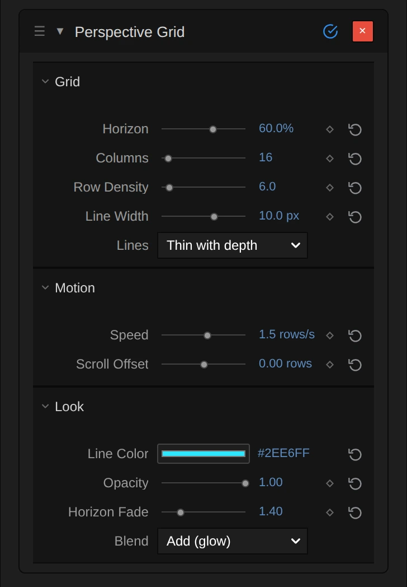

# Generate Effects

Six effects that make new pictures instead of changing the clip: a colour wheel, a
stage floor, a stick figure, a swarm, woven threads and raw computer memory.
Add one in **Properties → Effects → + Add Effect**: Color Wheel, Perspective Grid and
Stick Figure are under **Generate**, Flocking and Weave under **3D & Particles**,
Memory Leak under **Analog & Glitch**.

## The six generators

### Color Wheel
<figure class="docs-shot docs-shot--float-right">

<figcaption>Left: original. Right: Shape Disc, Mix 0.5.</figcaption>
</figure>

Paints a hue wheel: the colours go round the centre and grow stronger towards the
edge. Use it as a colour reference, a gel over the picture or a psychedelic background.
- **Shape** – Fill layer colours the whole layer (or only the inside of a shape layer); Disc draws a round wheel with a clean edge over the clip.
- **Hue Rotation** – turns the colours round, in degrees. **Spin** keeps them turning (degrees per second).
- **Saturation** and **Brightness** – how strong and how bright the colours are.
- **Mix** – how much of the clip shows through.

Tip: on a Blank clip, Disc gives a wheel on a transparent background.

### Perspective Grid
<figure class="docs-shot docs-shot--float-left">

<figcaption>Left half: original. Right half: Horizon 70 %, 16 columns, Row Density 4, Line Width 6 px, Opacity 1.</figcaption>
</figure>

A glowing floor grid that runs to a vanishing point and scrolls towards the viewer:
the classic retro stage floor. Lines stay crisp at any size and melt into an even
haze near the horizon instead of flickering.
- **Horizon** – where the floor ends, measured from the top of the picture.
- **Columns** and **Row Density** – how many lines; more rows make the floor look deeper.
- **Line Width** – thickness of the nearest lines, in pixels of a 1080p frame. Further away they get thinner, like lines painted on a floor.
- **Speed** – rows per second towards the viewer; negative values run away.
- **Blend** – Add makes glowing lines of light; Normal paints solid lines, which can also be dark.

Tip: put Horizon on the real floor line of the shot, then lower Opacity until the
grid sits on the stage.

### Stick Figure
<figure class="docs-shot docs-shot--float-right">

<figcaption>Left: original. Right: a posed figure, Facing Left, Head Ring, Scale 1.6.</figcaption>
</figure>

A posable stick figure for choreography sketches, storyboards and animated
characters. On a Blank clip only the figure shows.
- **Pose** – joint angles in degrees: shoulders and hips swing forward from hanging down, elbows and knees bend. The **Pose library** applies or keys whole poses.
- **Actions** – Walk, Run, Jump, Punch and more on the figure's own lane; they blend into each other.
- **Scale**, **Line Thickness**, **Head** (filled or ring) and **Color** – the look.
- **Ground** – Plant keeps the lowest point on the floor while the figure moves.

Tip: **Walk**, **Run** and **Idle** under Motion animate every joint in one click.

### Flocking
<figure class="docs-shot docs-shot--float-left">

<figcaption>Left: original. Right: preset Violet Filaments, 4 s in (editor preview).</figcaption>
</figure>

A swarm in 3D (birds, fish, krill, sparks) that moves by itself around the clip,
with real depth. Its behaviour is a node graph you can open and change.
- **Preset** – a starting swarm, from the calm Free Swarm to large showcase scenes.
- **Population**, **Behavior**, **Guidance**, **Appearance** and **Lines** – the controls the preset exposes in the effect card.
- **Open Nodes** – the whole graph, to add forces, paths or other looks.

Tip: more in [Flock Clips](./Flock-Clips.md).

### Weave
<figure class="docs-shot docs-shot--float-right">

<figcaption>Left: original. Right: the default Weave, 2.2 s in (editor preview).</figcaption>
</figure>

Woven fabric, yarn, ropes and knots, drawn as fine lit fibres in 3D. The default
is a knitted net that weaves itself in over the first seconds of the clip.
- The threads are a node graph: open the clip in the **Nodes** tab to change them.
- Values exposed from that graph appear in the effect card, ready to keyframe.

Tip: more in [Weave](./Weave.md).

### Memory Leak
<figure class="docs-shot docs-shot--float-left">

<figcaption>Left: original. Right: Block Width 128, Offset 1 MB, Per Frame Hold block (the bytes differ from session to session).</figcaption>
</figure>

Shows bytes the editor's video decoder left in memory as pixels: real data, not
noise, for databending glitches.
- **Feed Clip** – decodes two seconds of the clip, so its frames end up in that memory.
- **Block Width** – how many memory pixels fit across; fewer gives bigger blocks.
- **Bit Depth** – how bytes become colour: 8-bit, 16-bit or 32-bit float.
- **Per Frame** – hold the block, advance through memory, or jump each frame.
- **Freeze** – stores the current block in the project, so it looks the same in every session and in the export.

Tip: lower Mix to lay the glitch over the clip.

**Known limitations:** an unfrozen Memory Leak block changes from session to session;
Flocking and Weave need a moment to prepare their 3D scene before the preview shows them.

**Older projects:** Perspective Grid lines now keep their width on the floor and scale
with the picture size, so saved grids look the same along the front edge of a 1080p
frame and thinner towards the horizon. The other effects keep their look.

## How the generate effects are built

<figure class="docs-shot">

<svg class="docs-shot-overlay" viewBox="0 0 1017 929" aria-hidden="true" focusable="false">
<defs><marker id="perspective-grid-inspector-arrow" viewBox="0 0 10 10" refX="8" refY="5" markerWidth="5" markerHeight="5" orient="auto-start-reverse"><path d="M 0 0 L 10 5 L 0 10 Z" fill="#ffd54a" /></marker></defs>
<path class="docs-shot-arrow" d="M522 360 L606 360" marker-end="url(#perspective-grid-inspector-arrow)" />
<circle class="docs-shot-number" cx="522" cy="360" r="18" /><text x="522" y="360" class="docs-shot-number-text">1</text>
<path class="docs-shot-arrow" d="M499 475 L583 475" marker-end="url(#perspective-grid-inspector-arrow)" />
<circle class="docs-shot-number" cx="499" cy="475" r="18" /><text x="499" y="475" class="docs-shot-number-text">2</text>
<path class="docs-shot-arrow" d="M537 868 L621 868" marker-end="url(#perspective-grid-inspector-arrow)" />
<circle class="docs-shot-number" cx="537" cy="868" r="18" /><text x="537" y="868" class="docs-shot-number-text">3</text>
</svg>

<figcaption>Perspective Grid in the editor. 1 — Horizon: where the floor ends. 2 — Line Width of the nearest lines. 3 — Blend: glowing (Add) or solid (Normal) lines.</figcaption>
</figure>

Every generator is driven from its card in **Properties → Effects**: sliders with
units (%, px, °), a ◇ to set keyframes and ↺ to reset. Values a generator cannot
draw, such as a Stick Figure scaled to 0 or standing outside the picture, are named
in the card instead of failing silently.

### Three ways to build a picture

- **One fixed drawing:** Color Wheel, Perspective Grid and Stick Figure each draw
  their picture in a single built-in step. Everything you can change is in the card;
  there is no graph to open.
- **An image graph:** Memory Leak is a small node graph that turns bytes into
  pixels. You can open and rewire it like the effects on the other pages.
- **A 3D scene:** Weave and Flocking build threads or a swarm in the editor's 3D
  scene, above the clip. Their graphs work on curves and particles, not on pixels.

To open a graph, go to the **Nodes** tab and pick the clip in its source list; the
effect is a folded card, and the › left of its title opens it.
[Node Workspace](./Node-Workspace.md) shows how to add and connect nodes.

### Memory Leak: reading memory as pixels

<figure class="docs-shot docs-shot--graph">

<svg class="docs-shot-overlay" viewBox="0 0 1017 775" aria-hidden="true" focusable="false">
<defs><marker id="memory-leak-read-arrow" viewBox="0 0 10 10" refX="8" refY="5" markerWidth="5" markerHeight="5" orient="auto-start-reverse"><path d="M 0 0 L 10 5 L 0 10 Z" fill="#ffd54a" /></marker></defs>
<path class="docs-shot-arrow" d="M386 23 L386 107" marker-end="url(#memory-leak-read-arrow)" />
<circle class="docs-shot-number" cx="386" cy="23" r="18" /><text x="386" y="23" class="docs-shot-number-text">1</text>
<path class="docs-shot-arrow" d="M873 23 L873 107" marker-end="url(#memory-leak-read-arrow)" />
<circle class="docs-shot-number" cx="873" cy="23" r="18" /><text x="873" y="23" class="docs-shot-number-text">2</text>
</svg>

<figcaption>Where each pixel reads memory. 1 — Multiply scales the picture to the block of memory. 2 — Decode Byte Pixel turns the bytes into a colour. Green cards come from elsewhere in the graph.</figcaption>
</figure>

**Memory Window** holds the block of memory that Block Width, Offset and Per Frame
choose. **Multiply** (1) stretches the picture's **UV** (0–1 across and down) to the
size of that block in memory pixels, **Floor** snaps it to whole memory pixels, and
**Decode Byte Pixel** (2) reads the bytes there as a colour, as the Bit Depth says.
After that a **Mix** lays the result over the clip.

Remix: for vertical stripes, put a **Split Vector** on **UV**, build a new UV with a
2-part **Combine Vector** (X from the split, Y from a **Value** of 0) and plug it into
input A of **Multiply** (1). Every column then repeats the first row of memory.

### Weave: a chain of thread groups

<figure class="docs-shot docs-shot--graph">

<figcaption>The default Weave graph as it opens in the Nodes tab (the Output card left out). Yellow cables carry the threads.</figcaption>
</figure>

**Weave Pattern** lays out the threads of a plain weave as curves. Each folded
group then changes those curves: **Handmade** makes them uneven, **Weave In** pulls
them in over the first seconds, **Yarn** twists fibres around them (**Reveal by
Shape** sets how thick), and **Wind Cloth** puts them on a sheet in the wind.
**Strand Render** draws the result as lit fibres.

Remix: switch a group off with **Byp** in its title bar once it is open (or in its
section of the effect card): without **Weave In** you see the finished cloth from the
first frame, without **Wind Cloth** a flat sheet, without **Yarn** the bare threads. More recipes, knots and ropes are in [Weave](./Weave.md); the swarm
graph of Flocking is described in [Flock Clips](./Flock-Clips.md#graph-model).

## Technical details

Notes for developers. Registry, uniforms and the byte-texture binding are in
[Effects](./Effects.md#registry-and-ui), nodes in [Node Catalog](./Node-Catalog.md),
graph compilation in [Operator Graph Compiler](./Operator-Graph-Compiler.md).
Shared helpers for finite reads and choice warnings live in
`src/effects/generate/generatorParams.ts`.

- **Robust values.** Every number is read as a finite value and clamped to what the
  shader can draw; `renderMin`/`renderMax` notes and `paramWarnings` (unknown
  Shape, Blend, Head, Facing, Ground, Bit Depth or Per Frame) appear in the inspector
  and in `addEffect`/`updateEffect` tool results.
- **Perspective Grid.** Horizon is a share of the height (0–0.98, shown in %). Line
  Width is stored as the half width in pixels of a 1080-px-tall frame (shown as the
  full width) and scales with the output height, so preview and export match. Lines
  are filtered analytically: thinner than a pixel they keep their share of
  brightness and dense rows become an even haze instead of moiré. The composite is
  premultiplied, so lines over transparency keep their full colour. Scroll is
  wrapped to one row on the CPU in double precision, so long timelines do not jitter.
- **Color Wheel.** Hue Rotation and Spin are stored in turns (1 = 360°) and shown in °
  and °/s; the hue offset is wrapped on the CPU. Disc has a 1-px anti-aliased edge at
  any resolution. On screen the hue runs clockwise.
- **Stick Figure.** Joints are solved on the CPU (pose, actions, ground) and drawn
  as lines. Positions and lengths are kept within ±100 000 figure pixels
  (`SKELETON_COORDINATE_LIMIT`, for every rig user); angles are free. Scale ≤ 0 and
  a figure entirely outside its layer are reported (judged from the saved values,
  not from where an action walks it); `createRig` returns the same warnings. Joints
  are keyframeable and node-drivable, see
  [Node Workspace](./Node-Workspace.md#stick-figures-and-rig-nodes).
- **Memory Leak.** Block Width 8–1024, Float Gain at least 0.001; unknown Bit Depth or
  Per Frame fall back to 8-bit and Hold and say so. Without a fed heap the block is
  grey noise. Mix blends straight colours, so Mix below 1 over transparency gets
  darker. Details in [Memory Leak](./Memory-Leak.md).
- **Flocking and Weave** render into the shared 3D scene; their own 2D pass is a
  passthrough. Building the swarm's simulation shader takes about 0.3 s, so the
  preview shows "Preparing 3D scene" for a moment after adding.
- **Saved projects.** Effects without the new parameters keep their look: Shape
  Fill layer, Head Filled, Blend Add. New defaults apply only to new instances
  (Grid Opacity 0.8 and Line Width 3 px, Wheel Saturation 1). Perspective Grid
  lines follow the new width rule, see *Older projects* above.
- **Pictures on this page.** `scripts/effect-lab.mjs --pairs`,
  `scripts/effect-graph-shot.mjs` and `scripts/effect-editor-shot.mjs`, each with a
  `generate.json` manifest (`scripts/effect-*-shots/`). Flocking and Weave stills
  are editor-preview screenshots.

