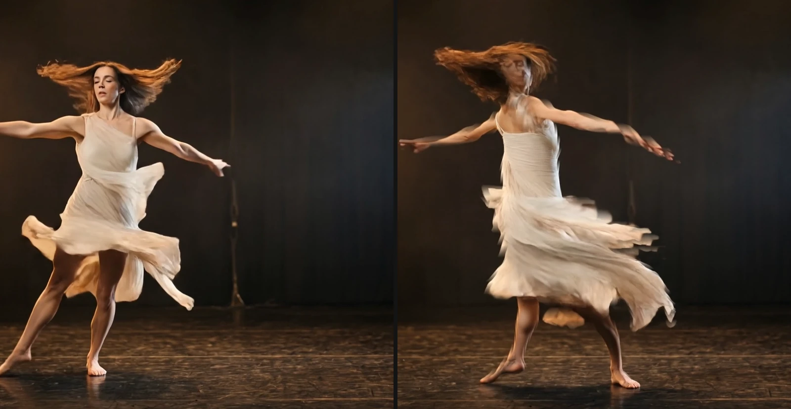

# Keying and Time Effects

Take a performer off a green or blue screen, or let time itself become the picture:
echoes of a movement, or every part of the frame from a different moment.
Add one in **Properties → Effects → + Add Effect** (Chroma Key under **Keying**,
Time Stack and Slit Scan under **Time**).

## The three keying and time effects

### Chroma Key
<figure class="docs-shot docs-shot--float-right">

<figcaption>Left: green-screen shot. Right: Chroma Key, default settings, over dark blue.</figcaption>
</figure>

Makes a green or blue screen transparent, so the performer can stand in front of
any background. It finds the screen colour in the picture by itself, and hair,
fine fabric and edges take on the new background instead of a green rim.
- **Screen** – Green screen, Blue screen, or a colour you pick from the screen.
- **Clip Black / Clip White** – raise Clip Black until the background is completely gone, lower Clip White until the performer is solid. **View → Matte** shows this in black and white.
- **Shrink / Grow** and **Edge Softness** – pull the edge in or out and soften it, in pixels of a 1080p picture.
- **Spill Suppression** – removes the green glow on skin and costume; **Gentle** keeps yellow costumes yellow.

Tip: curtains, stands and lights outside the screen stay in the picture; cut them
away with a mask around the performer.

### Time Stack
<figure class="docs-shot docs-shot--float-left">

<figcaption>Left: original. Right: Lighten, Decay 0.8.</figcaption>
</figure>

Shows several delayed copies of a moving clip at once, like a long-exposure photo
of a dance. Works on video clips.
- **Instances** – how many copies, up to 32.
- **Time offset** – the time between two copies. 20 copies 0.1 s apart cover almost two seconds of movement.
- **Decay** – lower it (around 0.8) and older copies fade out like an echo; at 1 all copies are equally strong.
- **Blend mode** – Lighten (the default) for a lit performer on a dark stage, Darken for a dark figure on a light background.

Tip: the trail builds up at the start of the clip, as each copy's moment is reached.

### Slit Scan
<figure class="docs-shot docs-shot--float-right">

<figcaption>Left: original. Right: the Falling time look; the lower in the picture, the further back in time.</figcaption>
</figure>

Shows each part of the frame from a different moment, so movement smears and
folds through the picture: the classic slit-scan look. Works on video clips.
- **Look** – a starting point: Sweep, Falling time, Out from the center, Wave folds, Radial bloom, Time rings or Time steps.
- **Delay** – how far back in time the picture reaches, in seconds (1 by default).
- **Profile** and **Scan direction** – the shape of the time gradient: which part of the frame shows now and which the past.

Tip: give a new Slit Scan a moment to load its frames; until the whole time window
is ready, the preview shows the plain clip.

**Known limitations:** Chroma Key measures one screen colour for the whole frame, so
on a very unevenly lit screen see-through areas such as chiffon can come out a little
too light or too dark; Time Stack and Slit Scan need a video clip, not a still image or
a nested composition.

**Saved projects:** a Chroma Key from an older project switches to the new keyer at its
default settings (a Chroma Key whose nodes you edited keeps the old key and says so in
the inspector); Time Stack and Slit Scan keep their look.

<!-- docs agent: middle and technical levels go here -->
