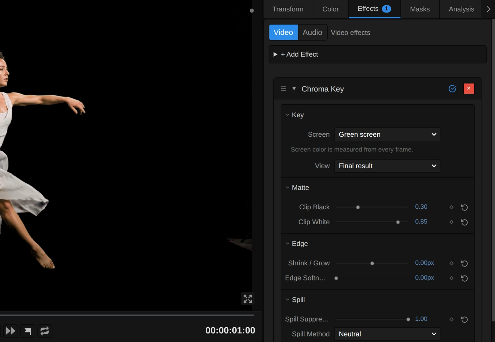

# Keying and Time Effects

Take a performer off a green or blue screen, or let time itself become the picture:
echoes of a movement, or every part of the frame from a different moment.
Add one in **Properties → Effects → + Add Effect** (Chroma Key under **Keying**,
Time Stack and Slit Scan under **Time**).

## The three keying and time effects

### Chroma Key
<figure class="docs-shot docs-shot--float-right">

<figcaption>Left: green-screen shot. Right: Chroma Key, default settings, over dark blue.</figcaption>
</figure>

Makes a green or blue screen transparent, so the performer can stand in front of
any background. It finds the screen colour in the picture by itself, and hair,
fine fabric and edges take on the new background instead of a green rim.
- **Screen** – Green screen, Blue screen, or a colour you pick from the screen.
- **Clip Black / Clip White** – raise Clip Black until the background is completely gone, lower Clip White until the performer is solid. **View → Matte** shows this in black and white.
- **Shrink / Grow** and **Edge Softness** – pull the edge in or out and soften it, in pixels of a 1080p picture.
- **Spill Suppression** – removes the green glow on skin and costume; **Gentle** keeps yellow costumes yellow.

Tip: curtains, stands and lights outside the screen stay in the picture; cut them
away with a mask around the performer.

### Time Stack
<figure class="docs-shot docs-shot--float-left">

<figcaption>Left: original. Right: Lighten, Decay 0.8.</figcaption>
</figure>

Shows several delayed copies of a moving clip at once, like a long-exposure photo
of a dance. Works on video clips.
- **Instances** – how many copies, up to 32.
- **Time offset** – the time between two copies. 20 copies 0.1 s apart cover almost two seconds of movement.
- **Decay** – lower it (around 0.8) and older copies fade out like an echo; at 1 all copies are equally strong.
- **Blend mode** – Lighten (the default) for a lit performer on a dark stage, Darken for a dark figure on a light background.

Tip: the trail builds up at the start of the clip, as each copy's moment is reached.

### Slit Scan
<figure class="docs-shot docs-shot--float-right">

<figcaption>Left: original. Right: the Falling time look; the lower in the picture, the further back in time.</figcaption>
</figure>

Shows each part of the frame from a different moment, so movement smears and
folds through the picture: the classic slit-scan look. Works on video clips.
- **Look** – a starting point: Sweep, Falling time, Out from the center, Wave folds, Radial bloom, Time rings or Time steps.
- **Delay** – how far back in time the picture reaches, in seconds (1 by default).
- **Profile** and **Scan direction** – the shape of the time gradient: which part of the frame shows now and which the past.

Tip: give a new Slit Scan a moment to load its frames; until the whole time window
is ready, the preview shows the plain clip.

**Known limitations:** Chroma Key measures one screen colour for the whole frame, so
on a very unevenly lit screen see-through areas such as chiffon can come out a little
too light or too dark; Time Stack and Slit Scan need a video clip, not a still image or
a nested composition.

**Saved projects:** a Chroma Key from an older project switches to the new keyer at its
default settings (a Chroma Key whose nodes you edited keeps the old key and says so in
the inspector); Time Stack and Slit Scan keep their look.

## How the keying and time effects are built

<figure class="docs-shot">

<svg class="docs-shot-overlay" viewBox="0 0 1017 704" aria-hidden="true" focusable="false">
<defs><marker id="chroma-key-inspector-arrow" viewBox="0 0 10 10" refX="8" refY="5" markerWidth="5" markerHeight="5" orient="auto-start-reverse"><path d="M 0 0 L 10 5 L 0 10 Z" fill="#ffd54a" /></marker></defs>
<path class="docs-shot-arrow" d="M542 276 L626 276" marker-end="url(#chroma-key-inspector-arrow)" />
<circle class="docs-shot-number" cx="542" cy="276" r="18" /><text x="542" y="276" class="docs-shot-number-text">1</text>
<path class="docs-shot-arrow" d="M557 341 L641 341" marker-end="url(#chroma-key-inspector-arrow)" />
<circle class="docs-shot-number" cx="557" cy="341" r="18" /><text x="557" y="341" class="docs-shot-number-text">2</text>
<path class="docs-shot-arrow" d="M524 426 L608 426" marker-end="url(#chroma-key-inspector-arrow)" />
<circle class="docs-shot-number" cx="524" cy="426" r="18" /><text x="524" y="426" class="docs-shot-number-text">3</text>
</svg>

<figcaption>1 — Screen: green, blue or a colour you pick. 2 — View: Final result or Matte. 3 — Clip Black and Clip White set the matte.</figcaption>
</figure>

All controls sit in the effect's card under **Properties → Effects**. For a key,
switch **View** (2) to **Matte**: the screen should be black and the performer
white. Raise **Clip Black** (3) until grey specks in the background are gone,
lower **Clip White** until the body is solid, then switch back to **Final result**.

Each of the three effects is also a node graph you can open and change: open the
**Nodes** tab, pick the clip in its source list and click the › left of the
effect's title ([as for the blurs](./Effects-Blur.md#how-the-blur-effects-are-built)).
Changes apply to this one effect. In the pictures below, green cards come from
elsewhere in the graph and are named for the picture.

### Chroma Key: find the screen, then take it out

The key runs in stages, each a folder in the graph. **Screen Grid** and **Screen
Color** find the screen colour by averaging the parts of the frame that look like
screen. **Screen Matte & Clip** compares every pixel with that colour and applies
Clip Black and Clip White. **Shrink / Grow** and **Edge Softness** shape the edge,
**Screen Subtraction** takes the screen's share out of see-through pixels (hair,
chiffon), and **Spill Suppression** removes the green glow.

<figure class="docs-shot docs-shot--graph">

<figcaption>Spill Suppression for a green screen, reduced to its recipe (a blue screen swaps the channels).</figcaption>
</figure>

Green may be no stronger than the other two channels allow. **Step** turns Spill
Method into 0 (Neutral) or 1 (Gentle), and **Mix** picks the limit: the average of
red and blue, or the stronger of the two. **Subtract** and **Maximum** keep the
green above that limit, **Multiply** scales it by Strength (Spill Suppression), and
the last **Subtract** takes it out of the colour.

Remix: for a limit halfway between Neutral and Gentle, unplug **Step** from input T
of **Mix** and plug a **Value** of 0.5 into T.

### Time Stack and Slit Scan: reading the past

Both time effects are built around one node, **Sample Past Frame**: it reads the
clip at the same spot a number of seconds earlier (its **Delay** input). They
differ only in how they choose that delay: Time Stack gives every copy its own,
Slit Scan every pixel.

### Time Stack: one delay per copy

<figure class="docs-shot docs-shot--graph">

<figcaption>Time Stack (UV, the clip, Instances and Blend mode left out). Decay arrives clamped to 0.0001–1.</figcaption>
</figure>

**Sequence Index** counts the copies (0, 1, 2 …). **Multiply** turns the index into
a delay (index × Time offset), so copy 3 shows the clip 0.3 s ago. **Power** gives
each copy its strength (Decay to the power of the index), and **Sequence Blend**
layers all copies with the Blend mode.

Remix: for a trail that fades evenly and ends at nothing, add a **Subtract**
(A = a **Value** of 1, B = **Progress** of Sequence Index) and plug it into
**Opacity** of Sequence Blend instead of Power.

### Slit Scan: one delay per pixel

<figure class="docs-shot docs-shot--graph">

<figcaption>The heart of Slit Scan, in its Time Sampling & Mix folder (UV, the clip and the motion field left out).</figcaption>
</figure>

The **Time map** gives every pixel a number from 0 (now) to 1 (the full Delay); the
Look, Profile and Scan direction shape it in the folders before. The first
**Multiply** sets protected areas back to now (**Protection mask**), the second turns
the map into seconds, and **Sample Past Frame** reads each pixel at its own moment.
**Preview → Time map** in the inspector shows the map itself.

Remix: for time that speeds up towards the far end of the scan, add a **Multiply**
with both inputs from **Time map** and plug it into input A of the first Multiply
instead of Time map.

## Technical details

Notes for developers. Effect details live in [Effects](./Effects.md#editable-keying-and-feedback-graphs),
[Slit Scan](./Effects.md#slit-scan), [Time Stack](./Time-Stack.md) and
[Slit Scan 3D](./Slit-Scan-3D.md); nodes in [Node Catalog](./Node-Catalog.md),
compilation in [Operator Graph Compiler](./Operator-Graph-Compiler.md).

- **Chroma Key passes.** A 64 px Screen Grid (each cell averages 5 × 5 reads,
  weighted by how screen-like they are), a 1 px Screen Color (the mean of 33 × 33
  grid reads) and the key pass. Both caches are **Cache Image** nodes with
  **Max size** 64 and 1. Picked colours skip the measurement.
- **Chroma Key units.** Clip Black/White are matte levels from 0 to 1 (default 0.30
  and 0.85). Shrink / Grow (−20 to 20) and Edge Softness (0 to 20) are pixels of a
  1080p frame (its shorter side) and scale with the render size; each adds two
  separable Gaussian passes (up to 32 taps per side) only while it is not 0.
- **Chroma Key limits.** One screen colour per frame; local Screen Grid colours are
  used only for screen subtraction. Out-of-range or invalid values are used at
  their limit and the inspector names them. The worker software preview keys on
  the CPU with the same grid and subtraction; it has no edge kernel, so it declines
  a key with Shrink / Grow or Edge Softness instead of dropping them.
- **Time Stack.** Up to 32 instances, Time offset 0–10 s; instance i reads
  t − i × offset with opacity decay^i (Decay clamped to 0.0001–1, reported). Only
  instances whose start time has been reached take part. The owner supplies the
  `i × offset` frame window, so graph edits that change delays do not widen it.
- **Slit Scan.** Delay 0–60 s (clamped in the graph, not yet reported). New effects blend adjacent
  frames (Sampling → Temporal interpolation: linear); Looks set only the Time and
  Wave values and show Custom once one differs. The first load of the frame window
  takes a few seconds; until it is ready the preview shows the plain clip.
- **Saved projects.** Untouched Rec.601 Chroma Key graphs upgrade to the new keyer
  at default settings; edited ones keep the old key and say so in the inspector.
  Untouched Time Stack graphs gain Decay 1 (identical output), and their stored
  blend mode stays. Older Slit Scans without a stored interpolation already blended.
- **Pictures on this page.** `scripts/effect-graph-shot.mjs` and
  `scripts/effect-editor-shot.mjs`, each with a `keying-time.json` manifest
  (`scripts/effect-*-shots/`); the stills come from `scripts/effect-lab.mjs`.

