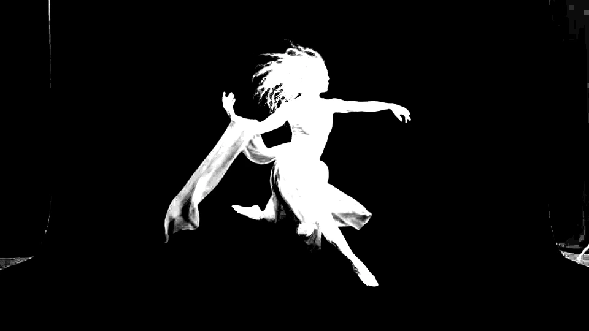
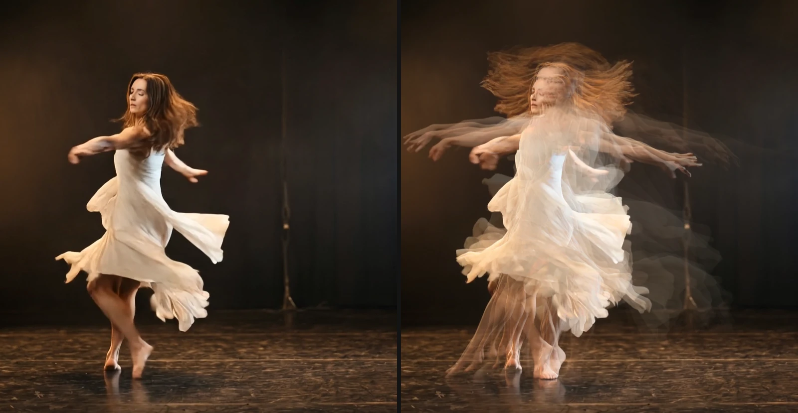
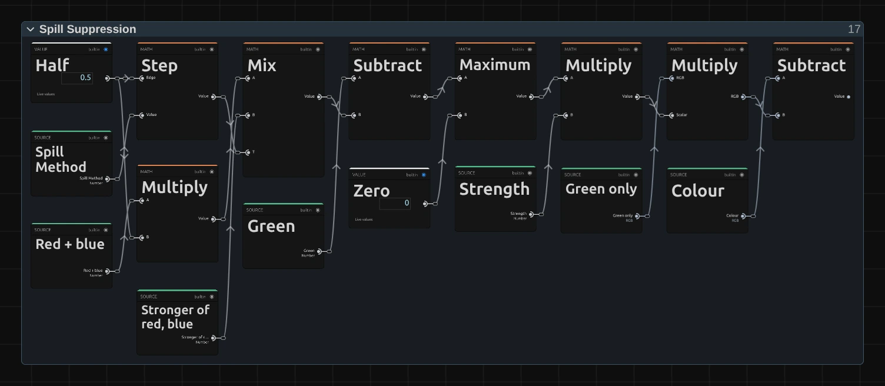
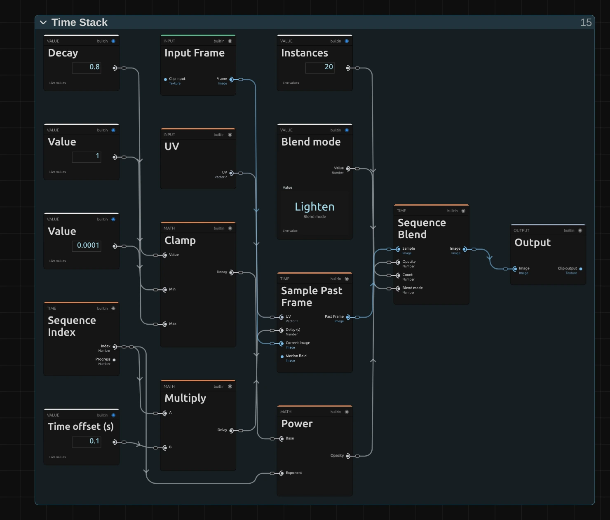
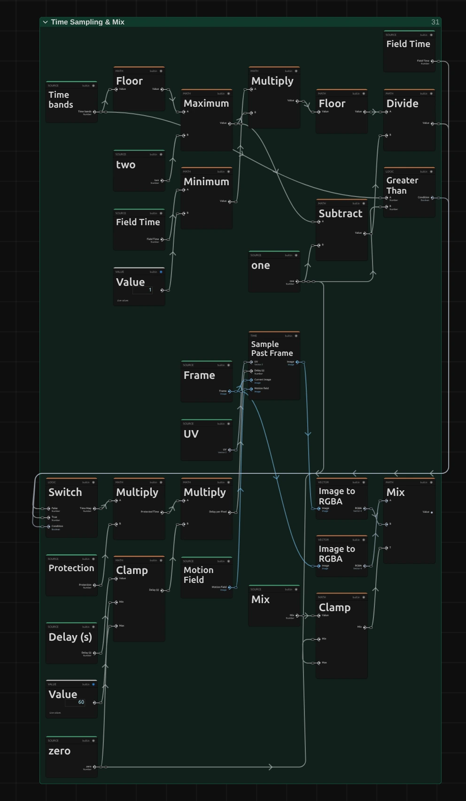

# Keying and Time Effects

Take a performer off a green or blue screen, or let time itself become the picture:
echoes of a movement, or every part of the frame from a different moment.
Add one in **Properties → Effects → + Add Effect** (Chroma Key under **Keying**,
Time Stack and Slit Scan under **Time**).

## The three keying and time effects

### Chroma Key
<figure class="docs-shot docs-shot--float-right">

<figcaption>Left: green-screen shot. Right: Chroma Key, default settings, over dark blue.</figcaption>
</figure>

<figure class="docs-shot docs-shot--float-right">

<figcaption>View → Matte, whole frame: the curtain edges stay white.</figcaption>
</figure>

Makes a green or blue screen transparent, so the performer can stand in front of
any background. It finds the screen colour in the picture by itself, and hair,
fine fabric and edges take on the new background instead of a green rim.
- **Screen** – Green, Blue, or a colour you pick from the screen. The inspector says so when the clip shows no such screen.
- **Clip Black / Clip White** – raise Clip Black until the background is gone, lower Clip White until the performer is solid. **View → Matte** shows this in black and white.
- **Shrink / Grow** and **Softness** (Edge) – pull the edge in or out and soften it, in pixels of a 1080p picture.
- **Suppression** and **Method** (Spill) – remove the green glow; Method **Gentle** keeps yellow costumes yellow.

Tip: curtains, stands and lights outside the screen are not screen colour, so they
stay in the picture (white in the matte). Cut them away with a mask around the
performer.

### Time Stack

Shows delayed copies of a moving video clip at once, like a long-exposure photo
of a dance. The trail builds up over the clip's first seconds.

<figure class="docs-shot docs-shot--float-left">

<figcaption>Left: original. Right: default settings (Lighten, Decay 0.8).</figcaption>
</figure>

- **Instances** – number of copies (up to 32).
- **Time offset** – time between copies.
- **Decay** – 0.8 fades older copies; 1 keeps them equal.
- **Blend mode** – Lighten for lit dancers on dark stages, Darken for the reverse.

### Slit Scan

Shows each part of a video clip's frame from a different moment, so movement
smears and folds through the picture: the classic slit-scan look.

<figure class="docs-shot docs-shot--float-right">

<figcaption>Left: original. Right: the Time steps look; each band further right is further back in time (up to 2 s).</figcaption>
</figure>

- **Look** – a starting point: Sweep, Falling time, Center out, Wave folds, Radial bloom, Time rings or Time steps.
- **Delay** – how far back in time the picture reaches (1 s).
- **Profile** and **Scan direction** – the shape of the time gradient.

Tip: fast limbs break into a row of soft ghosts; switch on the **Motion compensation**
section (its header switch) to turn them into one continuous smear. A new Slit Scan
needs a moment to load its frames.

**Known limitations:** Chroma Key measures one screen colour for the whole frame, so
see-through fabric such as chiffon can come out greyish or blotchy; Time Stack and
Slit Scan need a video clip, not a still image or a nested composition.

**Older projects:** Chroma Key switches to the new keyer and the inspector lists
retired values; Time Stack keeps its look.

## How the keying and time effects are built

<figure class="docs-shot docs-shot--float-right">

<svg class="docs-shot-overlay" viewBox="0 0 590 907" aria-hidden="true" focusable="false">
<defs><marker id="chroma-key-inspector-arrow" viewBox="0 0 10 10" refX="8" refY="5" markerWidth="5" markerHeight="5" orient="auto-start-reverse"><path d="M 0 0 L 10 5 L 0 10 Z" fill="#ffd54a" /></marker></defs>
<path class="docs-shot-arrow" d="M50 195 L134 195" marker-end="url(#chroma-key-inspector-arrow)" />
<circle class="docs-shot-number" cx="50" cy="195" r="18" /><text x="50" y="195" class="docs-shot-number-text">1</text>
<path class="docs-shot-arrow" d="M73 296 L157 296" marker-end="url(#chroma-key-inspector-arrow)" />
<circle class="docs-shot-number" cx="73" cy="296" r="18" /><text x="73" y="296" class="docs-shot-number-text">2</text>
<path class="docs-shot-arrow" d="M22 428 L106 428" marker-end="url(#chroma-key-inspector-arrow)" />
<circle class="docs-shot-number" cx="22" cy="428" r="18" /><text x="22" y="428" class="docs-shot-number-text">3</text>
</svg>

<figcaption>1 — Screen. 2 — View. 3 — Clip Black.</figcaption>
</figure>

All controls sit in the effect's card under **Properties → Effects**, grouped in
sections: Key, Matte, Edge and Spill for Chroma Key. For a key, choose the
**Screen** (1), then switch **View** (2) to **Matte**: the screen should be black
and the performer white. Raise **Clip Black** (3) until grey specks in the
background are gone, lower **Clip White** until the body is solid, then switch back
to **Final result**.

Each of the three effects is also a node graph you can open and change: open the
**Nodes** tab, pick the clip in its source list and click the › left of the
effect's title ([shown here](./Effects.md#the-node-setup)).
Changes apply to this one effect. The pictures below show small recipes from these
graphs; green cards stand for values from elsewhere in the graph and carry the names
the editor shows on those outputs.

### Chroma Key: find the screen, then take it out

The key runs in stages, each a folder in the graph. **Screen Grid** and **Screen
Color** find the screen colour by averaging the parts of the frame that look like
screen. **Screen Matte & Clip** compares every pixel with that colour and applies
Clip Black and Clip White. **Shrink / Grow** and **Edge Softness** shape the edge,
**Screen Subtraction** takes the screen's share out of see-through pixels (hair,
chiffon), and **Spill Suppression** removes the green glow.

<figure class="docs-shot docs-shot--graph">

<svg class="docs-shot-overlay" viewBox="0 0 1017 1013" aria-hidden="true" focusable="false">
<defs><marker id="chroma-key-spill-arrow" viewBox="0 0 10 10" refX="8" refY="5" markerWidth="5" markerHeight="5" orient="auto-start-reverse"><path d="M 0 0 L 10 5 L 0 10 Z" fill="#ffd54a" /></marker></defs>
<path class="docs-shot-arrow" d="M508 22 L508 84" marker-end="url(#chroma-key-spill-arrow)" />
<circle class="docs-shot-number" cx="508" cy="22" r="18" /><text x="508" y="22" class="docs-shot-number-text">1</text>
<path class="docs-shot-arrow" d="M836 22 L836 84" marker-end="url(#chroma-key-spill-arrow)" />
<circle class="docs-shot-number" cx="836" cy="22" r="18" /><text x="836" y="22" class="docs-shot-number-text">2</text>
<path class="docs-shot-arrow" d="M866 430 L772 430" marker-end="url(#chroma-key-spill-arrow)" />
<circle class="docs-shot-number" cx="866" cy="430" r="18" /><text x="866" y="430" class="docs-shot-number-text">3</text>
</svg>

<figcaption>Spill Suppression: the limit for the screen channel. 1 — Step. 2 — Mix. 3 — input T of Mix.</figcaption>
</figure>

The screen channel (green on a green screen) may be no stronger than the other two
channels allow. **Step** (1) turns Spill Method into 0 (Neutral) or 1 (Gentle), and
**Mix** (2) uses it at input T (3) to pick the **Limit**: A, the mean of the other two
channels (**Other Mean**), or B, the stronger of them (**Stronger Other**). After this
recipe a **Subtract** and a **Maximum** keep what lies above the limit, a **Multiply**
scales it by Strength (Spill Suppression), and a last **Subtract** takes it out of the
colour.

Remix: for a limit halfway between Neutral and Gentle, unplug **Step** from input T (3)
of **Mix** and plug a **Value** of 0.5 into T.

### Time Stack and Slit Scan: reading the past

Both time effects are built around one node, **Sample Past Frame**: it reads the
clip at the same spot a number of seconds earlier (its **Delay** input). They
differ only in how they choose that delay: Time Stack gives every copy its own,
Slit Scan every pixel.

### Time Stack: one delay and one strength per copy

<figure class="docs-shot docs-shot--graph">

<svg class="docs-shot-overlay" viewBox="0 0 1017 767" aria-hidden="true" focusable="false">
<defs><marker id="time-stack-arrow" viewBox="0 0 10 10" refX="8" refY="5" markerWidth="5" markerHeight="5" orient="auto-start-reverse"><path d="M 0 0 L 10 5 L 0 10 Z" fill="#ffd54a" /></marker></defs>
<path class="docs-shot-arrow" d="M180 279 L180 363" marker-end="url(#time-stack-arrow)" />
<circle class="docs-shot-number" cx="180" cy="279" r="18" /><text x="180" y="279" class="docs-shot-number-text">1</text>
<path class="docs-shot-arrow" d="M836 38 L836 122" marker-end="url(#time-stack-arrow)" />
<circle class="docs-shot-number" cx="836" cy="38" r="18" /><text x="836" y="38" class="docs-shot-number-text">2</text>
</svg>

<figcaption>Time Stack: how strong each copy is (Instances and Blend mode left out). 1 — Sequence Index. 2 — Sequence Blend.</figcaption>
</figure>

**Sequence Index** (1) counts the copies (Index 0, 1, 2 …; Progress runs from 0 to 1).
A **Multiply** turns the index into a delay (index × Time offset) for Sample Past
Frame, so copy 3 shows the clip 0.3 s ago (**Past Frame** in the picture). **Power**
gives each copy its **Opacity** (Decay to the power of the index; Decay arrives
clamped to 0.0001–1), and **Sequence Blend** (2) layers all copies with the Blend
mode, the current frame first.

Remix: for a trail that fades evenly and ends at nothing, add a **Subtract**
(A = a **Value** of 1, B = **Progress** of Sequence Index) and plug it into
**Opacity** of Sequence Blend instead of Power.

### Slit Scan: one delay per pixel

<figure class="docs-shot docs-shot--graph">

<svg class="docs-shot-overlay" viewBox="0 0 1017 767" aria-hidden="true" focusable="false">
<defs><marker id="slit-scan-time-sampling-arrow" viewBox="0 0 10 10" refX="8" refY="5" markerWidth="5" markerHeight="5" orient="auto-start-reverse"><path d="M 0 0 L 10 5 L 0 10 Z" fill="#ffd54a" /></marker></defs>
<path class="docs-shot-arrow" d="M508 38 L508 122" marker-end="url(#slit-scan-time-sampling-arrow)" />
<circle class="docs-shot-number" cx="508" cy="38" r="18" /><text x="508" y="38" class="docs-shot-number-text">1</text>
</svg>

<figcaption>The heart of Slit Scan, in its Time Sampling &amp; Mix folder. 1 — the first Multiply.</figcaption>
</figure>

The **Time Map** gives every pixel a number from 0 (now) to 1 (the full Delay); the
Look, Profile and Scan direction shape it in the folders before. The first
**Multiply** (1) sets protected areas back to now (**Protection**), the second turns
the map into seconds (**Delay per Pixel**), and **Sample Past Frame** reads each
pixel at its own moment. **Preview → Time map** in the inspector shows the map
itself.

Remix: for time that speeds up towards the far end of the scan, add a **Multiply**
with both inputs from **Time Map** and plug it into input A of the first Multiply
instead of Time Map.

## Technical details

Notes for developers. Effect details live in [Effect system](./Effect-System.md#editable-keying-and-feedback-graphs),
[Slit Scan](./Effect-System.md#slit-scan), [Time Stack](./Time-Stack.md) and
[Slit Scan 3D](./Slit-Scan-3D.md); nodes in [Node Catalog](./Node-Catalog.md),
compilation in [Operator Graph Compiler](./Operator-Graph-Compiler.md).

- **Chroma Key passes.** A 64 px Screen Grid (each cell averages 5 × 5 reads,
  weighted by how screen-like they are), a 1 px Screen Color (the mean of 33 × 33
  grid reads) and the key pass. Both caches are **Cache Image** nodes with
  **Max size** 64 and 1. A picked colour folds both away (one pass); a GPU check
  (`tests/browser/image-graph-probe.html?suite=chroma-key`) compares every pass chain
  with the CPU pass runner within 2/255.
- **Chroma Key units.** Clip Black/White are matte levels from 0 to 1 (default 0.30
  and 0.85). Shrink / Grow (−20 to 20) and Edge Softness (0 to 20) are pixels of a
  1080p frame (its shorter side) and scale with the render size; each adds two
  separable Gaussian passes (up to 32 taps per side) only while it is not 0.
- **Chroma Key values.** Out-of-range values are used at their limit, values that are
  not a number (NaN, null, text) at their default, and Clip Black at or above Clip
  White makes a hard cut; the inspector names each case and tool results report
  unusable numbers. A clip without screen colour keys nothing: the inspector and
  `addEffect`/`updateEffect` say so, checked on the clip's thumbnails (`screenProbe.ts`).
- **Chroma Key on the worker CPU.** Software preview and export readback key with
  scalar per-pixel code (the key of a 1080p frame in under 0.1 s, the whole worker
  pixel pass in about 0.3–0.4 s), also for the untouched graph every loaded project
  stores; the graph interpreter needed about a minute per frame. It keys only a layer whose sole effect is one
  Chroma Key without Shrink / Grow or Edge Softness; a stored key graph among other
  effects runs on the graph interpreter in stack order, and a graph-less key among
  other effects is declined (reported as unsupported).
- **Time Stack.** Up to 32 instances, Time offset 0–10 s; instance i reads
  t − i × offset with opacity decay^i (Decay 0.8 by default, clamped to 0.0001–1,
  reported). Sequence Blend draws the current frame first, so in Normal the older
  copies cover it (the inspector says so). Only
  instances whose start time has been reached take part. The owner supplies the
  `i × offset` frame window, so graph edits that change delays do not widen it.
- **Slit Scan.** Delay 0–60 s (clamped in the graph; the inspector reports a value
  outside). New effects blend adjacent frames (Sampling → Temporal sampling: Blend
  adjacent frames); that softens the bands of Nearest but leaves overlapping ghosts on
  fast limbs, which Motion compensation turns into a smear. Looks set only the Time and
  Wave values and show Custom once one differs or is animated. The first load of the
  frame window takes a few seconds; until it is ready the preview shows the plain clip.
- **Saved projects.** Untouched Rec.601 Chroma Key graphs upgrade to the new keyer:
  stored Spill Suppression stays, Clip Black/White and the edge use their defaults, and
  the inspector lists the old Tolerance/Edge Softness values and keyframes that no
  longer act; the old Custom choice keyed pure green and now keys the picked colour
  (#4C9A55 unless one is stored). Edited graphs keep the old key with its Tolerance and
  Edge Softness rows (keyframable). A Time Stack stored without Decay (project or
  preset) renders with Decay 1 (identical output) everywhere. Slit Scan graphs with the
  radial profiles in the Protected Center folder are regrouped, so Radial scan and Time
  rings render (they showed Wave while that folder was muted).
- **Pictures on this page.** `scripts/effect-graph-shot.mjs` and
  `scripts/effect-editor-shot.mjs`, each with a `keying-time.json` manifest
  (`scripts/effect-*-shots/`); the stills come from `scripts/effect-lab.mjs`.

