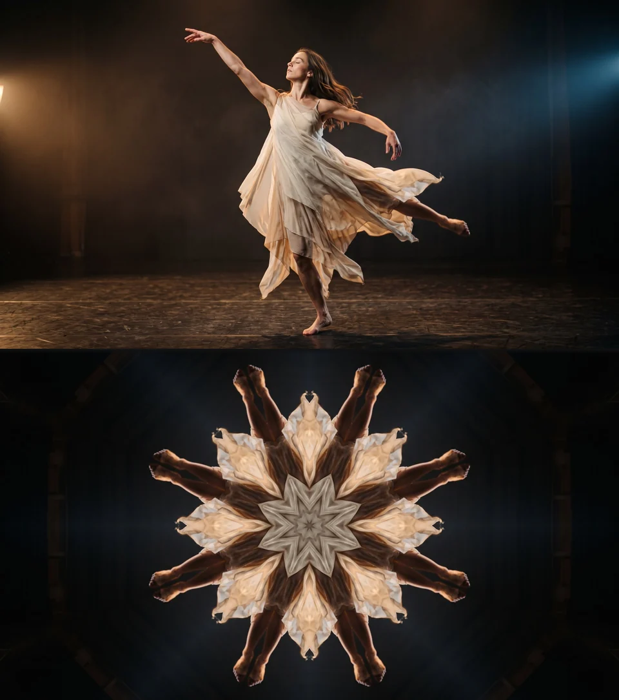
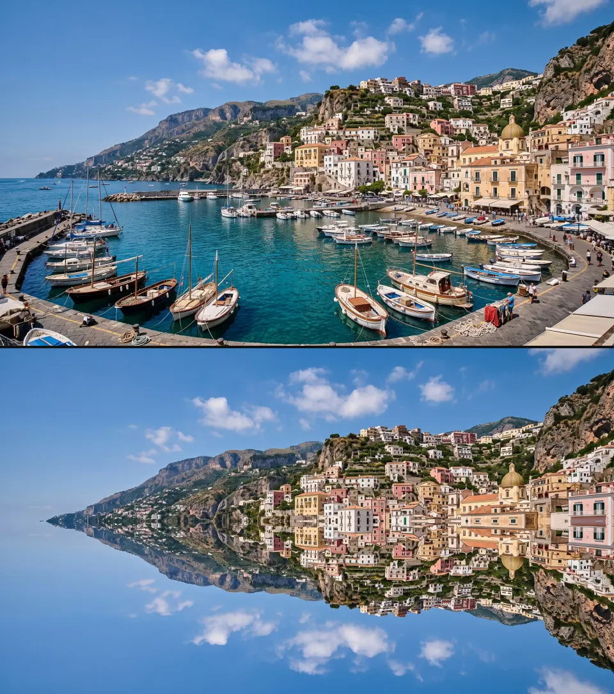
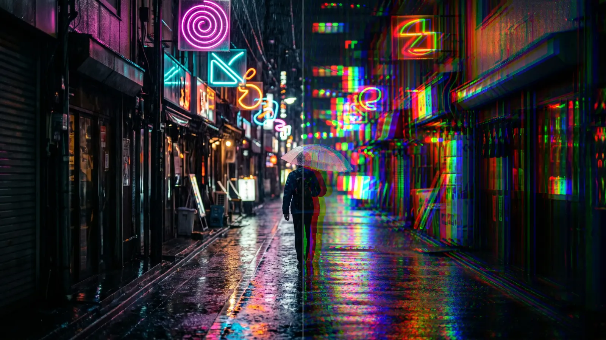
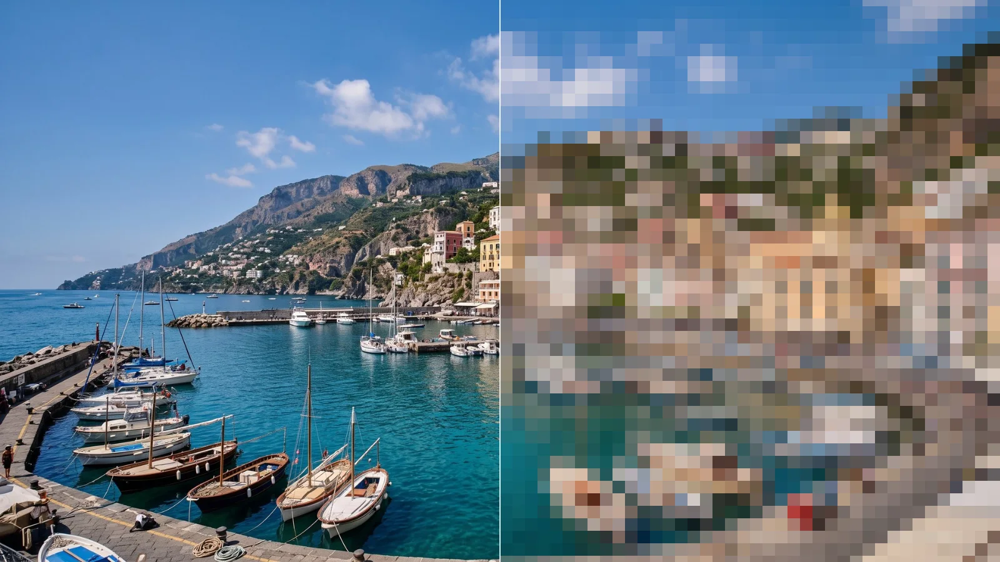
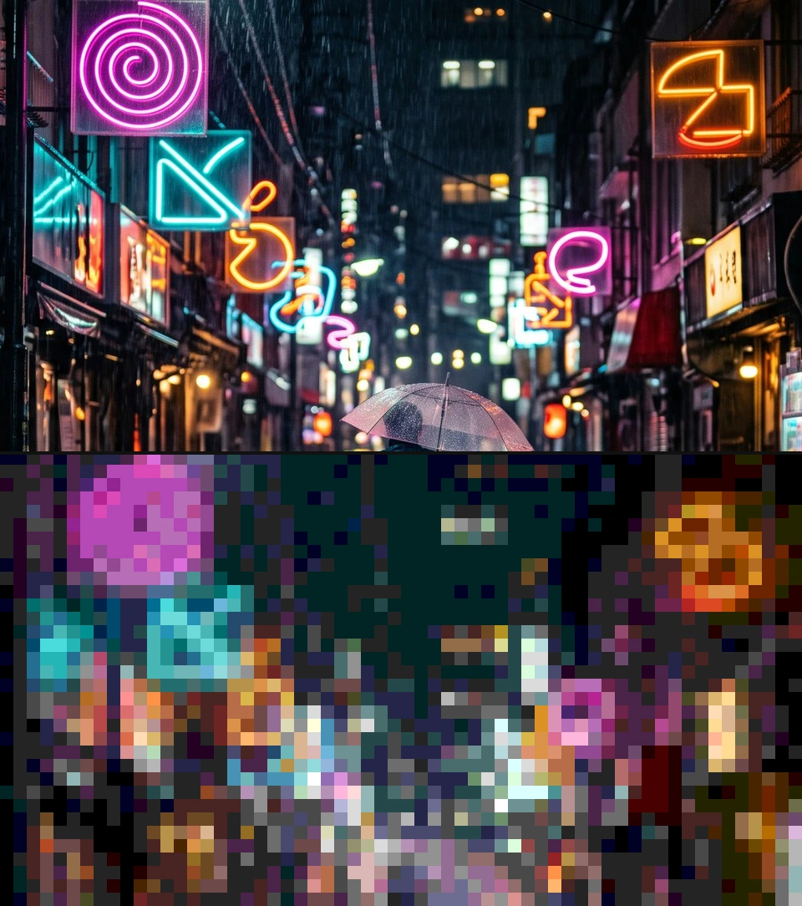
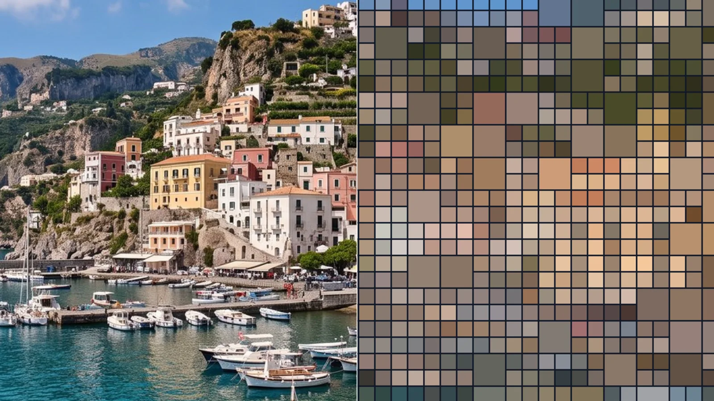
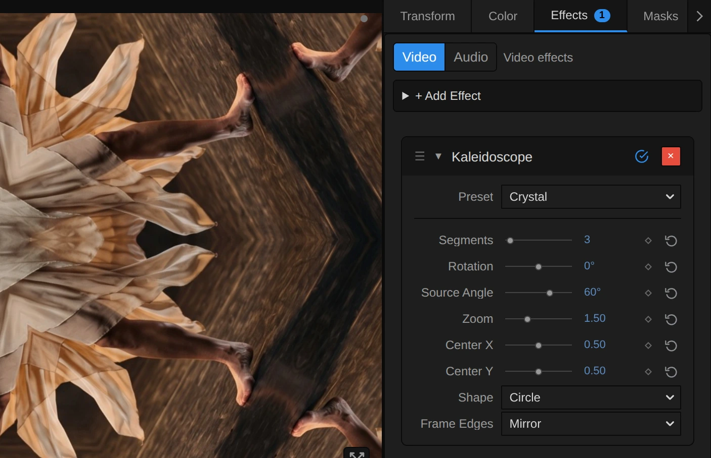
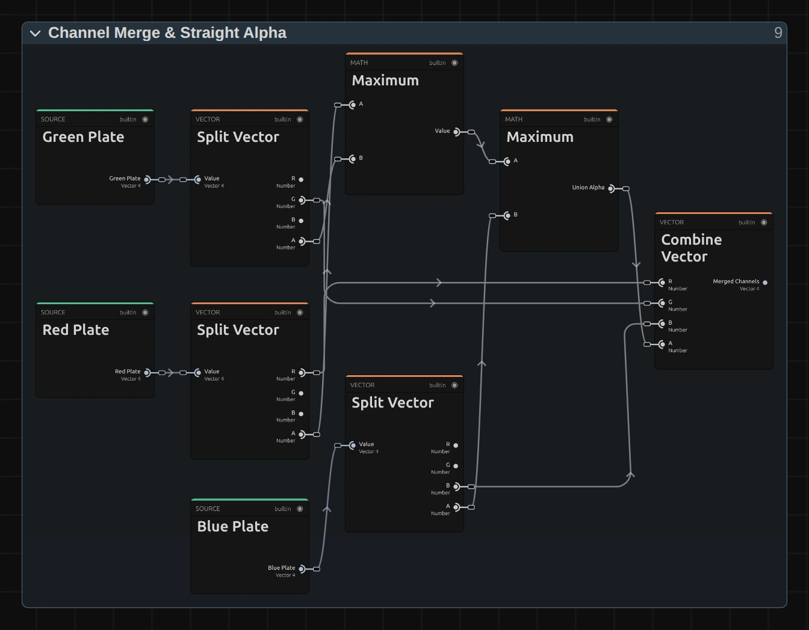

# Mirror, Split and Pixel Effects

Six ways to fold, flip, shift or rebuild the picture: kaleidoscope patterns,
mirror images, colour-fringe glitches and mosaics.
Add one in **Properties → Effects → + Add Effect**: Kaleidoscope, Mirror and
RGB Split are under **Lens & Distort**, Pixelate, Blockify and Block Mosaic
under **Pixel & Mosaic**.

Pictures with transparency (titles, logos, keyed footage) keep clean edges
without a dark rim.

## Six mirror, split and pixel effects

### Kaleidoscope
<figure class="docs-shot docs-shot--float-right">

<figcaption>Top: original. Bottom: Segments 8.</figcaption>
</figure>

Folds a slice of the picture into mirrored wedges around a centre, like
looking through a kaleidoscope. The pattern stays round on any picture size.
- **Segments** – how many mirrored slices make up the circle. Whole numbers give a clean pattern; when animated, the pattern blends smoothly into the next count.
- **Rotation** – spins the whole pattern, in degrees.
- **Source Angle** – picks which slice of the picture the mirrors show.
- **Zoom** – above 1 shows a smaller part of the picture, larger.

Tip: animate Source Angle slowly for the classic look of a turning kaleidoscope.

### Mirror
<figure class="docs-shot docs-shot--float-left">

<figcaption>Top: original. Bottom: Top / Bottom on, Left / Right off.</figcaption>
</figure>

Copies one half of the picture onto the other for perfect symmetry, with a
seamless mirror line.
- **Left / Right** – the left half appears again, flipped, on the right (on by default).
- **Top / Bottom** – the top half appears again, flipped, at the bottom.
- **Keep** – which side is kept and copied: Left / Top or Right / Bottom.
- **Center X / Center Y and Angle** – move and turn the mirror line.

Tip: Top / Bottom on a landscape gives a calm reflection in water.

### RGB Split
<figure class="docs-shot docs-shot--float-right">

<figcaption>Left: original. Right: Amount 0.01.</figcaption>
</figure>

Shifts the red and blue colour layers apart, like a misprinted poster or a
glitching screen.
- **Amount** – how far red and blue move, each in its own direction, as a share of the picture width (of the height when vertical). 0.003 is a fine fringe, 0.01 a clear glitch.
- **Angle** – the direction, in degrees: 0° sideways, 90° up and down.
- **Mode** – **Offset** shifts the whole picture; **Lens** leaves the middle clean and lets the fringes grow towards the edges, like a cheap lens.

Tip: keyframe Amount in short bursts for glitch hits on the beat.

### Pixelate
<figure class="docs-shot docs-shot--float-left">

<figcaption>Left: original. Right: Pixel Size 24.</figcaption>
</figure>

Rebuilds the picture from squares, each in the average colour of what it
covers, for mosaic looks or to hide a face or a sign.
- **Pixel Size** – the size of the squares, measured on a full-HD picture: they stay the same part of the picture at any resolution. 12 is clearly pixelated, 30 and more hides faces.

Tip: animate Pixel Size down to 1 for a reveal; the squares shrink towards the
middle of the picture.

### Blockify
<figure class="docs-shot docs-shot--float-right">

<figcaption>Left: original. Right: the default settings.</figcaption>
</figure>

Pixelates and reduces the colours, for the look of an old computer game.
- **Block Size** – the size of the blocks, measured like Pixel Size.
- **Levels** – how many shades each colour keeps. 6 gives 216 colours, 2 a hard poster look.
- **Amount** – mixes the blocks with the original picture.

### Block Mosaic
<figure class="docs-shot docs-shot--float-left">

<figcaption>Left: original. Right: the default settings.</figcaption>
</figure>

Rebuilds the picture as a tiled wall: small tiles mixed with larger ones,
separated by grout lines.
- **Tile Size** – the size of the small tiles, measured like Pixel Size.
- **Grout Width / Grout Color** – the lines between the tiles; 0 leaves them out.
- **Speed** – how often per second the large tiles change places; 0 keeps them still.
- **Amount** – mixes the tiles with the original picture.

Known limitations: between two whole Segments counts the Kaleidoscope shows
both patterns faintly blended, and in a small preview thin grout lines look
softer than in the export.

## How the effects are built

<figure class="docs-shot">

<svg class="docs-shot-overlay" viewBox="0 0 1017 461" aria-hidden="true" focusable="false">
<defs><marker id="kaleidoscope-inspector-arrow" viewBox="0 0 10 10" refX="8" refY="5" markerWidth="5" markerHeight="5" orient="auto-start-reverse"><path d="M 0 0 L 10 5 L 0 10 Z" fill="#ffd54a" /></marker></defs>
<path class="docs-shot-arrow" d="M630 223 L714 223" marker-end="url(#kaleidoscope-inspector-arrow)" />
<circle class="docs-shot-number" cx="630" cy="223" r="18" /><text x="630" y="223" class="docs-shot-number-text">1</text>
<path class="docs-shot-arrow" d="M611 281 L695 281" marker-end="url(#kaleidoscope-inspector-arrow)" />
<circle class="docs-shot-number" cx="611" cy="281" r="18" /><text x="611" y="281" class="docs-shot-number-text">2</text>
<path class="docs-shot-arrow" d="M610 424 L694 424" marker-end="url(#kaleidoscope-inspector-arrow)" />
<circle class="docs-shot-number" cx="610" cy="424" r="18" /><text x="610" y="424" class="docs-shot-number-text">3</text>
</svg>

<figcaption>The Kaleidoscope card in Properties → Effects. 1 — Segments. 2 — Source Angle, which part of the picture the mirrors show. 3 — Frame Edges.</figcaption>
</figure>

- **Segments** (1) and **Rotation** shape the pattern; **Source Angle** (2)
  changes what is inside it. Angles show in degrees.
- **Shape**: **Circle** keeps the pattern round on any picture; **Stretch to
  Frame** stretches it to the frame, an oval on a wide picture.
- **Frame Edges** (3) decides what appears where a read lands past the edge of
  the picture: **Mirror** reflects the picture, **Clamp** repeats the border
  pixels as streaks, **Transparent** leaves those places empty. Kaleidoscope,
  Mirror and RGB Split all have it.

Every effect on this page is a small node graph you can open and change: select
the clip, open the **Nodes** tab and use the › on the effect's card, then on each
folder. Changes apply to this one effect.
[Blur Effects](./Effects-Blur.md#how-the-blur-effects-are-built) shows the steps
with pictures, [Node Workspace](./Node-Workspace.md) how to add and connect nodes.

### Two ideas

**Kaleidoscope, Mirror and RGB Split move where each pixel reads.** Every pixel
of the result asks which spot of the original it shows; fold, flip or shift that
spot and the picture follows. This is the same idea as the
[distort effects](./Effects-Distort.md#one-idea-move-where-each-pixel-reads).

**Pixelate, Blockify and Block Mosaic paint each cell in its average colour.**
They share one recipe:

<figure class="docs-shot docs-shot--graph">

<figcaption>Pixelate as it opens in the Node Workspace, with the Constants and Coordinates folders and the Output card left out.</figcaption>
</figure>

- **Cell Size** turns Pixel Size into whole pixels of the rendered frame.
- **Centred Cell Grid** finds, for every pixel, where its cell starts and ends.
  The grid is anchored in the middle of the frame.
- **Row Average** averages each row of the cell and keeps the result;
  **Column Average** then averages those rows. Two short passes are much cheaper
  than reading the whole cell for every pixel.

Blockify adds a **Posterize** folder after the average, Block Mosaic a **Large
Tiles** folder before the grid and a **Grout** folder after it; both end with
**Mix with Original** for Amount.

### Kaleidoscope: folding the angle

<figure class="docs-shot docs-shot--graph">

<figcaption>The Wedge Fold folder for the lower whole segment count. A second, identical path handles the next count up. Green cards are values from outside the folder.</figcaption>
</figure>

**Arctangent 2** turns each pixel's offset from the centre into an angle, and
**Add** turns it by Rotation. **Divide** makes the width of one wedge (a full
turn, **Tau**, divided by the segment count). **Mirror Repeat** folds every angle
into that one wedge, back and forth, which is the whole trick. **Source Angle**
then picks the slice of the picture, and **Direction from Angle** and
**Multiply** turn angle and distance back into a place to read.

Remix, a spiral: add a **Multiply** of **Read Radius** and a **Value** of 3, and
an **Add** of **Turned Angle** and that Multiply. Plug the Add into the Value
input of both **Mirror Repeat** nodes (one per path). The pattern now twists
further the further it is from the centre.

### Block Mosaic: choosing the large tiles

<figure class="docs-shot docs-shot--graph">

<figcaption>The Large Tiles folder. Large Threshold (0.68) decides how many tile groups become one large tile.</figcaption>
</figure>

**Divide** and **Floor** number every square group of 2 × 2 tiles. **Add** mixes
in the **Shuffle Step**, which counts up Speed times per second. **Random
(Hash)** gives each group a number between 0 and 1, and **Greater Than** makes a
large tile wherever it is above **Large Threshold**: about one group in three.
**Switch** hands the grid the large or the small tile size.

Remix: select **Large Threshold** and lower it in the node inspector, for
example to 0.4, so more than half of the groups become large tiles; 1 turns them
off.

### RGB Split: which colour moves

<figure class="docs-shot docs-shot--float-right">

<figcaption>Part of the Channel Merge & Straight Alpha folder: one colour from each plate.</figcaption>
</figure>

RGB Split reads the picture three times: the **Red Plate** shifted one way, the
**Green Plate** in place and the **Blue Plate** shifted the other way. Each
**Split Vector** takes the plate apart, and **Combine Vector** keeps red from the
red plate, green from the green plate and blue from the blue plate. The **Union
Alpha** keeps the coloured fringes visible over transparency.

Remix, red and cyan like 3D glasses: plug the **G** output of the Blue Plate's
Split Vector into **G** of **Combine Vector**. Green then moves with blue.

## Technical details

Notes for developers. The recipes live in
`src/services/operators/mirrorRecipes.ts` and `cellGridRecipes.ts`; more in
[Effects: editable mirror, split and pixel graphs](./Effects.md#editable-mirror-split-and-pixel-graphs),
[Node Catalog](./Node-Catalog.md#composed-coordinate-nodes) (Mirror Repeat) and
[Operator Graph Compiler](./Operator-Graph-Compiler.md).

- **Frame space.** Kaleidoscope and Mirror measure offsets from the centre in
  units of the shorter frame side, so angles are on-screen angles and
  Kaleidoscope's Circle stays round; Stretch to Frame measures each axis in its own
  0–1 range. Angles are stored in radians and shown in degrees in the inspector;
  keyframe lanes, MIDI and tools use radians.
- **Kaleidoscope.** The angle is folded into one mirrored wedge of 360° / n,
  turned by Source Angle and read at distance / Zoom. A fractional Segments value
  crossfades the patterns of the two neighbouring whole counts (two reads per
  pixel). Segments is clamped to 2–64 (the slider shows 2–16) and Zoom to at
  least 0.01; both clamps are reported.
- **Mirror.** The offset is turned by −Angle, each enabled axis keeps one side
  (|x| with the kept side's sign) and is turned back, so the reflection is
  continuous at the line. With both axes off the effect is skipped and the
  inspector says so.
- **RGB Split.** Red reads at +offset, green in place, blue at −offset. Offset
  mode moves Amount × |(cos × width, sin × height)| pixels along the on-screen
  Angle. Lens mode scales red up and blue down about the frame centre by
  2 × Amount: no split in the middle, Amount × width at the left and right edges;
  Angle has no effect there. Alpha is the largest of the three reads. Amount 0 is
  skipped.
- **Premultiplied reads.** All six effects read a premultiplied `rgba16float`
  copy of the frame and unpremultiply the result, so transparent pixels never
  darken an edge or a cell. Frame Edges Transparent fades over one source pixel by
  lowering alpha only.
- **Cell grid.** Pixel Size, Block Size, Tile Size and Grout Width are pixels of a
  1080p frame (its shorter side), rounded to whole rendered pixels; the grid is
  anchored at the frame centre and cut by the frame edges. Three passes: the
  premultiplied copy, a cached row average and a column average. Cells up to 128
  rendered pixels wide are averaged exactly; wider cells average 64 evenly spread
  pairs per row and column. Smaller sizes are raised to one rendered pixel (two
  for Block Mosaic tiles), and the inspector and tool results say so; 1-pixel
  Pixelate cells are skipped, so the picture passes through exactly.
- **Blockify.** Each channel is rounded to the nearest of Levels steps
  (2–64, clamped and reported); Amount mixes with the original in premultiplied
  space, clamped to 0–1.
- **Block Mosaic.** A 2 × 2 tile group becomes one large tile when its hash, re-drawn
  Speed times per second from timeline time, is above 0.68, so seeking and export
  repeat the same pattern. Grout Width is split over both sides of every tile edge
  with a one-pixel soft edge; Grout Color is used as it is.
- **Saved projects.** Untouched old graphs, effects saved without a graph, presets
  and custom Looks upgrade on load. Kaleidoscope (Stretch to Frame, Clamp), Mirror
  and RGB Split (Clamp) keep their look; a diagonal RGB Split keeps its length and
  now points exactly along the on-screen angle. Pixelate, Blockify and Block
  Mosaic change on purpose: sizes now follow the 1080p rule (cells in a project of
  another resolution change size proportionally), the grid is centred and cells
  show their average colour; Blockify gets Levels 8, Block Mosaic Grout 1. Edited
  graphs stay as saved. Blockify's Angle, Ink and Paper and Block Mosaic's Angle
  and Paper had no effect and are retired; tools report them.
- **Worker CPU fallback.** Without WebGPU (software preview, worker-first export
  readback) the untouched Kaleidoscope, Mirror, RGB Split and Pixelate recipes run
  as one hand-written pass with the same mappings, frame edges and premultiplied
  reads, within 1/255 of the graph in tests; Pixelate averages every cell exactly
  there. Edited graphs run through the graph interpreter.
- **Pictures on this page.** The stills come from Effect Lab renders at 1920 px;
  the editor excerpt and graph pictures from `scripts/effect-editor-shot.mjs` and
  `scripts/effect-graph-shot.mjs` with a `mirror-pixel.json` manifest next to each
  (`scripts/effect-*-shots/`).
