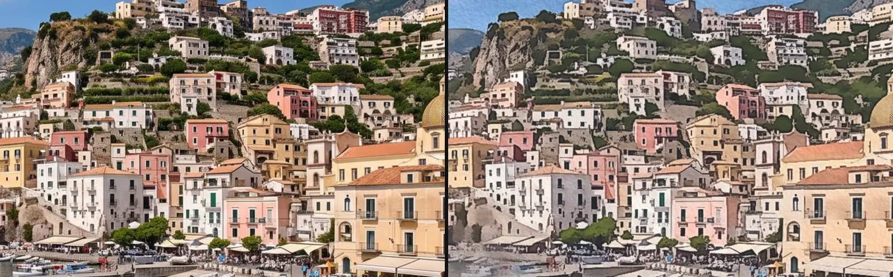

# Painterly, Relief and Particle Effects

Five looks that turn the picture into something else: a watercolour painting, flowing
smoke, a sweep of light, a 3D relief of blocks or a cloud of dust.
Add one in **Properties → Effects → + Add Effect**: Acuarela, Rom1 and Sheen are under
**Light & Stylize**, Voxel Relief and Pixel Particle Disintegrate under **3D & Particles**.

## The five painterly, relief and particle effects

### Acuarela
<figure class="docs-shot docs-shot--float-right">

<figcaption>Left: original. Right: Acuarela at its default settings.</figcaption>
</figure>

Paints the picture as a watercolour: flat washes of colour, darker paint where the
washes meet, a little wet bleeding and the grain of the paper. It keeps shapes readable,
so it works on moving footage as well as on stills.
- **Wash** – how much the colour flattens into washes, in pixels: 1–2 keeps detail, 6 and more is loose and soft.
- **Bleed** – how far wet paint wobbles and runs across edges, in pixels.
- **Edges** and **Blooms** – the darker paint along every edge, and a few lighter stains with a dark rim.
- **Granulation**, **Paper** and **Lift** – grainy pigment, the paper's relief, and white paper showing through.

Tip: set **Flow** to 0.1–0.3 and the wet areas drift slowly, as if the paint were still wet.

### Rom1
<figure class="docs-shot docs-shot--float-left">

<figcaption>Left: original. Right: Rom1 at its default settings, after 3 seconds.</figcaption>
</figure>

Watery smoke: bright parts of the picture smear along slowly drifting currents and leave
trails that build up over time and fade. This was the original look of Acuarela.
- **Strength** – how far the picture smears.
- **Speed** – how fast the currents drift.
- **Gain** – brightens the trails.
- **History Loop** and **Reset** – whether the trails start fresh when playback loops, and a manual restart.

Tip: the trails build up while the clip plays; a single paused frame shows less.

### Sheen
<figure class="docs-shot docs-shot--float-right">

<figcaption>Left: original. Right: a warm Sheen (Angle −60°, Intensity 1.2).</figcaption>
</figure>

A band of light that sweeps across the layer, the classic shine over a logo or a title.
It stays inside the layer's shape, and the picture underneath stays visible in the light.
- **Position** – where the band is; keyframe it from 0 to 1 for the sweep.
- **Angle** – the direction of the band, in degrees.
- **Width** and **Softness** – how broad the band is and how soft its edges are.
- **Intensity** and **Color** – how bright it is and its tint.

Tip: on a title, a narrow, soft band (Width 0.08) sweeping in half a second reads as a glint.

### Voxel Relief
<figure class="docs-shot docs-shot--float-left">

<figcaption>Left: original. Right: Voxel Relief seen from the side (Tilt 70°, Yaw −18°, Height 0.35).</figcaption>
</figure>

Builds the picture out of small blocks in 3D: bright parts rise, dark parts stay low.
Press **Orbit** on the effect card, then drag in the preview to look from another angle
and scroll to move closer.
- **Columns** – how many blocks across the picture.
- **Height** – how far bright parts rise.
- **Tilt**, **Yaw** and **Distance** – the camera, in degrees and distance.
- **Light Angle** – where the light comes from.

Tip: **Open Nodes** in the effect card shows the relief as nodes, where you can swap the block shape.

### Pixel Particle Disintegrate
<figure class="docs-shot docs-shot--float-right">

<figcaption>Left: original. Right: Progress 0.4; the dark gaps are already empty (transparent).</figcaption>
</figure>

The picture breaks into small particles that blow away, as the clip's exit. At Progress 0
the picture is untouched; at 1 it is gone.
- **Progress** – keyframe it from 0 to 1; the **Particle Out** button below + Add Effect sets this up at the end of the clip.
- **Cell Size** – the size of each particle, in pixels.
- **Stagger** and **Wind Sweep** – how unevenly and in which order the parts let go.
- **Fade** – how much each particle fades and shrinks while it flies.

Tip: change **Seed** for a different pattern with the same settings.

**Known limitations:** Sheen measures Position across the whole layer, so on a small logo
in a large transparent layer the band crosses the logo during only part of the sweep.
Pixel Particle Disintegrate draws larger particles in the preview than in the export at
very large sizes such as 4K; the effect card says when.

## How the painterly, relief and particle effects are built

<figure class="docs-shot">

<svg class="docs-shot-overlay" viewBox="0 0 1017 624" aria-hidden="true" focusable="false">
<defs><marker id="acuarela-inspector-arrow" viewBox="0 0 10 10" refX="8" refY="5" markerWidth="5" markerHeight="5" orient="auto-start-reverse"><path d="M 0 0 L 10 5 L 0 10 Z" fill="#ffd54a" /></marker></defs>
<path class="docs-shot-arrow" d="M581 184 L665 184" marker-end="url(#acuarela-inspector-arrow)" />
<circle class="docs-shot-number" cx="581" cy="184" r="18" /><text x="581" y="184" class="docs-shot-number-text">1</text>
<path class="docs-shot-arrow" d="M505 216 L665 216" marker-end="url(#acuarela-inspector-arrow)" />
<circle class="docs-shot-number" cx="505" cy="216" r="18" /><text x="505" y="216" class="docs-shot-number-text">2</text>
<path class="docs-shot-arrow" d="M577 248 L661 248" marker-end="url(#acuarela-inspector-arrow)" />
<circle class="docs-shot-number" cx="577" cy="248" r="18" /><text x="577" y="248" class="docs-shot-number-text">3</text>
</svg>

<figcaption>1 — Wash, how flat the colour washes are. 2 — Bleed, how far wet paint runs. 3 — Edges, the darker paint along every edge. The ◇ keyframes a control, ↺ resets it.</figcaption>
</figure>

Every control lives in the effect card. Acuarela sorts its controls into **Paint**,
**Paper** and **Motion** sections that fold away; the preview updates while you drag.

### Four different builds

These five effects do not share one recipe; each is built the way its look needs:

- **Acuarela** and **Rom1** are pixel recipes: every pixel of the result is worked out
  from reads of the picture.
- **Voxel Relief** is a small 3D scene: blocks on a grid, a camera and a light.
- **Pixel Particle Disintegrate** is a particle chain: the picture becomes particles,
  and forces move them.
- **Sheen** is one fixed shader without a graph.

To open a graph, use the **Nodes** tab, pick the clip as its source and open the folded
effect card with the › left of its title (shown on the [Blur page](./Effects-Blur.md#how-the-blur-effects-are-built)).
Voxel Relief also has **Open Nodes** in its effect card. Changes apply to this one effect.

### Acuarela: a watercolour in stages

<figure class="docs-shot docs-shot--graph">

<figcaption>Acuarela's stages (the Parameters and Frame &amp; Paper Coordinates folders and the Output card left out).</figcaption>
</figure>

The picture is painted in the order a painter would work. **Wet Patches & Bleed** decides
where the paint is still wet and how far each spot wobbles. **Pigment Wash** flattens the
colour inside shapes but stops at their borders (in wet patches it runs across them).
**Edge Pooling** finds the darker side of every border, **Paper & Granulation** makes the
paper's grain and **Blooms** the few stains. **Pigment Density** turns all of that into
more or less paint, and **Paper Light, Lift & Mix** adds the paper's relief and blends
with the original.

### Acuarela: more or less pigment

<figure class="docs-shot docs-shot--graph">

<svg class="docs-shot-overlay" viewBox="0 0 1017 417" aria-hidden="true" focusable="false">
<defs><marker id="acuarela-pigment-density-arrow" viewBox="0 0 10 10" refX="8" refY="5" markerWidth="5" markerHeight="5" orient="auto-start-reverse"><path d="M 0 0 L 10 5 L 0 10 Z" fill="#ffd54a" /></marker></defs>
<path class="docs-shot-arrow" d="M604 395 L604 311" marker-end="url(#acuarela-pigment-density-arrow)" />
<circle class="docs-shot-number" cx="604" cy="395" r="18" /><text x="604" y="395" class="docs-shot-number-text">1</text>
<path class="docs-shot-arrow" d="M946 275 L946 191" marker-end="url(#acuarela-pigment-density-arrow)" />
<circle class="docs-shot-number" cx="946" cy="275" r="18" /><text x="946" y="275" class="docs-shot-number-text">2</text>
</svg>

<figcaption>1 — the Clamp that limits the amount of pigment. 2 — the last Subtract, the Painted Colour. The values One, Zero and Three come from the Constants folder and are left out, so some inputs look empty.</figcaption>
</figure>

One formula from watercolour research does the painting: new colour = C − (C − C²) × (d − 1).
The bottom row adds up the amount of pigment d = 1 + edge pooling + granulation + blooms,
and the **Clamp** (1) keeps it between 0 and 3. Above 1 a colour darkens as if more
pigment had settled there, below 1 it lightens; white paper and black stay as they are.
The top row works out C − C² for the wash colour, and the last **Subtract** (2) gives the
painted colour.

Remix: for paint that only ever darkens, open the **Constants** folder and plug **One**
into Min of the Clamp (1) in place of Zero. The middles of the blooms and the light side
of every edge then keep the wash colour instead of turning lighter.

### Voxel Relief: blocks, camera, light

<figure class="docs-shot docs-shot--graph">

<figcaption>Voxel Relief with Column geometry open; Height field stays folded.</figcaption>
</figure>

**Column geometry** builds the blocks: **Grid Points** places one point per column,
**Primitive** is the block, **Height field** turns brightness into height (Height Contrast,
Height and Base are its controls) and **Instance on Points** puts a block on every point.
**Mesh Object** dresses the blocks in the picture's colours (**Surface Material**), and
**Relief Render** films them with the **Orbit Camera** and the **Relief Light**.

Remix: select **Primitive** and switch its **Shape** from Box to Sphere or Cylinder: the
relief turns into beads or round pillars. The effect card shows the same Shape under Primitive.

### Pixel Particle Disintegrate: a particle chain

<figure class="docs-shot docs-shot--graph">

<figcaption>Pixel Particle Disintegrate with its Forces folder open.</figcaption>
</figure>

**Image to Particles** cuts the picture into one particle per cell, **Particle Release**
decides when each one lets go (Progress, Stagger, Wind Sweep), **Particle Motion** moves the
released ones and **Particle Render** draws them. The four forces add up: **Curl Noise**
swirls, **Gravity** pulls down, **Scatter** pushes apart and **Wind Gusts** blows along a
direction. The cards hold the same settings as the effect card; there is no per-pixel math here.

Remix: unplug **Gravity** from Particle Motion and the dust floats instead of sinking. An
unplugged or muted force adds nothing; plug it back in to restore it.

## Technical details

Notes for developers. Formulas and history are in [Effects](./Effects.md), nodes in
[Node Catalog](./Node-Catalog.md), compilation in [Operator Graph Compiler](./Operator-Graph-Compiler.md).

- **Acuarela passes.** The frame is premultiplied into an `rgba16float` cache, the edge-aware
  7 × 7 pigment wash (taps 0.6 sigma apart, sigma = Wash) goes into a second cache, and one
  last pass adds density, paper and Mix. The density formula is Bousseau et al. 2006,
  "Interactive watercolor rendering". Recipe: `src/services/operators/acuarelaWatercolorGraph.ts`;
  see [Effects: glyph, cell and compute effects](./Effects.md#glyph-cell-and-compute-effects).
- **Units.** Wash, Bleed and Grain Size are pixels of a 1080p frame (its shorter side) and scale
  with the rendered size, so preview, export and 4K match. Flow is cycles per second; it moves
  the wet patches and the wobble with the timeline, while the paper stays put. Sheen's and Voxel
  Relief's angles are degrees.
- **Noise.** Acuarela's paper, wet patches and blooms use the shared **Fractal Noise** node
  (`noise.fractal2d.vec2`, integer-hashed gradient noise, 1–8 octaves), which stays clean at
  large positions; see [Node Catalog](./Node-Catalog.md#composed-coordinate-nodes).
- **Still and skipped.** Acuarela has no frame history: a paused frame stays put and needs no
  continuous rendering, and Mix 0 skips the effect. The graph has about 340 nodes; the first
  frame takes about 360 ms with the graph compile, then about 9 ms per 1080p frame (desktop
  Vulkan).
- **Rom1 feedback.** Rom1 builds every frame on the previous result, so its trails grow during
  playback; History Loop (Reset or Continuous) and Reset control that history. Gain above 1 turns
  the frame white, Speed, Detail or Density at 0 or below freeze the smoke, and the effect card and
  tool results say so. Its graph is one long chain of about 390 nodes without folders; see
  [Effects: editable keying and feedback graphs](./Effects.md#editable-keying-and-feedback-graphs).
- **Sheen light.** The band lifts each colour with a soft highlight shoulder,
  1 − (1 − c) · exp(−light / (1 − c)), so it never clips to flat white; anti-aliased edges get
  the full light, Softness 0 is a hard edge with 1 px anti-aliasing, and Intensity below 0
  renders as 0 (reported). Position spans the whole layer, not the logo's own bounds.
- **Voxel Relief limits.** The 2D relief is raymarched (Ray Steps); as a 3D scene object it uses
  instancing. Values its shader clamps (Columns, Distance, FOV, Gap, Ray Steps and others) are
  named in the effect card and tool results, and a missing or broken value falls back to the
  default. First frame 63–103 ms with the shader compile, then about 17 ms per frame. See
  [Effects: editable Voxel Relief nodes](./Effects.md#editable-voxel-relief-nodes).
- **Particle budget.** One particle per Cell Size cell, up to the Preview Particle Budget
  (60,000), Export Particle Budget (180,000) and Hard Particle Limit (220,000). Over budget the
  cells grow until the grid fits; no rows are dropped. At 4K with Cell Size 8 the preview draws
  12 px cells and the export 8 px; the effect card says so. Motion follows Progress and Seed,
  not a simulation, so every frame renders the same. The effect ends the clip's effect stack:
  effects after it are ignored with a warning. See [Effects: particle render effects](./Effects.md#particle-render-effects).
- **Saved projects.** Acuarela effects saved with the earlier smoke look keep it: a stored graph
  renders as saved, and a graph-less smoke effect gets the smoke graph. The smoke controls (Gain,
  Speed, Detail and others) are retired for the watercolour and show only where a graph reads them.
  Sheen bands saved before now keep the picture visible instead of turning flat white, and
  particles saved before Fade existed keep Fade 0.
- **Software preview.** The worker software preview runs Rom1 and the smoke-look Acuarela on the
  CPU; the watercolour Acuarela would take minutes per frame there, so it falls back to the
  main-thread GPU renderer.
- **Pictures on this page.** `scripts/effect-lab.mjs` (stills, manifest
  `scripts/effect-lab-shots/stylize-art.json`), `scripts/effect-graph-shot.mjs` and
  `scripts/effect-editor-shot.mjs`, each with a `stylize-art.json` manifest in
  `scripts/effect-graph-shots/` and `scripts/effect-editor-shots/`.
