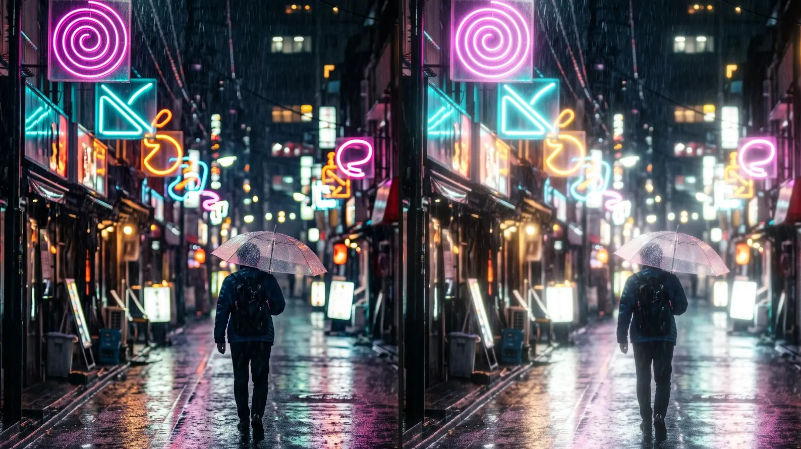
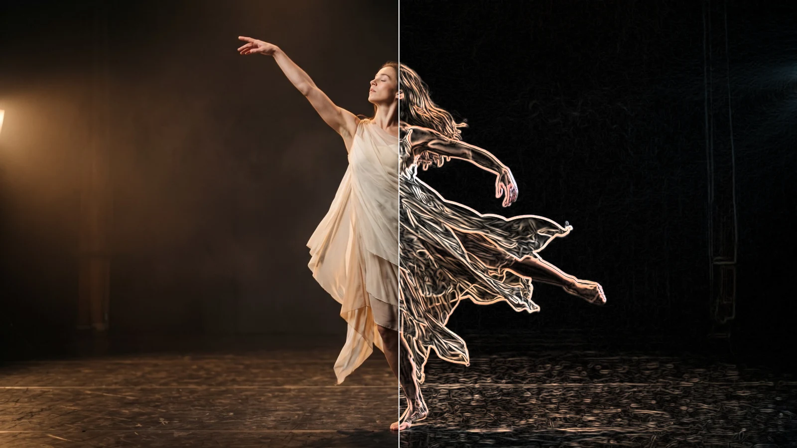
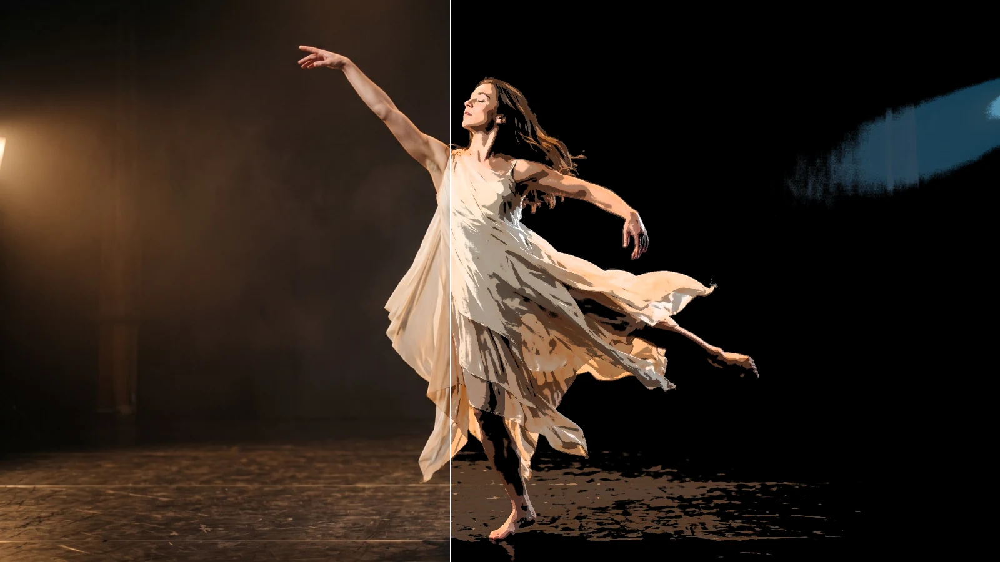
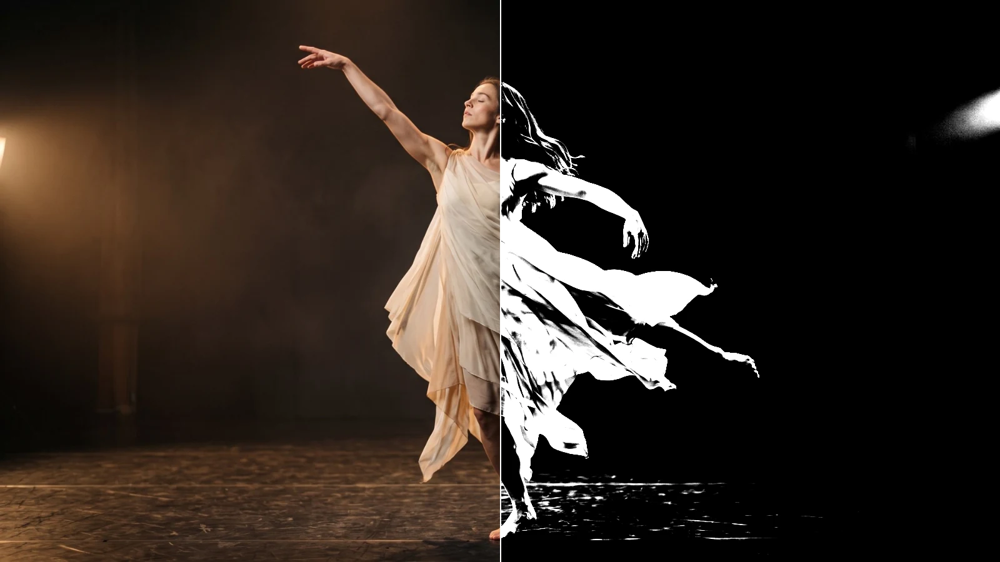

# Stylize Effects

Eight effects that give the picture a look: glowing light, film grain, outlines,
crisper detail and bold graphic tones.
Add one in **Properties → Effects → + Add Effect**.

## The eight stylize effects

### Glow
<figure class="docs-shot docs-shot--float-right">

<figcaption>Left: original. Right: Amount 1.6, Threshold 0.5, Radius 70.</figcaption>
</figure>

Makes the bright parts of the picture shine with a soft halo, like light
blooming in a lens. Good for neon, stage lights, candles and dreamy scenes.
- **Threshold** – which parts glow: only what is brighter than this. Lower it and more of the picture glows.
- **Radius** – how far the light spreads: 20 is a tight halo, 40 a soft glow, 150 and more a wide haze.
- **Amount** – how bright the glow is.
- **Color** – tints the glow, for example warm orange for candle light.

Tip: Softness decides how gently light near the threshold joins in; keep it at 0.5 for a natural look.

### Film Grain
<figure class="docs-shot docs-shot--float-left">

<figcaption>Left: original. Right: Amount 0.22, Size 1.5.</figcaption>
</figure>

Adds the fine, living texture of film. The grain changes on every frame, is
strongest in the mid tones and keeps its size at any resolution.
- **Amount** – how strong: 0.1 is subtle, 0.3 a heavy, grainy look.
- **Size** – 1 is fine like 35 mm film, 2–3 coarse like 16 mm.
- **Speed** – 1 gives new grain on every frame, 0 freezes it.
- **Color** – 0 is black-and-white grain, 1 lets every colour channel have its own grain.

### Vignette
<figure class="docs-shot docs-shot--float-right">

<figcaption>Left: original. Right: Amount 0.85, Size 0.25, Softness 0.8.</figcaption>
</figure>

Darkens the edges and corners so the eye goes to the middle of the frame.
- **Amount** – how dark the edges get.
- **Size** – where the darkening begins: smaller values start it closer to the centre.
- **Softness** – how gradually it fades in.
- **Roundness** – 1 is a circle, 0 follows the shape of the frame.

Tip: Amount 0.3 with a large Softness is barely noticeable, yet it calms busy edges.

### Sharpen
<figure class="docs-shot docs-shot--float-left">

<figcaption>The same houses, enlarged. Left: original. Right: Amount 2, Radius 1.5.</figcaption>
</figure>

Brings out detail and crisp edges in soft footage, without the bright and dark
outlines that strong sharpening usually leaves.
- **Amount** – how much crisper. Below 0 it softens instead.
- **Radius** – the size of the detail it works on: 1 for fine texture, 3–5 for larger shapes.

### Edge Detect
<figure class="docs-shot docs-shot--float-right">

<figcaption>Left: original. Right: Width 1.5, Strength 1.5, Color 0.7.</figcaption>
</figure>

Turns the picture into its outlines: bright lines where things meet, dark
everywhere else.
- **Strength** – how bright and how many lines.
- **Width** – line thickness; it stays the same at any resolution.
- **Color** – 0 draws white lines, 1 draws them in the picture's own colours.
- **Invert** – dark lines on white, like a pencil drawing.

### Posterize
<figure class="docs-shot docs-shot--float-left">

<figcaption>Left: original. Right: Levels 5, Softness 0.3.</figcaption>
</figure>

Reduces the picture to a few flat tones per colour, like a screen print or a
poster.
- **Levels** – how many tones: 2–4 is bold and graphic, 8 and more subtle.
- **Softness** – rounds the jumps between tones, so skies and faces don't break into jagged bands.

### Threshold
<figure class="docs-shot docs-shot--float-right">

<figcaption>Left: original. Right: Level 0.3, Softness 0.12.</figcaption>
</figure>

Turns the picture into pure black and white: everything brighter than the level
becomes white, the rest black.
- **Level** – the brightness that splits black from white.
- **Softness** – a soft grey edge instead of a hard cut.

Tip: animate Level for a silhouette that appears out of the dark.

### Scanlines
<figure class="docs-shot docs-shot--float-left">

<figcaption>Left: original. Right: Density 4, Opacity 0.55.</figcaption>
</figure>

Lays fine horizontal lines over the picture, like an old TV or computer monitor.
- **Density** – how many lines: 5 gives about 80 lines from top to bottom.
- **Opacity** – how dark the lines are.
- **Scroll Speed** – lets the lines roll slowly up the picture.

Lines too close to show at the current size blend into an even darkening
instead of flickering.

**Saved projects:** effects saved before this update keep their earlier look; the
effect card names it and offers the new version with one click.

**Known limitations:** very large grain (Size 4–5) looks blotchy rather than like
film, and wide Edge Detect lines cost more render time.

<!-- docs agent: middle and technical levels go here -->
