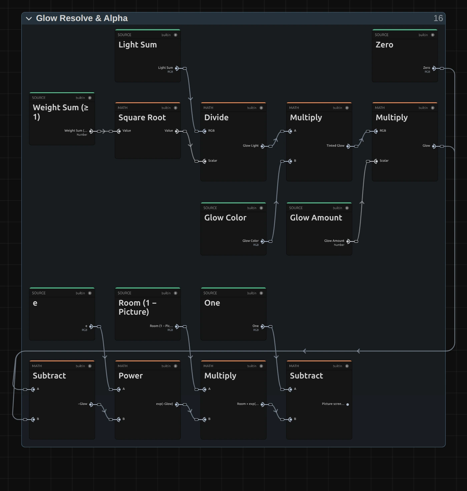
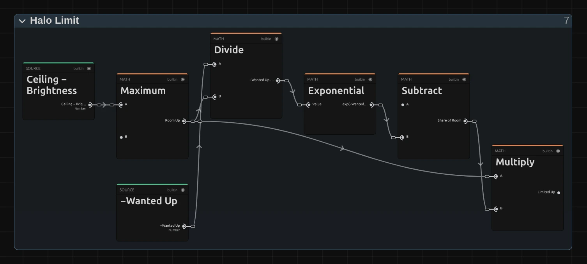

# Stylize Effects

Eight effects that give the picture a look: glowing light, film grain, outlines,
crisper detail and bold graphic tones.
Add one in **Properties → Effects → + Add Effect**.

## The eight stylize effects

### Glow
<figure class="docs-shot docs-shot--float-right">

<figcaption>Left: original. Right: Amount 1.6, Threshold 0.5, Radius 70.</figcaption>
</figure>

Makes the bright parts of the picture shine with a soft halo, like light
blooming in a lens. Good for neon, stage lights, candles and dreamy scenes.
- **Threshold** – which parts glow: only what is brighter than this. Lower it and more of the picture glows.
- **Radius** – how far the light spreads: 20 is a tight halo, 40 a soft glow, 150 and more a wide haze.
- **Amount** – how bright the glow is.
- **Color** – tints the glow, for example warm orange for candle light.

Tip: Softness decides how gently light near the threshold joins in; keep it at 0.5 for a natural look.

### Film Grain
<figure class="docs-shot docs-shot--float-left">

<figcaption>Left: original. Right: Amount 0.22, Size 1.5.</figcaption>
</figure>

Adds the fine, living texture of film. The grain changes on every frame, is
strongest in the mid tones and keeps its size at any resolution.
- **Amount** – how strong: 0.1 is subtle, 0.3 a heavy, grainy look.
- **Size** – 1 is fine like 35 mm film, 2–3 coarse like 16 mm.
- **Speed** – 1 gives new grain on every frame, 0 freezes it.
- **Color** – 0 is black-and-white grain, 1 lets every colour channel have its own grain.

### Vignette
<figure class="docs-shot docs-shot--float-right">

<figcaption>Left: original. Right: Amount 0.85, Size 0.25, Softness 0.8.</figcaption>
</figure>

Darkens the edges and corners so the eye goes to the middle of the frame.
- **Amount** – how dark the edges get.
- **Size** – where the darkening begins: smaller values start it closer to the centre.
- **Softness** – how gradually it fades in.
- **Roundness** – 1 is a circle, 0 follows the shape of the frame.

Tip: Amount 0.3 with a large Softness is barely noticeable, yet it calms busy edges.

### Sharpen
<figure class="docs-shot docs-shot--float-left">

<figcaption>The same houses, enlarged. Left: original. Right: Amount 2, Radius 1.5.</figcaption>
</figure>

Brings out detail and crisp edges in soft footage, without the bright and dark
outlines that strong sharpening usually leaves.
- **Amount** – how much crisper: 1 is gentle, 2–3 clearly crisp.
- **Radius** – the size of the detail it works on: 1 for fine texture, 3–5 for larger shapes.

### Edge Detect
<figure class="docs-shot docs-shot--float-right">

<figcaption>Left: original. Right: Width 1.5, Strength 1.5, Color 0.7.</figcaption>
</figure>

Turns the picture into its outlines: bright lines where things meet, dark
everywhere else.
- **Strength** – how bright and how many lines.
- **Width** – line thickness; it stays the same at any resolution.
- **Color** – 0 draws white lines, 1 draws them in the picture's own colours.
- **Invert** – dark lines on white, like a pencil drawing.

### Posterize
<figure class="docs-shot docs-shot--float-left">

<figcaption>Left: original. Right: Levels 5, Softness 0.3.</figcaption>
</figure>

Reduces the picture to a few flat tones per colour, like a screen print or a
poster.
- **Levels** – how many tones: 2–4 is bold and graphic, 8 and more subtle.
- **Softness** – rounds the jumps between tones, so skies and faces don't break into jagged bands.

### Threshold
<figure class="docs-shot docs-shot--float-right">

<figcaption>Left: original. Right: Level 0.3, Softness 0.12.</figcaption>
</figure>

Turns the picture into pure black and white: everything brighter than the level
becomes white, the rest black.
- **Level** – the brightness that splits black from white.
- **Softness** – a soft grey edge instead of a hard cut.

Tip: animate Level for a silhouette that appears out of the dark.

### Scanlines
<figure class="docs-shot docs-shot--float-left">

<figcaption>Left: original. Right: Density 4, Opacity 0.55.</figcaption>
</figure>

Lays fine horizontal lines over the picture, like an old TV or computer monitor.
- **Density** – how many lines: 5 gives about 80 lines from top to bottom.
- **Opacity** – how dark the lines are.
- **Scroll Speed** – lets the lines roll slowly up the picture.

Lines too close to show at the current size blend into an even darkening
instead of flickering, so a small preview can look smoother than the full-size
export.

**Saved projects:** effects saved before this update keep their earlier look; the
effect card names it and offers the new version with one click.

**Known limitations:** very large grain (Size 4–5) looks blotchy rather than like
film, and wide Edge Detect lines cost more render time.

## How the stylize effects are built

<figure class="docs-shot">

<svg class="docs-shot-overlay" viewBox="0 0 1017 519" aria-hidden="true" focusable="false">
<defs><marker id="glow-inspector-arrow" viewBox="0 0 10 10" refX="8" refY="5" markerWidth="5" markerHeight="5" orient="auto-start-reverse"><path d="M 0 0 L 10 5 L 0 10 Z" fill="#ffd54a" /></marker></defs>
<path class="docs-shot-arrow" d="M555 293 L639 293" marker-end="url(#glow-inspector-arrow)" />
<circle class="docs-shot-number" cx="555" cy="293" r="18" /><text x="555" y="293" class="docs-shot-number-text">1</text>
<path class="docs-shot-arrow" d="M538 331 L622 331" marker-end="url(#glow-inspector-arrow)" />
<circle class="docs-shot-number" cx="538" cy="331" r="18" /><text x="538" y="331" class="docs-shot-number-text">2</text>
<path class="docs-shot-arrow" d="M561 406 L645 406" marker-end="url(#glow-inspector-arrow)" />
<circle class="docs-shot-number" cx="561" cy="406" r="18" /><text x="561" y="406" class="docs-shot-number-text">3</text>
</svg>

<figcaption>A Glow on the night street. 1 — Amount: how bright. 2 — Threshold: what glows. 3 — Radius: how far it spreads.</figcaption>
</figure>

Every stylize effect is a small node graph you can open and change: pick the clip
in the **Nodes** tab and open the effect's card with the › left of its title
([shown on the Blur page](./Effects-Blur.md#how-the-blur-effects-are-built)).
Inside, each stage is a folder with a plain name, such as **Bright Pass** or
**Halo Limit**. Changes apply to this one effect.

### The shared idea

<figure class="docs-shot docs-shot--float-right">

<figcaption>The core of Threshold: Greater Than compares the brightness with Level, and a Switch picks Zero (black) or One (white).</figcaption>
</figure>

Stylize effects come in two kinds. **Threshold, Posterize, Vignette, Scanlines
and Film Grain** change every pixel on its own, from its colour, its place in the
frame and the time. **Glow, Sharpen and Edge Detect** also look at the pixels
around it; like the blurs, they first weigh each colour by its transparency
(**Premultiplied Source**), so transparent edges stay clean.

Threshold is the smallest example. **Luminance** measures the brightness,
**Greater Than** compares it with **Level**, and a **Switch** picks black or
white. With Softness above 0, a **Mix** blends in a soft ramp instead of the hard
step.

Remix: for black where the picture is bright (with Softness at 0), swap the two
cables at the **Switch**: **One** into False, **Zero** into True.

### Glow: a stack of ever softer copies

<figure class="docs-shot docs-shot--float-right">

<figcaption>The last step of Glow: the glow is tinted, scaled by Amount and added onto the picture.</figcaption>
</figure>

**Bright Pass** keeps only the light above Threshold. **Pyramid: Halve the
Light** then shrinks that light ten times, each copy half the size of the last
(a **Cache Image** with its **Resolution** set to 1/2, 1/4 …), so every copy is
softer and reaches further. **Pyramid: Add Levels Back Up** adds the copies
together; Radius decides how many join. **Glow Resolve & Alpha** tints the result,
scales it and adds it onto the picture.

Remix: to see the glow alone, on black, open **Glow Resolve & Alpha** and plug a
**Value** of 0 into the Scalar input of the **Multiply** fed by **Source Color**.
Handy for checking what Threshold picks.

### Film Grain: strongest in the midtones

<figure class="docs-shot docs-shot--graph">

<figcaption>Film Response: 4 · brightness · (1 − brightness) is 1 in the midtones and 0 in black and white; Mix lifts it to Shadow Floor.</figcaption>
</figure>

The grain itself comes from **Random (Cell)** nodes in the **Smooth Noise**
folder: one random value per grain cell, blended smoothly between neighbouring
cells. **Film Response** then decides how much grain each pixel gets, from its
brightness: all of it in the midtones and 0.3 of it (**Shadow Floor**) in pure
black and white, as on film.

Remix: select **Shadow Floor** and set its value to 1 in the node inspector for
grain that is equally strong everywhere, like digital sensor noise; 0 keeps black
and white completely clean.

### Sharpen: crisp, but never past its neighbours

<figure class="docs-shot docs-shot--graph">

<figcaption>Halo Limit: the sharpened brightness may pass the darkest and brightest pixel nearby by only 15 % (Overshoot) of their difference.</figcaption>
</figure>

Sharpen blurs a copy with the same two passes as Gaussian Blur (**Horizontal**
and **Vertical Blur Pass**) and adds the difference between the picture and that
soft copy, times Amount (**Unsharp Mask**). Classic sharpening stops there and
draws bright and dark outlines along edges. **Halo Limit** prevents them: it
looks up the darkest and brightest pixel in the 3 × 3 neighbourhood and
**Clamp**s the result to that range, plus a small **Overshoot**.

Remix: select **Overshoot** and set it to 1 for the classic, punchy look with
halos, or to 0 for the cleanest result.

The other graphs follow the same plan; open their folders to see, for example,
how Vignette measures the distance to the corners or how Edge Detect turns line
Width into its search window.

## Technical details

Notes for developers. Formulas and history live in
[Effects: editable color effect graphs](./Effects.md#editable-color-effect-graphs)
(Threshold, Posterize, Vignette, Scanlines, Film Grain) and
[Effects: editable blur kernels](./Effects.md#editable-blur-kernels) (Sharpen,
Edge Detect, Glow); nodes in [Node Catalog](./Node-Catalog.md#composed-coordinate-nodes),
compilation in [Operator Graph Compiler](./Operator-Graph-Compiler.md).

- **Units.** Glow Radius, Grain Size, Sharpen Radius and Edge Detect Width are in
  pixels of a 1080p frame (its shorter side) and scale with the rendered size, so
  preview, export and 4K match. Vignette measures pixel distance with every corner
  at 1 on any aspect. Scanlines Density counts lines over the frame height (5 ≈ 80).
- **Glow.** A soft-knee bright pass on the brightest channel (knee = Softness ×
  Threshold), premultiplied; ten half-size Cache Image levels (`[1 3 3 1]` down, 3 × 3
  tent up); a level joins as Radius grows from half its reach to its reach. 21 small
  passes and about 1.7 frames of `rgba16float` cache at any Radius. Alpha grows
  into the halo, so titles on transparent layers glow outside their letters.
  Radius past the largest level (about 1536 at 1080p) is reported.
- **Film Grain.** Two octaves of value noise from **Random (Cell)**
  (`noise.cell-hash.vec2`, an integer PCG hash, identical on every GPU and in
  software). A new pattern every `round(time × 60 × Speed)`; zero-mean, standard
  deviation 0.35 × Amount in the midtones. Color blends shared grain towards one
  grain per channel.
- **Sharpen.** Premultiplied source cache, then the Gaussian Blur's separable
  passes (sigma = Radius); brightness unsharp mask applied equally to R, G and B;
  halo limit from a 3 × 3 Darken/Lighten window (Sequence Blend, approximate under
  partial alpha). Three passes. Amount below 0 (typed or via tools) softens and is
  reported.
- **Edge Detect.** Derivative of a Gaussian on premultiplied brightness in one
  Kernel Sum (Rect), normalized by the window's own second moment. Width is sigma
  (at least 0.7 px), the window reaches at most ±8 px: up to 289 reads per pixel.
  Alpha is max(source alpha, edge), so transparent surroundings stay transparent
  and a layer's outline counts as an edge.
- **Vignette, Scanlines.** Vignette's feather is at least 1.5 px, and a dither of
  at most half an 8-bit step, only where the picture changes, prevents banding.
  Scanlines fade into their even average below a 4 px line spacing (fully at
  2 px); Opacity is limited to 0–1.
- **Threshold, Posterize.** Softness 0 is pixel-identical to the earlier hard
  step. Posterize output is limited to 0–1; Levels below 2 or fractional are
  reported.
- **Out-of-range values.** Tool results and the inspector list every value that
  is clamped or ignored (`paramWarnings`), instead of failing silently.
- **Saved projects.** Effects saved before 2026-10-21 keep their earlier graph and
  folders (`stylizeRecipes.ts`); the card offers **Use the new …**, which for Glow
  and Vignette also resets the values (Vignette's old Roundness 0.5–2 meant
  something else). Glow's Rings and Samples/Ring are read only by those earlier
  ring graphs. Untouched earlier Threshold and Posterize graphs become the current
  recipe automatically.
- **Software preview.** Graphless Glows generated by transitions render with the
  earlier ring approximation in the worker software preview, and the CPU graph
  path is slow for the Glow pyramid at large sizes.
- **Pictures on this page.** `scripts/effect-graph-shot.mjs` and
  `scripts/effect-editor-shot.mjs`, each with a `stylize.json` manifest
  (`scripts/effect-graph-shots/`, `scripts/effect-editor-shots/`).
