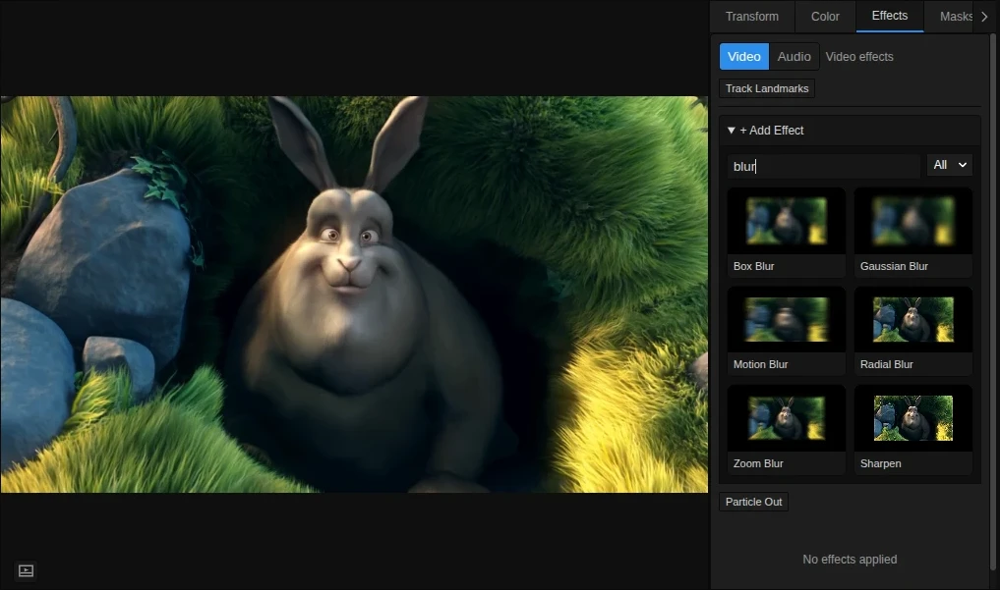
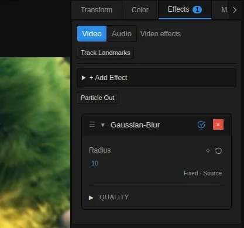
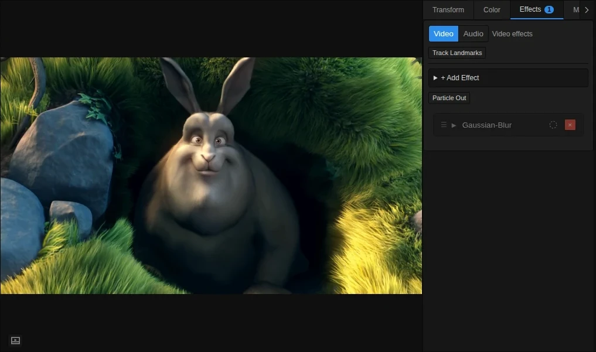
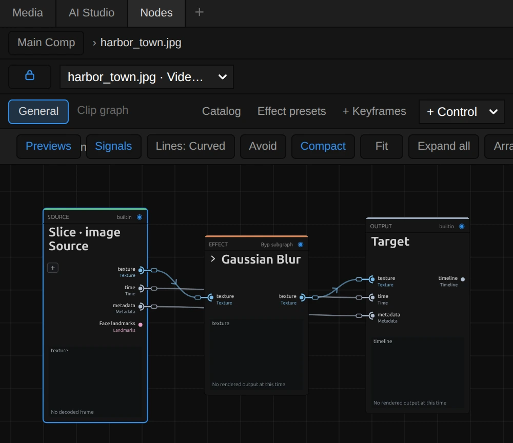

# Using effects

Effects change how a clip looks: soften it, colour it, break it up, draw over it. You add them
to a clip, adjust them while the preview follows, and animate them like any other setting.
Every effect has its own page in the [Effect catalog](./effects/index.md).

Try it interactively: **Info → Tutorials → Effects & Color**.

## Add an effect

Select a clip in the timeline and open **Properties → Effects**. Click **+ Add Effect**, type part
of a name (for example `blur`) or pick a group, then click a tile. The tiles preview each look on
your own clip, so you can compare before you choose. Effects whose name matches your search come
first.

<figure class="docs-shot docs-shot--detail">

<svg class="docs-shot-overlay" viewBox="600 0 417 500" aria-hidden="true" focusable="false">
<defs><marker id="effects-catalog-detail-arrow" viewBox="0 0 10 10" refX="8" refY="5" markerWidth="5" markerHeight="5" orient="auto-start-reverse"><path d="M 0 0 L 10 5 L 0 10 Z" fill="#ffd54a" /></marker></defs>
<path class="docs-shot-arrow" d="M840 65 L903 18" marker-end="url(#effects-catalog-detail-arrow)" />
<circle class="docs-shot-number" cx="840" cy="65" r="18" /><text x="840" y="65" class="docs-shot-number-text">1</text>
<path class="docs-shot-arrow" d="M655 167 L811 167" marker-end="url(#effects-catalog-detail-arrow)" />
<circle class="docs-shot-number" cx="655" cy="167" r="18" /><text x="655" y="167" class="docs-shot-number-text">2</text>
<path class="docs-shot-arrow" d="M655 275 L903 270" marker-end="url(#effects-catalog-detail-arrow)" />
<circle class="docs-shot-number" cx="655" cy="275" r="18" /><text x="655" y="275" class="docs-shot-number-text">3</text>
</svg>

<figcaption>1 — Open Effects. 2 — Search for blur under + Add Effect. 3 — Click Gaussian Blur to apply it. The main preview still shows the untreated clip here.</figcaption>
</figure>

On an **Adjustment Layer** the list offers only the effects that work there (Brightness, Contrast,
Saturation, Invert and Gaussian Blur). Effects marked *Experimental* in the list work, but have
known flaws; their card says which.

## Change a setting

The new effect appears as a card below the list. Drag a number left or right, or double-click it
to type a value. The reset arrow (or a right-click on the number) brings back the default.

<figure class="docs-shot docs-shot--detail">

<svg class="docs-shot-overlay" viewBox="600 0 417 390" aria-hidden="true" focusable="false">
<defs><marker id="effects-blur-after-detail-arrow" viewBox="0 0 10 10" refX="8" refY="5" markerWidth="5" markerHeight="5" orient="auto-start-reverse"><path d="M 0 0 L 10 5 L 0 10 Z" fill="#ffd54a" /></marker></defs>
<path class="docs-shot-arrow" d="M650 278 L760 278" marker-end="url(#effects-blur-after-detail-arrow)" />
<circle class="docs-shot-number" cx="650" cy="278" r="18" /><text x="650" y="278" class="docs-shot-number-text">1</text>
<path class="docs-shot-arrow" d="M855 165 L939 211" marker-end="url(#effects-blur-after-detail-arrow)" />
<circle class="docs-shot-number" cx="855" cy="165" r="18" /><text x="855" y="165" class="docs-shot-number-text">2</text>
</svg>

<figcaption>1 — Edit Radius (10 here) to control the blur. 2 — Click the enabled checkmark to bypass the effect. The softened preview is the result of the active effect.</figcaption>
</figure>

Some settings show a warning under the card, for example when a keyframe pushes a value past
what the effect can draw: the card then says which value it uses instead.

## Compare with the original

Click the checkmark in the effect's header (**Bypass effect**) to switch the effect off without
losing its settings: the card dims and the preview shows the clip without it. Click again to
switch it back on. The red **×** removes the effect.

<figure class="docs-shot docs-shot--detail">

<svg class="docs-shot-overlay" viewBox="600 0 417 390" aria-hidden="true" focusable="false">
<defs><marker id="effects-blur-before-detail-arrow" viewBox="0 0 10 10" refX="8" refY="5" markerWidth="5" markerHeight="5" orient="auto-start-reverse"><path d="M 0 0 L 10 5 L 0 10 Z" fill="#ffd54a" /></marker></defs>
<path class="docs-shot-arrow" d="M850 162 L940 211" marker-end="url(#effects-blur-before-detail-arrow)" />
<circle class="docs-shot-number" cx="850" cy="162" r="18" /><text x="850" y="162" class="docs-shot-number-text">1</text>
</svg>

<figcaption>1 — Click the dimmed bypass control to enable the effect again. Compare the sharp eyes, fur and grass at the same playhead position; the settings are preserved.</figcaption>
</figure>

*Example footage: © 2008 Blender Foundation / [Big Buck Bunny](https://peach.blender.org/),
[CC BY 3.0](https://creativecommons.org/licenses/by/3.0/). Screenshots show an
excerpt resized for the demonstration; the enabled example adds Gaussian blur.*

## Order matters

A clip's effects work from top to bottom: the first card changes the clip's picture, every next
card changes the result of the cards above it. So the same two effects can give two different
looks. **Pixelate** then **Glow** makes the squares glow; **Glow** then **Pixelate** turns the glow
itself into squares.

To change the order, drag a card by its **☰** handle to a new place. **Pixel Particle
Disintegrate** always works last: effects below it have no effect. A colour grade from the Color
tab also appears in the list, as **Color**.

## Animate a setting

Click the diamond next to a setting to set a keyframe at the playhead, move the playhead, and
change the value: the effect now changes over time. Everything about keys, easing and curves:
[Keyframes](./Keyframes.md).

To give other clips the same effects, right-click the clip in the timeline and choose
**Copy Effects**, then right-click the other clips and choose **Paste Effects**. Their keyframes
come along.

## Let a setting follow something else

Some settings, such as Gaussian Blur's Radius or Hue Shift's Shift, have a **Source** button next
to their value. It reads *Fixed*, *Keys* or *Node*. Instead of a fixed number or keyframes, a small
node can drive the setting: a slow wobble (LFO), random drift (Noise), the playing time, or the
loudness of a sound clip (Audio Envelope). Choose one in the Source menu; the button beside it
opens that node in the Nodes tab. More: [Parameter sources](./Node-Workspace.md#procedural-parameter-sources).

## Styles and presets

**Styles.** Many print, line, textile and text effects are looks of one shared engine. Their card
has a **Style** menu at the top: it switches to another look and keeps your settings and
keyframes.

**Effect presets.** To reuse an effect you have set up, open the **Nodes** tab, click **Effect
presets**, give it a name and click **Save effect copy**. Under **Saved effects**, **Add copy** adds
it to the selected clip, in any project in this browser.

**Particle Out** (next to the effect list) adds a ready-made outro: Pixel Particle Disintegrate with
keyframes that blow the picture away at the end of the clip.

## The node setup

Most effects are small node setups you can open and change. Open the **Nodes** tab and pick the
clip in its source list: each effect is a folded card, and the **›** left of its title opens it.
Changes apply to this one effect. Each effect page shows its setup under *Node setup*; how to add
and connect nodes: [Nodes basics](./Node-Workspace.md).

<figure class="docs-shot docs-shot--float-right">

<svg class="docs-shot-overlay" viewBox="0 0 590 510" aria-hidden="true" focusable="false">
<defs><marker id="gaussian-blur-nodes-arrow" viewBox="0 0 10 10" refX="8" refY="5" markerWidth="5" markerHeight="5" orient="auto-start-reverse"><path d="M 0 0 L 10 5 L 0 10 Z" fill="#ffd54a" /></marker></defs>
<path class="docs-shot-arrow" d="M180 115 L180 31" marker-end="url(#gaussian-blur-nodes-arrow)" />
<circle class="docs-shot-number" cx="180" cy="115" r="18" /><text x="180" y="115" class="docs-shot-number-text">1</text>
<path class="docs-shot-arrow" d="M359 88 L275 88" marker-end="url(#gaussian-blur-nodes-arrow)" />
<circle class="docs-shot-number" cx="359" cy="88" r="18" /><text x="359" y="88" class="docs-shot-number-text">2</text>
<path class="docs-shot-arrow" d="M245 201 L245 285" marker-end="url(#gaussian-blur-nodes-arrow)" />
<circle class="docs-shot-number" cx="245" cy="201" r="18" /><text x="245" y="201" class="docs-shot-number-text">3</text>
</svg>

<figcaption>1 — the Nodes tab. 2 — pick the clip here (the tab starts on the whole Timeline). 3 — the › opens the effect.</figcaption>
</figure>

## Audio effects

The **Video / Audio** switch at the top of the Effects tab shows the clip's sound effects instead
(volume, EQ, compressor and more). See [Audio](./Audio.md).

## Technical details

How effects are registered, rendered, cached and exported, and how their pages are made:
[Effect system](./Effect-System.md). Their building blocks: [Node Catalog](./Node-Catalog.md).
The preview and the export use the same effect render path.
