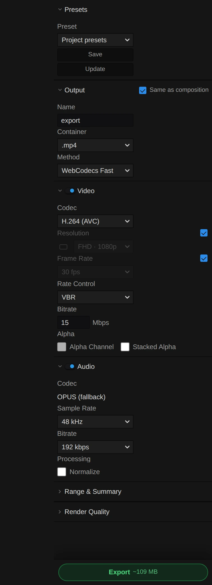

# Export

Export renders your timeline, or a range of it, to a video, an animated GIF, a still or image sequence, an audio file or an FCPXML timeline for other editors. Open the **Export** tab (in the Video layout it is the open tab of the right-hand group), pick a container, and press the green **Export** button at the bottom. Saving and archiving the project itself: [Project Persistence](./Project-Persistence.md).

---

## Export methods

The Export panel offers four video methods:

- **WebCodecs Fast**: the browser's hardware encoder, frame by frame. The default.
- **HTMLVideo Precise**: seeks each frame with the browser's own video player; slower, the safe choice for files or timing that the fast path cannot handle.
- **FFmpeg CPU**: the FFmpeg build that runs in the browser, for intermediates such as ProRes or DNxHR (only where that build is available; load it with **Load FFmpeg Runtime**).
- **HAP GPU**: HAP files for media servers and show playback ([Browser-Native HAP Export](#browser-native-hap-export)).

FCPXML is a container choice of its own, under **Timeline**.

### The Export panel

<figure class="docs-shot docs-shot--detail">

<div class="docs-shot-stage">



<svg class="docs-shot-overlay" viewBox="0 0 610 1674" aria-hidden="true" focusable="false">
<defs><marker id="export-panel-arrow" viewBox="0 0 10 10" refX="8" refY="5" markerWidth="5" markerHeight="5" orient="auto-start-reverse"><path d="M 0 0 L 10 5 L 0 10 Z" fill="#ffd54a" /></marker></defs>
<path class="docs-shot-arrow" d="M74 27 L158 27" marker-end="url(#export-panel-arrow)" />
<circle class="docs-shot-number" cx="74" cy="27" r="18" /><text x="74" y="27" class="docs-shot-number-text">1</text>
<path class="docs-shot-arrow" d="M74 258 L158 258" marker-end="url(#export-panel-arrow)" />
<circle class="docs-shot-number" cx="74" cy="258" r="18" /><text x="74" y="258" class="docs-shot-number-text">2</text>
<path class="docs-shot-arrow" d="M74 546 L158 546" marker-end="url(#export-panel-arrow)" />
<circle class="docs-shot-number" cx="74" cy="546" r="18" /><text x="74" y="546" class="docs-shot-number-text">3</text>
<path class="docs-shot-arrow" d="M74 1048 L158 1048" marker-end="url(#export-panel-arrow)" />
<circle class="docs-shot-number" cx="74" cy="1048" r="18" /><text x="74" y="1048" class="docs-shot-number-text">4</text>
<path class="docs-shot-arrow" d="M74 1406 L158 1406" marker-end="url(#export-panel-arrow)" />
<circle class="docs-shot-number" cx="74" cy="1406" r="18" /><text x="74" y="1406" class="docs-shot-number-text">5</text>
<path class="docs-shot-arrow" d="M74 1464 L158 1464" marker-end="url(#export-panel-arrow)" />
<circle class="docs-shot-number" cx="74" cy="1464" r="18" /><text x="74" y="1464" class="docs-shot-number-text">6</text>
<path class="docs-shot-arrow" d="M77 1636 L161 1636" marker-end="url(#export-panel-arrow)" />
<circle class="docs-shot-number" cx="77" cy="1636" r="18" /><text x="77" y="1636" class="docs-shot-number-text">7</text>
</svg>
</div>

<figcaption>The Export panel. 1 — Presets. 2 — Output. 3 — Video. 4 — Audio. 5 — Range &amp; Summary. 6 — Render Quality. 7 — Export.</figcaption>
</figure>

From top to bottom:

1. **Presets**: the **Preset** list holds the project's saved export settings; choosing one loads it. **Save** stores the current settings under a name, **Update** overwrites the selected preset. For a video export whose range holds storyboard scenes, a **Storyboard output** row follows (not while a batch is queued): **Normal video** (blocked while a scene has no accepted media) or **Animatic (slates + stills)**, which renders empty scenes as labelled slates.
2. **Output**: **Same as composition** keeps resolution and frame rate in step with the active composition. **Name** is the file name, **Container** chooses the deliverable, grouped as Video, Image, Audio and Timeline (`.fcpxml`), and **Method** chooses how a video is encoded.
3. **Video** (**Image** for a still or image sequence, **GIF** for an animated GIF): the switch in its header turns the picture off for an audio-only export. Below it: codec, resolution, frame rate, rate control and bitrate, and under **Alpha** the **Alpha Channel** and **Stacked Alpha** options. Animated GIF shows its palette controls here.
4. **Audio**: the switch in its header turns sound off for a silent video. Below it: codec, sample rate, bitrate for compressed audio and **Normalize** under Processing. MP4 uses AAC; where the browser cannot encode AAC (Chrome on Linux, as in the picture), it falls back to Opus and the codec reads **OPUS (fallback)**. On Linux a banner also says so ([Linux: H.265 and AAC](#linux-h265-and-aac)).
5. **Range & Summary** (closed at first): **Range** is **Full timeline** or **In / Out markers**, followed by the timecode, duration, frame count, output size and the estimated file size.
6. **Render Quality** (closed at first, for video and images): how 3D scenes are rendered ([Render Quality](#render-quality)).
7. The green **Export** button, with the estimated size beside its label.

Two more sections appear above the Export button only when needed: **Batch Export** when you drag video, audio or image items from the Media panel onto it (it lists them as a queue; **All same** shares one set of settings between them), and **Glyph Artifacts** (closed at first) when the selected clip has a Glyph effect; it exports the effect's cell grid as files ([Glyph Artifact Export](#glyph-artifact-export)).

While a video export runs, red **Cancel** discards the run and yellow **Finish File Early** finishes the current frame, closes the file and downloads what is done so far. Finish File Early becomes available after the first frame with WebCodecs, HTMLVideo, FFmpeg and HAP; it is not offered while the export prepares or finalises, and not for audio-only, GIF, image-sequence or batch exports. The audio ends with the shortened video.

Narrow panels never scroll sideways: rows stack into one column as the panel gets narrower. Export settings, presets and the batch queue are saved with the project; changing them is not an undo step.

### Opaque preview/export parity

WebCodecs and HTMLVideo video exports preserve the compositor's displayed RGB when
using GPU readback (including the Linux canvas-capture fallback). Ordinary output
sets alpha to opaque before publishing the export preview or passing pixels to the
encoder, matching the normal preview output shader. Partially transparent dust,
soft glows and thin strands are therefore not multiplied by their coverage a
second time. Stacked-alpha output keeps its separate coverage plane, and image or
native-alpha consumers retain their existing readback contract.

### Audio export cancellation

Cancelling while the browser audio encoder flushes returns a cancelled run without
an export error banner or duplicate runtime error reports. An `AbortError` is only
treated as cancellation when this pipeline received an explicit cancel request;
unexpected encoder failures still propagate. Encoders are also released when
cancellation arrives during initialization or encoding fails.

### Render Quality

Single-sample Raster exports show frame progress only, without a flashing sample
counter. Multi-sample renders keep their sample progress visible between frames;
Denoise appears only when the renderer has enabled that pass. Raster sub-samples
also improve edge antialiasing with the physical camera bypassed; one sub-sample
means one ordinary render, not path tracing.

**Raster is the default for new exports.** Choose Path Traced explicitly, or choose
Composition to follow its render engine. Saved explicit choices remain intact.

**Render Quality** sets how 3D scenes are rendered for export: the engine
(composition setting or override), raster sub-samples (jittered antialiasing, and
motion blur when the camera shutter is open), and for path traced scenes the samples
per pixel, an adaptive threshold (pixels stop once their error is below it, after 16
samples), a time limit per frame and OIDN denoising. Path traced frames render
bit-identically across exports. The progress shows a second level for the current
frame: samples → denoise → encode, with the remaining time. See
[Path Tracing](./Path-Tracing.md). Export samples wait for pending geometry before
accumulating, including motion-blur time slices, so placeholder frames are never
counted as completed samples. Diagnostics include the render quality and render time.

### Export Presets

- Presets are stored per project, not in browser-only local storage.
- `Save` prompts for a name and creates a new preset or overwrites an existing preset with the same name.
- `Update` overwrites the currently selected preset without asking for a new name.
- Choosing a preset in the list loads it into the live export settings.
- Presets and the current export settings are written into the project UI state and restored with the project.

---

## WebCodecs And HTMLVideo Export

`FrameExporter` is used for both the WebCodecs and HTMLVideo export buttons.

Canvas-backed sources such as text, solids, Lottie, and Rive are re-rendered for every export frame before capture, so the exported frame matches the current timeline time instead of reusing a stale first-frame texture. Motion shape clips are built as `motion` layer sources and rendered by the WebGPU motion renderer at export frame time before compositing.

### Fast Mode

- Source preparation tries project handles, project RAW paths, original media handles,
  media Files and clip Files in order until it actually reads nonempty bytes. A File
  returned by a handle can still fail later with `NotReadableError`; that failure
  continues to the next file candidate before trying URLs. URL fallback includes the
  video's `currentSrc`, skips duplicate URLs and rejects HTTP errors and empty bodies.
  Failures remain logged. If every source is unavailable, export still fails explicitly;
  this cannot reconstruct missing or revoked media. Clips sharing a source reuse one
  preparation read per export run.
- Sources of 512 MB and more are read on demand instead of whole. Chromium cannot read a
  file of several GB into one ArrayBuffer (`NotReadableError`); a 4.5 GB phone recording
  used to stop FAST export with "Could not load file data". FAST export reads only the
  top-level box headers and the `ftyp`/`moov` boxes, then fetches sample bytes window by
  window as the decoder consumes them: 8 MB read-ahead, at most 256 MB held per clip,
  older bytes dropped and read again if a keyframe restart needs them. Samples beyond
  4 GiB (64-bit `co64` offsets) work the same way. A fragmented MP4 keeps its sample
  tables in `moof` boxes and falls back to the whole-file read; if that fails too, the
  error names the file size and the reason. Code: `src/engine/webcodecs/fileSampleData.ts`,
  `loadMp4FileOnDemand()` in `mp4DemuxLoader.ts`, `clipPreparation/fastSourceLoading.ts`.
  Nightly journey: `tests/playwright/nightly/export/large-source-fast-export.spec.ts`
  (generates a source above 4 GiB, or uses `MASTERSELECTS_LARGE_VIDEO_FIXTURE`).
- Export canvas capture snapshots the submitted GPU image immediately, without a per-frame `queue.onSubmittedWorkDone()` round trip. The retained `VideoFrame` remains valid if canvas cleanup happens afterward; capture does not read a nullable canvas field after yielding.
- A canvas capture failure still permits pixel readback, but disables repeated direct-capture attempts only for that export canvas. Initializing a new export retries the direct path.
- `tests/browser/export-canvas-probe.html` is a dev-only synthetic WebGPU check: it compares immediate/waited capture, verifies alternating frame pixels, encodes H.264, and reproduces the former cleanup race without changing a project. Its timings are not whole-editor export benchmarks.
- Uses WebCodecs sequential decoding for a single clip.
- FAST export resolves the requested time to a source sample, waits for that exact decoded frame, and fails if it stays unavailable instead of silently substituting a buffered neighbor. The Windows beta harness verifies the complete exported frame sequence with independently decoded frame counters.
- When a decoder withholds the exact frame past the first rolling window, FAST export submits a bounded number of later samples while releasing older buffered frames. This lets reordered frames arrive without accepting a neighboring frame in the output.
- Repeated source-time jumps, such as frames from a sped-up or speed-ramped clip, continue decoding from the current cursor and discard skipped outputs. A forward jump restarts at a keyframe only when a keyframe lies inside the gap, so skipping is cheaper than decoding through it.
- Speed ramps: FAST export tracks the source stride between requested frames, decodes the predicted next frame in the background, and immediately closes decoded frames that fall between predicted requests. Hardware decoders therefore keep free output surfaces. If a decelerating ramp requests a frame that was closed, export restarts from the preceding keyframe for that frame.
- Decoder backpressure waits for decoder progress events instead of fixed sleeps. If a hardware decoder holds reordered samples and its queue stops draining, export submits more input instead of waiting for a timeout.
- Regular multi-clip exports use source-shared sequential WebCodecs decoders; nested-composition video clips use `ParallelDecodeManager`.
- In parallel exports, speed-keyframed and transition-mapped clips prefetch at their mapped source time and retire old frames using that same time. They do not first seek to the clip's constant-speed time.
- Every FAST path picks the source frame for a requested time with one rule (`parallelDecode/presentationFrame.ts`). A reversed clip asks for the time 10 µs before a frame boundary, so it shows frame 119 − N of a 120-frame source, not 120 − N.
- Constant-rate media is matched on its nominal frame grid. An MP4 stores timestamps in its timescale, and a coarse one (1/1000, 1/600) moves a 30 fps frame start up to half a tick (500 µs) away from k/30, to either side of a request. Phone muxers (Android MediaMuxer at 1/90000 or 1/1000000) also store each frame up to a few milliseconds off k/30. The grid's frame duration is derived from the samples and snapped to an integer, half-integer (7.5, 12.5 fps) or 1000/1001 rate. The grid is used when every timestamp lies within a quarter frame of it, or within the container's rounding when the tick is coarser (240 fps at 1/600); dropped frames are allowed. When several rates fit a short clip, the one whose timestamps do not drift wins. A request goes to its nominal frame and is looked up in the middle of that frame. Before this, a 1/1000 file exported every third frame twice, and jittered phone footage showed the previous frame for about a quarter of all frames.
- Media without a grid (real VFR) takes the sample nearest to the request. Only when that sample starts 2–20 µs after the request (beyond the container's rounding), the request means "just before this boundary" and the previous sample is shown.
- Parallel exports count a frame as ready only when exactly that frame is buffered. If it is not, they wait, flush frames the decoder holds back, then re-decode. Before, a buffered neighbour within three frames counted as ready, so with about a dozen layers and the 8-decoder pool some layers showed the previous frame. Recycling a pool decoder resumes after the newest buffered frame. A clip that walks its source backward prunes and evicts the frames it has already passed.
- If the exact frame still does not arrive, a neighbour within the lookup window stands in. The run's diagnostics count it as a `previousFrameFallbacks` entry with `reason: 'neighbour-frame'`. The per-time and the per-clip source-time prefetch share this wait (`waitForExactBufferedFrame`). A single sample that never decodes therefore no longer stops the export. The export fails only when no frame is buffered nearby. For a reversed clip, a full frame buffer evicts the end farthest from the target, never the frame that just arrived.
- Preview resolution updates pause during export. Each export frame rechecks its render host dimensions before rendering so an intervening preview resize cannot produce readback pixels at the wrong size.
- Parses source media with MP4Box.
- Decode, buffer, and unsupported-file failures remain in the selected workflow. Errors are logged and surfaced; Fast mode does not automatically switch to HTMLVideo.

### Precise Mode

Nested preview and export account for each composition wrapper's start time and trim when seeking deeper video sources.

- Uses detached `HTMLVideoElement` instances and browser seeking.
- Prepares nested video sources for the selected export range and parent trims. Ordinary forward 1x composition branches skip unused descendants; retimed or transition-driven branches keep conservative preparation. Composition wrappers do not consume video decoders.
- If a required video cannot be admitted within the media budget, preparation reports the failure before rendering.
- A seek that exceeds its 2-second budget waits briefly for the frame. If the frame then decoded, it is logged at info; if not, the warning says the exported frame repeats the previously decoded frame, and the run's diagnostics (`debugExport` → `exportStats.*.seeks`) count `timeouts` and `previousFrameFallbacks` with sample times and clips. The export finish logs one summary warning when any frame repeated.
- Waits for ready state and a fresh frame before capture. A temporarily unavailable nested source triggers the export readiness retry; an older preview composition texture is never accepted as the current export frame.
- Is slower than fast mode, but it is the explicit compatibility choice for difficult files or timing cases.
- Streamed LOD splats (`*.lod.zip`) choose their chunks while a frame is drawn. Before each frame
  the export waits (up to 30 s, then logs a warning) until every chunk the previous frame asked
  for is resident, so detail trails the export camera by one nearly identical frame.

---

## Output Codec Support

### WebCodecs / HTMLVideo Export

Supported containers:

- MP4
- WebM

Supported codecs are checked at runtime:

- H.264
- H.265
- VP9
- AV1

### Runtime Behavior

- WebM is limited to VP9 or AV1.
- MP4 accepts the full codec list, but browser support is checked with `VideoEncoder.isConfigSupported()`.
- Unsupported combinations are not silently promised by the docs; they must pass the runtime checks or be remapped by the encoder logic.
- The selected bitrate is passed into `VideoEncoder`, but in the WebCodecs path it is a target, not a guaranteed final file bitrate.
- `rateControl = cbr` maps to `VideoEncoderConfig.bitrateMode = "constant"` and falls back to variable bitrate if constant mode is rejected during encoder configuration.
- Browser encoders can undershoot the requested bitrate on simple material, so the panel treats file size as a target estimate rather than an exact promise.
- Codec strings carry the smallest standard level that fits the export size and frame rate (for example HEVC Level 5.1 and H.264 Level 5.2 for 3840x2160 at 60 fps); small exports keep the historical defaults.
- Chrome on Windows advertises hardware encoders above 1080p with at most 30 fps even when they encode faster. When the real frame rate is rejected, export retries with a 30 fps rate-control hint and a bitrate scaled by 30/fps, so the file keeps the requested bits per second; frame timestamps keep the real rate (verified: 3840x2160 HEVC at 60 fps and 15 Mbps on an RTX 5080 laptop). Hardware configs are preferred over software ones at the real rate.
- Dense particle material needs far higher bitrates than camera footage; 4K60 HEVC of fine point clouds looks soft below roughly 60 Mbps.
- Encoder backpressure waits for encoded output instead of flushing, so hardware encoders keep their GOP and rate control. At least eight frames may be in flight (bounded by a 384 MB ceiling, so 8K stays at two) because hardware encoders hold several frames before their first output.
- Motion frame state is validated once per frame: replicator evaluations and modifier plans created by the frame runtime are sealed and proven by their input key instead of being re-evaluated and compared as JSON.

### Linux: H.265 and AAC

Chrome on Linux has no AAC encoder and usually cannot encode H.265; H.265 decoding depends on the graphics hardware. On Linux only, a banner at the top of the editor tells you when this affects your work, says what happens instead and what you can do. **✕** closes it for good: each notice is remembered on its own, also after a reload.

| When | Banner |
|---|---|
| You click the greyed-out **H.265 (HEVC)** codec, a preset or saved setting asks for H.265 (the export switches to H.264), or an export starts with H.265 | H.265 encoding is not available: choose H.264, VP9 or AV1 (the FFmpeg export has no H.265 either), or use Chrome on Windows or macOS. |
| You choose a browser MP4 export with audio (container, method, audio switch, preset) or start one | AAC is not available: the MP4 gets Opus audio, which QuickTime and some editors cannot open. For AAC choose the **.mov** container (FFmpeg export with AAC audio), or use Chrome on Windows or macOS. |
| An H.265 clip is imported or opened and the browser cannot decode it | The clip is decoded in software ([HEVC Decoding](./HEVC-Decoding.md)), so playback and export are slower; convert it to H.264, or use Chrome on Windows or macOS. |

The banner appears only when the browser's own check (`VideoEncoder`/`AudioEncoder`/`VideoDecoder.isConfigSupported()` with the configuration the export or clip actually uses) says no; never on Windows or macOS, never when the check passes. Opening the panel with saved MP4 settings stays quiet until you change them or start the export. The fallback is logged once per session under `LinuxCodecNotice`, also after the banner was closed. Code: `src/services/codecNotices/` (decision and texts), `src/components/common/LinuxCodecNotices.tsx`; closed notices are stored in `uiSettingsStore.dismissedCodecNotices`.

---

## Stacked Alpha Export

`stackedAlpha` is supported in the WebCodecs / HTMLVideo export path.

### How It Works

- The export canvas height is doubled.
- The top half contains RGB.
- The bottom half contains alpha as grayscale.
- `OutputPipeline` mode `2` and `ExportCanvasManager` handle the stacked-alpha render path.

### Limitation

- This is a stacked-alpha format, not a conventional single-layer transparent video container.

---

## Animated GIF Export

Animated GIF is exposed as `.gif` in the video container group.

### Browser GIF Mode

- Available from the WebCodecs / HTMLVideo workflow selector, but GIF is not a WebCodecs codec.
- Uses the same frame-accurate browser render path, then encodes indexed GIF frames with the `gifenc` JavaScript encoder.
- Supports palette size, global vs per-frame palette mode, forever/once/count loop modes, transparent or opaque GIF output, and binary alpha threshold.
- Uses fast quantization without dithering because `gifenc` has no dithering support.
- Does not support audio.
- Uses the GIF size estimator instead of video bitrate math.
- Stops before rendering when the selected range would exceed the browser encoder's memory budget; use FFmpeg GIF or reduce duration, FPS, or resolution for larger exports.

### FFmpeg GIF Mode

- Available from the FFmpeg workflow selector.
- Uses FFmpeg `palettegen` and `paletteuse` for palette-quality output.
- Supports palette size, global/per-frame palette behavior, dithering, Bayer scale, forever/once/count loop modes, transparent or opaque GIF output, transparency threshold, and frame-difference optimization.
- Does not extract or mux audio.

### Size Estimation

- GIF estimates are based on output pixels, frame count, palette size, dither mode, palette mode, transparency mode, and optimization settings.
- The panel shows a single estimate and a content-dependent range because GIF LZW compression varies heavily with motion, noise, and transparency.
- MP4/WebM estimates continue to use bitrate targets.

---

## Audio Export

Audio export is handled separately from the video encoder.

### Current Flow

- Audio is extracted from the selected timeline range.
- `AudioExportPipeline` renders the mixed audio through the same clip-local path used for processed timeline waveforms.
- Audio-only WAV export writes the mixed `AudioBuffer` as 16-bit PCM WAV.
- WebCodecs export can mux the audio chunks into the final file.

### Supported Behavior

- Audio-only export supports uncompressed WAV (`.wav`) without WebCodecs audio encoding.
- Audio-only export supports MP3 (`.mp3`) through the browser-side Mediabunny MP3 encoder package, without the Native Helper.
- Browser-compressed audio-only export writes AAC (`.aac`) or Opus (`.ogg`), according to runtime support.
- AAC is the MP4 default. Browser exports default to 192 kbps and retry with a Chromium-compatible AAC bitrate when the requested bitrate is unsupported.
- Opus is used for WebM when supported.
- Clip-local trim, region edit-stack operations including paste/insert/delete silence, reverse, speed/pitch, mute, EQ, and volume are rendered before mixing.
- If the browser cannot encode a usable audio format, the export can proceed without audio.

### Limitation

- Audio availability is determined by browser and container support; export may proceed without audio when no supported format is available.

---

## Image Export

Image export can render a single composited frame at the current playhead position or a numbered still-image sequence over the selected range.

### Supported Formats

- PNG
- JPG
- WebP
- BMP

### Current Behavior

- A visual clip's **Export Current Frame** context-menu command renders the whole active composition at its full resolution, independent of preview quality. Its JPG has a black background, without preview overlays. Use the export panel's PNG or WebP format for transparency.
- Timeline `Frame` mode does not use the In/Out range. It renders only the current playhead frame. Direct source batch export instead encodes the complete source image.
- `Sequence` mode uses the normal export range, respects `Use In/Out`, renders at the selected frame rate, and writes numbered image files into a user-selected folder when the browser supports File System Access.
- Browsers without folder write access fall back to a ZIP download.
- Custom resolution still applies before the image is written.
- PNG and BMP are exported losslessly.
- JPG and WebP expose a quality control in the panel.
- Audio is ignored while image export is active.

### Glyph Artifact Export

When the current frame contains a supported glyph/cell treatment, the Advanced
panel can export the exact cell result independently of the normal raster
deliverable:

- **TXT** writes the character grid as plain UTF-8 text.
- **SVG** creates real vector `<text>` cells; it does not embed a raster frame.
- **Web Pack** bundles TXT, SVG, metadata, and optional gzip tracking sidecar
  data in a ZIP.

The exporter uses the same grid/ramp contract as the GPU glyph path. Files and
Blobs are created only for the download operation and are never stored in
durable project state.

### Batch Source Export

- Media files can be queued for batch export from the export panel.
- The queue can use each job's own settings or apply one shared technical configuration while retaining individual file names.
- Direct source jobs bypass timeline-only outputs and In/Out markers; source images are exported at the selected output resolution.

---

## Browser-Native HAP Export

HAP is a dedicated browser encoder choice rather than an FFmpeg codec. It
produces QuickTime `.mov` files through the WebGPU block encoder and exposes
HAP, HAP Alpha, and HAP Q formats for VJ and media-server playback. The export
summary, size estimate, progress UI, persistent presets, and project settings
all treat HAP as its own encoder; video exports use PCM audio when audio is
included.

---

## FFmpeg Export

The FFmpeg path is a separate CPU-based export pipeline.

### Current Build Characteristics

- Loads the FFmpeg core from the local `/ffmpeg` path on demand.
- Runs FFmpeg synchronously; the UI is blocked while one segment or the final join is encoding.
- Reports progress from FFmpeg log output where possible.
- Streams frames in bounded segments (`src/engine/ffmpeg/bridge/ffmpegFrameStream.ts`): rendered frames fill one reused RGBA buffer of about 256 MB (32 frames at 1080p, 8 at 4K); each full buffer is encoded into a compressed segment file in the FFmpeg memory filesystem, and the end of the export joins all segments with the concat demuxer (stream copy) and encodes the audio once. All FFmpeg export codecs are intra-only, so the copy join is exact. GIF segments are a lossless UT Video intermediate and the join runs the palette pass for the whole clip.
- Peak raw memory is therefore one segment, independent of the export length. What still grows with the length is the compressed file: the segments, then the joined file and its copy for the download (roughly 2-3x the final file size at the end). Example: 20 s of 1080p30 ProRes 422 HQ is about 550 MB of output instead of 4.6 GB of raw frames; 600 frames of 720p MJPEG peaked at about 480 MB of buffers in a Node run of the real FFmpeg core instead of 2.1 GB raw. The practical limit is the encoded size, so heavy profiles (ProRes 4444 XQ, FFV1, UT Video) reach it first.
- Out of memory is reported by stage: the segment buffer (halved automatically down to one frame before giving up), the encoded segments, or the finished file. Each message names the size and suggests a more compact codec or profile, a shorter range, or WebCodecs.
- Cancel takes effect at the next segment boundary, including during encoding; temporary files are removed. A JavaScript exception thrown out of an FFmpeg run makes the bridge reload the core before the next command.
- Known pre-existing quirk: MXF with PCM audio drops the last video frame in this FFmpeg 5.1 core, with or without segments.

### Supported Video Codecs

- ProRes
- DNxHR / DNxHD family
- FFV1
- UTVideo
- MJPEG
- Animated GIF

### Supported Containers

- MOV
- MKV
- AVI
- MXF
- GIF

### Current Limitations

- GIF export is silent.
- This build does not expose a shared decoder pool.
- Multi-threaded mode is only reported as a capability check; the exported core path is synchronous.
- `callMain()` blocks while encoding, so it is not the same runtime profile as the WebCodecs path.

---

## FCPXML Export

FCPXML export is available through the container chooser as `.fcpxml`.

### What It Exports

- Timeline structure
- Clip timing and track layout
- Basic audio placement

### What It Does Not Export

- Compositions are skipped
- Text clips are skipped
- The XML points back to media by file reference, so it is an interchange file, not a self-contained rendered deliverable

### Limitation

- This is useful for NLE round-tripping, not for final media delivery.

---

## Frame Export

Still-image export renders the current composited frame through an export render session.

### Current Path

- The runner reads back the rendered RGBA pixels.
- It encodes the pixels as PNG, JPG, WebP, or BMP according to the selected image format.

### Limitation

- Still-image and image-sequence paths use CPU pixel readback.

---

## Export Process Notes

### WebCodecs / HTMLVideo

1. Prepare clips and runtimes for the selected export mode.
2. Seek all clips to each export time.
3. Build layers for that frame. Export layers carry the same transform as the preview, including
   the clip anchor (pivot); anchored 3D clips such as splats therefore render in the same place.
4. Render procedural motion shapes, nested compositions, transitions, and supported 3D assets, then composite through the GPU engine.
5. Capture a `VideoFrame` from the export canvas when possible, otherwise fall back to pixel readback.
6. Encode and mux the file.

Baked Datamosh transitions are prepared as ordinary project-backed video media before frame rendering. Preview and export therefore consume the same cached codec artifact; export does not run the I-frame-removal bake again. Isolated source renders used by the baker stage detached HTML video frames through a canvas before WebGPU import so a newly sought frame cannot collapse into a repeated source column.

WebCodecs decoder startup submits a bounded search window of up to 32 samples before waiting for delayed initial output. It does not insert a separate output wait after each small startup chunk; normal decoding still waits for its target, and end-of-source decoding still drains the decoder. This supports hardware decoders that briefly report an empty queue before delivering their first frame.

### FFmpeg

1. Render each frame through the GPU engine.
2. Read pixels from the GPU.
3. Write frames into the bounded segment buffer; every full buffer is encoded into a compressed segment.
4. Extract audio if enabled and the selected output supports audio.
5. Join the segments (stream copy, or the GIF palette pass) and mux the audio.

### Limitation

- Neither path is background rendering. Both depend on the current browser session.

### Browser Export Debugging

When export fails in the UI, reproduce the same browser-side path through the dev bridge before changing exporter code:

```powershell
$token = Get-Content -Path .ai-bridge-token -Raw
$headers = @{ Authorization = "Bearer $token"; 'Content-Type' = 'application/json' }
$body = @{ tool = 'debugExport'; args = @{ includeAudio = $true; exportMode = 'fast'; download = $false; maxRuntimeMs = 25000 } } | ConvertTo-Json -Depth 6
Invoke-RestMethod -Uri 'http://localhost:5173/api/ai-tools' -Method Post -Headers $headers -Body $body
```

`debugExport` calls `FrameExporter` in the active browser tab and returns blob metadata, sampled progress, engine readiness before/after, and recent Export/WebGPU logs. It intentionally does not download unless `download = $true`. Use `maxRuntimeMs` to cancel cleanly before a long bridge request appears hung.

Interpret the result as follows:

- Blob `size > 0`: browser export works; debug UI download/progress/preset handling next.
- `WebGPU device lost during export` plus broken `getStats` fields such as `renderLoop.isRunning=false`, `renderDispatcher=null`, or `targetCanvasCount=0`: hard-reload the browser tab or call `reloadApp`, then retest.
- Video-only timelines should skip audio work even if `includeAudio = $true`; a long "Rendering audio" phase usually points at audio-range detection.

---

## Current Limitations

- Preview and export are separate pipelines, even though they reuse the same engine.
- Precise export still depends on browser media readiness and seek behavior.
- FFmpeg export is blocking.
- The exporter does not provide a true multi-pass render pipeline.

---

## Sources

Key implementation files:

- `src/components/export/ExportPanel.tsx`
- `src/components/export/useExportState.ts`
- `src/components/export/useExportRunController.ts`
- `src/components/export/exportHelpers.ts`
- `src/components/export/runners/`
- `src/components/export/panel/`
- `src/engine/export/FrameExporter.ts`
- `src/engine/export/ClipPreparation.ts`
- `src/engine/export/BrowserGifExporter.ts`
- `src/engine/export/ImageSequenceExporter.ts`
- `src/engine/export/VideoSeeker.ts`
- `src/engine/export/VideoEncoderWrapper.ts`
- `src/engine/export/codecHelpers.ts`
- `src/engine/managers/ExportCanvasManager.ts`
- `src/engine/pipeline/OutputPipeline.ts`
- `src/services/export/fcpxmlExport.ts`
- `src/engine/ffmpeg/FFmpegBridge.ts`
- `src/engine/ffmpeg/codecs.ts`

### Decoder loss while awaiting a frame

FAST export includes the final exact-frame wait in its bounded decoder recovery. If the browser loses the decoder after samples were submitted, export recreates it and restarts from the preceding keyframe once. It still requires the exact source frame; a missing frame or failed recreation produces an explicit failure instead of substituting a neighboring frame or retrying indefinitely.

Export submissions retain exclusive ownership until the runner and its cleanup settle. Same-tick duplicate starts and restart attempts during cancellation are ignored; cancellation leaves the timeline export lock in place until cleanup finishes. A later export can start normally after completion or failure.

### Encoder allocation during preparation

Video export checks codec support and selects the audio format before preparation, but allocates the video encoder only when the first RGBA or zero-copy frame is ready. Slow source loading, audio rendering, and asset preparation therefore do not hold an idle video codec that the browser can reclaim. Cancellation during preparation discards the pending encoder and muxer. This does not restore inaccessible source files or prevent resource loss after encoding has begun.

On desktop Linux, WebCodecs export captures compositor pixels by GPU readback.
This avoids silently black frames from GPU-canvas capture on Mesa, and supports
stacked alpha (RGB above alpha-as-luma). Rendering remains on WebGPU; readback
adds a GPU-to-CPU copy.

Export diagnostics retain the latest runner phase and ten-percent progress bucket
under an ephemeral operation ID. The Cancel button and a runner returning no
output are separate observed signals. Tab visibility/pagehide records remain
nonterminal observations. See [Product analytics](Product-Analytics.md#operation-traces-and-observed-interruptions)
for privacy, delivery limits, and interpretation of incomplete runs.
