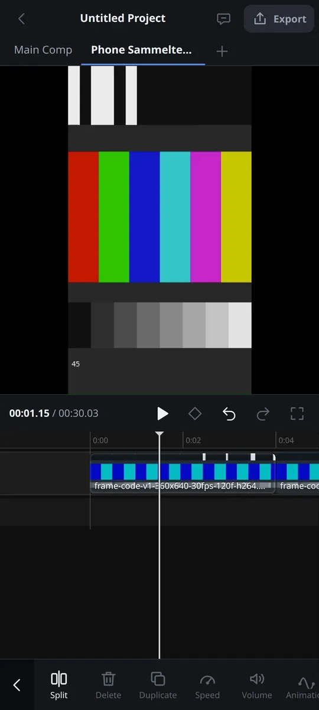

# Phone Editor

[Back to Index](./README.md)

<figure class="docs-shot docs-shot--float-right">

<figcaption>The phone editor with a clip selected. Tools a phone cannot use stay visible but greyed out.</figcaption>
</figure>

Open **masterselects.com** on your phone and the phone editor opens by itself, made for your thumb
(the address is **masterselects.com/m**). It is the same editor underneath: the same timeline,
effects, undo history and projects as on the desktop. A project you start on the phone opens
unchanged in the full editor, and the other way round. Tablets and computers keep the full editor.

## Start or reopen a project

The home screen opens when no project is open, and any time you tap **Projects** (top left).

- **New project** asks for a name and a canvas: **9:16** (preselected), 16:9, 1:1 or 4:5. It creates
  the project with its first composition at 1080 px on the short side (9:16 is 1080 × 1920), 30 fps.
  The canvas is part of the new project itself, so Undo never turns it back into 1920 × 1080.
- **Recent projects** lists the projects stored on this device, most recent first. Tap one to open it.
- **Import project file** opens a `.msproj` archive from your phone.
- Tap the **project name** in the top bar for the project sheet; the small status next to it tells you
  where the project is stored and warns when the browser may delete it.

Closing the browser does not lose anything: reopen /m and the last project comes back with the same
timeline. If the browser asks for access to the project folder again, one tap resumes it.

## Switch to the full editor

**Full editor** on the home screen and in the project sheet saves the project and opens it in the
full editor with every tool. The phone remembers that choice. To come back, tap **Mobile** in the
bottom bar of the full editor. On a computer or tablet, **Layouts → Phone editor** opens the phone
editor too. While an export is running, both wait and tell you why.

MasterSelects installed as an app (from the browser's install button) stays in the full editor on a
phone, because the installed app covers only the full editor's address.

## The editing screen

The screen has five strips:

1. **Top bar** – projects, project name, assistant and export.
2. **Preview** – the real picture of your composition. It stays visible while you work, also above an
   open sheet.
3. **Transport** – time, play, undo and redo.
4. **Timeline** – the playhead stays fixed in the middle and the clips move under it.
5. **Tools** – with nothing selected the main tools, with a clip selected that clip's tools.

**Swipe** across the timeline to scrub; the preview shows the frame under the playhead. **Pinch**
with two fingers to zoom; the frame under the playhead stays put. **Tap** a clip to select it and
tap empty space (or the clip again) to deselect.

## Cut a story

- **Add media:** **Media** opens the phone's file picker for videos, images and audio. Several files
  land on the main track in the order you picked them.
- **Trim:** select a clip and drag the handles at its ends; the preview shows the new first or last
  frame.
- **Split:** with the playhead inside the selected clip, **Split** cuts it there.
- **Move and reorder:** long-press a clip and drag it. **Reorder** in the clip tools reminds you.
- **Delete** removes the selected clips and leaves a gap. **Delete & close gap** removes them and
  pulls everything after them forward. They are two separate commands on purpose: nothing shifts
  your timing unless you ask for it.
- **Duplicate** copies the selected clips right behind themselves.
- **Text:** with nothing selected, **Text** opens a sheet with a line above the keyboard and adds the
  title at the playhead. Cancel adds nothing.
- **Undo and redo** take back every step above, one at a time.

Sheets (media, text, export, projects) rise from the bottom with **Cancel** and **Done**. Cancel
throws the draft away and never changes your project; **Done** commits it as one undo step.

## Design your video

Every design tool opens as a sheet under the preview, so you see each change live. **Cancel** throws
the change away and leaves your project exactly as it was; **Done** keeps it as one step you can undo.

**Effects, filters and colour:** select a clip and tap **Effects** to browse every effect of the
editor by group, or search for one, and tap a card to add it. Your clip's effects are listed above the
cards: switch one off, move it up or down, remove it, or drag its slider to set its main value. With
nothing selected, **Effects** adds an adjustment layer at the playhead that changes everything below
it (Brightness, Contrast, Saturation, Invert and Gaussian Blur so far). **Filters** puts one look on
the clip, with **Strength** to make it subtler and **None** to remove it. **Adjust** changes the
colour: tap a tile (Brightness, Exposure, Contrast, Saturation, Temperature, Tint, Highlights, Shadows
and more) and drag the slider; **Reset** and **Reset all** go back to the defaults.

**Transitions:** wherever two clips meet on a track, the timeline shows a small square at the cut. Tap
it, pick a transition (Dissolve, Wipe, Slide and more) or None, and set its length. **Apply to all
cuts** gives every cut on that track the same transition. A square turns solid once its cut has one.

**Speed:** select a clip and tap **Speed**. Under **Normal**, drag the slider (0.1x to 10x) or tap a
preset; the clip gets shorter or longer on the timeline. **Keep pitch** keeps voices natural and
**Reverse** plays the clip backwards. Under **Curve**, a preset such as Speed up or Slow middle
changes the pace inside the clip and keeps its length.

**Sound:** select a clip and tap **Volume** for its level (silent to +18 dB), **Mute**, **Fade in** and
**Fade out**; on a video clip it changes the video's own sound. With nothing selected, **Audio** adds
**Music & sounds** from your phone at the playhead, records a **Voiceover** with your microphone, or
**Extracts the audio** of the video under the playhead into its own clip.

**Text style and animation:** in the Text sheet, the tabs above the text row set the font, size,
colour, outline, shadow and alignment while you type. To change a title later, select it and tap
**Edit text**. **Animation** brings a clip **In**, takes it **Out**, does both (**Combo**) or builds a
title letter by letter (**Reveal**); the slider sets how long it takes. The presets are ordinary
keyframes, so they open unchanged in the full editor.

**Keyframes:** select a clip, move the playhead and tap the **diamond** in the transport. It keys the
clip's position, size, rotation and opacity there and fills while you stand on a keyframe; tap it
again to remove those keys. **Keyframe** in the clip tools lists the animated properties, jumps to the
previous or next key and deletes one.

**Mask, crop and canvas:** **Mask** cuts the clip with a shape (Linear, Mirror, Circle, Rectangle,
Star, Heart) with position, size, angle, **Soft edge** and **Invert**. **Crop & transform** crops to a
ratio or edge by edge, and moves, scales, rotates, fades or flips the clip; **Fit** and **Fill** size
it to the frame. With nothing selected, **Overlay** puts a photo or video on top of your picture at
the playhead as a picture in picture, and **Format** changes the whole canvas (9:16, 16:9, 1:1, 4:5,
4:3, 21:9) while keeping every clip in proportion.

## Export and share

**Export** (top right) opens the export sheet for the composition at 1080p. It needs at least one
clip; without a clip it says so. You see a summary, a progress bar and **Cancel**. When the file is
ready, **Share** hands it to the phone's share sheet (`navigator.share` with the file) and **Save**
downloads it; phones without file sharing offer Save.

**Advanced** picks any format MasterSelects can write: MP4 or WebM (H.264, HEVC, AV1, VP9), MOV
ProRes or DNxHR (they load the FFmpeg encoder first, which is slow on a phone), GIF, an image sequence
as ZIP, a single PNG, JPG or WebP of the frame under the playhead, or sound only as WAV, MP3 or AAC.
Set the resolution, frame rate, quality or an exact bitrate, and the range: the whole edit, your in
and out marks or the selected clips. Presets are shared with the desktop export panel, and **All
options** opens the desktop panel itself. **Batch queue** exports several media files one after
another, retries the ones that failed, and saves or shares each result. **Keep rendered part** stops
a running video export early and keeps what is rendered so far.

**Tip:** a greyed-out tool is not hidden on purpose. Tap it: it tells you why it does not work on
a phone. The same project always opens in the full editor (tap the project name, then **Full editor**).

## Pro tools

The pro tools open as sheets like the design tools, with the same rule: **Done** keeps your changes
as one undo step, **Cancel** throws them away.

**Compositions:** tap the stack icon at the left of the composition tabs to see every composition and
switch between them. **New composition** asks for a name, format, frame rate and duration; **More**
renames, duplicates, changes settings or deletes one (it always asks first and never deletes your last
composition). Select clips and tap **Nest** to move them into a new composition that takes their
place; **Enter** opens a nested one and the back arrow in the top bar takes you out again.

**Tracks, markers and trimming:** with nothing selected, **Tracks** adds video, audio and MIDI tracks,
hides, mutes, solos or locks them, and under **More** renames, recolours, resizes, reorders or deletes
them and sets an audio track's level and pan. **Markers** adds a marker with a label and colour at the
playhead; tap one to jump to it. With a clip selected, **Trim modes** gives you ripple trim to the
playhead, roll, slip and slide in frame steps, close gaps and link or unlink picture and sound.
**Replace** swaps the clip's footage and keeps everything you did to the clip. **All settings** opens
every property of the selected clip.

**Timeline tools:** under the timeline, the magnet turns snapping on or off (to clips, playhead,
markers and the beat grid), **In** and **Out** mark the export and loop range, and the metronome clicks
while you play (never in the export). **Timeline** in the tools opens **Snap**, **Range** (nudge,
loop, clear, bake the range, compare alternatives), **Tempo** (tempo, time signature, tempo changes,
metronome) and **View** (focus, thumbnails, waveforms). With a clip selected, **Details** shows its
source and timing, colours its source, renames MIDI clips and storyboard scenes, and gives it a parent
clip, parent track or new null object. **Bake** pre-renders a clip for smooth playback. **Compare
alternatives** plays the versions A, B and C the assistant built for a range, and **Accept** keeps one.

**Copy & paste, looks and titles:** select a clip and tap **Copy & paste** to copy its effects, colour
grade and animation, then tick the clips to paste onto and tap **Paste**. **Effects** and **Adjust**
reach the same sheet (**Copy or paste effects**, **Copy or paste colour**); in **Keyframe**, **Select**
picks keys to copy, delete or paste at the playhead. **Save as look** in Effects stores a clip's effect
stack under **Filters → Saved** on this device. **Style titles** changes size, colour, bold, italic,
alignment, outline or shadow of several titles at once. In a transition, **Edit transition content**
opens its own composition for every phone tool and **Edit in Nodes** its node graph.

**Captions:** with nothing selected, tap **Captions**. **Generate** lists every clip with speech;
**Transcribe** runs on your phone for free (**On this phone**) or with an online provider for an
account with credits. **Words** fixes a typo or cuts a word from picture and sound; **Style** and
**Timing** set the look, how many words a caption shows and how long it holds.

**Audio effects:** select a clip with sound and tap **Audio effects**. Add an effect, drag its main
slider, switch it off, reorder or remove it; **All parameters** opens every setting. **Clean up**
normalizes the level or removes silent parts, and **AI** separates stems or opens AI Studio.

**Library and settings:** **Library** shows all media of your project with thumbnails, folders,
labels and details. **Source monitor** (on an item, or under All tools) plays a file frame by frame,
sets In and Out and places the part with the editor's own modes: Insert, Overwrite, Append, On top,
Replace, Fit to fill or Ripple overwrite. **Jobs** lists imports, proxies, waveforms and analyses with
their progress; an item can save or share its original file, and **Paste** brings in a copied picture,
file or video link. Import, move, duplicate or delete several items at once; before deleting, it tells
you which clips use an item, and one Undo brings everything back. Missing media show up in red and one
tap relinks them. **Web sources** searches YouTube, Instagram or TikTok, and **Storage and sequences**
imports numbered 3D model or splat files as one item. Tap the project name, then **Settings**, for the
theme, the transcription provider, **Touch and input** (a ring under every finger for screen
recordings), **Assistant**, **Integrations**, your account, the version and a cache reset that says
exactly what it clears. **Help** installs MasterSelects as an app, opens the legal pages and the chat
with the developer, and shows the welcome again.

**Project tools:** the project sheet can **Duplicate** the project and keep working in the copy, save
and restore named **Versions**, and **Export .msproj** to share or save the whole project. **Storage**
moves other temporary projects into permanent storage. A folder backup needs a folder picker, which
phone browsers do not have, so it stays greyed with that reason.

**Speed, effects and transitions, in depth:** **Freeze frame** holds the frame under the playhead and
**Fit to a length** sets the speed from the seconds you type. **All parameters** in the effects sheet
opens every setting of the clip's effects, and **Settings and offset** in a transition its direction,
softness and offset. Wherever a landscape editor does the job better, the sheet hands over: **Edit
curve points** opens Curves, **Track and master effects** the Mixer, **Edit notes** the piano roll and
**Wheels** in Adjust the Colour editor. **Audio → Beats** puts the clips of a video track on every
beat of a music clip.

## Preview handles and view

Tap a clip, then drag it on the preview to move it, pinch to resize and twist two fingers to rotate.
Its frame shows while your fingers are on it and snaps to the frame edges, the centre and your guides;
each gesture is one undo step. **View** beside the picture (or **All tools → Preview view**) turns the
handles or snapping off, resets the position, shows pixel rulers, adds or clears guides, switches
between Fit and 1:1, and compares before and after: the clip without its effects left of a line you
drag, the edited version right of it. Exports never contain the compare. **All tools → Shape path**
draws a free line with your finger as a Motion Design path; keyframe its **Reveal** for a line that
draws itself.

## Sound range, recording and notation

Select a clip with sound and tap **Sound range** (also under **Audio → More audio tools**). Drag across
the waveform to select part of the sound, or switch to **Move range** to slide or resize it. The tabs
then split, cut, copy and paste the range, change its level or fades, insert or delete silence,
reverse it, swap or fold channels, add a filter, compressor or gate, and repair hum, clicks or loudness
or fill the range with the clip's room tone. **Stack** lets you listen to the edited or original range
and bypass each edit. In **Audio → Voiceover**, **Record a range** records only between a punch-in and
a punch-out time, and **Rescue recordings** brings back an interrupted take. **Notation** opens the
score editor with touch keys for notes, chords, rests and stems; score clips do not sound in the
timeline or export yet.

## All tools and desktop panels

**All tools** in the main toolbar lists everything the phone editor can do; type to search. An entry
opens a toolbar tool, a pro sheet, the fullscreen preview or a desktop panel such as Properties, Media,
Export, History, AI Studio or Go Live. A panel opens in a tall sheet under the preview and works as on
the desktop, with the same undo history; **All tools** at its top takes you back. The fullscreen button
next to Undo shows your edit on the whole screen; tap the picture or use the back gesture to return.

## Landscape editors

Tap **Editors** in the main toolbar and pick **Nodes**, **Mixer**, **Multicam**, **Piano roll**,
**3D scene**, **Curves**, **Colour** or **Output**. The editor opens full screen; turn the phone sideways for room.
**Back** in its top bar, or your phone's back gesture, returns to the timeline, and Undo and Redo sit
in the same bar. Each side panel folds away with the arrows in the bar or a swipe on its edge grip and
leaves a thin rail with its name; tap it or swipe inward to bring it back. The editor remembers your
choice, also after a reload.

- **Nodes:** drag empty canvas to move, pinch to zoom, drag a node to move it, drag between ports to
  connect. **Add** inserts nodes and effects, **Delete** removes the selection, and a tap on a clip
  node opens its lane.
- **Mixer:** drag any fader with a finger (you need not hit the cap), drag Pan, tap Mute, Solo, R, In,
  FX or Send, and swipe the strips sideways; the master stays in place.
- **Piano roll:** edits the selected MIDI clip, or lists the composition's MIDI clips and creates one.
  Draw, move and resize notes with the Pointer, remove them with the Eraser, frame them with Select.
  Two fingers zoom time sideways and pitch up and down. Each drag is one undo step.
- **Colour:** the Primaries wheels, Exposure, Custom Curves and colour keys in the middle, the scopes
  on the left and the colour node graph on the right. Each drag, reset or node change is one undo step.
- **Multicam:** tap **Multicam** to turn a composition with one camera per video track into a
  multicam edit, then tap a camera to cut to it at the playhead. If nothing happens, a note says why.
- **3D scene:** tap an object or its layer, drag the Move, Rotate and Scale handles with a finger,
  drag the empty scene to orbit, pinch to zoom and move two fingers together to pan.
- **Curves:** tap near a keyframe to select it, drag it or its Bezier handles, drag the empty graph
  through time; two fingers side by side zoom time, one above the other make the curves taller.
- **Output:** projector outputs. On the left add outputs and choose what each shows (the active
  composition, a fixed composition or a slot); in the middle the output's real picture; on the right
  its slices and masks. Drag the corner handles to pick the source region (**Input**) and pin it onto
  the stage (**Output**); a mask blacks out its inside or outside. **Done** saves the mapping for the
  desktop Output Manager (a save, not an undo step); **Cancel** or **Back** discards it. A phone cannot
  drive a projector, so **Open on display** stays greyed: open the mapping from the full editor.

## Assistant

The speech-bubble button in the top bar opens the assistant: the same MasterSelects chat as on the
desktop, in a tall sheet with the preview above it. Ask for an edit in your own words ("cut the
pauses", "add a title that says Berlin"); every change is a normal step on the timeline. Under **All
tools → Assistant**, each "Ask the assistant: …" entry puts a prepared request into the field without
sending it.

- **Fast**, **Medium** or **Slow** at the top picks the model; the choice is remembered.
- The line below shows your account: signed out (**Sign in**), guest, no credits (**Get credits**) or
  your credit count. Editing by hand always keeps working.
- While a request runs, a live line shows what the assistant does and **Send** becomes **Stop**. You
  can close the sheet and keep editing; the request keeps running.
- Every answer lists the tools it used, each with Done, Failed or Running and a short result.
- A request is one undo step, however many tools it used: **Undo this request** or one Undo in the
  transport takes it back. An edit you make while it runs stays and splits it there.
- When the assistant built three versions, you can watch A, B or C and keep one. **New** starts a fresh
  conversation.

## Draw a mask with the pen

Select a clip, tap **Mask**, then **Pen**. Tap the preview to place points; keep your finger down and
drag to bend the line into a curve. Tap the first point (or **Close path**) to close the shape. Drag a
point to move it and its round handles to reshape the curve; **Undo point** takes the last point back
and **Clear** starts over. **Soft edge** and **Invert** work on the pen path too, and the full editor
shows the same mask. **Edit as points** turns a rectangle, circle, star or heart into points; **Lock
axis**, **Whole shape**, **Handles only**, **Snap handles**, **Straight edges** and **Align neighbours**
do what the modifier keys do in the full editor.

## Accessibility and themes

Every control has a name for screen readers, and timeline clips read as "name, starts at …, … long".
A keyboard reaches everything: Tab moves through top bar, transport, timeline and tools in screen
order, stays inside an open sheet, and Escape closes it and returns focus. Buttons you tap often are at
least 44 px, sheets open without animation when the system asks for reduced motion, and the phone
follows the editor theme: it is light for Light, for System while the device is light, and for a
Custom theme brighter than 50.

## Android start

Home, the project list, the timeline and the sheets work while the graphics engine is still starting.
On an Android phone whose graphics took too long to start before, the next start opens your project
first and starts the graphics afterwards, so you can begin sooner. A phone whose graphics adapter
request timed out tries the compatibility path first next time.

## Milestones

**M0** proved touch and speed, **M1** brought the story cutter and **M2** the design tools. **M3**
added the pro sheets, All tools and the desktop panels, **M4** the landscape editors, **M5** the
assistant out of beta and **M6** completeness. Every feature of the plan's catalog now has a place on
the phone, with no open gap left. Whatever does not work on a phone stays visible, greyed, and explains
itself on tap: downloading from a link (it needs the desktop helper), a second screen, the OptiX
renderer, local Python models, showing a file in the file manager, the folder backup (no folder picker
in phone browsers) and reading text in pictures (MasterSelects has no OCR engine yet).

## Technical details

- Entry: the path `/m` (also `/m/…`) resolves to the `phone` experience in
  `src/routing/entryExperience.ts` and loads `src/components/mobileSkin/PhoneApp.tsx` lazily, without
  the desktop `App`. Before the first render, `src/main.tsx` sends phones from `/` and `/editor` to
  `/m` (`src/routing/phoneEntry.ts`): a phone is a device whose primary pointer is coarse and whose
  screen has a short side below 600 CSS px, so tablets and unfolded foldables stay in the desktop
  editor with its automatic Mobile dock layout. `?test`, `?entry=editor`, `/medium`, `/chat` and
  deep links below `/editor/` never move, and neither does the installed app (display mode
  standalone, fullscreen or minimal-ui), whose manifest scope is `/editor`. **Full editor**
  (`project/phoneFullEditor.ts`) saves and stores `ms.phoneEditor.preferFullEditor` in
  localStorage; the desktop **Mobile** toggle and **Layouts → Phone editor**
  (`src/components/common/openPhoneEditor.ts`) save, clear that choice and open `/m`. Both refuse
  while an export runs (`services/project/editorSwitchGuard.ts`). The Android app serves `/m` as an
  editor entry (`EditorUrlPolicy.java`).
- Runtime: `runtime/PhoneRuntimeHost.tsx` owns the single `useEngine()` and `useGlobalHistory()`,
  mounts the playback and FlashBoard runtime hosts and restores the last project like the desktop
  toolbar. `runtime/phoneEngineStartPolicy.ts` defers the engine until the project is open on an
  Android device whose adapter request stalled before; the adapter order and deadline come from
  `ms.gpu.androidAdapter` (`src/engine/core/androidAdapterMemory.ts`, see
  [Debugging](./Debugging.md#android-adapter-memory)). `runtime/phoneBootTimeline.ts` keeps the boot
  marks on `window.__MS_PHONE_BOOT__`.
- Sheets: `sheets/PhoneSheet.tsx` is the frame (`half` 45 %, `tall` 75 % of the visual viewport,
  lifted by `--phone-keyboard-inset`). `sheets/PhoneSheetHost.tsx` renders
  `usePhoneUiStore().activeSheet` from the lazy `sheets/phoneSheetRegistry.tsx`: `projects`, `media`,
  `title`, `export`, `assistant`, the M2 ids (`effects` … `format`), `editors`, `panel`, `allTools`,
  `compositions`, `tracks`, `markers`, `edits`, `replace`, `captions`, `audioFx`, `library`,
  `settings`, `clipboard`, `textMulti`, `source`, `mediaJobs`, `audioRegion`, `score`,
  `timelineTools`, `clipDetails`, `bake`, `variants`, `preview-view` and `shape-path`. Every editing sheet goes through `sheets/phoneEditSession.ts`: live changes inside one
  owned transaction, **Done** commits one undo step, **Cancel** rolls back exactly.
- Pro sheets (M3): `compositions/`, `tracks/`, `markers/`, `edits/` (trim modes), `replace/`
  (`replaceClipSource`), `captions/`, `audiofx/`, `library/`, `settings/` and `project/` (versions,
  duplicate, `.msproj`). `export/` holds the advanced export and batch queue. The final wave added
  `timelineTools/` (snap, range, tempo, view, details, bake, variants), `clipboard/` (copy and paste,
  saved looks, title styling), `audioRegions/` (sound range, punch recording, notation), `output/`
  (the Output editor) and `source/` (source monitor, media jobs).
- Desktop panels: `panels/PhonePanelView.tsx` renders the real desktop panel (`DockPanelContent`)
  with the providers the dock normally supplies; `panels/phonePanelCatalog.ts` lists the panels and
  `panels/phoneAllToolsCatalog.ts` builds the **All tools** list.
- Landscape editors (M4): `workspace/phoneWorkspaceCatalog.ts` defines the eight editors and their
  side panels; `workspace/PhoneWorkspace.tsx` is the frame, with the back gesture in
  `usePhoneWorkspaceBackGesture.ts`. Collapsed sides are stored per editor under
  `ms.phoneWorkspace.collapsed`. `pianoroll/` embeds the desktop piano roll (`embedded` mode).
- Assistant (M5): `assistant/` builds the phone chat on the FlashBoard chat controller
  (`useFlashBoardChatController`), with model choice, account states and the tool-call list;
  `phoneAssistantTasks.ts` holds the All tools requests. No prompt, tool or kernel code changes.
- Toolbar: `actions/phoneActionCatalog.ts` lists every root and clip action with its milestone;
  `PHONE_SHIPPED_MILESTONE` in `contracts.ts` (`M4`, the last milestone that gates actions) decides
  which ones work. Unavailable actions are focusable, `aria-disabled` and explain themselves on tap.
- Preview, timeline and split: `preview/PhonePreview.tsx` registers the `phone-main-preview` render
  target; `timeline/phoneTimelineGeometry.ts` holds the fixed-centre geometry and
  `usePhoneTimelineNavigation.ts` the single gesture owner; zoom is phone-local (4–1200 px per second,
  default 60). Split dispatches `split-at-time` for the selected clips only.
- Catalog coverage: `catalog/` maps every id of the phone plan's catalog to its place on the phone
  (toolbar action, sheet control, desktop panel, landscape editor, always-visible control, assistant
  task, or a greyed exception with its reason). `tests/unit/phoneCatalogCoverage.test.ts` checks every
  entry against the real phone catalogs. Its gap budget is 0 and "M6: the catalog has no open gap"
  passes; the folder backup and OCR are deliberate exceptions with their reasons.
- Tests: the unit `tests/unit/phone*.test.ts` files plus `entryExperience.test.ts` and
  `phoneEntry.test.ts`; Playwright journeys `m0-*` to `m6-*.spec.ts` in `tests/playwright/mobile/`
  (`npm run test:e2e:phone`) on the `pixel-7` and `iphone-viewport` projects with real touch. They
  prove for every sheet that Done changes the picture, one Undo restores it and Cancel leaves pixels
  and timeline unchanged. The phone emulation does not spoof an Android user agent: the engine's
  Linux/Mesa presentation path is keyed on "not Android", and a spoofed agent on a Linux test host
  leaves the WebGPU preview black.
