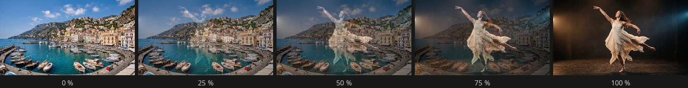

# Dissolve Transitions

Soft transitions that let one shot melt into the next instead of cutting.

## Crossfade

The first clip fades out while the next one fades in, so for a moment you see
both. The calm, classic way to soften a cut or to show that time has passed.

Drag **Dissolve** from the Transitions panel onto the cut between two clips –
Crossfade is its default. Select it to change it in Properties. It uses a little
of the footage trimmed off each clip; where there is none, a frame is held (red
while you drag).
- **Duration** – how long the blend takes, 1 second by default. You can also drag the edge of the transition in the timeline.
- **Include audio** – off by default; also blends the clips' sound.
- **Audio curve** – Equal power for two different sounds, Equal gain for a cut inside one recording.

Between two sound clips on an audio track, Crossfade blends the sound.

Tip: Titles, logos and keyed clips dissolve cleanly too – the old one fades away while the new one appears over whatever lies below.
