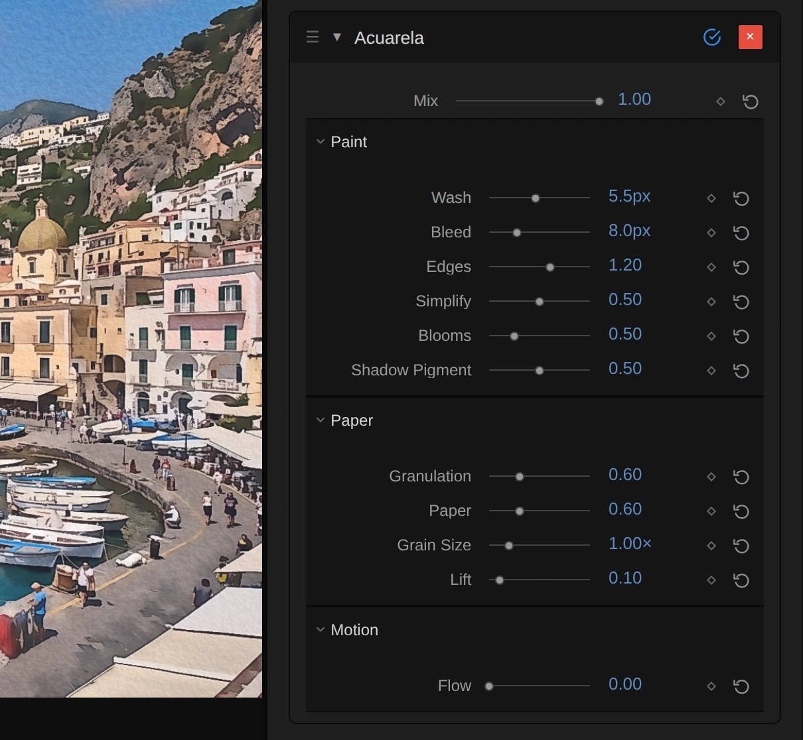

# Acuarela

Paints the picture as a watercolour, with flat washes of colour and the grain of the paper. Darker
paint gathers where the washes meet, and shapes stay readable, so it works on moving footage as well
as on stills.

Group: [Light & Stylize](../Effects-Stylize.md) · [How to add an effect](../Effects.md#add-an-effect)

<figure class="docs-shot">

<figcaption>Left: original. Right: Acuarela at its default settings (a close-up of a 1080p frame).</figcaption>
</figure>

**Use it for:** a painted, storybook look · softening busy projections into calm colour fields · a
hand-made feel for titles and backgrounds.

- **Wash** – how much the colour flattens into washes, in pixels: 1–2 keeps detail, 6 and more is
  loose and soft.
- **Bleed** – how far wet paint wobbles and runs across edges, in pixels.
- **Edges** and **Blooms** – the darker paint along every edge, and a few lighter stains with a dark
  rim.
- **Simplify** and **Shadow Pigment** – fewer, flatter tones, and how far black lifts to a dark
  indigo paint.

**Tip:** set **Flow** to 0.1–0.3 and the wet areas drift slowly, as if the paint were still wet.
**Granulation**, **Paper** and **Lift** add grainy pigment, the paper's relief and white paper
showing through.

## Controls

<figure class="docs-shot">

<svg class="docs-shot-overlay" viewBox="0 0 1017 938" aria-hidden="true" focusable="false">
<defs><marker id="acuarela-inspector-arrow" viewBox="0 0 10 10" refX="8" refY="5" markerWidth="5" markerHeight="5" orient="auto-start-reverse"><path d="M 0 0 L 10 5 L 0 10 Z" fill="#ffd54a" /></marker></defs>
<path class="docs-shot-arrow" d="M456 250 L540 250" marker-end="url(#acuarela-inspector-arrow)" />
<circle class="docs-shot-number" cx="456" cy="250" r="18" /><text x="456" y="250" class="docs-shot-number-text">1</text>
<path class="docs-shot-arrow" d="M379 294 L539 294" marker-end="url(#acuarela-inspector-arrow)" />
<circle class="docs-shot-number" cx="379" cy="294" r="18" /><text x="379" y="294" class="docs-shot-number-text">2</text>
<path class="docs-shot-arrow" d="M449 338 L533 338" marker-end="url(#acuarela-inspector-arrow)" />
<circle class="docs-shot-number" cx="449" cy="338" r="18" /><text x="449" y="338" class="docs-shot-number-text">3</text>
</svg>

<figcaption>1 — Wash, how flat the colour washes are. 2 — Bleed, how far wet paint runs. 3 — Edges, the darker paint along every edge. The ◇ keyframes a control, ↺ resets it.</figcaption>
</figure>

The card sorts the controls into **Paint**, **Paper** and **Motion** sections that fold away; the
preview updates while you drag.

<!-- generated:controls start -->
| Control | Range | Default |
|---|---|---|
| **General** | | |
| Mix | 0 to 1 | 1 |
| **Paint** | | |
| Wash | 0 to 12 px | 5.5 px |
| Bleed | 0 to 30 px | 8 px |
| Edges | 0 to 2 | 1.2 |
| Simplify | 0 to 1 | 0.5 |
| Blooms | 0 to 2 | 0.5 |
| Shadow Pigment | 0 to 1 | 0.5 |
| **Paper** | | |
| Granulation | 0 to 2 | 0.6 |
| Paper | 0 to 2 | 0.6 |
| Grain Size | 0.25 to 4× | 1× |
| Lift | 0 to 1 | 0.1 |
| **Motion** | | |
| Flow | 0 to 2 | 0 |
<!-- generated:controls end -->

## Node setup

<figure class="docs-shot docs-shot--graph">

<figcaption>Acuarela, first half: from the frame to the two washes and Edge Pooling.</figcaption>
</figure>

The picture is painted in the order a painter would work. **Wet Patches & Bleed** decides where the
paint is still wet and how far each spot wobbles. **Pigment Wash** flattens the colour inside shapes
but stops at their borders, and **Second Wash & Wet Bleeding** goes over the first wash once more:
that makes the washes flatter, and in wet patches it lets colour run across the borders. **Edge
Pooling** finds the darker side of every border.

<figure class="docs-shot docs-shot--graph">

<figcaption>Acuarela, second half: from Edge Pooling to the finished paint.</figcaption>
</figure>

**Simplify** groups the wash into a few tones, like layered glazes. **Paper & Granulation** makes
the paper's grain and **Blooms** the few stains. **Pigment Density** turns all of that into more or
less paint, **Shadow Pigment** lifts black (also in the pooled edges) to a dark indigo paint, and
**Paper Light, Lift & Mix** adds the paper's relief and blends with the original.

### More or less pigment

<figure class="docs-shot docs-shot--graph">

<svg class="docs-shot-overlay" viewBox="0 0 1017 1085" aria-hidden="true" focusable="false">
<defs><marker id="acuarela-pigment-density-arrow" viewBox="0 0 10 10" refX="8" refY="5" markerWidth="5" markerHeight="5" orient="auto-start-reverse"><path d="M 0 0 L 10 5 L 0 10 Z" fill="#ffd54a" /></marker></defs>
<path class="docs-shot-arrow" d="M813 218 L729 218" marker-end="url(#acuarela-pigment-density-arrow)" />
<circle class="docs-shot-number" cx="813" cy="218" r="18" /><text x="813" y="218" class="docs-shot-number-text">1</text>
<path class="docs-shot-arrow" d="M873 701 L873 617" marker-end="url(#acuarela-pigment-density-arrow)" />
<circle class="docs-shot-number" cx="873" cy="701" r="18" /><text x="873" y="701" class="docs-shot-number-text">2</text>
</svg>

<figcaption>The core of Pigment Density. 1 — the second Add, where Blooms joins the Pigment Excess. 2 — the last Subtract, the Painted Colour. The two easing branches (More and Less Pigment) and the colour inputs come from the rest of the folder.</figcaption>
</figure>

One formula from watercolour research does the painting: new colour = C − (C − C²) × e. The first
two **Add** cards sum the extra pigment: edge pooling + granulation + blooms (Blooms joins at the
second **Add**, 1). Before it is used, that sum eases: more pigment can at most square a colour
(C², a deeper tint of the same paint), less pigment can at most brighten it to 2C − C², so no colour
is pushed to black or past white. White paper and black stay as they are. **Multiply** scales
C − C² by the eased amount, and the last **Subtract** (2) gives the painted colour.

**Remix:** drag the cable from **Blooms** off the second **Add** (1). The stains disappear while the
pooled edges and the grain stay; the difference shows most in flat areas such as the sky. Plug it
back in to restore them.

## Technical details

- **Passes.** Four: a premultiplied source cache, two edge-aware washes, and one pass for tones,
  eased (Bousseau) pigment density, paper and a premultiplied Mix. Kernels, sigmas and the wobble
  cap: [Effect system](../Effect-System.md#glyph-cell-and-compute-effects).
- **Units.** Wash and Bleed are pixels of a 1080p frame, so preview, export and 4K match; Grain
  Size is a scale factor of the paper grain (1 = standard). Flow is in cycles per second.
- **Cost.** About 3–4 ms per 1080p frame, after a first frame of about 250–350 ms that compiles the
  graph (desktop Vulkan).
- **Saved projects.** Acuarela effects saved with the earlier smoke look keep it (their Gain is
  clamped to 0–1); that look is now [Rom1](./rom1.md).
- **Software preview.** The worker software preview falls back to the main-thread GPU renderer for
  the watercolour; the smoke look runs on the CPU.
- Shared notes: [Light & Stylize](../Effects-Stylize.md#technical-details). Blocks:
  [Node Catalog](../Node-Catalog.md).
