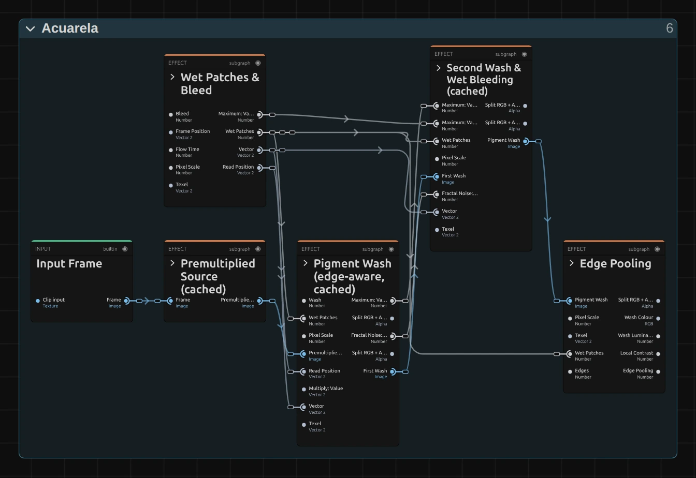

# Acuarela

Paints the picture as a watercolour, with flat washes of colour and the grain of the paper. Darker paint gathers where the washes meet and shapes stay readable, so it works on moving footage as well as on stills.

Group: [Light & Stylize](../Effects-Stylize.md) · [How to add an effect](../Effects.md#add-an-effect)

<figure class="docs-shot docs-clip docs-compare docs-shot--float-left">
<video src="../assets/effects/clips/acuarela.mp4" poster="../assets/effects/clips/acuarela.webp" width="960" height="460" autoplay muted loop playsinline preload="none" aria-label="The dancer turning on a dark stage, original left and with Acuarela right: her white dress and skin become flat washes of warm colour with darker paint pooled along every fold and edge, the dark stage turns into a soft brown-grey paper with grain and a few stained rings, and the painting follows her as she moves"></video>
<figcaption>Left: original. Right: Acuarela at its default settings.</figcaption>
</figure>

**Use it for:** a painted, storybook look · softening busy projections into calm fields of colour · a hand-made feel for titles and backgrounds.

- **Wash** – how flat the colour gets.
- **Bleed** – how far wet paint runs over the edges.
- **Edges** – the darker paint along every border.
- **Granulation** and **Paper** – the grain and relief of the paper.

**Tip:** for a still picture or a slow shot, set **Flow** to 0.3 or more: the wet edges and patches keep moving, as if the paint were still drying.

## Presets

<figure class="docs-shot docs-clip">
<video src="../assets/effects/clips/acuarela-presets.mp4" poster="../assets/effects/clips/acuarela-presets.webp" width="962" height="938" autoplay muted loop playsinline preload="none" aria-label="The dancer four times in a grid, moving in sync, each with one preset: Fine Study top left with crisp lines and readable face and hands, Loose Wash top right with big flat patches of colour and dark rims, Wet in Wet bottom left with colour running over the edges and stained rings drifting slowly over the background, Pale Paper bottom right faded towards white on coarse grained paper"></video>
<figcaption>The four presets on the moving dancer, in sync.</figcaption>
</figure>

Pick one in the **Preset** row of the effect card. It sets all controls at once, in one undo step, and the row then shows its name until you change something. A control with keyframes keeps them, and the card says so.

**Fine Study** – small washes, crisp dark edges and little paper. Faces and hands stay readable; a careful study rather than a sketch.

**Loose Wash** – big, flat patches in a few tones, strong edges and some stains. A quick, loose sketch; faces lose their features, so use it for bodies, crowds and places.

**Wet in Wet** – colour runs far over the borders, many blooms, and the wet areas drift slowly with the playhead. For dreams and memories, and for slow or still shots.

**Pale Paper** – a thin wash on coarse, strongly grained paper that shows through, with the shadows lifted to indigo. A faded page from a sketchbook; calm enough to put text over.

## Controls

<figure class="docs-shot docs-shot--detail">

<svg class="docs-shot-overlay" viewBox="0 0 590 1313" aria-hidden="true" focusable="false">
<defs><marker id="acuarela-inspector-arrow" viewBox="0 0 10 10" refX="8" refY="5" markerWidth="5" markerHeight="5" orient="auto-start-reverse"><path d="M 0 0 L 10 5 L 0 10 Z" fill="#ffd54a" /></marker></defs>
<path class="docs-shot-arrow" d="M44 356 L128 356" marker-end="url(#acuarela-inspector-arrow)" />
<circle class="docs-shot-number" cx="44" cy="356" r="18" /><text x="44" y="356" class="docs-shot-number-text">1</text>
<path class="docs-shot-arrow" d="M97 567 L181 567" marker-end="url(#acuarela-inspector-arrow)" />
<circle class="docs-shot-number" cx="97" cy="567" r="18" /><text x="97" y="567" class="docs-shot-number-text">2</text>
<path class="docs-shot-arrow" d="M91 662 L175 662" marker-end="url(#acuarela-inspector-arrow)" />
<circle class="docs-shot-number" cx="91" cy="662" r="18" /><text x="91" y="662" class="docs-shot-number-text">3</text>
<path class="docs-shot-arrow" d="M39 950 L123 950" marker-end="url(#acuarela-inspector-arrow)" />
<circle class="docs-shot-number" cx="39" cy="950" r="18" /><text x="39" y="950" class="docs-shot-number-text">4</text>
<path class="docs-shot-arrow" d="M106 1238 L190 1238" marker-end="url(#acuarela-inspector-arrow)" />
<circle class="docs-shot-number" cx="106" cy="1238" r="18" /><text x="106" y="1238" class="docs-shot-number-text">5</text>
</svg>

<figcaption>Acuarela with the Loose Wash preset. 1 — Preset: pick a starting point. 2 — Wash: how flat the colour gets. 3 — Edges: the darker paint along every border. 4 — Granulation: pigment in the paper grain. 5 — Flow: lets the wet paint drift.</figcaption>
</figure>

The card sorts the controls into **Paint**, **Paper** and **Motion** sections that fold away; the preview updates while you drag.

### General

<figure class="docs-shot docs-clip docs-shot--float-right">
<video src="../assets/effects/clips/acuarela-mix.mp4" poster="../assets/effects/clips/acuarela-mix.webp" width="640" height="480" autoplay muted loop playsinline preload="none" aria-label="The dancer with Acuarela while Mix runs from 0 to 1 and back: the photo fades into the watercolour painting and back; the current value is shown at the bottom left"></video>
<figcaption>Mix from 0 to 1 and back.</figcaption>
</figure>

**Mix** – how much of the painting covers the original. 1 is the full watercolour, 0.5 lays it half over the photo, so faces get some detail back. At 0 the picture is untouched and the effect costs nothing. 0 to 1, default 1.

### Paint

<figure class="docs-shot docs-clip docs-shot--float-right">
<video src="../assets/effects/clips/acuarela-wash.mp4" poster="../assets/effects/clips/acuarela-wash.webp" width="640" height="480" autoplay muted loop playsinline preload="none" aria-label="The dancer with Acuarela while Wash runs from 0 to 12 px and back: the fine folds of her dress and the strands of her hair melt into broader, flatter patches of colour and sharpen again; the current value is shown at the bottom left"></video>
<figcaption>Wash from 0 to 12 px and back.</figcaption>
</figure>

**Wash** – how far the colour flattens into washes. The wash stops at the borders of shapes, so they stay sharp while their inside turns into one colour. 1–2 keeps fine detail, 5 is a classic watercolour, 8 and more paints loose patches and wipes out small features such as eyes. Even 0 still smooths by half a pixel. 0 to 12 px, default 5.5 px.

<figure class="docs-shot docs-clip docs-shot--float-right">
<video src="../assets/effects/clips/acuarela-bleed.mp4" poster="../assets/effects/clips/acuarela-bleed.webp" width="640" height="480" autoplay muted loop playsinline preload="none" aria-label="The dancer with Acuarela while Bleed runs from 0 to 30 px and back: her outline starts to wobble and colour runs out over the edges of the dress and arms in wet patches, then settles again; the current value is shown at the bottom left"></video>
<figcaption>Bleed from 0 to 30 px and back.</figcaption>
</figure>

**Bleed** – how wet the paint is. A few large wet patches lie over the frame; there the outlines wobble and colour runs across the borders. 0 keeps every edge dry and still, 8 gives a gentle wobble, 20 and more lets colour flood out of shapes. The wobble stops growing at 16 px (the card says so); higher values only widen the bleeding. 0 to 30 px, default 8 px.

<figure class="docs-shot docs-clip docs-shot--float-right">
<video src="../assets/effects/clips/acuarela-edges.mp4" poster="../assets/effects/clips/acuarela-edges.webp" width="640" height="480" autoplay muted loop playsinline preload="none" aria-label="The dancer with Acuarela while Edges runs from 0 to 2 and back: at 0 the painting looks pale and soft, then darker paint gathers along every fold, arm and hair edge, and fades again; the current value is shown at the bottom left"></video>
<figcaption>Edges from 0 to 2 and back.</figcaption>
</figure>

**Edges** – the darker paint that gathers along the border of every wash, as it does when real watercolour dries. Without it (0) the painting looks pale and flat; 1 to 1.5 is natural; 2 draws a clear dark rim, almost like ink. The darkest pooled paint is a deeper tone of the same colour, never black. 0 to 2, default 1.2.

<figure class="docs-shot docs-clip docs-shot--float-right">
<video src="../assets/effects/clips/acuarela-simplify.mp4" poster="../assets/effects/clips/acuarela-simplify.webp" width="640" height="480" autoplay muted loop playsinline preload="none" aria-label="The dancer with Acuarela while Simplify runs from 0 to 1 and back: the soft gradients of her dress and skin step into a few flat tones like layered glazes, then smooth out again; the current value is shown at the bottom left"></video>
<figcaption>Simplify from 0 to 1 and back.</figcaption>
</figure>

**Simplify** – how far the brightness steps into a few flat tones, like glazes laid one over another. 0 keeps the photo's smooth gradients, 0.5 hints at the steps, 1 gives six clear tones; the colours stay as they are. 0 to 1, default 0.5.

<figure class="docs-shot docs-clip docs-shot--float-right">
<video src="../assets/effects/clips/acuarela-blooms.mp4" poster="../assets/effects/clips/acuarela-blooms.webp" width="640" height="480" autoplay muted loop playsinline preload="none" aria-label="The dancer with Acuarela while Blooms runs from 0 to 2 and back: ragged rings with dark rims and lighter centres appear on the flat background and grow stronger, then fade again; the current value is shown at the bottom left"></video>
<figcaption>Blooms from 0 to 2 and back.</figcaption>
</figure>

**Blooms** – a few stains with a lighter inside and a dark, ragged rim, where water ran back into drying paint. They appear only in flat areas such as a sky or a dark stage, never on busy detail. 0.5 is a hint, 1–2 makes them a strong part of the picture. They stay in place on the frame. 0 to 2, default 0.5.

<figure class="docs-shot docs-clip docs-shot--float-right">
<video src="../assets/effects/clips/acuarela-shadow-pigment.mp4" poster="../assets/effects/clips/acuarela-shadow-pigment.webp" width="640" height="480" autoplay muted loop playsinline preload="none" aria-label="The dancer with Acuarela while Shadow Pigment runs from 0 to 1 and back: the black of the stage lifts to a dark blue-grey indigo paint and sinks back to near black; the current value is shown at the bottom left"></video>
<figcaption>Shadow Pigment from 0 to 1 and back.</figcaption>
</figure>

**Shadow Pigment** – watercolour has no true black. This lifts the darkest parts, the pooled edges too, to a dark indigo paint. 0 keeps the black of the footage, 1 paints all shadows in indigo, softer and cooler. 0 to 1, default 0.5.

### Paper

<figure class="docs-shot docs-clip docs-shot--float-right">
<video src="../assets/effects/clips/acuarela-granulation.mp4" poster="../assets/effects/clips/acuarela-granulation.webp" width="640" height="480" autoplay muted loop playsinline preload="none" aria-label="The dancer with Acuarela while Granulation runs from 0 to 2 and back: fine speckled pigment settles into the grain of the paper, most of all on the dress, then smooths out again; the current value is shown at the bottom left"></video>
<figcaption>Granulation from 0 to 2 and back.</figcaption>
</figure>

**Granulation** – pigment that settles in the valleys of the paper, as coarse paint does. It shows most in the mid tones and on dense paint; light skin and white stay cleaner. 0 gives smooth washes, 0.6 a fine speckle, 2 a strong, sandy grain. 0 to 2, default 0.6.

<figure class="docs-shot docs-clip docs-shot--float-right">
<video src="../assets/effects/clips/acuarela-paper.mp4" poster="../assets/effects/clips/acuarela-paper.webp" width="640" height="480" autoplay muted loop playsinline preload="none" aria-label="The dancer with Acuarela while Paper runs from 0 to 2 and back: the relief of the paper, lit from one side, rises over the light dress and arms and sinks again; the dark stage hides most of it; the current value is shown at the bottom left"></video>
<figcaption>Paper from 0 to 2 and back.</figcaption>
</figure>

**Paper** – the relief of the paper, lit from one side, as if the painting lay under a lamp. It shows on light and middle tones; dense dark paint hides it. 0 turns it off, 0.6 is a subtle texture, 2 a rough, handmade sheet. 0 to 2, default 0.6.

<figure class="docs-shot docs-clip docs-shot--float-right">
<video src="../assets/effects/clips/acuarela-grain-size.mp4" poster="../assets/effects/clips/acuarela-grain-size.webp" width="640" height="480" autoplay muted loop playsinline preload="none" aria-label="The dancer with Acuarela while Grain Size runs from 0.25 to 4 and back: the paper grain grows from a fine sand into a coarse, cloudy texture and shrinks again; the current value is shown at the bottom left"></video>
<figcaption>Grain Size from 0.25 to 4× and back.</figcaption>
</figure>

**Grain Size** – how coarse the paper is, for Granulation and Paper together. 1 is a standard cold-pressed sheet; 0.5 is smooth hot-pressed paper, 2–4 a rough sheet whose grain reads even on a large projection. 0.25 to 4×, default 1×.

<figure class="docs-shot docs-clip docs-shot--float-right">
<video src="../assets/effects/clips/acuarela-lift.mp4" poster="../assets/effects/clips/acuarela-lift.webp" width="640" height="480" autoplay muted loop playsinline preload="none" aria-label="The dancer with Acuarela while Lift runs from 0 to 1 and back: the whole painting fades towards white paper until only a faint wash is left, then the colour comes back; the current value is shown at the bottom left"></video>
<figcaption>Lift from 0 to 1 and back.</figcaption>
</figure>

**Lift** – lets the white paper shine through, like a wash that was lifted with a sponge. 0.1 softens the darkest tones a little, 0.4 gives a pale, airy page, 1 leaves only a faint tint (80 % paper). 0 to 1, default 0.1.

### Motion

<figure class="docs-shot docs-clip docs-shot--float-right">
<video src="../assets/effects/clips/acuarela-flow.mp4" poster="../assets/effects/clips/acuarela-flow.webp" width="640" height="480" autoplay muted loop playsinline preload="none" aria-label="The dancer turning with Acuarela at Bleed 20, close up, at two Flow values for about 1.6 seconds each: at Flow 0 the wobble of her outline and the wet patches hold still on the screen while she moves through them, at Flow 2 the wobbly edges crawl and the wet areas drift on their own; the value is shown at the bottom left"></video>
<figcaption>Flow 0 and 2 at Bleed 20, close up, about 1.6 seconds each.</figcaption>
</figure>

**Flow** – lets the wet paint move on its own: the wobble of the outlines and the wet patches drift slowly with the playhead, while the paper and the blooms stay put. At 0 everything holds still, which suits moving footage; 0.3–1 gives a still picture a quiet life; 2 makes the edges crawl. It reads the timeline time, so the export matches the preview; keyframing Flow makes the paint jump, so set it once per clip. Its effect grows with Bleed. 0 to 2, default 0.

## Node setup

<figure class="docs-shot docs-shot--graph">

<svg class="docs-shot-overlay" viewBox="0 0 1017 802" aria-hidden="true" focusable="false">
<defs><marker id="acuarela-arrow" viewBox="0 0 10 10" refX="8" refY="5" markerWidth="5" markerHeight="5" orient="auto-start-reverse"><path d="M 0 0 L 10 5 L 0 10 Z" fill="#ffd54a" /></marker></defs>
<path class="docs-shot-arrow" d="M314 598 L314 514" marker-end="url(#acuarela-arrow)" />
<circle class="docs-shot-number" cx="314" cy="598" r="18" /><text x="314" y="598" class="docs-shot-number-text">1</text>
<path class="docs-shot-arrow" d="M314 25 L314 109" marker-end="url(#acuarela-arrow)" />
<circle class="docs-shot-number" cx="314" cy="25" r="18" /><text x="314" y="25" class="docs-shot-number-text">2</text>
<path class="docs-shot-arrow" d="M509 779 L509 695" marker-end="url(#acuarela-arrow)" />
<circle class="docs-shot-number" cx="509" cy="779" r="18" /><text x="509" y="779" class="docs-shot-number-text">3</text>
<path class="docs-shot-arrow" d="M703 22 L703 96" marker-end="url(#acuarela-arrow)" />
<circle class="docs-shot-number" cx="703" cy="22" r="18" /><text x="703" y="22" class="docs-shot-number-text">4</text>
<path class="docs-shot-arrow" d="M897 701 L897 617" marker-end="url(#acuarela-arrow)" />
<circle class="docs-shot-number" cx="897" cy="701" r="18" /><text x="897" y="701" class="docs-shot-number-text">5</text>
</svg>

<figcaption>Acuarela opened in the Nodes tab, first half (Constants, Coordinates, Parameters and the later stages left out). 1 — Premultiplied Source (cached): the frame, ready for clean reads. 2 — Wet Patches & Bleed: where the paint is wet. 3 — Pigment Wash (edge-aware, cached): flat colour inside shapes. 4 — Second Wash & Wet Bleeding (cached): flatter, and running where wet. 5 — Edge Pooling: dark paint along the borders.</figcaption>
</figure>

<figure class="docs-shot docs-shot--graph">

<svg class="docs-shot-overlay" viewBox="0 0 1017 1082" aria-hidden="true" focusable="false">
<defs><marker id="acuarela-paint-arrow" viewBox="0 0 10 10" refX="8" refY="5" markerWidth="5" markerHeight="5" orient="auto-start-reverse"><path d="M 0 0 L 10 5 L 0 10 Z" fill="#ffd54a" /></marker></defs>
<path class="docs-shot-arrow" d="M427 156 L427 240" marker-end="url(#acuarela-paint-arrow)" />
<circle class="docs-shot-number" cx="427" cy="156" r="18" /><text x="427" y="156" class="docs-shot-number-text">1</text>
<path class="docs-shot-arrow" d="M274 716 L358 716" marker-end="url(#acuarela-paint-arrow)" />
<circle class="docs-shot-number" cx="274" cy="716" r="18" /><text x="274" y="716" class="docs-shot-number-text">2</text>
<path class="docs-shot-arrow" d="M427 1060 L427 976" marker-end="url(#acuarela-paint-arrow)" />
<circle class="docs-shot-number" cx="427" cy="1060" r="18" /><text x="427" y="1060" class="docs-shot-number-text">3</text>
<path class="docs-shot-arrow" d="M589 675 L589 591" marker-end="url(#acuarela-paint-arrow)" />
<circle class="docs-shot-number" cx="589" cy="675" r="18" /><text x="589" y="675" class="docs-shot-number-text">4</text>
<path class="docs-shot-arrow" d="M752 632 L752 548" marker-end="url(#acuarela-paint-arrow)" />
<circle class="docs-shot-number" cx="752" cy="632" r="18" /><text x="752" y="632" class="docs-shot-number-text">5</text>
<path class="docs-shot-arrow" d="M914 399 L914 315" marker-end="url(#acuarela-paint-arrow)" />
<circle class="docs-shot-number" cx="914" cy="399" r="18" /><text x="914" y="399" class="docs-shot-number-text">6</text>
</svg>

<figcaption>Second half. 1 — Paper & Granulation: the paper and the pigment in its grain. 2 — Blooms: the stains. 3 — Simplify (tones): a few flat tones. 4 — Pigment Density: more or less paint. 5 — Shadow Pigment: black to indigo. 6 — Paper Light, Lift & Mix: the paper's light and the blend.</figcaption>
</figure>

Acuarela paints in the order a painter works, one folder per stage in the Nodes tab. **Premultiplied Source (cached)** keeps the frame ready for clean reads, also at transparent edges. **Wet Patches & Bleed** decides where the paint is wet, **Pigment Wash (edge-aware, cached)** and **Second Wash & Wet Bleeding (cached)** flatten the colour, and **Edge Pooling** finds the borders. **Paper & Granulation**, **Blooms** and **Simplify (tones)** prepare the paper, the stains and the tones; **Pigment Density** turns all of it into more or less paint, **Shadow Pigment** lifts black to indigo, and **Paper Light, Lift & Mix** lights the paper and blends with the original. Frame & Paper Coordinates measures every size in pixels of a 1080p frame. Click a folder's header to open it; the sections below show what is inside.

### Wet Patches & Bleed

<figure class="docs-shot docs-shot--graph">

<svg class="docs-shot-overlay" viewBox="0 0 1017 1862" aria-hidden="true" focusable="false">
<defs><marker id="acuarela-bleed-arrow" viewBox="0 0 10 10" refX="8" refY="5" markerWidth="5" markerHeight="5" orient="auto-start-reverse"><path d="M 0 0 L 10 5 L 0 10 Z" fill="#ffd54a" /></marker></defs>
<path class="docs-shot-arrow" d="M627 573 L627 657" marker-end="url(#acuarela-bleed-arrow)" />
<circle class="docs-shot-number" cx="627" cy="573" r="18" /><text x="627" y="573" class="docs-shot-number-text">1</text>
<path class="docs-shot-arrow" d="M865 573 L865 657" marker-end="url(#acuarela-bleed-arrow)" />
<circle class="docs-shot-number" cx="865" cy="573" r="18" /><text x="865" y="573" class="docs-shot-number-text">2</text>
<path class="docs-shot-arrow" d="M571 224 L487 224" marker-end="url(#acuarela-bleed-arrow)" />
<circle class="docs-shot-number" cx="571" cy="224" r="18" /><text x="571" y="224" class="docs-shot-number-text">3</text>
<path class="docs-shot-arrow" d="M571 498 L487 498" marker-end="url(#acuarela-bleed-arrow)" />
<circle class="docs-shot-number" cx="571" cy="498" r="18" /><text x="571" y="498" class="docs-shot-number-text">4</text>
<path class="docs-shot-arrow" d="M865 1329 L865 1245" marker-end="url(#acuarela-bleed-arrow)" />
<circle class="docs-shot-number" cx="865" cy="1329" r="18" /><text x="865" y="1329" class="docs-shot-number-text">5</text>
</svg>

<figcaption>Inside Wet Patches & Bleed, reduced to its recipe (the noise settings and the wet thresholds are left out). 1 — Wet Area: where the paint could be wet. 2 — Wet Patches: how wet, with Bleed. 3 — Capped Reach: at most 12 px. 4 — Read Position: where the wash reads. 5 — Wobble Offset (px): how far the read wobbles.</figcaption>
</figure>

**Wet Area** – a slow noise field over the frame, cut by a Smoothstep between 0.55 and 0.75: a few large, soft-edged patches. Flow moves the noise, so the patches drift.

**Wet Patches** – the Wet Area times the Bleed Share (Bleed ÷ 10, at most 1). From Bleed 10 on, the patches are fully wet; the washes widen there and their colour runs.

**Capped Reach** – how far the read position may wobble: Bleed × (0.25 + 0.5 × wet), at most 12 px. The cap keeps neighbouring pixels from reading rows far apart, which would fold the picture into stepped copies.

**Wobble Offset (px)** – two smooth noise fields, centred around zero, times twice the reach: the shift of every pixel's read position.

**Read Position** – the pixel's own place plus that shift. The first wash reads the frame there, so outlines wobble a little, most of all in the wet patches.

### Pigment Wash (edge-aware, cached)

<figure class="docs-shot docs-shot--graph">

<svg class="docs-shot-overlay" viewBox="0 0 1017 669" aria-hidden="true" focusable="false">
<defs><marker id="acuarela-wash-arrow" viewBox="0 0 10 10" refX="8" refY="5" markerWidth="5" markerHeight="5" orient="auto-start-reverse"><path d="M 0 0 L 10 5 L 0 10 Z" fill="#ffd54a" /></marker></defs>
<path class="docs-shot-arrow" d="M341 210 L257 210" marker-end="url(#acuarela-wash-arrow)" />
<circle class="docs-shot-number" cx="341" cy="210" r="18" /><text x="341" y="210" class="docs-shot-number-text">1</text>
<path class="docs-shot-arrow" d="M341 512 L257 512" marker-end="url(#acuarela-wash-arrow)" />
<circle class="docs-shot-number" cx="341" cy="512" r="18" /><text x="341" y="512" class="docs-shot-number-text">2</text>
<path class="docs-shot-arrow" d="M569 204 L569 288" marker-end="url(#acuarela-wash-arrow)" />
<circle class="docs-shot-number" cx="569" cy="204" r="18" /><text x="569" y="204" class="docs-shot-number-text">3</text>
<path class="docs-shot-arrow" d="M691 204 L691 288" marker-end="url(#acuarela-wash-arrow)" />
<circle class="docs-shot-number" cx="691" cy="204" r="18" /><text x="691" y="204" class="docs-shot-number-text">4</text>
<path class="docs-shot-arrow" d="M935 459 L935 375" marker-end="url(#acuarela-wash-arrow)" />
<circle class="docs-shot-number" cx="935" cy="459" r="18" /><text x="935" y="459" class="docs-shot-number-text">5</text>
</svg>

<figcaption>Inside Pigment Wash, reduced to its recipe (the tap jitter and how the distances are formed are left out). 1 — Multiply: the wash size. 2 — Mix: how different a colour may be. 3 — Exponential: the weight of a tap. 4 — Kernel Sum (Grid): all 49 taps. 5 — Cache Image: the first wash.</figcaption>
</figure>

**Multiply** – the wash size in pixels of a 1080p frame: Wash, 30 % wider in wet patches.

**Mix** – the colour tolerance: 0.1 where the paper is dry, 0.3 where it is wet. A tap whose colour differs more than that from the centre barely counts, so the wash stops at borders.

**Exponential** – the weight of every tap: it falls with the distance from the centre (relative to the wash size) and with the colour difference. This is an edge-aware (bilateral) blur.

**Kernel Sum (Grid)** – adds 7 × 7 weighted taps around the read position. The grid is turned and shifted a little for every pixel, so thin lines turn into fine grain instead of ghost copies; Normalize by Weight divides by the summed weights.

**Cache Image** – stores the first wash for the next pass.

### Second Wash & Wet Bleeding (cached)

<figure class="docs-shot docs-shot--graph">

<svg class="docs-shot-overlay" viewBox="0 0 1017 1073" aria-hidden="true" focusable="false">
<defs><marker id="acuarela-second-wash-arrow" viewBox="0 0 10 10" refX="8" refY="5" markerWidth="5" markerHeight="5" orient="auto-start-reverse"><path d="M 0 0 L 10 5 L 0 10 Z" fill="#ffd54a" /></marker></defs>
<path class="docs-shot-arrow" d="M673 178 L589 178" marker-end="url(#acuarela-second-wash-arrow)" />
<circle class="docs-shot-number" cx="673" cy="178" r="18" /><text x="673" y="178" class="docs-shot-number-text">1</text>
<path class="docs-shot-arrow" d="M314 947 L314 863" marker-end="url(#acuarela-second-wash-arrow)" />
<circle class="docs-shot-number" cx="314" cy="947" r="18" /><text x="314" y="947" class="docs-shot-number-text">2</text>
<path class="docs-shot-arrow" d="M509 448 L509 532" marker-end="url(#acuarela-second-wash-arrow)" />
<circle class="docs-shot-number" cx="509" cy="448" r="18" /><text x="509" y="448" class="docs-shot-number-text">3</text>
<path class="docs-shot-arrow" d="M897 748 L897 664" marker-end="url(#acuarela-second-wash-arrow)" />
<circle class="docs-shot-number" cx="897" cy="748" r="18" /><text x="897" y="748" class="docs-shot-number-text">4</text>
</svg>

<figcaption>Inside Second Wash & Wet Bleeding, reduced to its recipe (the distances and the colour tolerance are left out). 1 — Add: the second wash size. 2 — Exponential: the weight of a tap. 3 — Kernel Sum (Grid): all 49 taps. 4 — Cache Image: the finished wash.</figcaption>
</figure>

**Add** – the size of the second wash: 0.6 × Wash, plus 0.25 × Bleed in the wet patches. Washing a wash again flattens the colour inside shapes further and keeps their borders, like a painter's second layer.

**Exponential** – the same tap weight as in the first wash, but with a colour tolerance that grows to 0.5 where the paint is wet: there colour crosses the borders and runs.

**Kernel Sum (Grid)** – the 7 × 7 taps around the pixel, read from the first wash at its own place (no wobble this time).

**Cache Image** – the finished pigment wash. Edge Pooling, Simplify and the paper stages all read it.

### Edge Pooling

<figure class="docs-shot docs-shot--graph">

<svg class="docs-shot-overlay" viewBox="0 0 1017 526" aria-hidden="true" focusable="false">
<defs><marker id="acuarela-edge-pooling-arrow" viewBox="0 0 10 10" refX="8" refY="5" markerWidth="5" markerHeight="5" orient="auto-start-reverse"><path d="M 0 0 L 10 5 L 0 10 Z" fill="#ffd54a" /></marker></defs>
<path class="docs-shot-arrow" d="M292 303 L292 219" marker-end="url(#acuarela-edge-pooling-arrow)" />
<circle class="docs-shot-number" cx="292" cy="303" r="18" /><text x="292" y="303" class="docs-shot-number-text">1</text>
<path class="docs-shot-arrow" d="M509 23 L509 107" marker-end="url(#acuarela-edge-pooling-arrow)" />
<circle class="docs-shot-number" cx="509" cy="23" r="18" /><text x="509" y="23" class="docs-shot-number-text">2</text>
<path class="docs-shot-arrow" d="M509 503 L509 419" marker-end="url(#acuarela-edge-pooling-arrow)" />
<circle class="docs-shot-number" cx="509" cy="503" r="18" /><text x="509" y="503" class="docs-shot-number-text">3</text>
<path class="docs-shot-arrow" d="M833 23 L833 107" marker-end="url(#acuarela-edge-pooling-arrow)" />
<circle class="docs-shot-number" cx="833" cy="23" r="18" /><text x="833" y="23" class="docs-shot-number-text">4</text>
<path class="docs-shot-arrow" d="M941 303 L941 219" marker-end="url(#acuarela-edge-pooling-arrow)" />
<circle class="docs-shot-number" cx="941" cy="303" r="18" /><text x="941" y="303" class="docs-shot-number-text">5</text>
</svg>

<figcaption>Inside Edge Pooling, reduced to its recipe (the Gaussian neighbourhood is left out). 1 — Local Contrast: how much darker the pixel is. 2 — Dark Side: the darker side of a border. 3 — Light Side: the lighter side. 4 — Pooling (drier): less in wet paint. 5 — Edge Pooling: times Edges.</figcaption>
</figure>

**Local Contrast** – the brightness of the neighbourhood (a soft average over about 6 px) minus the pixel's own. Next to a border it is positive on the darker side and negative on the lighter one, and it fades over a few pixels.

**Dark Side** – a Smoothstep from 0.005 to 0.08 of that contrast: a soft band 2–4 px wide on the darker side of every border, where pigment pools. It counts 1.5 times.

**Light Side** – the same on the lighter side, counted 0.25 times and taken away: the paper next to a pooled edge looks a little brighter.

**Pooling (drier)** – the pooling shape times 1 − 0.6 × wet: in wet paint the edges stay softer.

**Edge Pooling** – times Edges. This is the extra pigment Pigment Density adds along the borders.

### Paper & Granulation

<figure class="docs-shot docs-shot--graph">

<svg class="docs-shot-overlay" viewBox="0 0 1017 568" aria-hidden="true" focusable="false">
<defs><marker id="acuarela-paper-arrow" viewBox="0 0 10 10" refX="8" refY="5" markerWidth="5" markerHeight="5" orient="auto-start-reverse"><path d="M 0 0 L 10 5 L 0 10 Z" fill="#ffd54a" /></marker></defs>
<path class="docs-shot-arrow" d="M341 262 L257 262" marker-end="url(#acuarela-paper-arrow)" />
<circle class="docs-shot-number" cx="341" cy="262" r="18" /><text x="341" y="262" class="docs-shot-number-text">1</text>
<path class="docs-shot-arrow" d="M341 424 L257 424" marker-end="url(#acuarela-paper-arrow)" />
<circle class="docs-shot-number" cx="341" cy="424" r="18" /><text x="341" y="424" class="docs-shot-number-text">2</text>
<path class="docs-shot-arrow" d="M691 391 L691 307" marker-end="url(#acuarela-paper-arrow)" />
<circle class="docs-shot-number" cx="691" cy="391" r="18" /><text x="691" y="391" class="docs-shot-number-text">3</text>
<path class="docs-shot-arrow" d="M935 251 L935 167" marker-end="url(#acuarela-paper-arrow)" />
<circle class="docs-shot-number" cx="935" cy="251" r="18" /><text x="935" y="251" class="docs-shot-number-text">4</text>
</svg>

<figcaption>Inside Paper & Granulation, reduced to its recipe (the noise settings and the mid-tone bell are left out). 1 — Paper Relief: the paper's light and shade. 2 — Paper Slope: which way the paper tilts. 3 — Paper Visibility: where paper shows. 4 — Granulation: pigment in the valleys.</figcaption>
</figure>

The paper is three layers of Fractal Noise, the Paper Height, its size set by Grain Size. It stays fixed on the frame.

**Paper Slope** – the height one pixel to the right and one below, each minus the height here: the tilt of the paper, as if lit from one side.

**Paper Relief** – 0.5 plus four times the slope, kept between 0 and 1: light where the paper faces the lamp, shade where it turns away. Paper Light, Lift & Mix uses it.

**Paper Visibility** – where the paper shows: 0.2 everywhere, up to 1 in the middle tones of the wash; dense dark paint and near-white (skin, a white dress, sky) show less of it.

**Granulation** – pigment that settles in the valleys: (0.55 − height) × 1.3 × (0.3 + the amount of pigment), plus a slow, uneven density, times the visibility and Granulation.

### Blooms

<figure class="docs-shot docs-shot--graph">

<svg class="docs-shot-overlay" viewBox="0 0 1017 922" aria-hidden="true" focusable="false">
<defs><marker id="acuarela-blooms-arrow" viewBox="0 0 10 10" refX="8" refY="5" markerWidth="5" markerHeight="5" orient="auto-start-reverse"><path d="M 0 0 L 10 5 L 0 10 Z" fill="#ffd54a" /></marker></defs>
<path class="docs-shot-arrow" d="M369 22 L369 95" marker-end="url(#acuarela-blooms-arrow)" />
<circle class="docs-shot-number" cx="369" cy="22" r="18" /><text x="369" y="22" class="docs-shot-number-text">1</text>
<path class="docs-shot-arrow" d="M648 319 L648 235" marker-end="url(#acuarela-blooms-arrow)" />
<circle class="docs-shot-number" cx="648" cy="319" r="18" /><text x="648" y="319" class="docs-shot-number-text">2</text>
<path class="docs-shot-arrow" d="M508 899 L508 815" marker-end="url(#acuarela-blooms-arrow)" />
<circle class="docs-shot-number" cx="508" cy="899" r="18" /><text x="508" y="899" class="docs-shot-number-text">3</text>
<path class="docs-shot-arrow" d="M648 690 L648 606" marker-end="url(#acuarela-blooms-arrow)" />
<circle class="docs-shot-number" cx="648" cy="690" r="18" /><text x="648" y="690" class="docs-shot-number-text">4</text>
<path class="docs-shot-arrow" d="M926 319 L926 235" marker-end="url(#acuarela-blooms-arrow)" />
<circle class="docs-shot-number" cx="926" cy="319" r="18" /><text x="926" y="319" class="docs-shot-number-text">5</text>
</svg>

<figcaption>Inside Blooms, reduced to its recipe (the noise settings and thresholds are left out). 1 — Bloom Inside: the stain itself. 2 — Bloom Shape: dark rim, lighter inside. 3 — Bloom Gate: only a few places. 4 — Bloom Place: only in flat areas. 5 — Blooms: times the control.</figcaption>
</figure>

**Bloom Inside** – a noise field with a ragged fringe, cut sharply at 0.6: the inside of a stain.

**Bloom Shape** – a thin rim right at that cut (an Exponential of the distance, counted 1.1 times) minus half the inside: the rim gets more pigment, the inside less, like water that pushed the paint outwards.

**Bloom Gate** – a second, coarser noise lets stains appear only in a few places of the frame.

**Bloom Place** – the gate times the Flat Area: where the wash has almost no contrast (a sky, a dark stage). On busy detail a stain would look like dirt, so there is none.

**Blooms** – the placed stain times Blooms: the pigment it adds or takes away in Pigment Density.

**Remix:** open the **Constants** folder and set **Bloom Gate Low** from 0.56 to 0.4: the gate opens in many more places, and stains spread over every flat area of the frame.

### Simplify (tones)

<figure class="docs-shot docs-shot--graph">

<svg class="docs-shot-overlay" viewBox="0 0 1017 533" aria-hidden="true" focusable="false">
<defs><marker id="acuarela-simplify-arrow" viewBox="0 0 10 10" refX="8" refY="5" markerWidth="5" markerHeight="5" orient="auto-start-reverse"><path d="M 0 0 L 10 5 L 0 10 Z" fill="#ffd54a" /></marker></defs>
<path class="docs-shot-arrow" d="M400 97 L400 181" marker-end="url(#acuarela-simplify-arrow)" />
<circle class="docs-shot-number" cx="400" cy="97" r="18" /><text x="400" y="97" class="docs-shot-number-text">1</text>
<path class="docs-shot-arrow" d="M400 511 L400 427" marker-end="url(#acuarela-simplify-arrow)" />
<circle class="docs-shot-number" cx="400" cy="511" r="18" /><text x="400" y="511" class="docs-shot-number-text">2</text>
<path class="docs-shot-arrow" d="M617 97 L617 181" marker-end="url(#acuarela-simplify-arrow)" />
<circle class="docs-shot-number" cx="617" cy="97" r="18" /><text x="617" y="97" class="docs-shot-number-text">3</text>
<path class="docs-shot-arrow" d="M941 414 L941 330" marker-end="url(#acuarela-simplify-arrow)" />
<circle class="docs-shot-number" cx="941" cy="414" r="18" /><text x="941" y="414" class="docs-shot-number-text">4</text>
</svg>

<figcaption>Inside Simplify, reduced to its recipe. 1 — Tone Below: the tone under the pixel. 2 — Soft Step: a soft move to the next one. 3 — Tone Level: one of six tones. 4 — Simplified Colour: mixed in by Simplify.</figcaption>
</figure>

**Tone Below** – the wash brightness times 6, rounded down: which of six tones lies just below the pixel.

**Soft Step** – a Smoothstep of what is left between 0.3 and 0.7: the step to the next tone is soft, so no hard contour lines appear.

**Tone Level** – Tone Below plus the Soft Step, divided by 6. Multiply scales the wash colour so its brightness matches the tone and the colour stays the same.

**Simplified Colour** – the wash mixed towards that toned colour by Simplify.

### Pigment Density

<figure class="docs-shot docs-shot--graph">

<svg class="docs-shot-overlay" viewBox="0 0 1017 1265" aria-hidden="true" focusable="false">
<defs><marker id="acuarela-pigment-density-arrow" viewBox="0 0 10 10" refX="8" refY="5" markerWidth="5" markerHeight="5" orient="auto-start-reverse"><path d="M 0 0 L 10 5 L 0 10 Z" fill="#ffd54a" /></marker></defs>
<path class="docs-shot-arrow" d="M673 178 L589 178" marker-end="url(#acuarela-pigment-density-arrow)" />
<circle class="docs-shot-number" cx="673" cy="178" r="18" /><text x="673" y="178" class="docs-shot-number-text">1</text>
<path class="docs-shot-arrow" d="M509 807 L509 723" marker-end="url(#acuarela-pigment-density-arrow)" />
<circle class="docs-shot-number" cx="509" cy="807" r="18" /><text x="509" y="807" class="docs-shot-number-text">2</text>
<path class="docs-shot-arrow" d="M703 223 L703 307" marker-end="url(#acuarela-pigment-density-arrow)" />
<circle class="docs-shot-number" cx="703" cy="223" r="18" /><text x="703" y="223" class="docs-shot-number-text">3</text>
<path class="docs-shot-arrow" d="M898 673 L898 589" marker-end="url(#acuarela-pigment-density-arrow)" />
<circle class="docs-shot-number" cx="898" cy="673" r="18" /><text x="898" y="673" class="docs-shot-number-text">4</text>
</svg>

<figcaption>Inside Pigment Density, reduced to its recipe (how the excess eases is left out). 1 — Pigment Excess: all the extra paint. 2 — C − C²: how much a colour can change. 3 — Pigment Change: how much it does. 4 — Painted Colour: the result.</figcaption>
</figure>

One formula from watercolour research does the painting: new colour = C − (C − C²) × e, with C the simplified colour and e the extra pigment.

**Pigment Excess** – Edge Pooling plus Granulation plus Blooms. Before it is used it eases: more pigment can at most square a colour (C², a deeper tone of the same paint), less pigment can at most lighten it to 2C − C². No colour is pushed to black or past white.

**C − C²** – how far a colour can move at all: nothing for white paper (C = 1) and for black, most for the middle tones.

**Pigment Change** – C − C² times the eased excess.

**Painted Colour** – C minus that change: darker where pigment pooled, lighter inside a bloom.

### Shadow Pigment

<figure class="docs-shot docs-shot--graph">

<svg class="docs-shot-overlay" viewBox="0 0 1017 748" aria-hidden="true" focusable="false">
<defs><marker id="acuarela-shadow-pigment-arrow" viewBox="0 0 10 10" refX="8" refY="5" markerWidth="5" markerHeight="5" orient="auto-start-reverse"><path d="M 0 0 L 10 5 L 0 10 Z" fill="#ffd54a" /></marker></defs>
<path class="docs-shot-arrow" d="M264 387 L264 347" marker-end="url(#acuarela-shadow-pigment-arrow)" />
<circle class="docs-shot-number" cx="264" cy="387" r="18" /><text x="264" y="387" class="docs-shot-number-text">1</text>
<path class="docs-shot-arrow" d="M589 481 L589 397" marker-end="url(#acuarela-shadow-pigment-arrow)" />
<circle class="docs-shot-number" cx="589" cy="481" r="18" /><text x="589" y="481" class="docs-shot-number-text">2</text>
<path class="docs-shot-arrow" d="M904 132 L820 132" marker-end="url(#acuarela-shadow-pigment-arrow)" />
<circle class="docs-shot-number" cx="904" cy="132" r="18" /><text x="904" y="132" class="docs-shot-number-text">3</text>
<path class="docs-shot-arrow" d="M752 725 L752 641" marker-end="url(#acuarela-shadow-pigment-arrow)" />
<circle class="docs-shot-number" cx="752" cy="725" r="18" /><text x="752" y="725" class="docs-shot-number-text">4</text>
<path class="docs-shot-arrow" d="M914 538 L914 454" marker-end="url(#acuarela-shadow-pigment-arrow)" />
<circle class="docs-shot-number" cx="914" cy="538" r="18" /><text x="914" y="538" class="docs-shot-number-text">5</text>
</svg>

<figcaption>Inside Shadow Pigment. 1 — Indigo Pigment: the darkest paint. 2 — Colour × (1 − Indigo): the colour, scaled down. 3 — Lifted to Indigo: black becomes indigo. 4 — Shadow Pigment (0 to 1): the control, kept in range. 5 — Shadow-lifted Colour: mixed in.</figcaption>
</figure>

**Indigo Pigment** – the darkest paint of the palette: a deep blue-grey (0.08, 0.09, 0.14).

**Colour × (1 − Indigo)** – the painted colour scaled down by what is left above the indigo.

**Lifted to Indigo** – plus the indigo: black becomes indigo, white stays white, and everything between keeps its order.

**Shadow Pigment (0 to 1)** – the control, kept between 0 and 1.

**Shadow-lifted Colour** – the painted colour mixed towards the lifted one by Shadow Pigment.

**Remix:** open the **Constants** folder and set the three **Shade Pigment** values (R, G, B) to 0.18, 0.08 and 0.05: the shadows turn into a warm sepia ink.

### Paper Light, Lift & Mix

<figure class="docs-shot docs-shot--graph">

<svg class="docs-shot-overlay" viewBox="0 0 1017 1089" aria-hidden="true" focusable="false">
<defs><marker id="acuarela-finish-arrow" viewBox="0 0 10 10" refX="8" refY="5" markerWidth="5" markerHeight="5" orient="auto-start-reverse"><path d="M 0 0 L 10 5 L 0 10 Z" fill="#ffd54a" /></marker></defs>
<path class="docs-shot-arrow" d="M272 427 L272 343" marker-end="url(#acuarela-finish-arrow)" />
<circle class="docs-shot-number" cx="272" cy="427" r="18" /><text x="272" y="427" class="docs-shot-number-text">1</text>
<path class="docs-shot-arrow" d="M744 608 L744 524" marker-end="url(#acuarela-finish-arrow)" />
<circle class="docs-shot-number" cx="744" cy="608" r="18" /><text x="744" y="608" class="docs-shot-number-text">2</text>
<path class="docs-shot-arrow" d="M902 482 L902 398" marker-end="url(#acuarela-finish-arrow)" />
<circle class="docs-shot-number" cx="902" cy="482" r="18" /><text x="902" y="482" class="docs-shot-number-text">3</text>
<path class="docs-shot-arrow" d="M429 919 L429 835" marker-end="url(#acuarela-finish-arrow)" />
<circle class="docs-shot-number" cx="429" cy="919" r="18" /><text x="429" y="919" class="docs-shot-number-text">4</text>
<path class="docs-shot-arrow" d="M894 811 L810 811" marker-end="url(#acuarela-finish-arrow)" />
<circle class="docs-shot-number" cx="894" cy="811" r="18" /><text x="894" y="811" class="docs-shot-number-text">5</text>
</svg>

<figcaption>Inside Paper Light, Lift & Mix, reduced to its recipe. 1 — Relief × Paper: how strong the paper's light is. 2 — Lift Share: how much white paper. 3 — Lifted Colour: the paper shows through. 4 — Painted: the painting with its alpha. 5 — Mixed: blended with the original.</figcaption>
</figure>

**Relief × Paper** – the paper's light and shade (relief − 0.5) times 0.25, times where the paper shows, times Paper. Plus 1, it brightens or darkens the colour slightly; it never goes below 0, even for an extreme Paper.

**Lift Share** – Lift times 0.8, so at Lift 1 a faint tint of the wash is left.

**Lifted Colour** – the lit colour mixed towards white paper by the Lift Share.

**Painted** – the colour with the wash's own transparency, premultiplied.

**Mixed** – the painting blended with the original frame by Mix, premultiplied, so a cut-out figure gets no dark fringe; at the end the colour is divided by alpha again.

## Technical details

- **Size.** Wash, Bleed and the paper count pixels of a frame whose shorter side is 1080: a 4K export, a portrait frame, a lower Preview Quality and the thumbnails show the same painting. Grain Size is a scale factor of the paper grain (1 = standard).
- **Passes and cost.** Four passes: a premultiplied source cache, two edge-aware 7 × 7 washes and one pass for pooling, tones, pigment density, paper and Mix. About 3–4 ms per 1080p frame after a first frame of about 250–350 ms that compiles the graph (desktop Vulkan). At Mix 0 the passes are skipped.
- **Time.** Without Flow the result depends only on the frame and the settings. Flow reads the timeline time, so scrubbing, playback and export give the same frame; the paper and the blooms stay put on the frame, the wet patches and the wobble move.
- **Limits.** Values from keyframes or tools outside a control's range are named in the card and the tool result: a negative Wash or Bleed renders as 0, Grain Size below 0.25 as 0.25, and Mix, Simplify, Shadow Pigment and Lift are kept within 0 to 1. A negative Edges, Blooms, Granulation or Paper inverts its look (the card says so). The wobble stops growing at Bleed 16 px.
- **Transparency.** The washes read premultiplied colour, so transparent surroundings never bleed dark into a cut-out figure; the painting keeps the wash's alpha.
- **Saved projects.** Acuarela effects saved with the earlier smoke look keep it (their Gain is clamped to 0–1); that look is now [Rom1](./rom1.md). Untouched node setups saved before 2026-10-22 carried two unused cards (an extra Pigment Density sum and a constant 3); they still count as the standard recipe and look the same.
- **Software preview.** The worker software preview falls back to the main-thread GPU renderer for the watercolour; the smoke look runs on the CPU.
- **More:** [Effect system](../Effect-System.md#light--stylize-notes) · [Node Catalog](../Node-Catalog.md) · [Styles and presets](../Effects.md#styles-and-presets).
