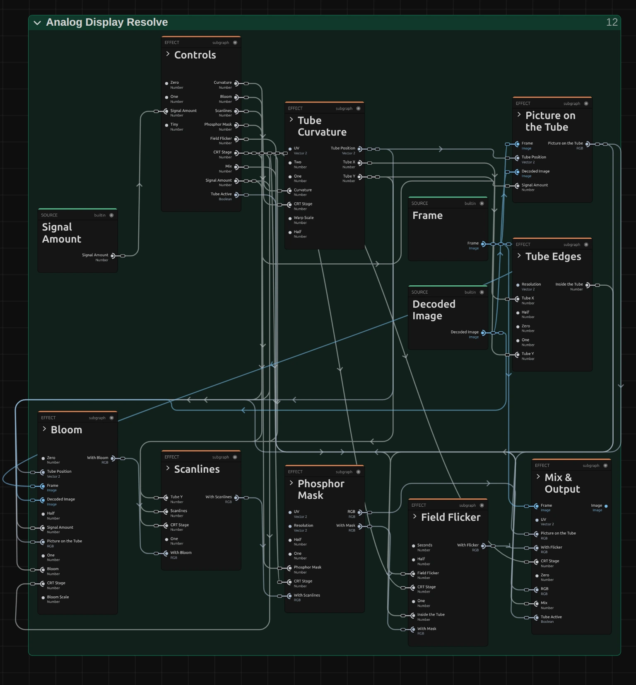
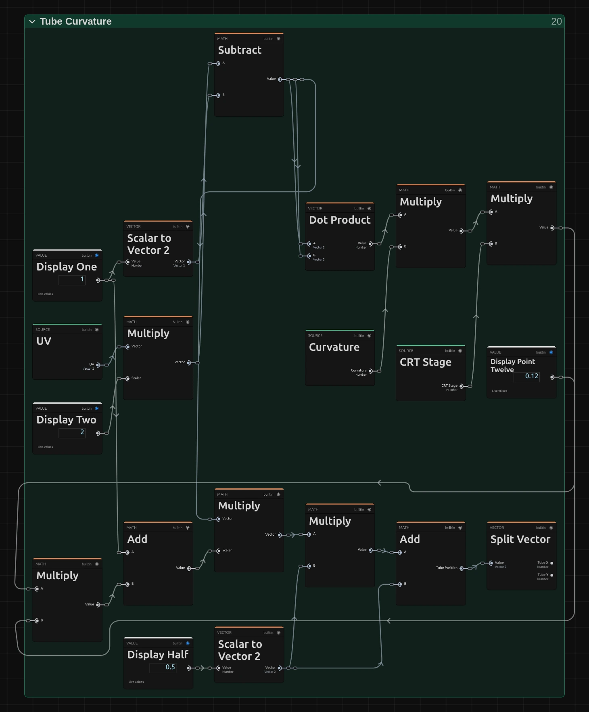
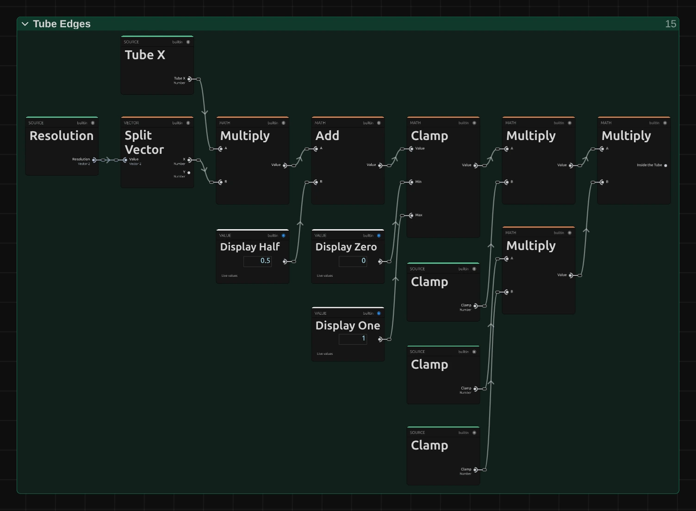
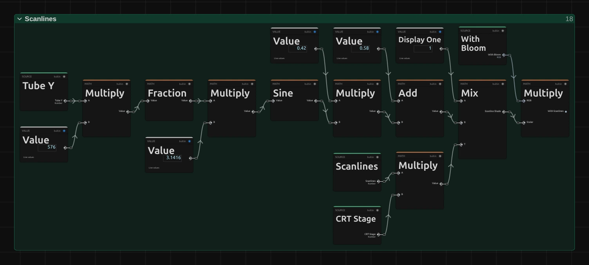
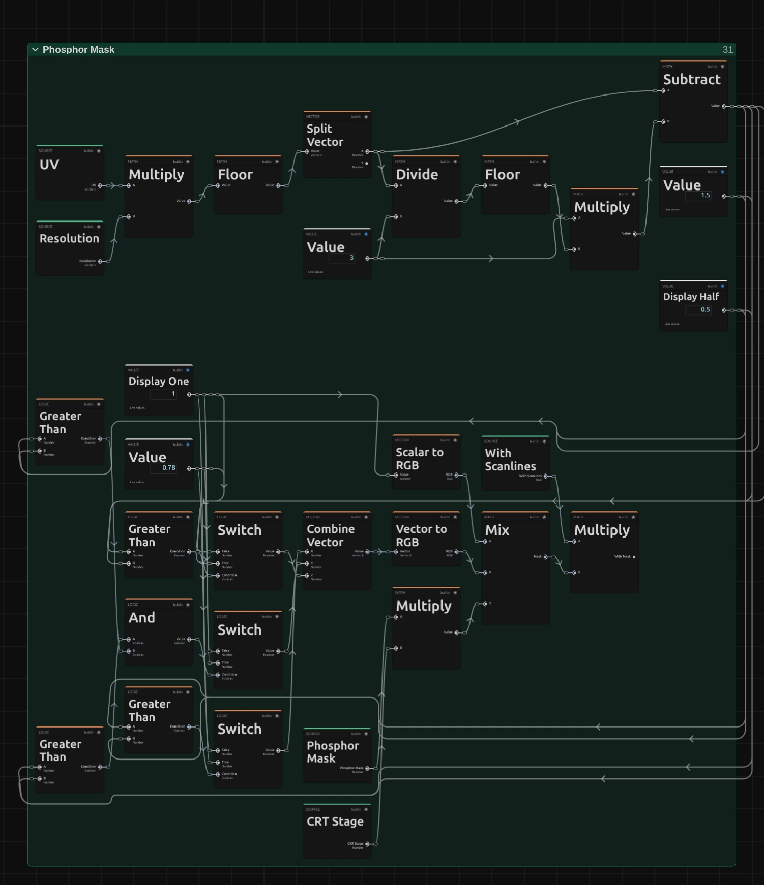
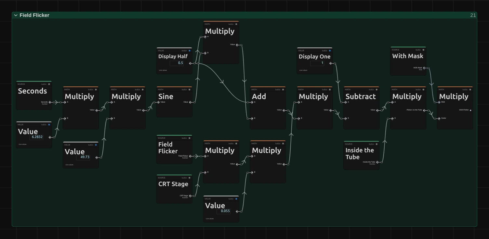
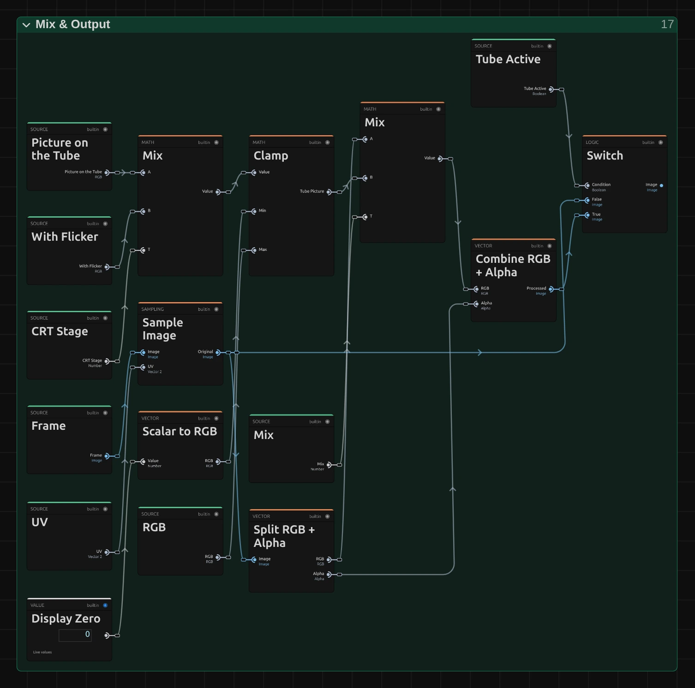

# Analog Signal Lab

Sends the picture through a simulated PAL television chain: antenna, video tape and tube TV. It adds their real faults – snow, ghost images, rolling, bleeding colour, tracking errors – and is the most realistic analog look, and the deepest.

Group: [Analog & Glitch](../Effects-Analog.md) · [How to add an effect](../Effects.md#add-an-effect)

<figure class="docs-shot docs-clip docs-compare">
<video src="../assets/effects/clips/analog-signal-lab.mp4" poster="../assets/effects/clips/analog-signal-lab.webp" width="1280" height="480" autoplay muted loop playsinline preload="none" aria-label="The dancer, original left and through Analog Signal Lab's Worn VHS preset right: softer, warm cream colours, noise speckles crawling through the dark background"></video>
<figcaption>Left: original. Right: the Worn VHS preset.</figcaption>
</figure>

**Use it for:** a broadcast from another decade · a home video found in the attic · a signal that slowly fails (animate Signal Strength).

- **Preset** – start from a snowy antenna, a worn tape, a tube TV or a picture that rolls.
- **RF / Antenna Stage**, **VHS Stage** and **CRT Stage** – how strongly the antenna, the tape and the tube act; 0 leaves that part out. A new effect starts as a broadcast: the VHS Stage is 0.
- **Signal Strength** – weaker reception brings snow, very weak reception makes the picture roll.
- **Tracking Error** and **Tape Wear** – the typical faults of a worn VHS tape.

**Tip:** for a signal that dies during a scene, start from Snowy Reception and keyframe Signal Strength from 0.35 down to 0.1: the snow grows, the colour fails and at the end the picture starts to roll.

## Presets

<figure class="docs-shot docs-clip">
<video src="../assets/effects/clips/analog-signal-lab-presets.mp4" poster="../assets/effects/clips/analog-signal-lab-presets.webp" width="962" height="646" autoplay muted loop playsinline preload="none" aria-label="The dancing figure on the whole stage four times in a grid, moving in sync, each with one preset: Snowy Reception top left with coloured grain and a faint ghost to the right of her, Worn VHS top right softer and warmer with a torn, noisy strip along the bottom edge, Tube Television bottom left on a curved screen with dark rounded corners and fine lines, Rolling Picture bottom right in heavy snow, torn sideways and slipping up and down"></video>
<figcaption>The four presets on the moving dancer, in sync.</figcaption>
</figure>

Pick one in the **Preset** row of the effect card. It sets all controls at once, in one undo step, and the row then shows its name until you change something. A control with keyframes keeps them, and the card says so.

**Snowy Reception** – a distant station on a roof antenna: grain over the whole picture, a faint ghost to the right of every edge, colours a little unsteady (Signal Strength 0.35, RF Noise 0.55, Ghost Level 0.45, Ghost Delay 3.5 µs). For a broadcast from far away, or as the starting point for a signal that fails.

**Worn VHS** – a long-play tape that has been watched many times: softer, warm colours that run to the right, a band of noise that drifts through the picture and a torn strip along the bottom edge (RF / Antenna Stage 0, VHS Stage 1, Tape Speed LP, Tracking Error 0.3, Tape Wear 0.25). For home videos and found footage.

**Tube Television** – a clean signal on an old curved set: visible scanlines, the red, green and blue stripes of the screen, highlights that glow sideways and dark rounded corners (CRT Stage 1, Curvature 0.45, Scanlines 0.6, Phosphor Mask 0.5, Bloom 0.4). For a picture that should look like it plays on a television in the room.

**Rolling Picture** – reception has almost gone: heavy snow, a second station shining through, colour that comes and goes and a picture that slips up and down (Signal Strength 0.25, Sync Instability 0.85, Color Lock 0.3, Co-channel 0.3). For the moment the signal breaks down.

## Controls

<figure class="docs-shot">

<svg class="docs-shot-overlay" viewBox="0 0 1017 2308" aria-hidden="true" focusable="false">
<defs><marker id="analog-signal-lab-inspector-arrow" viewBox="0 0 10 10" refX="8" refY="5" markerWidth="5" markerHeight="5" orient="auto-start-reverse"><path d="M 0 0 L 10 5 L 0 10 Z" fill="#ffd54a" /></marker></defs>
<path class="docs-shot-arrow" d="M565 281 L649 281" marker-end="url(#analog-signal-lab-inspector-arrow)" />
<circle class="docs-shot-number" cx="565" cy="281" r="18" /><text x="565" y="281" class="docs-shot-number-text">1</text>
<path class="docs-shot-arrow" d="M624 387 L708 387" marker-end="url(#analog-signal-lab-inspector-arrow)" />
<circle class="docs-shot-number" cx="624" cy="387" r="18" /><text x="624" y="387" class="docs-shot-number-text">2</text>
<path class="docs-shot-arrow" d="M550 843 L634 843" marker-end="url(#analog-signal-lab-inspector-arrow)" />
<circle class="docs-shot-number" cx="550" cy="843" r="18" /><text x="550" y="843" class="docs-shot-number-text">3</text>
<path class="docs-shot-arrow" d="M566 1681 L650 1681" marker-end="url(#analog-signal-lab-inspector-arrow)" />
<circle class="docs-shot-number" cx="566" cy="1681" r="18" /><text x="566" y="1681" class="docs-shot-number-text">4</text>
<path class="docs-shot-arrow" d="M566 2060 L650 2060" marker-end="url(#analog-signal-lab-inspector-arrow)" />
<circle class="docs-shot-number" cx="566" cy="2060" r="18" /><text x="566" y="2060" class="docs-shot-number-text">5</text>
</svg>

<figcaption>Analog Signal Lab at its defaults. 1 — Preset: pick a starting point. 2 — Mix: original to signal. 3 — RF / Antenna Stage: the antenna part. 4 — VHS Stage: the tape part. 5 — CRT Stage: the tube part.</figcaption>
</figure>

**Preset** – picks one of the four starting points above. Change any control afterwards; the row then shows no name.

The card follows the chain: the picture is turned into a PAL signal, sent over the antenna, optionally recorded on tape, received, decoded and shown on a tube. Three stage controls switch the big parts on and off: **RF / Antenna Stage**, **VHS Stage** and **CRT Stage**. Every control below acts only while its stage is above 0.

### Signal

**Mix** – how much of the processed picture you see: 0 shows the original, 1 the full signal chain. Use it to fade the look in or out. 0 to 1, default 1.

**Channel Seed** – picks another random pattern for the snow, the sparks, the dropouts and the place of the tracking band. Two copies of the effect with different seeds never show the same noise. It is not keyframeable. 0 to 9999, default 1.

### PAL Encode / Decode

**PAL Stage** – how strongly the picture goes through the PAL encoder and decoder: softer detail, colour that is less sharp than the brightness and, with Y/C Crosstalk, colour moiré on fine patterns. At 0, with every other stage at 0 too, the picture passes clean. 0 to 1, default 1.

<figure class="docs-shot docs-clip docs-shot--float-right">
<video src="../assets/effects/clips/analog-signal-lab-luma-bandwidth.mp4" poster="../assets/effects/clips/analog-signal-lab-luma-bandwidth.webp" width="640" height="640" autoplay muted loop playsinline preload="none" aria-label="The dancer close up while Luma Bandwidth runs from 0 to 1 and back: at 0 the picture is smeared sideways, at 1 her outline and the folds of the dress are crisp; the current value is shown at the bottom left"></video>
<figcaption>Luma Bandwidth from 0 to 1 and back.</figcaption>
</figure>

**Luma Bandwidth** – how sharp the picture is from side to side, from 2.5 MHz (0, clearly smeared) to 5.5 MHz (1, the full detail of a good broadcast). Around 0.4 looks like an old set, the default 0.72 like a decent receiver. The tape has its own, lower limit, so with VHS Stage on this matters less. 0 to 1, default 0.72.

**Chroma Bandwidth** – how sharp the colour is, from 0.6 MHz (0, colour bleeds well past the edges) to 1.3 MHz (1). Colour in PAL is always much softer than brightness; lower it for faces and clothes whose colour runs over their outline. 0 to 1, default 0.38.

**Chroma Level** – how strong the colour is in the signal: 0 is black and white, 1 normal, 2 twice as saturated, as on a set with its colour knob turned up. 0 to 2, default 1.

**Y/C Crosstalk** – how much fine detail turns into colour moiré, as on a real PAL TV: stripes in clothes or a far facade shimmer in rainbow colours. 0 keeps detail clean, the default 0.18 adds a trace, 0.6 and more make it obvious. 0 to 1, default 0.18.

**PAL Phase Error** – turns the colour of every other line one way and the lines between the other way, as a badly aligned transmitter does. With the **PAL Decoder** at Delay Line or Comb Filter the receiver averages two lines and the error only makes the colour paler; with Simple it shows as fine horizontal stripes of two hues (Hanover bars). In degrees: −45 to 45, default 0.

### RF Channel

**RF / Antenna Stage** – how strongly the antenna part acts: reception noise, sparks, ghosts, a second station, fine tuning and signal strength. At 0 the picture comes in as by cable, without any of them (Worn VHS sets it to 0 so the tape alone shapes the picture). 0 to 1, default 1.

### Reception

<figure class="docs-shot docs-clip docs-shot--float-right">
<video src="../assets/effects/clips/analog-signal-lab-signal-strength.mp4" poster="../assets/effects/clips/analog-signal-lab-signal-strength.webp" width="640" height="640" autoplay muted loop playsinline preload="none" aria-label="The dancer close up while Signal Strength runs from 1 down to 0.1 and back: the clean picture fills with grain and snow, colour fades and the picture starts to tear and roll at the weakest values; the current value is shown at the bottom left"></video>
<figcaption>Signal Strength from 1 down to 0.1 and back.</figcaption>
</figure>

**Signal Strength** – how well the station comes in. Lower values add snow that grows quickly below about 0.5 and more sparks; below about 0.35, with **Sync Instability** above 0, the receiver loses the picture and it starts to roll. Keyframe it for a signal that fades away. 0 to 1, default 0.82.

**RF Noise** – how much snow the reception adds; it grows with a weaker signal and with detuning. At the default 0.22 a good signal shows almost none, a weak one a lot. 0 to 1, default 0.22.

**Impulse Noise** – short sparks along single lines, as from a passing car or a light switch. They come more often on a weak signal. 0 to 1, default 0.08.

### Multipath

<figure class="docs-shot docs-clip docs-shot--float-right">
<video src="../assets/effects/clips/analog-signal-lab-ghost-level.mp4" poster="../assets/effects/clips/analog-signal-lab-ghost-level.webp" width="640" height="640" autoplay muted loop playsinline preload="none" aria-label="The dancer close up while Ghost Level runs from 0 to 0.8 and back: a second, fainter copy of her appears a little to the right and grows stronger; the current value is shown at the bottom left"></video>
<figcaption>Ghost Level from 0 to 0.8 and back, Ghost Delay 1.8 µs.</figcaption>
</figure>

**Ghost Level** – how strong the ghost image is: the signal also arrives a moment later over a reflection from a building or a hill, so a fainter copy of every edge appears to the right. 0.2 is a hint, 0.5 a clear double picture. 0 to 1, default 0.22.

**Ghost Delay (us)** – how far to the right the ghost sits, as the time the reflection arrives later: the default 1.8 µs is a narrow double edge, 6 µs and more a separate copy a good part of the picture away. In microseconds: 0.05 to 12, default 1.8.

**RF Phase** – how the ghost meets the main signal: around 0 it is a copy with the picture's own brightness, around 180 a negative (dark where the picture is light), and in between its colours shift. Try it with Ghost Level 0.5. In degrees: −180 to 180, default 25.

**Path Drift** – lets the reflection move, as when wind sways the antenna: the ghost wobbles from line to line and over time, and a second, weaker ghost appears. 0 to 1, default 0.12.

### Receiver

**Fine Tuning** – how far the set is tuned away from the station, in either direction: the picture gets softer and noisier the further it is from 0. 0.3 is a set that drifted a little, ±1 one that barely holds the station. −1 to 1, default 0.

**Co-channel** – a second, distant station on the same channel shines through as fine diagonal stripes that slowly drift. 0.1 is a faint pattern, 0.4 a clear one. 0 to 1, default 0.05.

<figure class="docs-shot docs-clip docs-shot--float-right">
<video src="../assets/effects/clips/analog-signal-lab-sync-instability.mp4" poster="../assets/effects/clips/analog-signal-lab-sync-instability.webp" width="640" height="640" autoplay muted loop playsinline preload="none" aria-label="The dancer close up while Sync Instability runs from 0 to 1 and back: the lines start to wobble sideways and at high values the picture tears and jumps; the current value is shown at the bottom left"></video>
<figcaption>Sync Instability from 0 to 1 and back.</figcaption>
</figure>

**Sync Instability** – how badly the receiver holds the lines together: lines wobble and tear sideways where the signal is poor, and together with a weak **Signal Strength** the picture rolls. 0 to 1, default 0.18.

**Color Lock** – how firmly the receiver holds the colour. At 1 colour stays put even on a poor signal; lower values let it fade and flicker into wrong hues line by line where reception is weak. 0 to 1, default 0.85.

**Receiver Stage** – how much the receiver's own faults act: the sideways sync shifts, Sync Instability and Color Lock. At 0 the set locks perfectly whatever arrives. 0 to 1, default 1.

**PAL Decoder** – how the set decodes the colour. Simple reads each line alone and shows phase errors as stripes; Delay Line averages each line with the one before and turns them into paler colour; Comb Filter averages a little more, also some brightness, for a smoother, slightly softer picture. Simple, Delay Line, Comb Filter, default Delay Line.

### VHS Transport

**VHS Stage** – how strongly the tape acts: a lower bandwidth, colour recorded under the brightness, tape noise and all the faults below. 0 leaves the tape out (the default: a live broadcast), 1 is a full tape. It fades in over the first tenth. 0 to 1, default 0.

<figure class="docs-shot docs-clip docs-shot--float-right">
<video src="../assets/effects/clips/analog-signal-lab-tracking.mp4" poster="../assets/effects/clips/analog-signal-lab-tracking.webp" width="640" height="640" autoplay muted loop playsinline preload="none" aria-label="The dancer close up on tape (VHS Stage 1, RF / Antenna Stage 0) while Tracking Error runs from 0 to 1 and back: a band of noise and torn lines rises through the picture and grows; the current value is shown at the bottom left"></video>
<figcaption>Tracking Error from 0 to 1 and back, with VHS Stage 1 and RF / Antenna Stage 0.</figcaption>
</figure>

**Tracking Error** – a band of noise and torn lines that drifts slowly through the picture, as when the heads do not follow the tape track. 0.1 is a thin band, 0.5 a wide, ragged one. 0 to 1, default 0.12.

**Dropouts** – light and dark streaks where the tape has lost its coating, flickering in for a frame on single lines. They come more often with **Tape Wear** and at LP and EP. 0 to 1, default 0.06.

**Time-base Error** – the lines wobble sideways in a slow wave, because the tape does not run perfectly even. Longer play speeds make it stronger. 0 to 1, default 0.2.

<figure class="docs-shot docs-clip docs-shot--float-right">
<video src="../assets/effects/clips/analog-signal-lab-tape-wear.mp4" poster="../assets/effects/clips/analog-signal-lab-tape-wear.webp" width="640" height="640" autoplay muted loop playsinline preload="none" aria-label="The dancer close up on tape (VHS Stage 1, RF / Antenna Stage 0) while Tape Wear runs from 0 to 1 and back: the picture gets softer, colours wash out and white dropout streaks flicker across it; the current value is shown at the bottom left"></video>
<figcaption>Tape Wear from 0 to 1 and back, with VHS Stage 1 and RF / Antenna Stage 0.</figcaption>
</figure>

**Tape Wear** – how old and worn the tape is: the picture gets softer, the noise and the streaks increase and dropouts come more often. 0.25 is a tape watched often, 0.7 one that barely plays. 0 to 1, default 0.08.

**Chroma Bleed** – how far the colour smears and shifts to the right of its outline, the classic red that runs out of a jacket on tape. 0 to 1, default 0.3.

**Head Switch** – the torn, noisy strip at the very bottom of the picture where the video heads switch over. 0.3 is a thin line, 1 a clearly shifted, flickering band. 0 to 1, default 0.45.

**Tape Speed** – SP records at standard play and keeps the most detail (about 3 MHz). LP (2.6 MHz) and EP (2.2 MHz) fit more on a tape and look softer and noisier, with more dropouts and a faster drifting tracking band. SP, LP, EP, default SP.

### CRT Display

**CRT Stage** – how strongly the tube acts: it scales Scanlines, Phosphor Mask, Bloom, Curvature and Field Flicker together. The default 0.25 gives a hint of a screen; 1 shows the controls below at full strength. 0 to 1, default 0.25.

**Scanlines** – the dark gaps between the lines of the tube. 0.3 is a fine texture, 1 clearly separate lines. 0 to 1, default 0.22.

**Phosphor Mask** – the fine red, green and blue stripes of the screen, three output pixels wide. It shows best close up; at a small size it darkens the picture a little. 0 to 1, default 0.12.

**Bloom** – bright parts glow and spread a little to the sides, as on a tube driven hard. Only the brightest areas glow. 0 to 1, default 0.16.

<figure class="docs-shot docs-clip docs-shot--float-right">
<video src="../assets/effects/clips/analog-signal-lab-curvature.mp4" poster="../assets/effects/clips/analog-signal-lab-curvature.webp" width="640" height="360" autoplay muted loop playsinline preload="none" aria-label="The whole stage on a tube (CRT Stage 1) while Curvature runs from 0 to 1 and back: the flat picture bulges into a rounded screen with dark corners; the current value is shown at the bottom left"></video>
<figcaption>Curvature from 0 to 1 and back, with CRT Stage 1.</figcaption>
</figure>

**Curvature** – bulges the picture into a rounded screen with dark corners; the edges stay clean. 0.3 is a modern flat-ish tube, 1 an old portable. 0 to 1, default 0.08.

**Field Flicker** – the light brightness flicker of a tube that redraws its picture 50 times a second. Keep it low; 0.3 and more are restless. 0 to 1, default 0.06.

## Node setup

<figure class="docs-shot docs-shot--graph">

<svg class="docs-shot-overlay" viewBox="0 0 1017 267" aria-hidden="true" focusable="false">
<defs><marker id="analog-signal-lab-arrow" viewBox="0 0 10 10" refX="8" refY="5" markerWidth="5" markerHeight="5" orient="auto-start-reverse"><path d="M 0 0 L 10 5 L 0 10 Z" fill="#ffd54a" /></marker></defs>
<path class="docs-shot-arrow" d="M225 212 L225 128" marker-end="url(#analog-signal-lab-arrow)" />
<circle class="docs-shot-number" cx="225" cy="212" r="18" /><text x="225" y="212" class="docs-shot-number-text">1</text>
<path class="docs-shot-arrow" d="M367 212 L367 128" marker-end="url(#analog-signal-lab-arrow)" />
<circle class="docs-shot-number" cx="367" cy="212" r="18" /><text x="367" y="212" class="docs-shot-number-text">2</text>
<path class="docs-shot-arrow" d="M509 212 L509 128" marker-end="url(#analog-signal-lab-arrow)" />
<circle class="docs-shot-number" cx="509" cy="212" r="18" /><text x="509" y="212" class="docs-shot-number-text">3</text>
<path class="docs-shot-arrow" d="M651 212 L651 128" marker-end="url(#analog-signal-lab-arrow)" />
<circle class="docs-shot-number" cx="651" cy="212" r="18" /><text x="651" y="212" class="docs-shot-number-text">4</text>
<path class="docs-shot-arrow" d="M793 228 L793 144" marker-end="url(#analog-signal-lab-arrow)" />
<circle class="docs-shot-number" cx="793" cy="228" r="18" /><text x="793" y="228" class="docs-shot-number-text">5</text>
<path class="docs-shot-arrow" d="M936 244 L936 160" marker-end="url(#analog-signal-lab-arrow)" />
<circle class="docs-shot-number" cx="936" cy="244" r="18" /><text x="936" y="244" class="docs-shot-number-text">6</text>
</svg>

<figcaption>Analog Signal Lab opened in the Nodes tab, from left to right. 1 — PAL Encode: picture to signal. 2 — RF Channel: the antenna. 3 — VHS Transport: the tape. 4 — Receiver Analysis: sync and colour lock. 5 — PAL Decode: signal to picture. 6 — Analog Display Resolve: the tube, as a folder.</figcaption>
</figure>

The effect opens as a chain of large stage nodes, one for each part of the television chain. How to open it: [The node setup](../Effects.md#the-node-setup).

**PAL Encode** turns the picture into a PAL signal: it limits the brightness to the **Luma Bandwidth**, softens the colour and puts it on its carrier, with **Chroma Level** and **PAL Phase Error**.

**RF Channel** adds what the antenna catches: snow, sparks, the ghost from a reflection, a second station and detuning.

**VHS Transport** records the signal on tape and plays it back, with tracking errors, dropouts, wobbling lines, the torn head-switch strip and bleeding colour.

**Receiver Analysis** looks at every line: where its sync sits, how steady it is and whether the colour can lock.

**PAL Decode** turns the signal back into a picture, with the chosen **PAL Decoder**, the sync shifts and the colour lock found by Receiver Analysis.

**Analog Display Resolve** is a folder that shows the decoded picture on a tube, with every step as an editable node. Open it with its ›.

**Remix:** bypass **RF Channel** or **VHS Transport** to leave that stage out entirely – a clean tape without antenna noise, or a broadcast without the tape.

### Inside Analog Display Resolve

<figure class="docs-shot docs-shot--graph">

<svg class="docs-shot-overlay" viewBox="0 0 1017 1094" aria-hidden="true" focusable="false">
<defs><marker id="analog-signal-lab-display-arrow" viewBox="0 0 10 10" refX="8" refY="5" markerWidth="5" markerHeight="5" orient="auto-start-reverse"><path d="M 0 0 L 10 5 L 0 10 Z" fill="#ffd54a" /></marker></defs>
<path class="docs-shot-arrow" d="M519 488 L519 404" marker-end="url(#analog-signal-lab-display-arrow)" />
<circle class="docs-shot-number" cx="519" cy="488" r="18" /><text x="519" y="488" class="docs-shot-number-text">1</text>
<path class="docs-shot-arrow" d="M883 683 L883 599" marker-end="url(#analog-signal-lab-display-arrow)" />
<circle class="docs-shot-number" cx="883" cy="683" r="18" /><text x="883" y="683" class="docs-shot-number-text">2</text>
<path class="docs-shot-arrow" d="M124 1071 L124 987" marker-end="url(#analog-signal-lab-display-arrow)" />
<circle class="docs-shot-number" cx="124" cy="1071" r="18" /><text x="124" y="1071" class="docs-shot-number-text">3</text>
<path class="docs-shot-arrow" d="M322 1001 L322 917" marker-end="url(#analog-signal-lab-display-arrow)" />
<circle class="docs-shot-number" cx="322" cy="1001" r="18" /><text x="322" y="1001" class="docs-shot-number-text">4</text>
<path class="docs-shot-arrow" d="M519 1069 L519 985" marker-end="url(#analog-signal-lab-display-arrow)" />
<circle class="docs-shot-number" cx="519" cy="1069" r="18" /><text x="519" y="1069" class="docs-shot-number-text">5</text>
</svg>

<figcaption>Inside Analog Display Resolve, its stage folders folded. 1 — Tube Curvature: the rounded screen. 2 — Tube Edges: the dark corners. 3 — Bloom: bright parts glow. 4 — Scanlines: gaps between the lines. 5 — Phosphor Mask: the colour stripes.</figcaption>
</figure>

The tube, folder by folder. **Controls** holds the card's display controls, **Picture on the Tube** reads the decoded picture through the curved screen, and **Mix & Output** blends the result with the original.

**Tube Curvature** – bends the picture into the rounded screen.

**Tube Edges** – finds where the bent picture ends, so the corners turn black with a soft edge.

**Bloom** – lets the brightest parts glow to the sides.

**Scanlines** – darkens the gaps between the lines.

**Phosphor Mask** – lays the red, green and blue stripes over the picture.

### Tube Curvature

<figure class="docs-shot docs-shot--graph">

<svg class="docs-shot-overlay" viewBox="0 0 1017 1229" aria-hidden="true" focusable="false">
<defs><marker id="analog-signal-lab-tube-arrow" viewBox="0 0 10 10" refX="8" refY="5" markerWidth="5" markerHeight="5" orient="auto-start-reverse"><path d="M 0 0 L 10 5 L 0 10 Z" fill="#ffd54a" /></marker></defs>
<path class="docs-shot-arrow" d="M587 259 L587 343" marker-end="url(#analog-signal-lab-tube-arrow)" />
<circle class="docs-shot-number" cx="587" cy="259" r="18" /><text x="587" y="259" class="docs-shot-number-text">1</text>
<path class="docs-shot-arrow" d="M273 810 L273 894" marker-end="url(#analog-signal-lab-tube-arrow)" />
<circle class="docs-shot-number" cx="273" cy="810" r="18" /><text x="273" y="810" class="docs-shot-number-text">2</text>
<path class="docs-shot-arrow" d="M744 1135 L744 1051" marker-end="url(#analog-signal-lab-tube-arrow)" />
<circle class="docs-shot-number" cx="744" cy="1135" r="18" /><text x="744" y="1135" class="docs-shot-number-text">3</text>
</svg>

<figcaption>Inside Tube Curvature. 1 — Dot Product: distance from the middle, squared. 2 — Add: how far a point is pushed out. 3 — Tube Position: the point read from the picture.</figcaption>
</figure>

**Dot Product** – measures how far each point is from the middle of the screen, squared: 0 in the middle, larger towards the corners.

**Add** – turns that distance into how far the point is pushed outwards: 1 plus the distance times the Curvature control, CRT Stage and a fixed 0.12.

**Tube Position** – the point of the decoded picture shown here: the original position pushed outwards, so the middle stays and the corners bulge.

### Tube Edges

<figure class="docs-shot docs-shot--graph">

<svg class="docs-shot-overlay" viewBox="0 0 1017 748" aria-hidden="true" focusable="false">
<defs><marker id="analog-signal-lab-edges-arrow" viewBox="0 0 10 10" refX="8" refY="5" markerWidth="5" markerHeight="5" orient="auto-start-reverse"><path d="M 0 0 L 10 5 L 0 10 Z" fill="#ffd54a" /></marker></defs>
<path class="docs-shot-arrow" d="M369 81 L369 165" marker-end="url(#analog-signal-lab-edges-arrow)" />
<circle class="docs-shot-number" cx="369" cy="81" r="18" /><text x="369" y="81" class="docs-shot-number-text">1</text>
<path class="docs-shot-arrow" d="M648 81 L648 165" marker-end="url(#analog-signal-lab-edges-arrow)" />
<circle class="docs-shot-number" cx="648" cy="81" r="18" /><text x="648" y="81" class="docs-shot-number-text">2</text>
<path class="docs-shot-arrow" d="M926 389 L926 305" marker-end="url(#analog-signal-lab-edges-arrow)" />
<circle class="docs-shot-number" cx="926" cy="389" r="18" /><text x="926" y="389" class="docs-shot-number-text">3</text>
</svg>

<figcaption>Inside Tube Edges, the left edge. 1 — Multiply: distance in pixels. 2 — Clamp: a soft edge over one pixel. 3 — Inside the Tube: 1 on the screen, 0 outside.</figcaption>
</figure>

**Multiply** – turns the distance from the left edge into output pixels. The folder measures the other three edges the same way; the picture shows the left one.

**Clamp** – makes the edge soft over one pixel: 0 outside the screen, 1 a pixel inside it.

**Inside the Tube** – the four edges multiplied: 1 on the screen, 0 in the dark corners.

### Bloom

<figure class="docs-shot docs-shot--graph">

<svg class="docs-shot-overlay" viewBox="0 0 1017 1484" aria-hidden="true" focusable="false">
<defs><marker id="analog-signal-lab-bloom-arrow" viewBox="0 0 10 10" refX="8" refY="5" markerWidth="5" markerHeight="5" orient="auto-start-reverse"><path d="M 0 0 L 10 5 L 0 10 Z" fill="#ffd54a" /></marker></defs>
<path class="docs-shot-arrow" d="M374 196 L374 280" marker-end="url(#analog-signal-lab-bloom-arrow)" />
<circle class="docs-shot-number" cx="374" cy="196" r="18" /><text x="374" y="196" class="docs-shot-number-text">1</text>
<path class="docs-shot-arrow" d="M241 957 L241 1041" marker-end="url(#analog-signal-lab-bloom-arrow)" />
<circle class="docs-shot-number" cx="241" cy="957" r="18" /><text x="241" y="957" class="docs-shot-number-text">2</text>
<path class="docs-shot-arrow" d="M508 1461 L508 1377" marker-end="url(#analog-signal-lab-bloom-arrow)" />
<circle class="docs-shot-number" cx="508" cy="1461" r="18" /><text x="508" y="1461" class="docs-shot-number-text">3</text>
<path class="docs-shot-arrow" d="M908 908 L908 992" marker-end="url(#analog-signal-lab-bloom-arrow)" />
<circle class="docs-shot-number" cx="908" cy="908" r="18" /><text x="908" y="908" class="docs-shot-number-text">4</text>
</svg>

<figcaption>Inside Bloom. 1 — Combine Vector: a step to the side. 2 — Mix: light from both sides. 3 — Smoothstep: only bright parts. 4 — With Bloom: the glow added.</figcaption>
</figure>

**Combine Vector** – the bloom reach: a small step to the left and the right of every point.

**Mix** – the light that spills in from both sides: the average of the two neighbouring points of the decoded picture.

**Smoothstep** – lets only bright parts glow: from brightness 0.55 up to full.

**With Bloom** – the glow, scaled by the Bloom control and CRT Stage, added to the picture.

### Scanlines

<figure class="docs-shot docs-shot--graph">

<svg class="docs-shot-overlay" viewBox="0 0 1017 458" aria-hidden="true" focusable="false">
<defs><marker id="analog-signal-lab-scanlines-arrow" viewBox="0 0 10 10" refX="8" refY="5" markerWidth="5" markerHeight="5" orient="auto-start-reverse"><path d="M 0 0 L 10 5 L 0 10 Z" fill="#ffd54a" /></marker></defs>
<path class="docs-shot-arrow" d="M184 48 L184 132" marker-end="url(#analog-signal-lab-scanlines-arrow)" />
<circle class="docs-shot-number" cx="184" cy="48" r="18" /><text x="184" y="48" class="docs-shot-number-text">1</text>
<path class="docs-shot-arrow" d="M509 48 L509 132" marker-end="url(#analog-signal-lab-scanlines-arrow)" />
<circle class="docs-shot-number" cx="509" cy="48" r="18" /><text x="509" y="48" class="docs-shot-number-text">2</text>
<path class="docs-shot-arrow" d="M833 48 L833 132" marker-end="url(#analog-signal-lab-scanlines-arrow)" />
<circle class="docs-shot-number" cx="833" cy="48" r="18" /><text x="833" y="48" class="docs-shot-number-text">3</text>
<path class="docs-shot-arrow" d="M941 328 L941 244" marker-end="url(#analog-signal-lab-scanlines-arrow)" />
<circle class="docs-shot-number" cx="941" cy="328" r="18" /><text x="941" y="328" class="docs-shot-number-text">4</text>
</svg>

<figcaption>Inside Scanlines. 1 — Multiply: the lines counted. 2 — Sine: a wave across each line. 3 — Mix: how deep the gaps get. 4 — With Scanlines: the shaded picture.</figcaption>
</figure>

**Multiply** – counts the lines: the height on the screen times 576, the lines of a PAL picture.

**Sine** – a smooth wave across each line, bright in its middle and dark at its edges.

**Mix** – how deep the dark gaps get: between no change and the wave, by the Scanlines control times CRT Stage.

**With Scanlines** – the picture multiplied by that shade.

### Phosphor Mask

<figure class="docs-shot docs-shot--graph">

<svg class="docs-shot-overlay" viewBox="0 0 1017 1180" aria-hidden="true" focusable="false">
<defs><marker id="analog-signal-lab-mask-arrow" viewBox="0 0 10 10" refX="8" refY="5" markerWidth="5" markerHeight="5" orient="auto-start-reverse"><path d="M 0 0 L 10 5 L 0 10 Z" fill="#ffd54a" /></marker></defs>
<path class="docs-shot-arrow" d="M923 22 L923 75" marker-end="url(#analog-signal-lab-mask-arrow)" />
<circle class="docs-shot-number" cx="923" cy="22" r="18" /><text x="923" y="22" class="docs-shot-number-text">1</text>
<path class="docs-shot-arrow" d="M567 591 L567 675" marker-end="url(#analog-signal-lab-mask-arrow)" />
<circle class="docs-shot-number" cx="567" cy="591" r="18" /><text x="567" y="591" class="docs-shot-number-text">2</text>
<path class="docs-shot-arrow" d="M686 591 L686 675" marker-end="url(#analog-signal-lab-mask-arrow)" />
<circle class="docs-shot-number" cx="686" cy="591" r="18" /><text x="686" y="591" class="docs-shot-number-text">3</text>
<path class="docs-shot-arrow" d="M805 880 L805 796" marker-end="url(#analog-signal-lab-mask-arrow)" />
<circle class="docs-shot-number" cx="805" cy="880" r="18" /><text x="805" y="880" class="docs-shot-number-text">4</text>
</svg>

<figcaption>Inside Phosphor Mask. 1 — Subtract: which stripe. 2 — Vector to RGB: the stripe colour. 3 — Mix: how strong. 4 — With Mask: the striped picture.</figcaption>
</figure>

**Subtract** – which of the three stripes an output pixel falls on: its column, counted in threes.

**Vector to RGB** – the stripe's colour: full red, green or blue on its own stripe, the other two dimmed to 0.78.

**Mix** – how strongly the stripes show: by the Phosphor Mask control times CRT Stage.

**With Mask** – the picture multiplied by the stripes.

### Field Flicker

<figure class="docs-shot docs-shot--graph">

<svg class="docs-shot-overlay" viewBox="0 0 1017 498" aria-hidden="true" focusable="false">
<defs><marker id="analog-signal-lab-flicker-arrow" viewBox="0 0 10 10" refX="8" refY="5" markerWidth="5" markerHeight="5" orient="auto-start-reverse"><path d="M 0 0 L 10 5 L 0 10 Z" fill="#ffd54a" /></marker></defs>
<path class="docs-shot-arrow" d="M363 90 L363 174" marker-end="url(#analog-signal-lab-flicker-arrow)" />
<circle class="docs-shot-number" cx="363" cy="90" r="18" /><text x="363" y="90" class="docs-shot-number-text">1</text>
<path class="docs-shot-arrow" d="M654 90 L654 174" marker-end="url(#analog-signal-lab-flicker-arrow)" />
<circle class="docs-shot-number" cx="654" cy="90" r="18" /><text x="654" y="90" class="docs-shot-number-text">2</text>
<path class="docs-shot-arrow" d="M752 90 L752 174" marker-end="url(#analog-signal-lab-flicker-arrow)" />
<circle class="docs-shot-number" cx="752" cy="90" r="18" /><text x="752" y="90" class="docs-shot-number-text">3</text>
<path class="docs-shot-arrow" d="M946 360 L946 276" marker-end="url(#analog-signal-lab-flicker-arrow)" />
<circle class="docs-shot-number" cx="946" cy="360" r="18" /><text x="946" y="360" class="docs-shot-number-text">4</text>
</svg>

<figcaption>Inside Field Flicker. 1 — Sine: 49.73 waves a second. 2 — Multiply: how deep. 3 — Subtract: the brightness factor. 4 — With Flicker: the flickering picture.</figcaption>
</figure>

**Sine** – a wave at 49.73 times a second, the rate a PAL tube redraws its fields.

**Multiply** – how deep the flicker goes: the Field Flicker control times CRT Stage times 0.055.

**Subtract** – the brightness factor: 1 minus that flicker.

**With Flicker** – the picture multiplied by the flicker and by Inside the Tube.

### Mix & Output

<figure class="docs-shot docs-shot--graph">

<svg class="docs-shot-overlay" viewBox="0 0 1017 1008" aria-hidden="true" focusable="false">
<defs><marker id="analog-signal-lab-mix-arrow" viewBox="0 0 10 10" refX="8" refY="5" markerWidth="5" markerHeight="5" orient="auto-start-reverse"><path d="M 0 0 L 10 5 L 0 10 Z" fill="#ffd54a" /></marker></defs>
<path class="docs-shot-arrow" d="M264 108 L264 192" marker-end="url(#analog-signal-lab-mix-arrow)" />
<circle class="docs-shot-number" cx="264" cy="108" r="18" /><text x="264" y="108" class="docs-shot-number-text">1</text>
<path class="docs-shot-arrow" d="M427 108 L427 192" marker-end="url(#analog-signal-lab-mix-arrow)" />
<circle class="docs-shot-number" cx="427" cy="108" r="18" /><text x="427" y="108" class="docs-shot-number-text">2</text>
<path class="docs-shot-arrow" d="M752 259 L752 343" marker-end="url(#analog-signal-lab-mix-arrow)" />
<circle class="docs-shot-number" cx="752" cy="259" r="18" /><text x="752" y="259" class="docs-shot-number-text">3</text>
<path class="docs-shot-arrow" d="M914 431 L914 347" marker-end="url(#analog-signal-lab-mix-arrow)" />
<circle class="docs-shot-number" cx="914" cy="431" r="18" /><text x="914" y="431" class="docs-shot-number-text">4</text>
</svg>

<figcaption>Inside Mix & Output. 1 — Mix: tube or decoded picture. 2 — Tube Picture: kept between black and white. 3 — Processed: blended with the original. 4 — Switch: the original when nothing acts.</figcaption>
</figure>

**Mix** – the tube picture in proportion to CRT Stage: at 0 the decoded picture as it is.

**Tube Picture** – the result, every colour kept between black and white.

**Processed** – the original blended with the tube picture by the card's Mix control, with the original's transparency.

**Switch** – when every stage is at 0, it passes the original straight through and skips the work.

## Technical details

- **Raster.** The effect works on a 702 × 288 PAL raster (one picture sample at 13.5 MHz per pixel, one field line per row), whatever the frame size. That is one PAL field, so the picture has half the line detail of a full PAL frame from top to bottom. A first pass averages the source over each sample and line (every source row and column, weighted by alpha).
- **Filters.** PAL Encode low-passes luma to the Luma Bandwidth cutoff (2.5 to 5.5 MHz) and removes it from the band the decoder reads as colour, except for the Y/C Crosstalk share. PAL Decode notches luma over about 3.6 to 5.2 MHz and low-passes the colour to 0.6 to 1.3 MHz (Chroma Bandwidth). The filters have 41 taps. The picture carries 16 samples of its edge colour into the blanking on either side, so the frame edges and small sync shifts read picture, not black.
- **Tape.** VHS Transport low-passes luma to about 3, 2.6 or 2.2 MHz (SP, LP, EP; lower with Tape Wear) and records colour under the luma, with sideways colour noise; hue is kept, saturation drops to 0.93, 0.87 or 0.81. It fades in over the first tenth of VHS Stage.
- **Time.** Noise, sparks, rolling, tracking and flicker follow the timeline clock: they hold still while playback is paused and repeat exactly on every render and export.
- **Values.** Values outside a control's range are clamped or, for some controls, used as given; the inspector and agent tool results say so.
- **Saved projects.** Saved effects keep their settings and render with the current PAL chain, which shows no colour dots on detail or at the frame edges and gives a worn tape its colours and a softer picture than a broadcast. There is no switch to the look of older versions. An effect saved with its node graph keeps that graph, with Analog Display Resolve as one flat folder; a new effect opens it with the stage folders above.

It runs as a GPU compute effect. Stage by stage: [Effect system: Analog Signal Lab](../Effect-System.md#analog-signal-lab). Nodes: [Node Catalog](../Node-Catalog.md).
