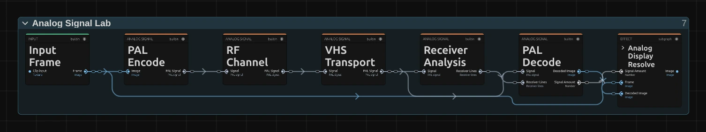

# Analog Signal Lab

Sends the picture through a simulated PAL television chain: antenna, video tape and tube TV. It adds their real faults – noise, ghost images, rolling, bleeding colour, tracking errors – and is the most realistic analog look, and the deepest.

Group: [Analog & Glitch](../Effects-Analog.md) · [How to add an effect](../Effects.md#add-an-effect)

<figure class="docs-shot docs-clip">
<video src="../assets/effects/clips/analog-signal-lab.mp4" poster="../assets/effects/clips/analog-signal-lab.webp" width="962" height="534" autoplay muted loop playsinline preload="none" aria-label="The dancer, original left and through Analog Signal Lab as a worn VHS tape right: softer, warm cream colours kept, noise streaks crawling through the dark background and along the bottom edge where the video heads switch"></video>
<figcaption>Left: original. Right: a worn VHS tape (RF / Antenna Stage 0, VHS Stage 1, Tape Speed LP, Tracking Error 0.3).</figcaption>
</figure>

**Use it for:** a broadcast from another decade · a home video found in the attic · a signal that slowly fails (animate Signal Strength).

- **RF / Antenna Stage**, **VHS Stage** and **CRT Stage** – how strongly each part of the chain acts; 0 leaves it out. A new effect starts as a broadcast: the VHS Stage is 0.
- **Signal Strength** – weaker reception adds noise; very weak reception makes the picture roll.
- **Tracking Error** and **Tape Wear** – the typical faults of a worn VHS tape.
- **Luma Bandwidth** – how sharp the picture is from side to side (2.5 to 5.5 MHz). **Y/C Crosstalk** – how much fine detail turns into colour moiré, as on a real PAL TV; 0 keeps detail clean.

**Tip:** for a worn tape like the clip, set RF / Antenna Stage 0, VHS Stage 1, Tape Speed LP, Tracking Error 0.3, Tape Wear 0.25 and Head Switch 0.7. For a weak antenna instead, lower Signal Strength to about 0.4 and raise RF Noise and Ghost Level.

## Controls

<!-- generated:controls start -->
| Control | Range | Default |
|---|---|---|
| **Signal** | | |
| Mix | 0 to 1 | 1 |
| Channel Seed | 0 to 9999 | 1 |
| **PAL Encode / Decode** | | |
| PAL Stage | 0 to 1 | 1 |
| Luma Bandwidth | 0 to 1 | 0.72 |
| Chroma Bandwidth | 0 to 1 | 0.38 |
| Chroma Level | 0 to 2 | 1 |
| Y/C Crosstalk | 0 to 1 | 0.18 |
| PAL Phase Error | −45 to 45 | 0 |
| **RF Channel** | | |
| RF / Antenna Stage | 0 to 1 | 1 |
| **Reception** | | |
| Signal Strength | 0 to 1 | 0.82 |
| RF Noise | 0 to 1 | 0.22 |
| Impulse Noise | 0 to 1 | 0.08 |
| **Multipath** | | |
| Ghost Level | 0 to 1 | 0.22 |
| Ghost Delay (us) | 0.05 to 12 | 1.8 |
| RF Phase | −180 to 180 | 25 |
| Path Drift | 0 to 1 | 0.12 |
| **Receiver** | | |
| Fine Tuning | −1 to 1 | 0 |
| Co-channel | 0 to 1 | 0.05 |
| Sync Instability | 0 to 1 | 0.18 |
| Color Lock | 0 to 1 | 0.85 |
| Receiver Stage | 0 to 1 | 1 |
| PAL Decoder | Simple, Delay Line, Comb Filter | Delay Line |
| **VHS Transport** | | |
| VHS Stage | 0 to 1 | 0 |
| Tracking Error | 0 to 1 | 0.12 |
| Dropouts | 0 to 1 | 0.06 |
| Time-base Error | 0 to 1 | 0.2 |
| Tape Wear | 0 to 1 | 0.08 |
| Chroma Bleed | 0 to 1 | 0.3 |
| Head Switch | 0 to 1 | 0.45 |
| Tape Speed | SP, LP, EP | SP |
| **CRT Display** | | |
| CRT Stage | 0 to 1 | 0.25 |
| Scanlines | 0 to 1 | 0.22 |
| Phosphor Mask | 0 to 1 | 0.12 |
| Bloom | 0 to 1 | 0.16 |
| Curvature | 0 to 1 | 0.08 |
| Field Flicker | 0 to 1 | 0.06 |
<!-- generated:controls end -->

## Node setup

<figure class="docs-shot docs-shot--graph">

<figcaption>Analog Signal Lab opened in the Nodes tab: the chain from left to right.</figcaption>
</figure>

The effect opens as a chain of large stage nodes. **PAL Encode** turns the picture into a PAL signal, **RF Channel** adds what the antenna catches (noise, ghosts, drift), **VHS Transport** records it on tape, **Receiver Analysis** finds the lines and the sync, and **PAL Decode** turns the signal back into a picture. **Analog Display Resolve** is a folder (open it with its ›) that holds the tube: curvature, bloom, scanlines, phosphor mask and flicker, as editable nodes. How to open it: [The node setup](../Effects.md#the-node-setup).

**Remix:** bypass **RF Channel** or **VHS Transport** to leave that stage out entirely – a clean tape without antenna noise, or a broadcast without the tape.

## Technical details

- **Raster.** The effect works on a 702 × 288 PAL raster (one picture sample at 13.5 MHz per pixel, one field line per row), whatever the frame size. That is one PAL field, so the picture has half the line detail of a full PAL frame from top to bottom. A first pass averages the source over each sample and line (every source row and column, weighted by alpha).
- **Filters.** PAL Encode low-passes luma to the Luma Bandwidth cutoff (2.5 to 5.5 MHz) and removes it from the band the decoder reads as colour, except for the Y/C Crosstalk share. PAL Decode notches luma over about 3.6 to 5.2 MHz and low-passes the colour to 0.6 to 1.3 MHz (Chroma Bandwidth). The filters have 41 taps. The picture carries 16 samples of its edge colour into the blanking on either side, so the frame edges and small sync shifts read picture, not black.
- **Tape.** VHS Transport low-passes luma to about 3, 2.6 or 2.2 MHz (SP, LP, EP; lower with Tape Wear) and records colour under the luma, with sideways colour noise; hue is kept, saturation drops to 0.93, 0.87 or 0.81. It fades in over the first tenth of VHS Stage.
- **Values.** Values outside a control's range are clamped or, for some controls, used as given; the inspector and agent tool results say so.
- **Saved projects.** Saved effects keep their settings and render with the current PAL chain, which shows no colour dots on detail or at the frame edges and gives a worn tape its colours and a softer picture than a broadcast. There is no switch to the look of older versions.

It runs as a GPU compute effect. Stage by stage: [Effect system: Analog Signal Lab](../Effect-System.md#analog-signal-lab).
