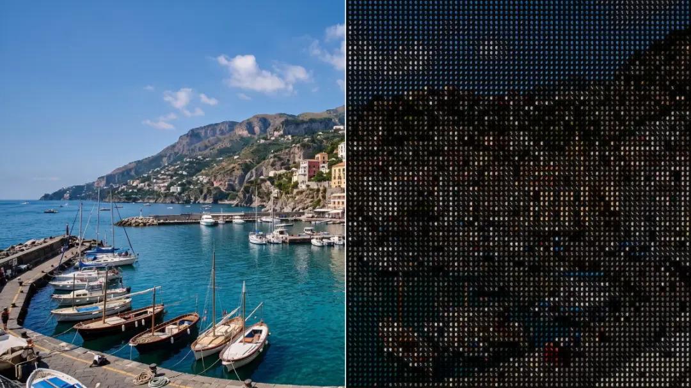

# ASCII Ghost

<!-- effect-docs: basic page sha=76708822bb60, written by scripts/effect-docs.mjs. Delete this line to write the page by hand (template B in Documentation-Site.md). -->

ASCII art whose characters cycle over time and leave fading ghost trails; Cell Size sets character size, Speed the cycling rate.

Group: [Text & Glyph](../Effects-Glyph.md) · [How to add an effect](../Effects.md#add-an-effect)

<figure class="docs-shot">

<figcaption>Left: the original. Right: ASCII Ghost at its default settings, one frame of its movement. An enlarged detail, so the characters can be read.</figcaption>
</figure>

*A short page made from the editor’s effect catalog: what the effect does and its controls. Tips and its node setup will follow.*

## Controls

<!-- generated:controls start -->
| Control | Range | Default |
|---|---|---|
| **Grid** | | |
| Cell Size | 4 to 72 px | 14 px |
| **Style** | | |
| Amount | 0 to 1 | 1 |
| Background | 0 to 1 | 0.3 |
| Invert Ramp | on or off | off |
| **Glyphs** | | |
| Ramp | Standard, Detailed, Blocks, Bars, Binary and 2 more | Standard |
| Custom Ramp | text | empty |
| Font | Monospace, Serif, Sans Serif | Monospace |
| Weight | 200 to 900 | 600 |
| **Color** | | |
| Color Source | Source, Duotone | Source |
| Dark | a colour | `#081018` |
| Light | a colour | `#e8fff5` |
| **Motion** | | |
| Speed | 0 to 5 | 1 |
| Reset Trail | on or off | off |
| **General** | | |
| History Loop | Reset, Continuous | Reset |
<!-- generated:controls end -->

## Technical details

It builds on its own earlier frames, so its trails grow during playback; **History Loop** sets whether they start again when playback jumps back to the loop start. How effects are stored, rendered and exported: [Effect system](../Effect-System.md). Its building blocks: [Node Catalog](../Node-Catalog.md).
