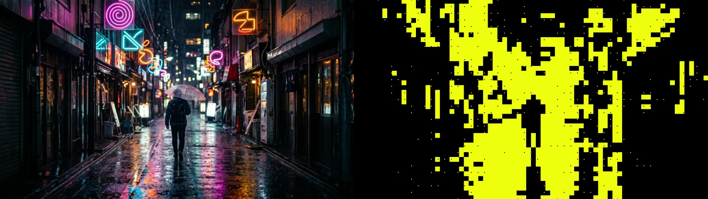

# Block Silhouette

<!-- effect-docs: basic page sha=70a046be9eb2, written by scripts/effect-docs.mjs. Delete this line to write the page by hand (template B in Documentation-Site.md). -->

Turns the picture into a flat two-colour silhouette on a block grid, like a neon poster: blocks darker than Threshold take Ink, the rest Paper (Invert swaps them); Marks adds dots or crosses on their own grid in the opposite colour.

Group: [Analog & Glitch](../Effects-Analog.md) · [How to add an effect](../Effects.md#add-an-effect)

<figure class="docs-shot docs-compare">

<figcaption>Left: the original. Right: Block Silhouette at its default settings.</figcaption>
</figure>

*A short page made from the editor’s effect catalog: what the effect does and its controls. Tips and its node setup will follow.*

**Presets:** Neon Yellow · White on Black · Big Pixels · Blueprint. Pick one in the **Preset** row of the effect card.

## Controls

<!-- generated:controls start -->
| Control | Range | Default |
|---|---|---|
| **Silhouette** | | |
| Block Size | 4 to 120 px | 26 px |
| Threshold | 0 to 1 | 0.2 |
| Invert | 0 to 1 | 0 |
| **Marks** | | |
| Marks | None, Dots, Crosses | Dots |
| Grid Size | 4 to 200 px | 36 px |
| Mark Size | 1 to 24 px | 4 px |
| Mark Area | Edges, Ink, Paper, Everywhere | Edges |
| Mark Amount | 0 to 1 | 0.5 |
| Mark Opacity | 0 to 1 | 1 |
| **Color** | | |
| Ink | a colour | `#000000` |
| Paper | a colour | `#eeff0d` |
| **Mix** | | |
| Seed | 0 to 9999 | 0 |
| Amount | 0 to 1 | 1 |
<!-- generated:controls end -->

## Technical details

How effects are stored, rendered and exported: [Effect system](../Effect-System.md). Its building blocks: [Node Catalog](../Node-Catalog.md).
