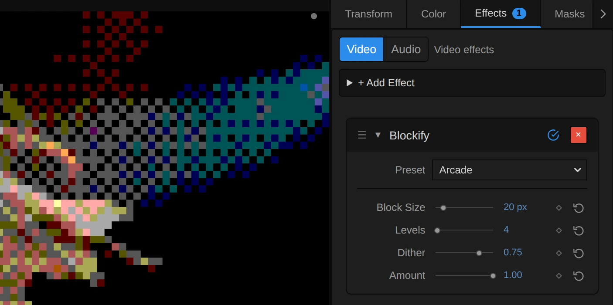
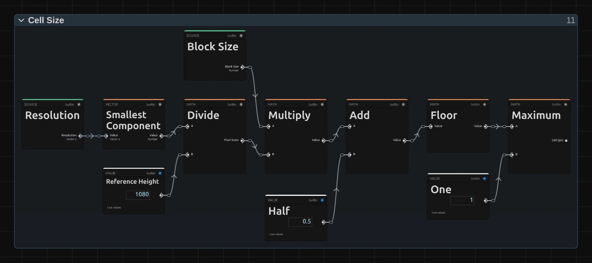

# Blockify

Rebuilds the picture from square blocks in a few flat colours, like an old computer game. For retro looks, graphic stage pictures and title backgrounds.

Group: [Pixel & Mosaic](../Effects-Pixel.md) · [How to add an effect](../Effects.md#add-an-effect)

<figure class="docs-shot docs-compare docs-shot--float-left">

<figcaption>Left: original. Right: Blockify at its default settings. A detail.</figcaption>
</figure>

**Use it for:** retro game and 8-bit looks · a graphic, poster-like stage picture · title backgrounds with few colours.

- **Block Size** – how big the blocks are.
- **Levels** – how many shades each colour keeps.
- **Dither** – a checker of blocks where one shade meets the next.
- **Amount** – how much of the original shows through.

**Tip:** keyframe **Block Size** from 2 up to 60 to let a picture fall apart into blocks on a cue; the blocks grow from the middle of the frame.

## Presets

<figure class="docs-shot docs-shot--detail">

<figcaption>The four presets on the dancer.</figcaption>
</figure>

Pick one in the **Preset** row of the effect card. It sets all controls at once, in one undo step, and the row then shows its name until you change something. A control with keyframes keeps them, and the card says so.

**16-Bit** – small blocks and six shades per colour: faces and hands still read, and soft gradients break into a fine checker. A console game of the nineties, calm enough for a whole scene.

**Arcade** – chunky blocks, four shades per colour and a strong checker where shades change. Loud and graphic: a title, a game scene, a flashback.

**Home Computer** – two shades per colour, so only black, white and six pure colours remain, dithered in between, like the first home computers. Strongest on a bright figure against black.

**Block Veil** – large flat blocks laid half over the original: the picture stays readable under a soft grid of colour. For a scene that starts to fall apart, or behind text.

## Controls

<figure class="docs-shot">

<svg class="docs-shot-overlay" viewBox="0 0 1017 506" aria-hidden="true" focusable="false">
<defs><marker id="blockify-inspector-arrow" viewBox="0 0 10 10" refX="8" refY="5" markerWidth="5" markerHeight="5" orient="auto-start-reverse"><path d="M 0 0 L 10 5 L 0 10 Z" fill="#ffd54a" /></marker></defs>
<path class="docs-shot-arrow" d="M565 282 L649 282" marker-end="url(#blockify-inspector-arrow)" />
<circle class="docs-shot-number" cx="565" cy="282" r="18" /><text x="565" y="282" class="docs-shot-number-text">1</text>
<path class="docs-shot-arrow" d="M534 344 L618 344" marker-end="url(#blockify-inspector-arrow)" />
<circle class="docs-shot-number" cx="534" cy="344" r="18" /><text x="534" y="344" class="docs-shot-number-text">2</text>
<path class="docs-shot-arrow" d="M565 382 L649 382" marker-end="url(#blockify-inspector-arrow)" />
<circle class="docs-shot-number" cx="565" cy="382" r="18" /><text x="565" y="382" class="docs-shot-number-text">3</text>
<path class="docs-shot-arrow" d="M569 419 L653 419" marker-end="url(#blockify-inspector-arrow)" />
<circle class="docs-shot-number" cx="569" cy="419" r="18" /><text x="569" y="419" class="docs-shot-number-text">4</text>
<path class="docs-shot-arrow" d="M555 457 L639 457" marker-end="url(#blockify-inspector-arrow)" />
<circle class="docs-shot-number" cx="555" cy="457" r="18" /><text x="555" y="457" class="docs-shot-number-text">5</text>
</svg>

<figcaption>Blockify with the Arcade preset. 1 — Preset: pick a starting point. 2 — Block Size. 3 — Levels: shades per colour. 4 — Dither. 5 — Amount.</figcaption>
</figure>

**Preset** – picks one of the four starting points above and sets the four controls below.

**Block Size** – how big the blocks are. 4–8 keeps faces readable, 16 is a clear retro look, 40 and more leaves only rough shapes. Each block shows the average colour of the pixels it covers. It counts pixels of a 1080p picture, so a 4K picture shows the same blocks, only sharper. 2 to 128 px, default 16 px.

**Levels** – how many shades each colour keeps. 8 gives 512 colours and stays close to the picture, 4 a bold palette of 64, 2 only black, white and six pure colours. Fewer levels also shift dark stage colours: a brown haze can turn dark red or olive. Whole numbers only. 2 to 64, default 8.

**Dither** – breaks the bands where one shade meets the next into a regular checker of blocks, like the graphics of old games. 0 gives flat bands, 0.5 a calm pattern only where shades change, 1 a full checker. It fades out in the darkest shades, so black and a dark stage stay flat. 0 to 1, default 0.5.

**Amount** – mixes the blocks with the original picture. 1 shows only blocks, 0.5 lays them half over the picture, 0 shows the original. Animate it for a mosaic that fades in. 0 to 1, default 1.

## Node setup

<figure class="docs-shot docs-shot--graph">

<svg class="docs-shot-overlay" viewBox="0 0 1017 561" aria-hidden="true" focusable="false">
<defs><marker id="blockify-arrow" viewBox="0 0 10 10" refX="8" refY="5" markerWidth="5" markerHeight="5" orient="auto-start-reverse"><path d="M 0 0 L 10 5 L 0 10 Z" fill="#ffd54a" /></marker></defs>
<path class="docs-shot-arrow" d="M204 174 L204 258" marker-end="url(#blockify-arrow)" />
<circle class="docs-shot-number" cx="204" cy="174" r="18" /><text x="204" y="174" class="docs-shot-number-text">1</text>
<path class="docs-shot-arrow" d="M326 68 L326 152" marker-end="url(#blockify-arrow)" />
<circle class="docs-shot-number" cx="326" cy="68" r="18" /><text x="326" y="68" class="docs-shot-number-text">2</text>
<path class="docs-shot-arrow" d="M448 22 L448 75" marker-end="url(#blockify-arrow)" />
<circle class="docs-shot-number" cx="448" cy="22" r="18" /><text x="448" y="22" class="docs-shot-number-text">3</text>
<path class="docs-shot-arrow" d="M691 312 L691 396" marker-end="url(#blockify-arrow)" />
<circle class="docs-shot-number" cx="691" cy="312" r="18" /><text x="691" y="312" class="docs-shot-number-text">4</text>
<path class="docs-shot-arrow" d="M813 486 L813 402" marker-end="url(#blockify-arrow)" />
<circle class="docs-shot-number" cx="813" cy="486" r="18" /><text x="813" y="486" class="docs-shot-number-text">5</text>
</svg>

<figcaption>Blockify opened in the Nodes tab (input frame and output left out). 1 — Cell Size: the block in pixels of this frame. 2 — Centred Cell Grid: which block a pixel lies in. 3 — Row Average: the average colour of the block. 4 — Posterize: rounds it to Levels shades. 5 — Mix with Original: Amount.</figcaption>
</figure>

Blockify works in stages, one folder each in the Nodes tab: **Cell Size** turns Block Size into whole pixels of this frame, **Centred Cell Grid** finds the block every pixel lies in, **Row Average** and Column Average average the colours of that block, **Posterize** rounds the average to the Levels shades with the dither, and **Mix with Original** blends the blocks with the picture by Amount. Pixel Position, Premultiplied Source and Straight Alpha Output only prepare the picture and hand it back. Click a folder's header to open it; the sections below show what is inside. Without Posterize and Mix with Original, the recipe is [Pixelate's](./pixelate.md#node-setup).

### Cell Size

<figure class="docs-shot docs-shot--graph">

<svg class="docs-shot-overlay" viewBox="0 0 1017 453" aria-hidden="true" focusable="false">
<defs><marker id="blockify-cell-size-arrow" viewBox="0 0 10 10" refX="8" refY="5" markerWidth="5" markerHeight="5" orient="auto-start-reverse"><path d="M 0 0 L 10 5 L 0 10 Z" fill="#ffd54a" /></marker></defs>
<path class="docs-shot-arrow" d="M230 81 L230 165" marker-end="url(#blockify-cell-size-arrow)" />
<circle class="docs-shot-number" cx="230" cy="81" r="18" /><text x="230" y="81" class="docs-shot-number-text">1</text>
<path class="docs-shot-arrow" d="M787 81 L787 165" marker-end="url(#blockify-cell-size-arrow)" />
<circle class="docs-shot-number" cx="787" cy="81" r="18" /><text x="787" y="81" class="docs-shot-number-text">2</text>
<path class="docs-shot-arrow" d="M926 389 L926 305" marker-end="url(#blockify-cell-size-arrow)" />
<circle class="docs-shot-number" cx="926" cy="389" r="18" /><text x="926" y="389" class="docs-shot-number-text">3</text>
</svg>

<figcaption>Inside Cell Size (Block Size). The number cards are values from the Constants folder, shown where they plug in. 1 — Smallest Component: the shorter side of the frame. 2 — Floor: whole pixels. 3 — Maximum: at least one pixel.</figcaption>
</figure>

**Smallest Component** – the shorter side of the frame. Divided by 1080, it says how much larger or smaller this frame is than a 1080p one, so Block Size looks the same on a 4K export, a portrait frame and a thumbnail.

**Floor** – Block Size times that scale, plus a half, rounded down: the block size in whole pixels of this frame, so every block is equally wide.

**Maximum** – keeps a block at least one pixel wide. Below that, the card says so, and Blockify only reduces the colours.

### Centred Cell Grid

<figure class="docs-shot docs-shot--graph">

<svg class="docs-shot-overlay" viewBox="0 0 1017 640" aria-hidden="true" focusable="false">
<defs><marker id="blockify-cell-grid-arrow" viewBox="0 0 10 10" refX="8" refY="5" markerWidth="5" markerHeight="5" orient="auto-start-reverse"><path d="M 0 0 L 10 5 L 0 10 Z" fill="#ffd54a" /></marker></defs>
<path class="docs-shot-arrow" d="M326 23 L326 107" marker-end="url(#blockify-cell-grid-arrow)" />
<circle class="docs-shot-number" cx="326" cy="23" r="18" /><text x="326" y="23" class="docs-shot-number-text">1</text>
<path class="docs-shot-arrow" d="M448 344 L448 260" marker-end="url(#blockify-cell-grid-arrow)" />
<circle class="docs-shot-number" cx="448" cy="344" r="18" /><text x="448" y="344" class="docs-shot-number-text">2</text>
<path class="docs-shot-arrow" d="M813 84 L813 168" marker-end="url(#blockify-cell-grid-arrow)" />
<circle class="docs-shot-number" cx="813" cy="84" r="18" /><text x="813" y="84" class="docs-shot-number-text">3</text>
</svg>

<figcaption>Inside Centred Cell Grid. 1 — Divide: the distance from the middle in blocks. 2 — Floor: the block number. 3 — Clamp: the block cut at the frame edge.</figcaption>
</figure>

**Divide** – the pixel's distance from the Grid Origin, the middle of the frame, counted in blocks.

**Floor** – drops the fraction: the Cell Index, the same for every pixel of a block. Multiply and Add turn it back into the place where the block starts, a second Add into the place where it ends. Because the grid starts in the middle, a keyframed Block Size grows the blocks from the centre.

**Clamp** – cuts the block at the frame edge, so a block half outside the frame averages only the pixels that are there.

### Row Average and Column Average

<figure class="docs-shot docs-shot--graph">

<svg class="docs-shot-overlay" viewBox="0 0 1017 669" aria-hidden="true" focusable="false">
<defs><marker id="blockify-row-average-arrow" viewBox="0 0 10 10" refX="8" refY="5" markerWidth="5" markerHeight="5" orient="auto-start-reverse"><path d="M 0 0 L 10 5 L 0 10 Z" fill="#ffd54a" /></marker></defs>
<path class="docs-shot-arrow" d="M264 110 L264 194" marker-end="url(#blockify-row-average-arrow)" />
<circle class="docs-shot-number" cx="264" cy="110" r="18" /><text x="264" y="110" class="docs-shot-number-text">1</text>
<path class="docs-shot-arrow" d="M752 599 L752 515" marker-end="url(#blockify-row-average-arrow)" />
<circle class="docs-shot-number" cx="752" cy="599" r="18" /><text x="752" y="599" class="docs-shot-number-text">2</text>
<path class="docs-shot-arrow" d="M914 110 L914 194" marker-end="url(#blockify-row-average-arrow)" />
<circle class="docs-shot-number" cx="914" cy="110" r="18" /><text x="914" y="110" class="docs-shot-number-text">3</text>
</svg>

<figcaption>Inside Row Average (cached). 1 — Subtract: the width of the block. 2 — Sample Image: reads the picture. 3 — Sequence Reduce: adds up the reads.</figcaption>
</figure>

**Subtract** – the width of the block in this row: where it ends minus where it starts. Times a half and rounded up (Ceiling), that is one read for every pair of pixels, at most Pairs Limit 64 (Minimum).

**Sample Image** – reads the premultiplied picture at the Read Position. Each read lands on the line between two pixels, so the graphics card averages both at once.

**Sequence Reduce** – adds up all reads of the row with their weights; Normalize by Weight divides by the total. Cache Image keeps these row averages as a picture, and the Column Average folder runs the same recipe down its columns: a 16 × 16 block needs 8 + 8 reads instead of 256.

**Remix:** open the **Constants** folder and set **Pairs Limit** from 64 to 2: a block now reads only a few of its pixels instead of all of them, so blocks with fine detail get harder, grainier colours, and on moving footage they flicker.

### Posterize

<figure class="docs-shot docs-shot--graph">

<svg class="docs-shot-overlay" viewBox="0 0 1017 728" aria-hidden="true" focusable="false">
<defs><marker id="blockify-posterize-arrow" viewBox="0 0 10 10" refX="8" refY="5" markerWidth="5" markerHeight="5" orient="auto-start-reverse"><path d="M 0 0 L 10 5 L 0 10 Z" fill="#ffd54a" /></marker></defs>
<path class="docs-shot-arrow" d="M184 84 L184 168" marker-end="url(#blockify-posterize-arrow)" />
<circle class="docs-shot-number" cx="184" cy="84" r="18" /><text x="184" y="84" class="docs-shot-number-text">1</text>
<path class="docs-shot-arrow" d="M509 705 L509 621" marker-end="url(#blockify-posterize-arrow)" />
<circle class="docs-shot-number" cx="509" cy="705" r="18" /><text x="509" y="705" class="docs-shot-number-text">2</text>
<path class="docs-shot-arrow" d="M833 84 L833 168" marker-end="url(#blockify-posterize-arrow)" />
<circle class="docs-shot-number" cx="833" cy="84" r="18" /><text x="833" y="84" class="docs-shot-number-text">3</text>
<path class="docs-shot-arrow" d="M941 702 L941 618" marker-end="url(#blockify-posterize-arrow)" />
<circle class="docs-shot-number" cx="941" cy="702" r="18" /><text x="941" y="702" class="docs-shot-number-text">4</text>
</svg>

<figcaption>Inside Posterize. 1 — Bayer Pattern: a 4 × 4 checker of thresholds. 2 — Shadow Guard: no dither in the dark. 3 — Floor: the shade each channel lands on. 4 — Divide: back to a colour.</figcaption>
</figure>

**Bayer Pattern** – a fixed 4 × 4 pattern of thresholds, one per block (Bayer Cell is the block number). Minus a half and times Dither, it nudges each block up or down by up to almost half a shade, in a regular order: that is the checker.

**Shadow Guard** – fades the nudge out in the darkest shades: none for black, the full nudge one shade up (at most a quarter of the way to white). That is why a dark stage stays flat instead of sparkling.

**Floor** – the Cell Colour times Levels − 1 (Multiply), plus a half and the guarded nudge, rounded down: the number of the shade each colour channel lands on.

**Divide** – divides that number by Levels − 1 again: the posterized colour, between 0 and 1.

### Mix with Original

<figure class="docs-shot docs-shot--graph">

<svg class="docs-shot-overlay" viewBox="0 0 1017 818" aria-hidden="true" focusable="false">
<defs><marker id="blockify-mix-arrow" viewBox="0 0 10 10" refX="8" refY="5" markerWidth="5" markerHeight="5" orient="auto-start-reverse"><path d="M 0 0 L 10 5 L 0 10 Z" fill="#ffd54a" /></marker></defs>
<path class="docs-shot-arrow" d="M427 22 L427 83" marker-end="url(#blockify-mix-arrow)" />
<circle class="docs-shot-number" cx="427" cy="22" r="18" /><text x="427" y="22" class="docs-shot-number-text">1</text>
<path class="docs-shot-arrow" d="M589 684 L589 600" marker-end="url(#blockify-mix-arrow)" />
<circle class="docs-shot-number" cx="589" cy="684" r="18" /><text x="589" y="684" class="docs-shot-number-text">2</text>
<path class="docs-shot-arrow" d="M752 22 L752 83" marker-end="url(#blockify-mix-arrow)" />
<circle class="docs-shot-number" cx="752" cy="22" r="18" /><text x="752" y="22" class="docs-shot-number-text">3</text>
</svg>

<figcaption>Inside Mix with Original. 1 — Combine RGB + Alpha: the blocks with their transparency. 2 — Clamp: Amount between 0 and 1. 3 — Mix: blends blocks and original.</figcaption>
</figure>

**Combine RGB + Alpha** – joins the posterized colour, multiplied by the block's transparency, with that transparency: the blocks as a premultiplied picture, so cut-out edges get no dark rim in the mix.

**Clamp** – keeps Amount between 0 and 1. A keyframe or a node that goes beyond is held there, and the card says so.

**Mix** – blends the original, read by Sample Image from the same premultiplied copy, with the blocks by Amount: 0 the original, 1 only blocks. Straight Alpha Output then turns the result back into a normal picture.

## Technical details

- **Size.** Block Size counts pixels of a frame whose shorter side is 1080, rounded to whole pixels of the rendered frame: a 4K export, a portrait 1080 × 1920 frame, a lower Preview Quality and the thumbnails show the same blocks. A block is never smaller than one pixel; the card says when that happens.
- **Grid.** The grid is centred on the frame, so blocks at the edges are cut by the frame and animated sizes grow from the middle. Each block shows the exact average of its pixels up to 128 pixels; larger blocks average 64 evenly spread pairs per row and column.
- **Colours.** Each channel is rounded to Levels steps after the block's 4 × 4 Bayer threshold − 0.5, times Dither and the shadow guard (c / w)², where w is one level step but at most 0.25. Black and white stay exact. Levels outside 2–64, Dither and Amount outside 0–1 are held at the limit, and the card says so.
- **Transparency.** Blocks are averaged and mixed premultiplied: transparent pixels never darken a block, and a cut-out figure keeps clean edges.
- **Motion.** Blockify does not change with time. On moving footage the grid and the dither pattern stay in place while the colours under them change.
- **Saved projects** made with the earlier Blockify open with the 1080p-based size, the centred grid and averaged colours, and keep 8 levels without dither.
- **More:** [Pixel & Mosaic notes](../Effect-System.md#pixel--mosaic-notes) · [Editable mirror, split and pixel graphs](../Effect-System.md#editable-mirror-split-and-pixel-graphs) · [Node Catalog](../Node-Catalog.md) · [Styles and presets](../Effects.md#styles-and-presets).
