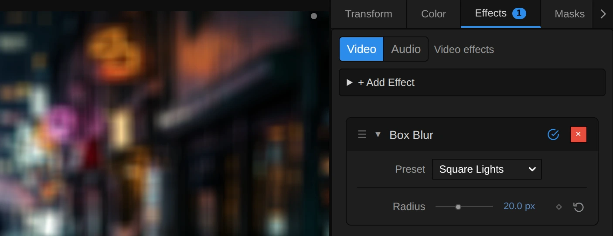
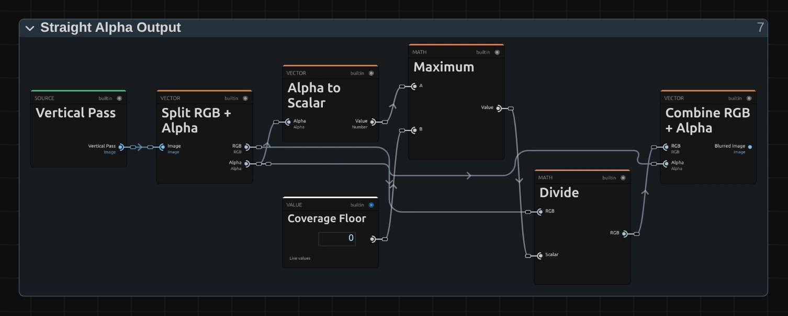

# Box Blur

Averages a square around every pixel: a graphic softness in which small lights turn into flat squares.

Group: [Blur & Sharpen](../Effects-Blur.md) · [How to add an effect](../Effects.md#add-an-effect)

<figure class="docs-shot docs-compare docs-shot--float-left">

<figcaption>Left: original. Right: Radius 16.</figcaption>
</figure>

**Use it for:** a graphic, digital softness · a frosted-glass panel behind text · lights that should read as squares, not glows.

- **Radius** – how far the softening reaches.

**Tip:** for a natural, lens-like defocus use [Gaussian Blur](./gaussian-blur.md); Box Blur is the graphic one. The difference shows most on small lights: [Which one?](../Effects-Blur.md#which-one)

## Presets

<figure class="docs-shot docs-shot--detail">

<figcaption>The four presets on lit windows and a neon sign against the night sky.</figcaption>
</figure>

Pick one in the **Preset** row of the effect card. It sets Radius in one undo step, and the row shows its name until you change something. A Radius with keyframes keeps them, and the card says so.

**Soft Edge** – Radius 1.5: takes the digital edge off sharp footage, graphics or text without looking blurred.

**Frosted Glass** – Radius 8: shapes stay readable as areas, fine detail and lettering behind it are gone. Good for a panel behind a title.

**Square Lights** – Radius 20: every lamp and window becomes a flat block with straight edges, and the frame reads as a pattern of squares. The look Gaussian Blur cannot give: its lights turn into round glows.

**Colour Field** – Radius 50: only large patches of light and colour are left, a quiet backdrop for text or a scene change.

## Controls

<figure class="docs-shot">

<svg class="docs-shot-overlay" viewBox="0 0 1017 393" aria-hidden="true" focusable="false">
<defs><marker id="box-blur-inspector-arrow" viewBox="0 0 10 10" refX="8" refY="5" markerWidth="5" markerHeight="5" orient="auto-start-reverse"><path d="M 0 0 L 10 5 L 0 10 Z" fill="#ffd54a" /></marker></defs>
<path class="docs-shot-arrow" d="M565 282 L649 282" marker-end="url(#box-blur-inspector-arrow)" />
<circle class="docs-shot-number" cx="565" cy="282" r="18" /><text x="565" y="282" class="docs-shot-number-text">1</text>
<path class="docs-shot-arrow" d="M561 344 L645 344" marker-end="url(#box-blur-inspector-arrow)" />
<circle class="docs-shot-number" cx="561" cy="344" r="18" /><text x="561" y="344" class="docs-shot-number-text">2</text>
</svg>

<figcaption>Box Blur with the Square Lights preset. 1 — Preset: pick a starting point. 2 — Radius: how far the softening reaches.</figcaption>
</figure>

**Preset** – a starting point for Radius; see [Presets](#presets).

<figure class="docs-shot docs-shot--float-right">

<figcaption>The same street lamps at Radius 10. Left: Gaussian Blur. Right: Box Blur.</figcaption>
</figure>

**Radius** – how far the softening reaches: every pixel becomes the average of a square twice as wide as Radius. 1–2 only takes the edge off, 8–12 makes a frosted panel, from about 20 small lights read as squares, and 50 leaves broad patches of colour. It counts pixels of a 1080p picture, so a 4K export shows the same blur relative to the picture. It changes smoothly when animated, and 0 leaves the picture untouched. 0 to 50 px, default 5 px.

## Node setup

<figure class="docs-shot docs-shot--graph">

<svg class="docs-shot-overlay" viewBox="0 0 1017 720" aria-hidden="true" focusable="false">
<defs><marker id="box-blur-arrow" viewBox="0 0 10 10" refX="8" refY="5" markerWidth="5" markerHeight="5" orient="auto-start-reverse"><path d="M 0 0 L 10 5 L 0 10 Z" fill="#ffd54a" /></marker></defs>
<path class="docs-shot-arrow" d="M314 155 L314 239" marker-end="url(#box-blur-arrow)" />
<circle class="docs-shot-number" cx="314" cy="155" r="18" /><text x="314" y="155" class="docs-shot-number-text">1</text>
<path class="docs-shot-arrow" d="M314 698 L314 614" marker-end="url(#box-blur-arrow)" />
<circle class="docs-shot-number" cx="314" cy="698" r="18" /><text x="314" y="698" class="docs-shot-number-text">2</text>
<path class="docs-shot-arrow" d="M509 22 L509 96" marker-end="url(#box-blur-arrow)" />
<circle class="docs-shot-number" cx="509" cy="22" r="18" /><text x="509" y="22" class="docs-shot-number-text">3</text>
<path class="docs-shot-arrow" d="M703 155 L703 239" marker-end="url(#box-blur-arrow)" />
<circle class="docs-shot-number" cx="703" cy="155" r="18" /><text x="703" y="155" class="docs-shot-number-text">4</text>
<path class="docs-shot-arrow" d="M897 155 L897 239" marker-end="url(#box-blur-arrow)" />
<circle class="docs-shot-number" cx="897" cy="155" r="18" /><text x="897" y="155" class="docs-shot-number-text">5</text>
</svg>

<figcaption>Box Blur opened in the Nodes tab (Constants, Coordinates and the Output card left out). 1 — Radius & Tap Count: how far to read. 2 — Premultiplied Source: the picture, ready to average. 3 — Horizontal Pass: blurs the rows. 4 — Vertical Pass: blurs the columns. 5 — Straight Alpha Output: back to a normal picture.</figcaption>
</figure>

Box Blur works in five stages, one folder each in the Nodes tab: **Radius & Tap Count** turns Radius into a reach in pixels and the number of reads, **Premultiplied Source** prepares the picture so transparent edges stay clean, **Horizontal Pass** averages along the rows and **Vertical Pass** along the columns of that result, and **Straight Alpha Output** turns the result back into a normal picture. Two passes of a line instead of one square are much faster and give exactly the same square. Click a folder's header to open it. [Gaussian Blur](./gaussian-blur.md#node-setup) has the same stages; only the weights inside the passes differ.

### Radius & Tap Count

<figure class="docs-shot docs-shot--graph">

<svg class="docs-shot-overlay" viewBox="0 0 1017 542" aria-hidden="true" focusable="false">
<defs><marker id="box-blur-radius-tap-count-arrow" viewBox="0 0 10 10" refX="8" refY="5" markerWidth="5" markerHeight="5" orient="auto-start-reverse"><path d="M 0 0 L 10 5 L 0 10 Z" fill="#ffd54a" /></marker></defs>
<path class="docs-shot-arrow" d="M168 138 L168 222" marker-end="url(#box-blur-radius-tap-count-arrow)" />
<circle class="docs-shot-number" cx="168" cy="138" r="18" /><text x="168" y="138" class="docs-shot-number-text">1</text>
<path class="docs-shot-arrow" d="M460 138 L460 222" marker-end="url(#box-blur-radius-tap-count-arrow)" />
<circle class="docs-shot-number" cx="460" cy="138" r="18" /><text x="460" y="138" class="docs-shot-number-text">2</text>
<path class="docs-shot-arrow" d="M752 138 L752 222" marker-end="url(#box-blur-radius-tap-count-arrow)" />
<circle class="docs-shot-number" cx="752" cy="138" r="18" /><text x="752" y="138" class="docs-shot-number-text">3</text>
<path class="docs-shot-arrow" d="M654 23 L654 107" marker-end="url(#box-blur-radius-tap-count-arrow)" />
<circle class="docs-shot-number" cx="654" cy="23" r="18" /><text x="654" y="23" class="docs-shot-number-text">4</text>
</svg>

<figcaption>Inside Radius & Tap Count, the folder that turns Radius into reads. The number cards are values from the Constants folder, shown where they plug in. 1 — Smallest Component: the shorter side of the frame. 2 — Add: the Reach. 3 — Minimum: the pairs of reads. 4 — Maximum: the stride.</figcaption>
</figure>

**Smallest Component** – the shorter side of the frame. Divided by 1080 it says how much larger or smaller this frame is than a 1080p one; Multiply turns Radius into pixels of this frame, so a 4K export, a portrait frame and a thumbnail show the same blur.

**Add** – Radius in pixels plus one: the Reach. Every pixel closer than Radius counts fully and the one just beyond counts in part, which is why the blur grows smoothly when Radius is animated, instead of in one-pixel jumps.

**Minimum** – how many pairs of pixels each side reads: half the Reach, rounded up by Ceiling, but at most 127. Each read takes two neighbouring pixels at once (Pairs times Two plus One is the Tap Count).

**Maximum** – the stride: Reach divided by 254, but at least 1. Up to a reach of 254 pixels every pixel is read; beyond that the reads spread out instead of cutting the square short. Even an 8K frame at Radius 50 stays below that limit.

### Premultiplied Source

<figure class="docs-shot docs-shot--graph">

<svg class="docs-shot-overlay" viewBox="0 0 1017 478" aria-hidden="true" focusable="false">
<defs><marker id="box-blur-premultiplied-source-arrow" viewBox="0 0 10 10" refX="8" refY="5" markerWidth="5" markerHeight="5" orient="auto-start-reverse"><path d="M 0 0 L 10 5 L 0 10 Z" fill="#ffd54a" /></marker></defs>
<path class="docs-shot-arrow" d="M589 455 L589 371" marker-end="url(#box-blur-premultiplied-source-arrow)" />
<circle class="docs-shot-number" cx="589" cy="455" r="18" /><text x="589" y="455" class="docs-shot-number-text">1</text>
<path class="docs-shot-arrow" d="M914 22 L914 106" marker-end="url(#box-blur-premultiplied-source-arrow)" />
<circle class="docs-shot-number" cx="914" cy="22" r="18" /><text x="914" y="22" class="docs-shot-number-text">2</text>
</svg>

<figcaption>Inside Premultiplied Source (cached). 1 — Multiply: colour times transparency. 2 — Cache Image: keeps the prepared picture.</figcaption>
</figure>

**Multiply** – multiplies each pixel's colour by its alpha. A see-through pixel then adds almost nothing to the average, so the colour of its invisible part cannot leak into the blur as a dark rim around a cut-out figure or a title.

**Cache Image** – keeps the prepared picture in a 16-bit float texture for Horizontal Pass to read, so no precision is lost in dark areas.

### Horizontal Pass

<figure class="docs-shot docs-shot--graph">

<svg class="docs-shot-overlay" viewBox="0 0 1017 770" aria-hidden="true" focusable="false">
<defs><marker id="box-blur-horizontal-pass-arrow" viewBox="0 0 10 10" refX="8" refY="5" markerWidth="5" markerHeight="5" orient="auto-start-reverse"><path d="M 0 0 L 10 5 L 0 10 Z" fill="#ffd54a" /></marker></defs>
<path class="docs-shot-arrow" d="M204 399 L204 315" marker-end="url(#box-blur-horizontal-pass-arrow)" />
<circle class="docs-shot-number" cx="204" cy="399" r="18" /><text x="204" y="399" class="docs-shot-number-text">1</text>
<path class="docs-shot-arrow" d="M326 34 L326 118" marker-end="url(#box-blur-horizontal-pass-arrow)" />
<circle class="docs-shot-number" cx="326" cy="34" r="18" /><text x="326" y="34" class="docs-shot-number-text">2</text>
<path class="docs-shot-arrow" d="M448 22 L448 89" marker-end="url(#box-blur-horizontal-pass-arrow)" />
<circle class="docs-shot-number" cx="448" cy="22" r="18" /><text x="448" y="22" class="docs-shot-number-text">3</text>
<path class="docs-shot-arrow" d="M691 95 L691 179" marker-end="url(#box-blur-horizontal-pass-arrow)" />
<circle class="docs-shot-number" cx="691" cy="95" r="18" /><text x="691" y="95" class="docs-shot-number-text">4</text>
<path class="docs-shot-arrow" d="M813 95 L813 179" marker-end="url(#box-blur-horizontal-pass-arrow)" />
<circle class="docs-shot-number" cx="813" cy="95" r="18" /><text x="813" y="95" class="docs-shot-number-text">5</text>
</svg>

<figcaption>Inside Horizontal Pass, reduced to its recipe (how the read position is worked out is left out). 1 — Pair Tap Offsets: where to read. 2 — Subtract: how far inside the Reach. 3 — Clamp: the weight, 0 to 1. 4 — Sequence Reduce: adds up the reads. 5 — Normalize by Weight: turns the sum into an average.</figcaption>
</figure>

**Pair Tap Offsets** – lists the reads along the row: the pixel itself and, for every pair, the distance of its near and far pixel. It holds a small node setup of its own; its › opens it.

**Subtract** – the Reach minus the distance of a pixel: how far that pixel lies inside the square. There is one for the near and one for the far pixel of each pair.

**Clamp** – keeps that between 0 and 1. This is the whole box kernel: inside the Radius a pixel counts fully, the pixel at the border in part, everything beyond not at all. **Merge Pair Weights** then folds each pair into one read between its two pixels, so one read covers two.

**Sequence Reduce** – reads the Premultiplied Source at every position (**Sample Image**) and adds up the reads, each times its weight.

**Normalize by Weight** – divides that sum by the sum of all weights, so the average keeps the picture's brightness, and **Cache Image** keeps the blurred rows for the vertical pass.

**Remix:** for a softer square whose lights fade towards their edges (a tent instead of a box), **Divide** the result of each **Subtract** by **Reach** before it goes into its **Clamp**, in both Subtracts of Horizontal Pass and of Vertical Pass.

### Vertical Pass

<figure class="docs-shot docs-shot--graph">

<svg class="docs-shot-overlay" viewBox="0 0 1017 595" aria-hidden="true" focusable="false">
<defs><marker id="box-blur-vertical-pass-arrow" viewBox="0 0 10 10" refX="8" refY="5" markerWidth="5" markerHeight="5" orient="auto-start-reverse"><path d="M 0 0 L 10 5 L 0 10 Z" fill="#ffd54a" /></marker></defs>
<path class="docs-shot-arrow" d="M314 145 L314 229" marker-end="url(#box-blur-vertical-pass-arrow)" />
<circle class="docs-shot-number" cx="314" cy="145" r="18" /><text x="314" y="145" class="docs-shot-number-text">1</text>
<path class="docs-shot-arrow" d="M897 470 L897 386" marker-end="url(#box-blur-vertical-pass-arrow)" />
<circle class="docs-shot-number" cx="897" cy="470" r="18" /><text x="897" y="470" class="docs-shot-number-text">2</text>
</svg>

<figcaption>Inside Vertical Pass, the read position. 1 — Combine Vector: the offset points up and down. 2 — Sample Image: reads the blurred rows.</figcaption>
</figure>

Vertical Pass holds the same recipe as Horizontal Pass, with two differences:

**Combine Vector** – puts the offset into the second, vertical place (the first is Zero), so the reads go up and down a column instead of along a row.

**Sample Image** – reads the cached result of Horizontal Pass instead of the source. A row average of column averages is the average of the whole square.

### Straight Alpha Output

<figure class="docs-shot docs-shot--graph">

<svg class="docs-shot-overlay" viewBox="0 0 1017 515" aria-hidden="true" focusable="false">
<defs><marker id="box-blur-straight-alpha-arrow" viewBox="0 0 10 10" refX="8" refY="5" markerWidth="5" markerHeight="5" orient="auto-start-reverse"><path d="M 0 0 L 10 5 L 0 10 Z" fill="#ffd54a" /></marker></defs>
<path class="docs-shot-arrow" d="M589 22 L589 83" marker-end="url(#box-blur-straight-alpha-arrow)" />
<circle class="docs-shot-number" cx="589" cy="22" r="18" /><text x="589" y="22" class="docs-shot-number-text">1</text>
<path class="docs-shot-arrow" d="M752 491 L752 407" marker-end="url(#box-blur-straight-alpha-arrow)" />
<circle class="docs-shot-number" cx="752" cy="491" r="18" /><text x="752" y="491" class="docs-shot-number-text">2</text>
<path class="docs-shot-arrow" d="M914 59 L914 143" marker-end="url(#box-blur-straight-alpha-arrow)" />
<circle class="docs-shot-number" cx="914" cy="59" r="18" /><text x="914" y="59" class="docs-shot-number-text">3</text>
</svg>

<figcaption>Inside Straight Alpha Output. 1 — Maximum: never divide by zero. 2 — Divide: the colour back to full strength. 3 — Combine RGB + Alpha: the finished picture.</figcaption>
</figure>

**Maximum** – the blurred alpha, but never below the Coverage Floor, a tiny 0.000001. Fully transparent pixels then stay black and transparent instead of turning into errors.

**Divide** – divides the blurred colour by the blurred alpha: the reverse of the Multiply in Premultiplied Source, so half-transparent edges get their real colour back.

**Combine RGB + Alpha** – joins colour and alpha into the finished picture that leaves the effect.

## Technical details

- **Size.** Radius counts pixels of a frame whose shorter side is 1080: preview quality, a 4K export, a portrait frame and the thumbnails all show the same blur relative to the picture.
- **Kernel.** Every pixel within Radius counts fully, the one at the border in part. A horizontal pass into a 16-bit float cache, then a vertical pass: about Radius + 2 reads per pass at 1080p, two pixels per read. Up to 127 reads per side; beyond that the reads spread out, and the card and the tool result say so.
- **Edges.** At the frame edge the outermost pixels repeat, so a large Radius does not darken the border. Transparent edges fade without a dark rim, and the preview and the export match.
- **Zero.** An unedited Box Blur at Radius 0 is skipped, so the picture passes through exactly.
- **Software preview.** Where the editor falls back to its software preview, Box Blur shows an approximation (a canvas blur, rounder than the box); the GPU preview and the export show the real square.
- **Saved projects.** They render with this kernel; a Box Blur whose node setup you edited keeps its own recipe.
- **More:** [Blur & Sharpen notes](../Effect-System.md#blur--sharpen-notes) · [Editable blur kernels](../Effect-System.md#editable-blur-kernels) · [Node Catalog](../Node-Catalog.md) · [Styles and presets](../Effects.md#styles-and-presets).
