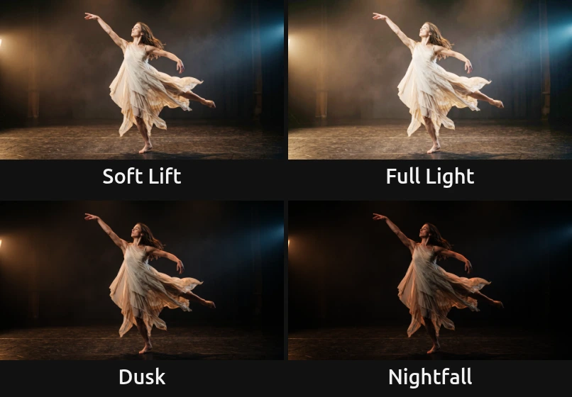
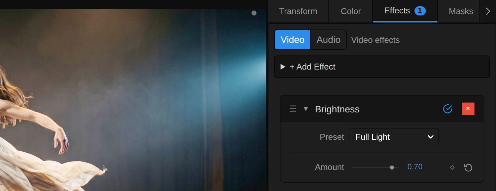
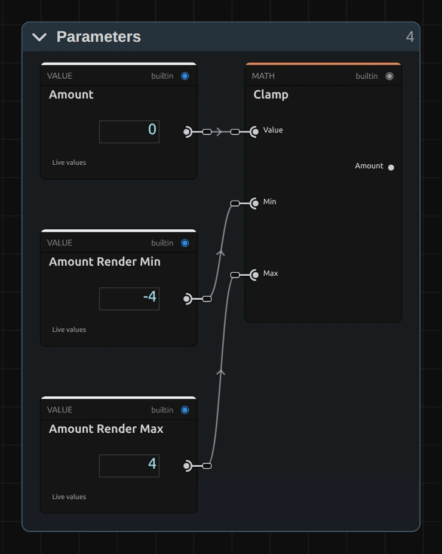

# Brightness

Lightens or darkens the mid-tones while black and white stay where they are. No grey veil, no washed-out shadows.

Group: [Color & Tone](../Effects-Color.md) · [How to add an effect](../Effects.md#add-an-effect)

<figure class="docs-shot docs-compare">

<figcaption>Left: original. Right: Amount 0.7 (the Full Light preset).</figcaption>
</figure>

**Use it for:** footage that is a little too dark or too bright · lifting a dim projection without greying it · calming a background behind a title.

- **Amount** – up to lighten, down to darken.

**Tip:** keyframe **Amount** from 0 down to −0.8 for a slow fall of night. Unlike a fade to black, the spots and the brightest costume stay alive to the end. For a change of light like the camera's aperture, use [Exposure](./exposure.md).

## Presets

<figure class="docs-shot docs-shot--detail">

<figcaption>The four presets on the dancer.</figcaption>
</figure>

Pick one in the **Preset** row of the effect card. It sets Amount in one undo step, and the row then shows its name until you change the value. A keyframed Amount keeps its keyframes, and the card says so.

**Soft Lift** – a gentle lift: a dim projection or a slightly dark shot opens up, and nobody notices that anything was changed.

**Full Light** – open, airy mid-tones, as under full stage light. The haze and the set come out of the dark, while the brightest whites still hold.

**Dusk** – calmer, heavier mid-tones: evening light, or a background that steps back behind a title.

**Nightfall** – only the lights and the brightest surfaces remain. For night scenes and the moment before a blackout.

## Controls

<figure class="docs-shot">

<svg class="docs-shot-overlay" viewBox="0 0 1017 313" aria-hidden="true" focusable="false">
<defs><marker id="brightness-inspector-arrow" viewBox="0 0 10 10" refX="8" refY="5" markerWidth="5" markerHeight="5" orient="auto-start-reverse"><path d="M 0 0 L 10 5 L 0 10 Z" fill="#ffd54a" /></marker></defs>
<path class="docs-shot-arrow" d="M639 224 L723 224" marker-end="url(#brightness-inspector-arrow)" />
<circle class="docs-shot-number" cx="639" cy="224" r="18" /><text x="639" y="224" class="docs-shot-number-text">1</text>
<path class="docs-shot-arrow" d="M631 274 L715 274" marker-end="url(#brightness-inspector-arrow)" />
<circle class="docs-shot-number" cx="631" cy="274" r="18" /><text x="631" y="274" class="docs-shot-number-text">2</text>
</svg>

<figcaption>Brightness with the Full Light preset. 1 — Preset: pick a starting point. 2 — Amount: lighter or darker.</figcaption>
</figure>

**Preset** – one of the four starting points above; it sets Amount.

<figure class="docs-shot docs-clip docs-shot--float-right">
<video src="../assets/effects/clips/brightness-amount.mp4" poster="../assets/effects/clips/brightness-amount.webp" width="720" height="540" autoplay muted loop playsinline preload="none" aria-label="The dancer on a dark stage with Brightness while Amount runs from −0.8 to 0.8 and back: the stage sinks into night until only her dress and the spotlights remain, then lifts until the haze and curtains show, while the deepest shadows stay dark and the brightest light never burns out; the current value is shown at the bottom left"></video>
<figcaption>Amount from −0.8 to 0.8 and back.</figcaption>
</figure>

**Amount** – how much lighter or darker the mid-tones get. Up lightens, down darkens; black stays black and white stays white at every value, so nothing clips and no grey veil appears. 0.2–0.3 is a lift you feel more than see, 0.7 opens a dark stage clearly, 1 is strong. Darkening deepens colours a little, lightening softens them, as on a lighter or darker print. −1 to 1, default 0. In the number field you can type up to ±4, for extreme looks where almost everything turns white or black.

## Node setup

<figure class="docs-shot docs-shot--graph">

<svg class="docs-shot-overlay" viewBox="0 0 1017 463" aria-hidden="true" focusable="false">
<defs><marker id="brightness-arrow" viewBox="0 0 10 10" refX="8" refY="5" markerWidth="5" markerHeight="5" orient="auto-start-reverse"><path d="M 0 0 L 10 5 L 0 10 Z" fill="#ffd54a" /></marker></defs>
<path class="docs-shot-arrow" d="M314 22 L314 96" marker-end="url(#brightness-arrow)" />
<circle class="docs-shot-number" cx="314" cy="22" r="18" /><text x="314" y="22" class="docs-shot-number-text">1</text>
<path class="docs-shot-arrow" d="M509 142 L509 226" marker-end="url(#brightness-arrow)" />
<circle class="docs-shot-number" cx="509" cy="142" r="18" /><text x="509" y="142" class="docs-shot-number-text">2</text>
</svg>

<figcaption>Brightness opened in the Nodes tab (the Constants folder left out). 1 — Parameters: Amount, kept within its range. 2 — Brightness Curve: lifts or lowers the mid-tones.</figcaption>
</figure>

Brightness works in two stages, one folder each in the Nodes tab: **Parameters** holds Amount and keeps it within the range the curve can show, and **Brightness Curve** bends each colour channel with it. **Split RGB + Alpha** takes the transparency aside first and **Combine RGB + Alpha** puts it back untouched. Every colour effect has this shape ([Color & Tone](../Effects-Color.md#the-shared-idea)). Click a folder's header to open it; the sections below show what is inside.

### Parameters

<figure class="docs-shot docs-shot--float-right">

<svg class="docs-shot-overlay" viewBox="0 0 590 740" aria-hidden="true" focusable="false">
<defs><marker id="brightness-parameters-arrow" viewBox="0 0 10 10" refX="8" refY="5" markerWidth="5" markerHeight="5" orient="auto-start-reverse"><path d="M 0 0 L 10 5 L 0 10 Z" fill="#ffd54a" /></marker></defs>
<path class="docs-shot-arrow" d="M432 521 L432 437" marker-end="url(#brightness-parameters-arrow)" />
<circle class="docs-shot-number" cx="432" cy="521" r="18" /><text x="432" y="521" class="docs-shot-number-text">1</text>
</svg>

<figcaption>Inside Parameters. 1 — Clamp: keeps Amount between −4 and 4.</figcaption>
</figure>

**Clamp** – keeps Amount between −4 and 4, the values in **Amount Render Min** and **Amount Render Max**. A keyframe, a node or the AI agent may send more; the curve then uses the limit, and the card and the tool result say so. Beyond ±4 the picture would not change visibly anyway.

### Brightness Curve

<figure class="docs-shot docs-shot--graph">

<svg class="docs-shot-overlay" viewBox="0 0 1017 637" aria-hidden="true" focusable="false">
<defs><marker id="brightness-curve-arrow" viewBox="0 0 10 10" refX="8" refY="5" markerWidth="5" markerHeight="5" orient="auto-start-reverse"><path d="M 0 0 L 10 5 L 0 10 Z" fill="#ffd54a" /></marker></defs>
<path class="docs-shot-arrow" d="M102 413 L102 329" marker-end="url(#brightness-curve-arrow)" />
<circle class="docs-shot-number" cx="102" cy="413" r="18" /><text x="102" y="413" class="docs-shot-number-text">1</text>
<path class="docs-shot-arrow" d="M427 22 L427 102" marker-end="url(#brightness-curve-arrow)" />
<circle class="docs-shot-number" cx="427" cy="22" r="18" /><text x="427" y="22" class="docs-shot-number-text">2</text>
<path class="docs-shot-arrow" d="M589 22 L589 102" marker-end="url(#brightness-curve-arrow)" />
<circle class="docs-shot-number" cx="589" cy="22" r="18" /><text x="589" y="22" class="docs-shot-number-text">3</text>
<path class="docs-shot-arrow" d="M914 22 L914 102" marker-end="url(#brightness-curve-arrow)" />
<circle class="docs-shot-number" cx="914" cy="22" r="18" /><text x="914" y="22" class="docs-shot-number-text">4</text>
</svg>

<figcaption>Inside Brightness Curve (Clamp's limits 0 and 1 are left out). 1 — Value: how strong one unit of Amount is. 2 — Power of Two: the gain. 3 — Multiply: lifts each channel. 4 — Divide: brings black and white back to where they were.</figcaption>
</figure>

**Value** – 2.5, the number of stops one unit of Amount is worth. The first Multiply turns Amount into stops: Amount 1 is 2.5 stops.

**Power of Two** – turns the stops into a gain: 0 stops is 1 (no change), 1 stop is 2, −1 stop is 0.5.

**Multiply** – the one on the right multiplies each colour channel by the gain. On its own this would push bright tones past white.

**Divide** – divides that by itself plus the rest up to white (**Subtract**: 1 minus the channel, summed by **Add**). That squeezes the result back: 0 stays 0, 1 stays 1, and only the tones in between move. That is why Brightness has no grey veil and never clips.

**Remix:** set that **Value** (1) from 2.5 to 1.25 and the whole slider becomes half as strong, for finer control; set it to 4 for a harder push.

## Technical details

- **Formula.** `y = x·m / (x·m + 1 − x)` on each colour channel, with `m = 2^(2.5 · Amount)`. It multiplies the odds `x / (1 − x)` of each channel by `m`, so mid-grey 0.5 becomes 0.63 at Amount 0.3, 0.85 at Amount 1 and 0.15 at Amount −1.
- **Range.** The slider covers −1 to 1; typed values, keyframes and nodes render up to ±4. Beyond that the curve uses the limit, and the inspector and the tool result say so.
- **Colour.** Each channel is bent on its own, so darkening deepens saturated colours a little and lightening softens them. Hue stays close; for a pure light change in linear light use [Exposure](./exposure.md).
- **Transparency.** Only the colour is changed; the transparency passes through untouched.
- What all colour effects share (8-bit range, saved projects, adjustment layers): [Color & Tone](../Effect-System.md#color--tone-notes). Formulas: [Effect system](../Effect-System.md#editable-color-effect-graphs); blocks: [Node Catalog](../Node-Catalog.md) · [Styles and presets](../Effects.md#styles-and-presets).
