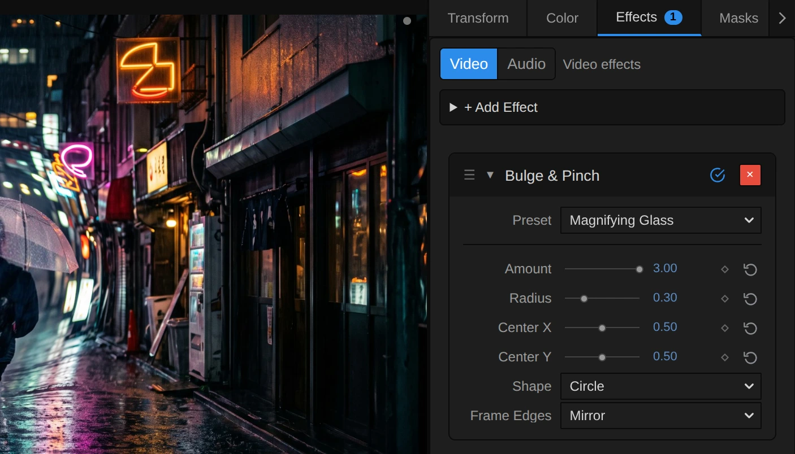
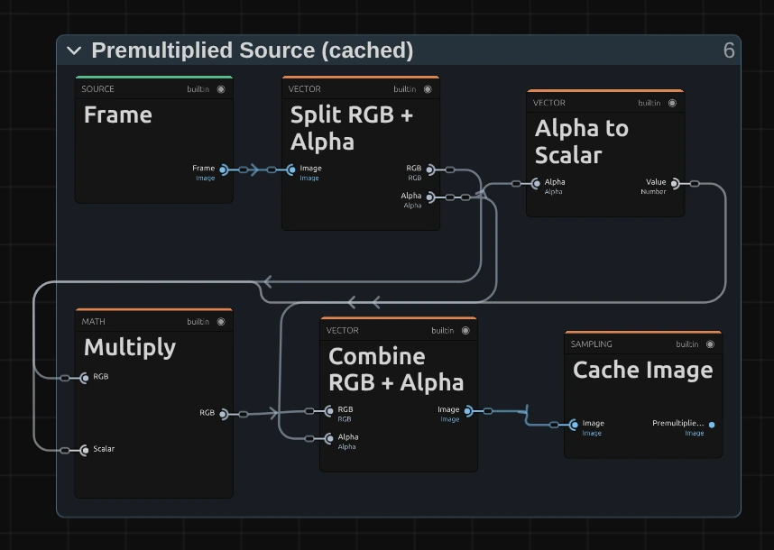
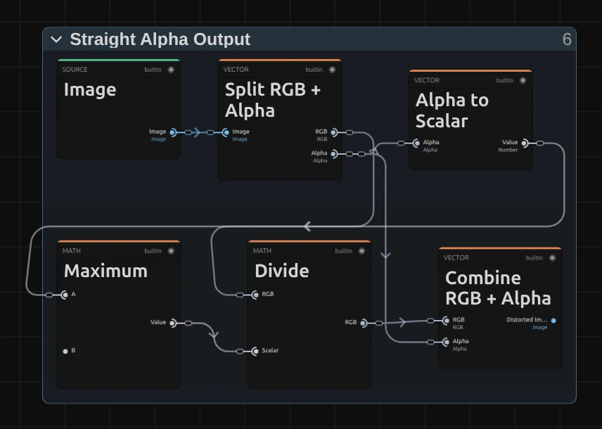

# Bulge & Pinch

Swells a round area of the picture like a lens bump, or squeezes it together. Its rim blends smoothly into the rest.

Group: [Lens & Distort](../Effects-Distort.md) · [How to add an effect](../Effects.md#add-an-effect)

<figure class="docs-shot docs-compare docs-shot--float-left">

<figcaption>Left: original. Right: the default settings.</figcaption>
</figure>

**Use it for:** a magnifying-glass moment · a bump that grows out of the picture on a cue · a cartoon squeeze of a face or an object.

- **Amount** – above 1 the middle swells, below 1 it squeezes together.
- **Radius** – how large the round area is.
- **Center X / Center Y** – where it sits.

**Tip:** keyframe **Amount** from 1 (no change) up to 2 to let a bump grow out of a still picture, and back to 1 to let it sink again. Bulge & Pinch changes one round area and leaves the rest of the picture untouched; [Fisheye Lens](./fisheye.md) bends the whole frame like a lens and keeps the corners in place ([which one?](../Effects-Distort.md#which-one)).

## Presets

<figure class="docs-shot docs-shot--detail">

<figcaption>The four presets on the night street.</figcaption>
</figure>

Pick one in the **Preset** row of the effect card. It sets all controls at once, in one undo step, and the row then shows its name until you change something. A control with keyframes keeps them, and the card says so. Every preset sits in the middle of the frame: move **Center X** and **Center Y** afterwards to put it on your subject.

**Magnifying Glass** – Amount 3, Radius 0.3: a small, strong lens. What lies in the middle is three times as large, the rest of the picture stays as it is. For a detail the audience should read, or a comic peek.

**Soft Swell** – Amount 1.35, Radius 0.9: the whole middle swells gently, so the picture seems to breathe towards the audience. Animate Amount between 1 and 1.35 for a slow pulse.

**Fishbowl** – Amount 2, Radius 0.7, Shape Stretch to Frame: a wide oval bulge across the frame. The middle comes close and the sides bow round, as if seen through a fishbowl.

**Pinch** – Amount 0.5, Radius 0.5: the middle shrinks and pulls the picture in towards it, as if it were sucked away. Good for a disappearance or a dizzy moment.

## Controls

<figure class="docs-shot docs-shot--float-right">

<svg class="docs-shot-overlay" viewBox="0 0 590 428" aria-hidden="true" focusable="false">
<defs><marker id="bulge-inspector-arrow" viewBox="0 0 10 10" refX="8" refY="5" markerWidth="5" markerHeight="5" orient="auto-start-reverse"><path d="M 0 0 L 10 5 L 0 10 Z" fill="#ffd54a" /></marker></defs>
<path class="docs-shot-arrow" d="M50 106 L195 106" marker-end="url(#bulge-inspector-arrow)" />
<circle class="docs-shot-number" cx="50" cy="106" r="18" /><text x="50" y="106" class="docs-shot-number-text">1</text>
<path class="docs-shot-arrow" d="M50 173 L185 173" marker-end="url(#bulge-inspector-arrow)" />
<circle class="docs-shot-number" cx="50" cy="173" r="18" /><text x="50" y="173" class="docs-shot-number-text">2</text>
<path class="docs-shot-arrow" d="M50 213 L191 213" marker-end="url(#bulge-inspector-arrow)" />
<circle class="docs-shot-number" cx="50" cy="213" r="18" /><text x="50" y="213" class="docs-shot-number-text">3</text>
<path class="docs-shot-arrow" d="M50 334 L195 334" marker-end="url(#bulge-inspector-arrow)" />
<circle class="docs-shot-number" cx="50" cy="334" r="18" /><text x="50" y="334" class="docs-shot-number-text">4</text>
<path class="docs-shot-arrow" d="M50 375 L137 375" marker-end="url(#bulge-inspector-arrow)" />
<circle class="docs-shot-number" cx="50" cy="375" r="18" /><text x="50" y="375" class="docs-shot-number-text">5</text>
</svg>

<figcaption>Bulge & Pinch with the Magnifying Glass preset. 1 — Preset: pick a starting point. 2 — Amount: bulge above 1, pinch below. 3 — Radius: the size of the area. 4 — Shape: round or stretched with the frame. 5 — Frame Edges: what shows beyond the picture.</figcaption>
</figure>

**Preset** – a starting point for every control; see [Presets](#presets).

**Amount** – how strongly the area swells or squeezes. 1 changes nothing. Above 1 the middle is magnified exactly that many times: the default 2 makes it twice as large, 3 three times, and towards 3 the enlarged pixels get soft. Below 1 it pinches, but not as the mirror image of a bulge: 0.5 shows the middle about 1.6 times smaller (not half), and 0 about 2.6 times smaller. Below about 0.3 a ring halfway to the rim stretches into streaks that point to the middle. 0 to 3, default 2.

**Radius** – how large the round area is, as a share of the shorter side of the frame (the height of a wide picture). 0.5 makes a circle as tall as the picture, 0.2 a small spot, 1 reaches well beyond the top and bottom. Outside the area nothing moves, and towards its rim the effect fades out smoothly, so no edge shows. 0.05 to 1, default 0.5.

**Center X** – where the middle of the area sits across the frame: 0 is the left edge, 1 the right. Move it onto a face or an object that is not in the middle; the area may reach past the frame edge. 0 to 1, default 0.5.

**Center Y** – where the middle of the area sits from top (0) to bottom (1). 0 to 1, default 0.5.

**Shape** – **Circle** keeps the area round on any frame. **Stretch to Frame** stretches it with the frame into an oval as wide as the picture, so on a wide frame it bends more across than up and down; at Radius 0.5 the oval just touches all four edges. Circle, Stretch to Frame, default Circle.

**Frame Edges** – what shows where a pinch reads from beyond the picture: with a large Radius, or with the area near an edge. **Mirror** reflects the picture there, **Clamp** repeats its border pixels as streaks, and **Transparent** leaves those places empty, for a layer below to show through. A bulge only reads from nearer the middle, so with the area inside the frame it never needs this. Mirror, Clamp, Transparent, default Mirror.

## Node setup

<figure class="docs-shot docs-shot--graph">

<svg class="docs-shot-overlay" viewBox="0 0 1017 979" aria-hidden="true" focusable="false">
<defs><marker id="bulge-arrow" viewBox="0 0 10 10" refX="8" refY="5" markerWidth="5" markerHeight="5" orient="auto-start-reverse"><path d="M 0 0 L 10 5 L 0 10 Z" fill="#ffd54a" /></marker></defs>
<path class="docs-shot-arrow" d="M143 160 L143 244" marker-end="url(#bulge-arrow)" />
<circle class="docs-shot-number" cx="143" cy="160" r="18" /><text x="143" y="160" class="docs-shot-number-text">1</text>
<path class="docs-shot-arrow" d="M386 22 L386 106" marker-end="url(#bulge-arrow)" />
<circle class="docs-shot-number" cx="386" cy="22" r="18" /><text x="386" y="22" class="docs-shot-number-text">2</text>
<path class="docs-shot-arrow" d="M386 956 L386 872" marker-end="url(#bulge-arrow)" />
<circle class="docs-shot-number" cx="386" cy="956" r="18" /><text x="386" y="956" class="docs-shot-number-text">3</text>
<path class="docs-shot-arrow" d="M629 290 L629 374" marker-end="url(#bulge-arrow)" />
<circle class="docs-shot-number" cx="629" cy="290" r="18" /><text x="629" y="290" class="docs-shot-number-text">4</text>
<path class="docs-shot-arrow" d="M873 290 L873 374" marker-end="url(#bulge-arrow)" />
<circle class="docs-shot-number" cx="873" cy="290" r="18" /><text x="873" y="290" class="docs-shot-number-text">5</text>
</svg>

<figcaption>Bulge & Pinch opened in the Nodes tab (the Parameters, Constants and Coordinates & Resources folders and the Output card left out). 1 — Centre, Shape & Radius: where each pixel lies in the area. 2 — Bulge & Pinch Curve: where it reads instead. 3 — Premultiplied Source: a clean copy of the picture. 4 — Frame Edges & Sampling: reads it there. 5 — Straight Alpha Output: a normal picture again.</figcaption>
</figure>

Bulge & Pinch does not paint anything: it moves where each pixel reads from, like every distortion of its group ([the shared idea](../Effects-Distort.md#the-shared-idea)). It works in five stages, one folder each in the Nodes tab: **Centre, Shape & Radius** measures where a pixel lies in the area, **Bulge & Pinch Curve** works out from where it reads instead, **Premultiplied Source** prepares a copy of the picture with clean transparent edges, **Frame Edges & Sampling** reads that copy there, and **Straight Alpha Output** turns the result back into a normal picture. All of it runs in one pass after the copy. Click a folder's header to open it; the sections below show what is inside.

### Centre, Shape & Radius

<figure class="docs-shot docs-shot--graph">

<svg class="docs-shot-overlay" viewBox="0 0 1017 818" aria-hidden="true" focusable="false">
<defs><marker id="bulge-space-arrow" viewBox="0 0 10 10" refX="8" refY="5" markerWidth="5" markerHeight="5" orient="auto-start-reverse"><path d="M 0 0 L 10 5 L 0 10 Z" fill="#ffd54a" /></marker></defs>
<path class="docs-shot-arrow" d="M569 668 L569 518" marker-end="url(#bulge-space-arrow)" />
<circle class="docs-shot-number" cx="569" cy="668" r="18" /><text x="569" y="668" class="docs-shot-number-text">1</text>
<path class="docs-shot-arrow" d="M569 53 L569 253" marker-end="url(#bulge-space-arrow)" />
<circle class="docs-shot-number" cx="569" cy="53" r="18" /><text x="569" y="53" class="docs-shot-number-text">2</text>
<path class="docs-shot-arrow" d="M691 169 L691 253" marker-end="url(#bulge-space-arrow)" />
<circle class="docs-shot-number" cx="691" cy="169" r="18" /><text x="691" y="169" class="docs-shot-number-text">3</text>
<path class="docs-shot-arrow" d="M935 169 L935 253" marker-end="url(#bulge-space-arrow)" />
<circle class="docs-shot-number" cx="935" cy="169" r="18" /><text x="935" y="169" class="docs-shot-number-text">4</text>
</svg>

<figcaption>Inside Centre, Shape & Radius (Center X, Center Y, Shape, Radius). 1 — Subtract: the way from the centre. 2 — Switch: round or stretched. 3 — Multiply: the Offset. 4 — Divide: Distance / Radius.</figcaption>
</figure>

**Subtract** – the pixel's place (UV) minus the centre, which Combine Vector builds from Center X and Center Y: the way from the middle of the area to this pixel, as a share of the frame.

**Switch** – the Shape Scale. For **Circle** it takes the frame size divided by its shorter side (Divide, Minimum), so a step across counts as much as a step up and the area stays round. For **Stretch to Frame** (Greater Than compares Shape with Half) it takes (1, 1), and the area stretches with the frame.

**Multiply** – the way from the centre times the Shape Scale: the Offset, measured in shorter sides of the frame. The later stages bend this Offset.

**Divide** – the Length of the Offset divided by Radius: Distance / Radius, 0 in the middle and 1 at the rim of the area. Maximum keeps Radius above 0.0001, so a Radius of 0 never divides by zero.

### Bulge & Pinch Curve

<figure class="docs-shot docs-shot--graph">

![Inside the Bulge & Pinch Curve folder, left to right: Distance / Radius times itself (Multiply), One minus that (Subtract), Maximum with Zero and Multiply by itself give the falloff; Amount goes through Maximum with One and Natural Logarithm, and through One minus Amount, Clamp and Multiply by Pinch Beta Limit −0.95, and Add joins both into the Strength; Multiply, Subtract from Zero and Exponential turn Strength times the falloff into the Lens Scale, and the last Multiply applies it to the Offset](../assets/effects/graphs/bulge-curve.webp)

<svg class="docs-shot-overlay" viewBox="0 0 1017 801" aria-hidden="true" focusable="false">
<defs><marker id="bulge-curve-arrow" viewBox="0 0 10 10" refX="8" refY="5" markerWidth="5" markerHeight="5" orient="auto-start-reverse"><path d="M 0 0 L 10 5 L 0 10 Z" fill="#ffd54a" /></marker></defs>
<path class="docs-shot-arrow" d="M509 121 L509 205" marker-end="url(#bulge-curve-arrow)" />
<circle class="docs-shot-number" cx="509" cy="121" r="18" /><text x="509" y="121" class="docs-shot-number-text">1</text>
<path class="docs-shot-arrow" d="M400 660 L400 576" marker-end="url(#bulge-curve-arrow)" />
<circle class="docs-shot-number" cx="400" cy="660" r="18" /><text x="400" y="660" class="docs-shot-number-text">2</text>
<path class="docs-shot-arrow" d="M292 778 L292 694" marker-end="url(#bulge-curve-arrow)" />
<circle class="docs-shot-number" cx="292" cy="778" r="18" /><text x="292" y="778" class="docs-shot-number-text">3</text>
<path class="docs-shot-arrow" d="M509 526 L509 442" marker-end="url(#bulge-curve-arrow)" />
<circle class="docs-shot-number" cx="509" cy="526" r="18" /><text x="509" y="526" class="docs-shot-number-text">4</text>
<path class="docs-shot-arrow" d="M833 373 L833 289" marker-end="url(#bulge-curve-arrow)" />
<circle class="docs-shot-number" cx="833" cy="373" r="18" /><text x="833" y="373" class="docs-shot-number-text">5</text>
</svg>

<figcaption>Inside Bulge & Pinch Curve (Amount); the moved Offset goes back to a position after the last Multiply (Divide and Add left out). The number cards are values from the Constants folder, shown where they plug in. 1 — Multiply: the smooth falloff. 2 — Natural Logarithm: the bulge strength. 3 — Pinch Beta Limit: the deepest pinch. 4 — Add: the Strength. 5 — Exponential: the Lens Scale.</figcaption>
</figure>

**Multiply** – the falloff: Multiply, Subtract and Maximum turn Distance / Radius into 1 − r², which is 1 in the middle and 0 at the rim, and this Multiply squares it. Squared, it reaches 0 with no kink, so the rim of the area never shows as a line.

**Natural Logarithm** – the bulge strength: the logarithm of Amount, kept at 1 or more by Maximum. That value makes the middle grow exactly Amount times; for a pinch it is 0.

**Pinch Beta Limit** – −0.95, the deepest pinch. One minus Amount, held between 0 and 1 by Clamp, times this value is the pinch strength: 0 for a bulge, −0.95 at Amount 0. It stays above −1, where the pinch would fold the picture back over itself.

**Add** – the bulge strength plus the pinch strength: the Strength, positive for a bulge and negative for a pinch. The next Multiply scales it by the falloff, so it is full in the middle and fades to nothing at the rim.

**Exponential** – after Subtract from Zero, turns that into the Lens Scale: below 1 in a bulge, so a pixel reads nearer the middle and the picture there grows, above 1 in a pinch, so it reads farther out and the picture shrinks. The last Multiply applies it to the Offset; Divide and Add then turn the moved Offset back into the Read Position.

**Remix:** for a lens with a visible glass rim, connect the output of the top **Maximum** to input **B** of the Multiply right of Multiply (1), in place of the cable from Multiply (1). The bump then stays strong further out and ends in a clear edge.

### Premultiplied Source

<figure class="docs-shot docs-shot--float-right">

<svg class="docs-shot-overlay" viewBox="0 0 590 454" aria-hidden="true" focusable="false">
<defs><marker id="bulge-premultiply-arrow" viewBox="0 0 10 10" refX="8" refY="5" markerWidth="5" markerHeight="5" orient="auto-start-reverse"><path d="M 0 0 L 10 5 L 0 10 Z" fill="#ffd54a" /></marker></defs>
<path class="docs-shot-arrow" d="M22 300 L64 300" marker-end="url(#bulge-premultiply-arrow)" />
<circle class="docs-shot-number" cx="22" cy="300" r="18" /><text x="22" y="300" class="docs-shot-number-text">1</text>
<path class="docs-shot-arrow" d="M493 431 L493 347" marker-end="url(#bulge-premultiply-arrow)" />
<circle class="docs-shot-number" cx="493" cy="431" r="18" /><text x="493" y="431" class="docs-shot-number-text">2</text>
</svg>

<figcaption>Inside Premultiplied Source (cached). 1 — Multiply: colour times alpha. 2 — Cache Image: keeps the copy.</figcaption>
</figure>

**Multiply** – multiplies each pixel's colour by its alpha. A fully transparent pixel then carries no colour, so when the next stage blends neighbouring pixels, a cut-out figure gets no dark or coloured fringe.

**Cache Image** – keeps that copy for the frame, so the distortion reads it as often as it needs without preparing it again.

### Frame Edges & Sampling

<figure class="docs-shot docs-shot--graph">

<svg class="docs-shot-overlay" viewBox="0 0 1017 1058" aria-hidden="true" focusable="false">
<defs><marker id="bulge-edges-arrow" viewBox="0 0 10 10" refX="8" refY="5" markerWidth="5" markerHeight="5" orient="auto-start-reverse"><path d="M 0 0 L 10 5 L 0 10 Z" fill="#ffd54a" /></marker></defs>
<path class="docs-shot-arrow" d="M314 145 L314 229" marker-end="url(#bulge-edges-arrow)" />
<circle class="docs-shot-number" cx="314" cy="145" r="18" /><text x="314" y="145" class="docs-shot-number-text">1</text>
<path class="docs-shot-arrow" d="M314 928 L314 844" marker-end="url(#bulge-edges-arrow)" />
<circle class="docs-shot-number" cx="314" cy="928" r="18" /><text x="314" y="928" class="docs-shot-number-text">2</text>
<path class="docs-shot-arrow" d="M703 145 L703 229" marker-end="url(#bulge-edges-arrow)" />
<circle class="docs-shot-number" cx="703" cy="145" r="18" /><text x="703" y="145" class="docs-shot-number-text">3</text>
<path class="docs-shot-arrow" d="M897 145 L897 229" marker-end="url(#bulge-edges-arrow)" />
<circle class="docs-shot-number" cx="897" cy="145" r="18" /><text x="897" y="145" class="docs-shot-number-text">4</text>
</svg>

<figcaption>Inside Frame Edges & Sampling (Frame Edges), reduced to its path: the soft border of Transparent arrives as Coverage. 1 — Mirror Repeat: reflects a position beyond the frame. 2 — Clamp: holds it at the border. 3 — Sample Image: the one read. 4 — Multiply: empties the edges for Transparent.</figcaption>
</figure>

**Mirror Repeat** – turns a Read Position beyond the frame into its mirror image inside it, as if the picture were reflected at its edges. Used for Mirror.

**Clamp** – holds the Read Position between (0, 0) and (1, 1), so a read beyond the frame takes the nearest border pixel. Used for Clamp and Transparent; the Switch beside it picks one of the two positions (Greater Than checks whether Frame Edges is past Mirror).

**Sample Image** – reads the prepared copy at that position, blending the four nearest pixels. It is the only read of the effect.

**Multiply** – multiplies the sample by 1, or for Transparent by the Coverage: 1 inside the frame, falling to 0 across one pixel at its border. Only the transparency drops, so the empty edges get a smooth rim.

### Straight Alpha Output

<figure class="docs-shot docs-shot--float-right">

<svg class="docs-shot-overlay" viewBox="0 0 590 483" aria-hidden="true" focusable="false">
<defs><marker id="bulge-output-arrow" viewBox="0 0 10 10" refX="8" refY="5" markerWidth="5" markerHeight="5" orient="auto-start-reverse"><path d="M 0 0 L 10 5 L 0 10 Z" fill="#ffd54a" /></marker></defs>
<path class="docs-shot-arrow" d="M22 300 L64 300" marker-end="url(#bulge-output-arrow)" />
<circle class="docs-shot-number" cx="22" cy="300" r="18" /><text x="22" y="300" class="docs-shot-number-text">1</text>
<path class="docs-shot-arrow" d="M311 461 L311 377" marker-end="url(#bulge-output-arrow)" />
<circle class="docs-shot-number" cx="311" cy="461" r="18" /><text x="311" y="461" class="docs-shot-number-text">2</text>
</svg>

<figcaption>Inside Straight Alpha Output (its tiny Coverage Floor card left out). 1 — Maximum: a safe alpha. 2 — Divide: the colour back.</figcaption>
</figure>

**Maximum** – the alpha of the sample, but never below 0.000001 (the Coverage Floor), so a fully transparent pixel never divides by zero.

**Divide** – divides the colour by that alpha: the reverse of the Premultiplied Source step. Combine RGB + Alpha joins it with the alpha into a normal picture for the next effect.

## Technical details

- **Formula.** With p the offset from the centre (in shorter frame sides) and r = |p| / Radius, a pixel reads from p × exp(−β (1 − r²)²) inside the area, with β = ln(max(Amount, 1)) − 0.95 × clamp(1 − Amount, 0, 1). Above 1 the centre is magnified exactly Amount times; a pinch stays above β = −1, so it never folds the picture back on itself.
- **Amount 1** skips the recipe, so the picture passes through exactly.
- **Sampling.** Each pixel is read once, from a premultiplied copy, and the result is unpremultiplied, so cut-outs keep clean edges. A strong pinch can shimmer on fine detail, and a strong bulge shows soft enlarged pixels.
- **Warnings.** A Radius at or below 0, a negative Amount (it acts like 0) and an unknown Shape or Frame Edges are named below the effect and in the tool results.
- **Software preview and export.** Without WebGPU the same recipe runs on the CPU.
- **Saved projects.** An untouched graph, an effect saved before effects owned a graph and an effect preset of the earlier recipe load as the current recipe with Stretch to Frame and Clamp, and get the smooth curve.
- **More:** [Effect system: editable UV distortions](../Effect-System.md#editable-uv-distortions) · [Lens & Distort notes](../Effect-System.md#lens--distort-notes) · [Node Catalog](../Node-Catalog.md) · [Styles and presets](../Effects.md#styles-and-presets).
