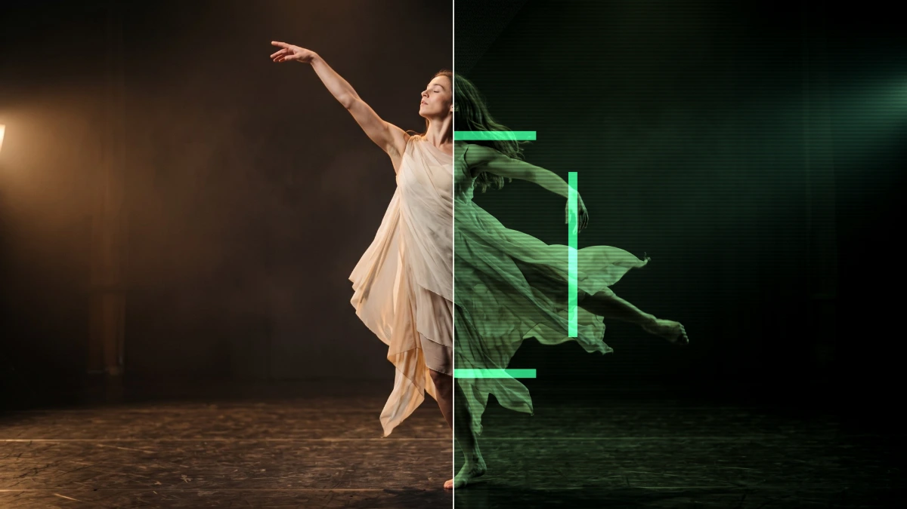

# CCTV

<!-- effect-docs: basic page sha=cfd3f914067b, written by scripts/effect-docs.mjs. Delete this line to write the page by hand (template B in Documentation-Site.md). -->

Turns footage into greenish monochrome security-camera video with scanlines, noise and a target box around the tracked subject.

Group: [Tracking & Overlays](../Effects-Tracking.md) · [How to add an effect](../Effects.md#add-an-effect)

<figure class="docs-shot">

<figcaption>Left: the original. Right: CCTV at its default settings, one frame of its movement.</figcaption>
</figure>

*A short page made from the editor’s effect catalog: what the effect does and its controls. Tips and its node setup will follow.*

## Controls

<!-- generated:controls start -->
| Control | Range | Default |
|---|---|---|
| **Style** | | |
| Amount | 0 to 1 | 0.8 |
| Overlay | a colour | `#36f59a` |
| **Motion** | | |
| Speed | 0 to 5 | 1 |
<!-- generated:controls end -->

**Styles:** the **Style** menu in the effect card switches to another look of the same engine and keeps the values and keyframes: [HUD Tracker](./hud-tracker.md), [Rain Reveal](./rain-reveal.md), [Stardust](./stardust.md), [Tracked Scene](./tracked-scene.md).

## Technical details

CCTV is one look of the tracking overlay engine; its looks share one node setup. It keeps moving while the playhead stands still. How effects are stored, rendered and exported: [Effect system](../Effect-System.md). Its building blocks: [Node Catalog](../Node-Catalog.md).

Go deeper: [Effect system: landmark tracking effects](../Effect-System.md#landmark-tracking-effects)
