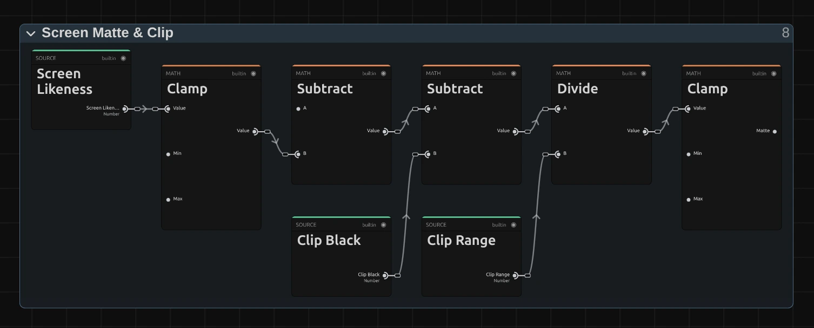
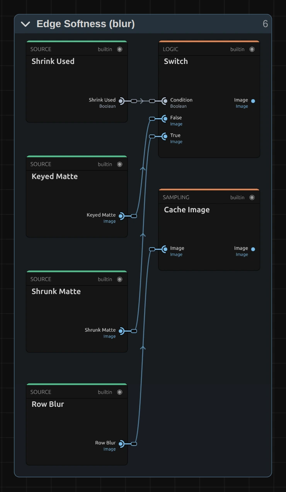
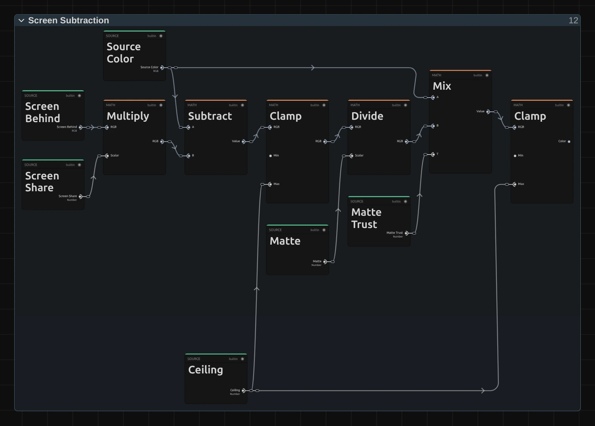

# Chroma Key

Makes a green or blue screen transparent, so a performer can stand in front of any background. It finds the screen colour by itself, and hair, fine fabric and edges take on the new background instead of a green rim.

Group: [Keying & Time](../Effects-Keying-Time.md) · [How to add an effect](../Effects.md#add-an-effect)

<figure class="docs-shot docs-compare">

<figcaption>Left: original. Right: Chroma Key at its default settings, over dark blue.</figcaption>
</figure>

**Use it for:** a performer filmed in front of a green screen · a blue-screen insert · a coloured cloth or wall that should disappear (pick its colour).

- **Screen** – Green, Blue, or a colour you pick from the screen.
- **View** – switch to **Matte** to see what stays (white) and what goes (black).
- **Clip Black** and **Clip White** – raise Clip Black until the background is gone, lower Clip White until the body is solid.
- **Shrink / Grow** – pull the edge in when a thin rim of screen remains.

**Tip:** curtains, stands and lights beside the screen are no screen colour, so they stay in the picture. Cut them away with a [mask](../Masks.md) around the performer.

## Presets

<figure class="docs-shot">

<figcaption>The four presets on the green-screen dancer, over dark blue.</figcaption>
</figure>

Pick one in the **Preset** row of the effect card. It sets all controls at once, in one undo step, and the row then shows its name until you change something. A control with keyframes keeps them, and the card says so. A preset sets the **Screen** to Green and the **View** to Final result: on a blue screen, choose Blue after the preset.

**Fine Hair** – keeps faint detail: wisps of hair, chiffon and smoke stay, soft and see-through (Clip Black 0.15, Clip White 0.95). For a well-lit screen and a performer with loose hair. On an uneven screen, specks of the background may stay too.

**Firm Figure** – a solid body with a clean, slightly tightened edge (Clip Black 0.4, Clip White 0.7, Shrink / Grow 1.5 px, Softness 1 px). For a figure that must not let the background through, such as a dancer over a busy projection. The finest wisps go.

**Uneven Screen** – takes out dark corners, creases and shadows on the screen (Clip Black 0.5, Clip White 0.9, Shrink / Grow 0.5 px). For a screen that is lit unevenly or too small for the shot. See-through fabric gets thinner.

**Soft Blend** – a soft outline that melts into the new background instead of a cut-out line (Shrink / Grow 1 px, Softness 3 px). For a performer placed into a painted or projected scene.

## Controls

<figure class="docs-shot">

<svg class="docs-shot-overlay" viewBox="0 0 1017 940" aria-hidden="true" focusable="false">
<defs><marker id="chroma-key-inspector-arrow" viewBox="0 0 10 10" refX="8" refY="5" markerWidth="5" markerHeight="5" orient="auto-start-reverse"><path d="M 0 0 L 10 5 L 0 10 Z" fill="#ffd54a" /></marker></defs>
<path class="docs-shot-arrow" d="M565 282 L649 282" marker-end="url(#chroma-key-inspector-arrow)" />
<circle class="docs-shot-number" cx="565" cy="282" r="18" /><text x="565" y="282" class="docs-shot-number-text">1</text>
<path class="docs-shot-arrow" d="M570 376 L654 376" marker-end="url(#chroma-key-inspector-arrow)" />
<circle class="docs-shot-number" cx="570" cy="376" r="18" /><text x="570" y="376" class="docs-shot-number-text">2</text>
<path class="docs-shot-arrow" d="M588 456 L672 456" marker-end="url(#chroma-key-inspector-arrow)" />
<circle class="docs-shot-number" cx="588" cy="456" r="18" /><text x="588" y="456" class="docs-shot-number-text">3</text>
<path class="docs-shot-arrow" d="M548 560 L632 560" marker-end="url(#chroma-key-inspector-arrow)" />
<circle class="docs-shot-number" cx="548" cy="560" r="18" /><text x="548" y="560" class="docs-shot-number-text">4</text>
<path class="docs-shot-arrow" d="M520 701 L604 701" marker-end="url(#chroma-key-inspector-arrow)" />
<circle class="docs-shot-number" cx="520" cy="701" r="18" /><text x="520" y="701" class="docs-shot-number-text">5</text>
</svg>

<figcaption>Chroma Key with the Fine Hair preset. 1 — Preset: pick a starting point. 2 — Screen: the colour to key. 3 — View: the result or the matte. 4 — Clip Black: background away. 5 — Shrink / Grow: the edge in or out.</figcaption>
</figure>

**Preset** – picks one of the four starting points above. Change any control afterwards; the row then shows no name.

A key in four steps: choose the **Screen**, switch **View** to Matte, raise **Clip Black** until the background is black and lower **Clip White** until the body is white, then switch back to Final result.

### Key

**Screen** – which colour becomes transparent. Green and Blue measure the screen from every frame, so a screen that is darker in the corners, or a light change during the shot, still keys. Picked color keys the colour in the row below, for a cloth, a wall or a screen of another shade. The card says so when the clip shows no such screen. Green, Blue, Picked color, default Green.

**Screen color** – the colour to key with Picked color; the row appears only then. Pick it from the screen where it is brightest and purest. A greyish colour keys nothing, and the card says so. a colour, default `#4c9a55`.

<figure class="docs-shot docs-shot--float-right">

<figcaption>View → Matte: black is keyed away, white stays, grey is see-through. The curtain edges are no screen colour, so they stay.</figcaption>
</figure>

**View** – Final result shows the keyed picture; Matte shows the key in black and white: black is gone, white stays, grey is see-through. Set Clip Black and Clip White in Matte, then switch back. Final result, Matte, default Final result.

### Matte

**Clip Black** – everything the key finds this much like the screen or more becomes fully transparent. Raise it until grey specks and shadows in the background turn black in the matte; 0.3 cleans a good screen, 0.5 an uneven one. Too high, and wisps of hair and see-through fabric vanish too. 0 to 1, default 0.3.

**Clip White** – everything above it becomes fully solid. Lower it until the body is pure white in the matte, with no see-through patches in the costume. Keep it above Clip Black: at or below it, the matte becomes a hard cut at Clip Black, and the card says so. 0 to 1, default 0.85.

### Edge

**Shrink / Grow** – pulls the edge of the key in (positive values) or pushes it out (negative values), in pixels of a 1080p picture, so a 4K export shows the same edge. 1–2 px removes a thin rim of screen around a figure; −1 to −3 px brings back an edge that was cut too tight. Large negative values reveal a light rim of former screen around the figure. At 0 it costs nothing. −20 to 20, default 0.

**Softness** – blurs the edge of the key, in pixels of a 1080p picture. 1–3 px takes the hard cut-out look away; 10 and more gives a glowing, dreamlike outline. Works well together with a small Shrink / Grow, so the soft edge does not reach into the screen. At 0 it costs nothing. 0 to 20, default 0.

### Spill

**Suppression** – removes the green (or blue) glow the screen throws onto skin, hair and costume. At 0 the edges keep a green tint, at 1 it is gone. Lower it when a costume's own green or turquoise turns grey. 0 to 1, default 1.

**Method** – how much green may stay. Neutral holds the screen colour to the mean of the other two colours: hair and fabric lose the tint without turning olive. Gentle holds it to the stronger of the two and so keeps yellows on a green screen and cyans on a blue one, but leaves a slight olive cast on hair. Neutral, Gentle (keeps yellows), default Neutral.

## Node setup

<figure class="docs-shot docs-shot--graph">

<svg class="docs-shot-overlay" viewBox="0 0 1017 1065" aria-hidden="true" focusable="false">
<defs><marker id="chroma-key-arrow" viewBox="0 0 10 10" refX="8" refY="5" markerWidth="5" markerHeight="5" orient="auto-start-reverse"><path d="M 0 0 L 10 5 L 0 10 Z" fill="#ffd54a" /></marker></defs>
<path class="docs-shot-arrow" d="M22 406 L73 406" marker-end="url(#chroma-key-arrow)" />
<circle class="docs-shot-number" cx="22" cy="406" r="18" /><text x="22" y="406" class="docs-shot-number-text">1</text>
<path class="docs-shot-arrow" d="M176 876 L260 876" marker-end="url(#chroma-key-arrow)" />
<circle class="docs-shot-number" cx="176" cy="876" r="18" /><text x="176" y="876" class="docs-shot-number-text">2</text>
<path class="docs-shot-arrow" d="M552 244 L636 244" marker-end="url(#chroma-key-arrow)" />
<circle class="docs-shot-number" cx="552" cy="244" r="18" /><text x="552" y="244" class="docs-shot-number-text">3</text>
<path class="docs-shot-arrow" d="M364 691 L448 691" marker-end="url(#chroma-key-arrow)" />
<circle class="docs-shot-number" cx="364" cy="691" r="18" /><text x="364" y="691" class="docs-shot-number-text">4</text>
<path class="docs-shot-arrow" d="M552 729 L636 729" marker-end="url(#chroma-key-arrow)" />
<circle class="docs-shot-number" cx="552" cy="729" r="18" /><text x="552" y="729" class="docs-shot-number-text">5</text>
</svg>

<figcaption>Chroma Key opened in the Nodes tab (input frame, parameters, output and four small helper folders left out). 1 — Screen Color: the colour of the screen. 2 — Screen Matte & Clip: the key. 3 — Shrink / Grow: the edge in or out. 4 — Screen Subtraction: the screen out of see-through pixels. 5 — Spill Suppression: the green glow away.</figcaption>
</figure>

Chroma Key works in stages, one folder each in the Nodes tab. **Screen Color** finds the screen colour from a small cached grid of the frame (Screen Grid). **Screen Matte & Clip** compares every pixel with it and applies Clip Black and Clip White. **Shrink / Grow** and Edge Softness shape the edge of that matte. **Screen Subtraction** takes the screen's share out of see-through pixels, so hair and chiffon show the new background, and **Spill Suppression** removes the glow. View & Output puts out the result or the matte. Click a folder's header to open it; the sections below show what is inside. How to open the graph: [The node setup](../Effects.md#the-node-setup).

### Screen Color

<figure class="docs-shot docs-shot--graph">

<svg class="docs-shot-overlay" viewBox="0 0 1017 1343" aria-hidden="true" focusable="false">
<defs><marker id="chroma-key-screen-color-arrow" viewBox="0 0 10 10" refX="8" refY="5" markerWidth="5" markerHeight="5" orient="auto-start-reverse"><path d="M 0 0 L 10 5 L 0 10 Z" fill="#ffd54a" /></marker></defs>
<path class="docs-shot-arrow" d="M203 554 L287 554" marker-end="url(#chroma-key-screen-color-arrow)" />
<circle class="docs-shot-number" cx="203" cy="554" r="18" /><text x="203" y="554" class="docs-shot-number-text">1</text>
<path class="docs-shot-arrow" d="M446 596 L530 596" marker-end="url(#chroma-key-screen-color-arrow)" />
<circle class="docs-shot-number" cx="446" cy="596" r="18" /><text x="446" y="596" class="docs-shot-number-text">2</text>
<path class="docs-shot-arrow" d="M446 961 L530 961" marker-end="url(#chroma-key-screen-color-arrow)" />
<circle class="docs-shot-number" cx="446" cy="961" r="18" /><text x="446" y="961" class="docs-shot-number-text">3</text>
<path class="docs-shot-arrow" d="M689 189 L773 189" marker-end="url(#chroma-key-screen-color-arrow)" />
<circle class="docs-shot-number" cx="689" cy="189" r="18" /><text x="689" y="189" class="docs-shot-number-text">4</text>
</svg>

<figcaption>Inside Screen Color; its number cards (the ramp limits) are left out. 1 — Divide: the mean screen colour. 2 — Mix: measured or picked. 3 — Smoothstep: is the colour pure enough. 4 — Multiply: how sure the key is.</figcaption>
</figure>

**Divide** – the mean colour of everything in the frame that looks like screen. The Screen Grid folder (a 64 px cache) and Screen Average (1 px) add up the frame, each pixel weighted by how screen-like it is; Divide turns that Weighted Sum into a colour. While no screen is seen, a faint built-in green or blue keeps the result sensible.

**Mix** – uses that measured colour, or the Picked Color when Screen is Picked color. This is the Screen Color every later stage compares with.

**Smoothstep** – how pure the screen colour is: a greyish colour counts as no screen at all. The other Smoothstep checks that enough of the frame is screen.

**Multiply** – both checks together: Screen Found, from 0 (no screen, the key leaves the picture alone) to 1. That is why a clip without a screen stays untouched instead of losing its greens.

### Screen Matte & Clip

<figure class="docs-shot docs-shot--graph">

<svg class="docs-shot-overlay" viewBox="0 0 1017 405" aria-hidden="true" focusable="false">
<defs><marker id="chroma-key-matte-clip-arrow" viewBox="0 0 10 10" refX="8" refY="5" markerWidth="5" markerHeight="5" orient="auto-start-reverse"><path d="M 0 0 L 10 5 L 0 10 Z" fill="#ffd54a" /></marker></defs>
<path class="docs-shot-arrow" d="M274 151 L358 151" marker-end="url(#chroma-key-matte-clip-arrow)" />
<circle class="docs-shot-number" cx="274" cy="151" r="18" /><text x="274" y="151" class="docs-shot-number-text">1</text>
<path class="docs-shot-arrow" d="M599 151 L683 151" marker-end="url(#chroma-key-matte-clip-arrow)" />
<circle class="docs-shot-number" cx="599" cy="151" r="18" /><text x="599" y="151" class="docs-shot-number-text">2</text>
<path class="docs-shot-arrow" d="M762 179 L846 179" marker-end="url(#chroma-key-matte-clip-arrow)" />
<circle class="docs-shot-number" cx="762" cy="179" r="18" /><text x="762" y="179" class="docs-shot-number-text">3</text>
</svg>

<figcaption>Inside Screen Matte & Clip, the clip part; its 0 and 1 cards are left out. 1 — Subtract: the raw matte. 2 — Divide: Clip Black and Clip White as levels. 3 — Clamp: the matte.</figcaption>
</figure>

**Subtract** – one minus the Screen Likeness: how much this pixel differs from the screen, compared with how much the screen itself stands out (its green above red and blue). A pixel as green as the screen gets 0, a skin tone 1. Pixels darker than the screen are compared by purity, so the shadowed corners of a screen key as cleanly as its lit middle.

**Divide** – Clip Black is subtracted and the rest divided by the Clip Range (Clip White minus Clip Black, never below 0.001): levels on the matte, like Input Black and White in [Levels](./levels.md).

**Clamp** – keeps the result between 0 and 1. That is the matte the edge stages and View → Matte show.

### Shrink / Grow

<figure class="docs-shot docs-shot--graph">

<svg class="docs-shot-overlay" viewBox="0 0 1017 465" aria-hidden="true" focusable="false">
<defs><marker id="chroma-key-shrink-grow-arrow" viewBox="0 0 10 10" refX="8" refY="5" markerWidth="5" markerHeight="5" orient="auto-start-reverse"><path d="M 0 0 L 10 5 L 0 10 Z" fill="#ffd54a" /></marker></defs>
<path class="docs-shot-arrow" d="M52 144 L136 144" marker-end="url(#chroma-key-shrink-grow-arrow)" />
<circle class="docs-shot-number" cx="52" cy="144" r="18" /><text x="52" y="144" class="docs-shot-number-text">1</text>
<path class="docs-shot-arrow" d="M593 161 L677 161" marker-end="url(#chroma-key-shrink-grow-arrow)" />
<circle class="docs-shot-number" cx="593" cy="161" r="18" /><text x="593" y="161" class="docs-shot-number-text">2</text>
<path class="docs-shot-arrow" d="M593 286 L677 286" marker-end="url(#chroma-key-shrink-grow-arrow)" />
<circle class="docs-shot-number" cx="593" cy="286" r="18" /><text x="593" y="286" class="docs-shot-number-text">3</text>
<path class="docs-shot-arrow" d="M702 180 L786 180" marker-end="url(#chroma-key-shrink-grow-arrow)" />
<circle class="docs-shot-number" cx="702" cy="180" r="18" /><text x="702" y="180" class="docs-shot-number-text">4</text>
</svg>

<figcaption>Inside Shrink / Grow (soft min/max), after its two blur passes; its number cards are left out. 1 — Blurred Matte Terms: the matte, blurred. 2 — Divide: the shrunk edge. 3 — Add: the grown edge. 4 — Mix: shrink or grow.</figcaption>
</figure>

**Blurred Matte Terms** – the Matte Cache folder stores the matte together with two exponential forms of it, and two Gaussian passes (rows, then columns) as wide as Shrink / Grow blur all three at once.

**Divide** – a soft minimum: the logarithm of the blurred term, divided by the Erode Sharpness. A pixel near the background takes on the background's low matte, so the edge moves inwards smoothly, without the stair steps of a hard minimum.

**Add** – the same as a soft maximum for negative values: the edge moves outwards.

**Mix** – takes the shrunk edge when Shrinks (Shrink / Grow above 0), else the grown one. At 0 the whole folder is skipped.

### Edge Softness

<figure class="docs-shot docs-shot--float-right">

<svg class="docs-shot-overlay" viewBox="0 0 590 1013" aria-hidden="true" focusable="false">
<defs><marker id="chroma-key-edge-softness-arrow" viewBox="0 0 10 10" refX="8" refY="5" markerWidth="5" markerHeight="5" orient="auto-start-reverse"><path d="M 0 0 L 10 5 L 0 10 Z" fill="#ffd54a" /></marker></defs>
<path class="docs-shot-arrow" d="M237 204 L321 204" marker-end="url(#chroma-key-edge-softness-arrow)" />
<circle class="docs-shot-number" cx="237" cy="204" r="18" /><text x="237" y="204" class="docs-shot-number-text">1</text>
<path class="docs-shot-arrow" d="M237 473 L321 473" marker-end="url(#chroma-key-edge-softness-arrow)" />
<circle class="docs-shot-number" cx="237" cy="473" r="18" /><text x="237" y="473" class="docs-shot-number-text">2</text>
</svg>

<figcaption>Inside Edge Softness (blur), its entrance and cache. 1 — Switch: which matte to soften. 2 — Cache Image: the rows, blurred.</figcaption>
</figure>

**Switch** – softens the Shrunk Matte when Shrink / Grow is in use, otherwise the Keyed Matte straight from the Matte Cache.

**Cache Image** – keeps the matte after a Gaussian blur along the rows; a second pass blurs its columns. Two passes of one direction each read far fewer pixels than one round blur of the same size. At Softness 0 both are skipped.

### Screen Subtraction

<figure class="docs-shot docs-shot--graph">

<svg class="docs-shot-overlay" viewBox="0 0 1017 729" aria-hidden="true" focusable="false">
<defs><marker id="chroma-key-screen-subtraction-arrow" viewBox="0 0 10 10" refX="8" refY="5" markerWidth="5" markerHeight="5" orient="auto-start-reverse"><path d="M 0 0 L 10 5 L 0 10 Z" fill="#ffd54a" /></marker></defs>
<path class="docs-shot-arrow" d="M86 235 L170 235" marker-end="url(#chroma-key-screen-subtraction-arrow)" />
<circle class="docs-shot-number" cx="86" cy="235" r="18" /><text x="86" y="235" class="docs-shot-number-text">1</text>
<path class="docs-shot-arrow" d="M226 235 L310 235" marker-end="url(#chroma-key-screen-subtraction-arrow)" />
<circle class="docs-shot-number" cx="226" cy="235" r="18" /><text x="226" y="235" class="docs-shot-number-text">2</text>
<path class="docs-shot-arrow" d="M504 235 L588 235" marker-end="url(#chroma-key-screen-subtraction-arrow)" />
<circle class="docs-shot-number" cx="504" cy="235" r="18" /><text x="504" y="235" class="docs-shot-number-text">3</text>
<path class="docs-shot-arrow" d="M644 208 L728 208" marker-end="url(#chroma-key-screen-subtraction-arrow)" />
<circle class="docs-shot-number" cx="644" cy="208" r="18" /><text x="644" y="208" class="docs-shot-number-text">4</text>
</svg>

<figcaption>Inside Screen Subtraction, from the screen behind the pixel on; its 0 card is left out. 1 — Multiply: the screen's share. 2 — Subtract: the screen taken out. 3 — Divide: back to full strength. 4 — Mix: only where the matte is sure.</figcaption>
</figure>

**Multiply** – the Screen Behind this pixel times its Screen Share (one minus the matte): how much of the pixel's colour is screen. The Screen Behind is the local colour of the Screen Grid around the pixel, dimmed like the pixel, so a darker corner of the screen is taken out as cleanly as the lit middle.

**Subtract** – takes that share out of the Source Color. What remains is the performer's own colour, weakened by the see-through part.

**Divide** – divides it by the Matte, which brings a strand of hair or chiffon back to its full colour; the new background then shows through it instead of grey or green.

**Mix** – uses this clean colour only where the matte is above 0.05 (Matte Trust); in almost transparent pixels the division would only enlarge noise, so their own colour fades back in.

### Spill Suppression

<figure class="docs-shot docs-shot--graph">

<svg class="docs-shot-overlay" viewBox="0 0 1017 444" aria-hidden="true" focusable="false">
<defs><marker id="chroma-key-spill-arrow" viewBox="0 0 10 10" refX="8" refY="5" markerWidth="5" markerHeight="5" orient="auto-start-reverse"><path d="M 0 0 L 10 5 L 0 10 Z" fill="#ffd54a" /></marker></defs>
<path class="docs-shot-arrow" d="M67 210 L151 210" marker-end="url(#chroma-key-spill-arrow)" />
<circle class="docs-shot-number" cx="67" cy="210" r="18" /><text x="67" y="210" class="docs-shot-number-text">1</text>
<path class="docs-shot-arrow" d="M189 232 L273 232" marker-end="url(#chroma-key-spill-arrow)" />
<circle class="docs-shot-number" cx="189" cy="232" r="18" /><text x="189" y="232" class="docs-shot-number-text">2</text>
<path class="docs-shot-arrow" d="M555 210 L639 210" marker-end="url(#chroma-key-spill-arrow)" />
<circle class="docs-shot-number" cx="555" cy="210" r="18" /><text x="555" y="210" class="docs-shot-number-text">3</text>
<path class="docs-shot-arrow" d="M798 210 L882 210" marker-end="url(#chroma-key-spill-arrow)" />
<circle class="docs-shot-number" cx="798" cy="210" r="18" /><text x="798" y="210" class="docs-shot-number-text">4</text>
</svg>

<figcaption>Inside Spill Suppression; its 0.5 and 0 cards are left out. 1 — Step: Neutral or Gentle. 2 — Mix: the limit. 3 — Multiply: the excess green. 4 — Subtract: the glow taken out.</figcaption>
</figure>

**Step** – turns Spill Method into 0 (Neutral) or 1 (Gentle).

**Mix** – picks the Limit for the screen channel: the Other Mean of red and blue (Neutral), or the Stronger Other of the two (Gentle).

**Multiply** – whatever green lies above the Limit, times the Strength (Suppression, and Screen Found): the Excess, the glow of the screen.

**Subtract** – takes the Excess out of the screen channel only, so the other colours stay as they are.

**Remix:** for a limit halfway between Neutral and Gentle, unplug **Step** from input T of **Mix** and plug a **Value** of 0.5 into T.

## Technical details

- **Passes.** A 64 px Screen Grid (each cell averages 5 × 5 reads, weighted by how screen-like they are), a 1 px Screen Average (the mean of 33 × 33 grid reads) and the key pass. Both are **Cache Image** nodes with **Max size** 64 and 1. A picked colour folds both away (one pass). Shrink / Grow and Softness each add two blur passes, only while they are not 0.
- **Units.** Clip Black and Clip White are matte levels. Shrink / Grow and Softness are pixels of a 1080p frame (its shorter side) and scale with the render size: a 4K export, a portrait frame and a lower Preview Quality show the same edge.
- **Values.** Out-of-range values are used at their limit, values that are not a number at their default, and Clip Black at or above Clip White makes a hard cut; the card names each case and tool results report unusable numbers. A clip without screen colour keys nothing, and the card and `addEffect`/`updateEffect` say so (checked on the clip's thumbnails).
- **Limits.** Chroma Key measures one screen colour per frame plus a coarse local grid, so see-through fabric that fills a whole grid cell can come out greyish. Curtains, stands and floor edges that are not screen colour stay; cut them with a mask.
- **Software preview and export readback.** The worker CPU keys a 1080p frame in under 0.1 s (the whole worker pixel pass, with frame copy and write-back, about 0.25 s), but only on a layer whose sole effect is one Chroma Key without Shrink / Grow or Softness. A stored key graph among other effects runs on the slower graph interpreter in stack order; a graph-less key among other effects is reported as unsupported.
- **Presets.** They set Clip Black, Clip White, Shrink / Grow, Softness, Suppression and Method, and reset Screen to Green and View to Final result. A Chroma Key whose node setup was edited before the screen-matte keyer has no Clip Black, Shrink / Grow or Method: a preset then changes only what that setup reads. Re-add Chroma Key to use the presets fully.
- **Saved projects.** Untouched older key graphs switch to the current keyer: stored Spill Suppression stays, Clip Black/White and the edge use their defaults, and the card lists the retired Tolerance and Edge Softness values and keyframes that no longer act. The old Custom choice keyed pure green and now keys the picked colour (#4C9A55 unless one is stored). Edited graphs keep the old key with its Tolerance and Edge Softness rows.
- **More:** [Effect system: editable keying and feedback graphs](../Effect-System.md#editable-keying-and-feedback-graphs) · [Node Catalog](../Node-Catalog.md) · [Styles and presets](../Effects.md#styles-and-presets).
