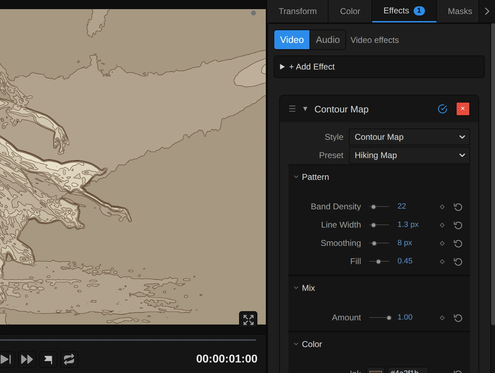
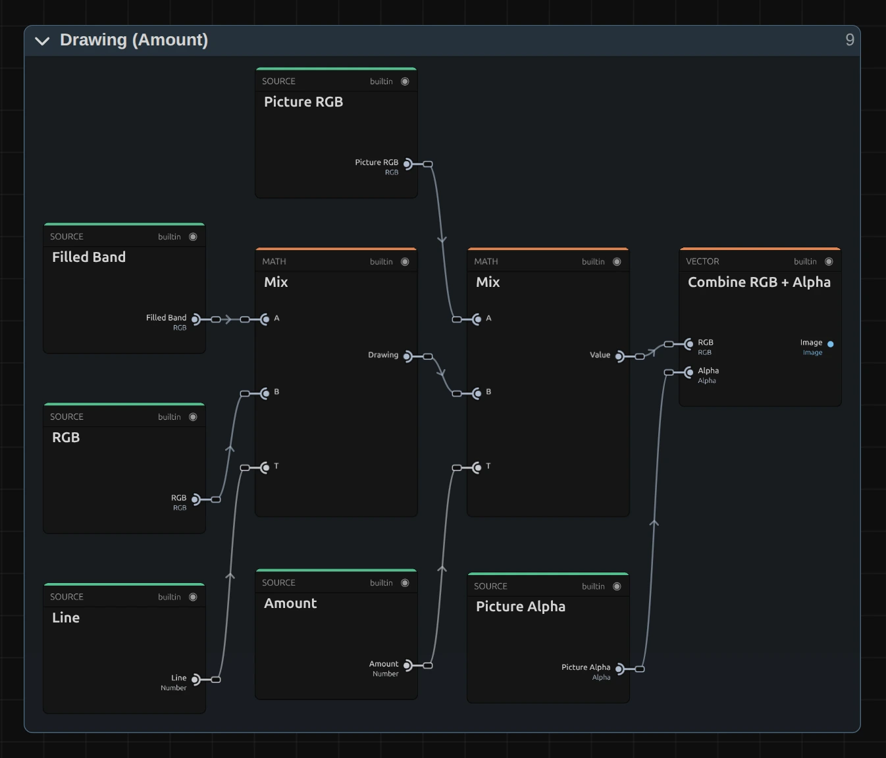

# Contour Map

Turns the picture into a map of its own light: bands from dark to light, like the height zones of a hiking map, with a fine contour line on every edge between two bands. For stage pictures that become landscapes, survey drawings and glowing sonar screens.

Group: [Lines & Engraving](../Effects-Lines.md) · [How to add an effect](../Effects.md#add-an-effect)

<figure class="docs-shot docs-compare docs-shot--float-left">

<figcaption>Left: original. Right: Contour Map at its default settings.</figcaption>
</figure>

**Use it for:** a figure that turns into a landscape seen from above · a survey or blueprint drawing of a scene · a sonar or radar screen in a submarine or control-room scene.

- **Band Density** – how many bands, and so how many lines.
- **Line Width** – how thick the contour lines are.
- **Smoothing** – how calm the lines run.
- **Fill** – how strongly the bands are tinted.
- **Ink** and **Paper** – the two colours of the map.

**Tip:** keyframe **Band Density** slowly up over a scene: new lines grow out of the old ones, as if the map were being drawn more finely while you watch.

## Presets

<figure class="docs-shot docs-shot--detail">

<figcaption>The five presets on the whole figure.</figcaption>
</figure>

Pick one in the **Preset** row of the effect card. It sets all controls at once, in one undo step, and the row then shows its name until you change something. A control with keyframes keeps them, and the card says so.

**Hiking Map** – brown contour lines over pale brown bands on cream, like a walking map. The figure stands out as the highest, lightest ground.

**Survey Lines** – only the lines, black on white: a survey drawing of the picture. Close lines show steep light changes such as the outline of the figure, wide gaps show even areas.

**Sonar** – a few calm, glowing green rings on black, the picture smoothed far so only the big shapes draw: a sonar or radar screen. Strong in a dark scene, a submarine or a control room.

**Poster Bands** – flat bands from deep blue to warm sand without any lines: a screen-printed poster with six colours.

**Topographic** – many fine brown lines over a faint tint on paper, like a dense survey map: every small change of light gets its own line, and the figure reads as a hill drawn in detail.

## Controls

<figure class="docs-shot">

<svg class="docs-shot-overlay" viewBox="0 0 1017 866" aria-hidden="true" focusable="false">
<defs><marker id="contour-map-inspector-arrow" viewBox="0 0 10 10" refX="8" refY="5" markerWidth="5" markerHeight="5" orient="auto-start-reverse"><path d="M 0 0 L 10 5 L 0 10 Z" fill="#ffd54a" /></marker></defs>
<path class="docs-shot-arrow" d="M565 319 L649 319" marker-end="url(#contour-map-inspector-arrow)" />
<circle class="docs-shot-number" cx="565" cy="319" r="18" /><text x="565" y="319" class="docs-shot-number-text">1</text>
<path class="docs-shot-arrow" d="M548 425 L632 425" marker-end="url(#contour-map-inspector-arrow)" />
<circle class="docs-shot-number" cx="548" cy="425" r="18" /><text x="548" y="425" class="docs-shot-number-text">2</text>
<path class="docs-shot-arrow" d="M569 462 L653 462" marker-end="url(#contour-map-inspector-arrow)" />
<circle class="docs-shot-number" cx="569" cy="462" r="18" /><text x="569" y="462" class="docs-shot-number-text">3</text>
<path class="docs-shot-arrow" d="M568 500 L652 500" marker-end="url(#contour-map-inspector-arrow)" />
<circle class="docs-shot-number" cx="568" cy="500" r="18" /><text x="568" y="500" class="docs-shot-number-text">4</text>
<path class="docs-shot-arrow" d="M629 538 L713 538" marker-end="url(#contour-map-inspector-arrow)" />
<circle class="docs-shot-number" cx="629" cy="538" r="18" /><text x="629" y="538" class="docs-shot-number-text">5</text>
</svg>

<figcaption>Contour Map with the Hiking Map preset. 1 — Preset: pick a starting point. 2 — Band Density: how many bands. 3 — Line Width. 4 — Smoothing: how calm the lines run. 5 — Fill: how strongly the bands are tinted.</figcaption>
</figure>

**Preset** – sets every control at once to one of the five starting points above.

**Style** – switches to another look of the same engine, for example [Crosshatch](./crosshatch.md), [Vector Engraving](./vector-tiling.md) or [Halftone](./halftone.md). **Amount**, **Ink** and **Paper** keep the values and keyframes you set. Band Density counts bands and means something else in every other look, so there the new look's own size starts at its default, and the row under the menu says so. **Undo** brings the old value back.

### Pattern

**Band Density** – how many bands the picture is split into: the value times 0.35, so 14 gives about 5 bands, 30 about 10, 80 twenty-eight. Few bands give a bold poster with a handful of lines, many bands a fine map with a line on every small change of light. The bands follow the light of the picture, not its size, so they look the same in the preview and in a 4K export. Below 8.57 (from keyframes or a tool) it renders 8.57, three bands, and the card says so. 9 to 80, default 14.

**Line Width** – how thick each contour line is, in pixels of a 1080p picture: a 4K export draws it twice as wide, so it looks the same. A line keeps its width whether the light changes slowly or fast; where many bands meet in a few pixels, such as at the edge of the figure, the lines run together into one strong outline. Under 1 px a line fades instead of getting thinner; 0 switches the lines off and leaves only the bands. Below 0 (from keyframes or a tool) it renders 0, and the card says so. 0 to 6 px, default 1.8 px.

**Smoothing** – how calm the lines run. The picture is read through a soft box of this size before the bands are cut, so grain, hair and small specks no longer draw little rings, and on moving footage the lines glide instead of shimmering. 0 reads every pixel and draws the finest, most nervous lines; 6–10 px is calm; 20 px and more draws only the big shapes, like a map of a whole region. It counts pixels of a 1080p picture. Above 32 px it renders 32, and the card says so. 0 to 32 px, default 10 px.

**Fill** – how strongly the bands are tinted. At 1 they run the whole way from Ink in the darkest band to Paper in the lightest; 0.7 keeps the darkest band light enough that its lines still show; at 0 every band is Paper and only the lines remain, like a survey drawing. Values outside 0 to 1 (from keyframes or a tool) render as 0 or 1, and the card says so. 0 to 1, default 0.7.

### Mix

**Amount** – how much of the map covers the picture. At 1 there are only the map's colours; 0.5 lays the map over the picture's own colours; 0 switches it off. Keyframe it to let the map appear on a cue. 0 to 1, default 0.75.

### Color

**Ink** – the colour of the lines and of the darkest band. A dark brown reads like a hiking map, black like a drawing. With an ink lighter than the paper, such as the green of Sonar, the lines glow on a dark ground. It takes a colour, default `#111827`.

**Paper** – the colour of the lightest band and, at Fill 0, of every band. A warm cream looks like an old map, a deep blue like a blueprint. It takes a colour, default `#f8fafc`.

## Node setup

<figure class="docs-shot docs-shot--graph">

<svg class="docs-shot-overlay" viewBox="0 0 1017 944" aria-hidden="true" focusable="false">
<defs><marker id="contour-map-arrow" viewBox="0 0 10 10" refX="8" refY="5" markerWidth="5" markerHeight="5" orient="auto-start-reverse"><path d="M 0 0 L 10 5 L 0 10 Z" fill="#ffd54a" /></marker></defs>
<path class="docs-shot-arrow" d="M264 269 L264 185" marker-end="url(#contour-map-arrow)" />
<circle class="docs-shot-number" cx="264" cy="269" r="18" /><text x="264" y="269" class="docs-shot-number-text">1</text>
<path class="docs-shot-arrow" d="M427 584 L427 668" marker-end="url(#contour-map-arrow)" />
<circle class="docs-shot-number" cx="427" cy="584" r="18" /><text x="427" y="584" class="docs-shot-number-text">2</text>
<path class="docs-shot-arrow" d="M589 664 L589 580" marker-end="url(#contour-map-arrow)" />
<circle class="docs-shot-number" cx="589" cy="664" r="18" /><text x="589" y="664" class="docs-shot-number-text">3</text>
<path class="docs-shot-arrow" d="M752 517 L752 601" marker-end="url(#contour-map-arrow)" />
<circle class="docs-shot-number" cx="752" cy="517" r="18" /><text x="752" y="517" class="docs-shot-number-text">4</text>
<path class="docs-shot-arrow" d="M752 458 L752 374" marker-end="url(#contour-map-arrow)" />
<circle class="docs-shot-number" cx="752" cy="458" r="18" /><text x="752" y="458" class="docs-shot-number-text">5</text>
<path class="docs-shot-arrow" d="M914 151 L914 235" marker-end="url(#contour-map-arrow)" />
<circle class="docs-shot-number" cx="914" cy="151" r="18" /><text x="914" y="151" class="docs-shot-number-text">6</text>
</svg>

<figcaption>Contour Map opened in the Nodes tab (input frame and output left out). 1 — Smoothing: the picture averaged over a small box. 2 — Picture & Tone: the tone at the pixel and around it. 3 — Height & Slope: the height in bands and the distance to the next band edge. 4 — Bands: the tinted band colours. 5 — Lines: the contour line on each band edge. 6 — Drawing: the lines over the bands and the mix.</figcaption>
</figure>

Contour Map works in six stages, one folder each in the Nodes tab: **Smoothing** keeps a copy of the picture averaged over a small box, **Picture & Tone** reads its tone at the pixel and one pixel to each side, **Height & Slope** turns the tone into a height counted in bands and measures how far the next band edge is in pixels, **Bands** colours each band from Ink to Paper, **Lines** draws the contour line on each band edge, and **Drawing** lays the lines over the bands and mixes the result with the picture. Click a folder's header to open it; the sections below show what is inside. Contour Map is one look of the pattern engine that the [Lines & Engraving](../Effects-Lines.md#the-shared-idea) looks share; its **Style** menu switches between them.

### Smoothing

<figure class="docs-shot docs-shot--graph">

![Inside the Smoothing folder: Multiply doubles Smoothing into a cell; Maximum gives the Box Width in whole pixels and Minimum the Reads per Row, at most 32; a Clamped Image Sample reads the frame at one Read Position of a row in linear light weighted by alpha, Sequence Reduce adds up the reads of a row and Cache Image keeps the row averages; a second Clamped Image Sample and Sequence Reduce average those down a column; Divide by the Average Alpha and Linear to sRGB give the average colour, and Cache Image keeps the Smoothed Picture](../assets/effects/graphs/contour-map-smoothing.webp)

<svg class="docs-shot-overlay" viewBox="0 0 1017 1520" aria-hidden="true" focusable="false">
<defs><marker id="contour-map-smoothing-arrow" viewBox="0 0 10 10" refX="8" refY="5" markerWidth="5" markerHeight="5" orient="auto-start-reverse"><path d="M 0 0 L 10 5 L 0 10 Z" fill="#ffd54a" /></marker></defs>
<path class="docs-shot-arrow" d="M276 22 L276 106" marker-end="url(#contour-map-smoothing-arrow)" />
<circle class="docs-shot-number" cx="276" cy="22" r="18" /><text x="276" y="22" class="docs-shot-number-text">1</text>
<path class="docs-shot-arrow" d="M895 702 L895 618" marker-end="url(#contour-map-smoothing-arrow)" />
<circle class="docs-shot-number" cx="895" cy="702" r="18" /><text x="895" y="702" class="docs-shot-number-text">2</text>
<path class="docs-shot-arrow" d="M121 884 L121 968" marker-end="url(#contour-map-smoothing-arrow)" />
<circle class="docs-shot-number" cx="121" cy="884" r="18" /><text x="121" y="884" class="docs-shot-number-text">3</text>
<path class="docs-shot-arrow" d="M431 1159 L431 1075" marker-end="url(#contour-map-smoothing-arrow)" />
<circle class="docs-shot-number" cx="431" cy="1159" r="18" /><text x="431" y="1159" class="docs-shot-number-text">4</text>
</svg>

<figcaption>Inside Smoothing, with one read of a row. 1 — Multiply: Smoothing as a cell of twice its size. 2 — Minimum: how many reads a row takes. 3 — Sequence Reduce: the average of a row. 4 — Cache Image: keeps the row averages, and at the end the Smoothed Picture.</figcaption>
</figure>

Contour lines follow every small change of light. Read from the picture itself, grain and fine detail would cross the band edges again and again and draw little rings everywhere, and on moving footage the lines would shimmer. So the stages read this copy, in which every pixel holds the average of a box Smoothing wide around it. It is the same filter as the Cell Filter of [Halftone](./halftone.md#cell-filter), which averages half a cell: **Multiply** hands it Smoothing times 2 as the cell.

**Minimum** – Maximum first gives the Box Width: Smoothing in pixels of this frame, rounded to whole pixels and never less than one (at 0 the box is the pixel itself). Minimum takes that, but at most 32: how many reads a row takes.

**Sequence Reduce** – reads the frame at every point of the row around the pixel, in linear light weighted with its alpha, so a transparent pixel adds nothing, and adds them up, each weighing 1 ÷ Reads: the row's average.

**Cache Image** – keeps those row averages as a picture of their own, worked out once per frame; a second Sequence Reduce averages them down a column. The last Cache Image keeps the result, turned back into colour: the Smoothed Picture that Picture & Tone reads.

### Picture & Tone

<figure class="docs-shot docs-shot--graph">

<svg class="docs-shot-overlay" viewBox="0 0 1017 1462" aria-hidden="true" focusable="false">
<defs><marker id="contour-map-picture-tone-arrow" viewBox="0 0 10 10" refX="8" refY="5" markerWidth="5" markerHeight="5" orient="auto-start-reverse"><path d="M 0 0 L 10 5 L 0 10 Z" fill="#ffd54a" /></marker></defs>
<path class="docs-shot-arrow" d="M479 1313 L395 1313" marker-end="url(#contour-map-picture-tone-arrow)" />
<circle class="docs-shot-number" cx="479" cy="1313" r="18" /><text x="479" y="1313" class="docs-shot-number-text">1</text>
<path class="docs-shot-arrow" d="M509 1046 L509 962" marker-end="url(#contour-map-picture-tone-arrow)" />
<circle class="docs-shot-number" cx="509" cy="1046" r="18" /><text x="509" y="1046" class="docs-shot-number-text">2</text>
<path class="docs-shot-arrow" d="M895 939 L895 1023" marker-end="url(#contour-map-picture-tone-arrow)" />
<circle class="docs-shot-number" cx="895" cy="939" r="18" /><text x="895" y="939" class="docs-shot-number-text">3</text>
<path class="docs-shot-arrow" d="M315 356 L315 272" marker-end="url(#contour-map-picture-tone-arrow)" />
<circle class="docs-shot-number" cx="315" cy="356" r="18" /><text x="315" y="356" class="docs-shot-number-text">4</text>
</svg>

<figcaption>Inside Picture & Tone, with one of the four neighbours. 1 — Divide: the size of one pixel. 2 — Add: the position one pixel to the side. 3 — Luminance: the tone beside the pixel. 4 — Clamped Image Sample: reads the Smoothed Picture at the pixel.</figcaption>
</figure>

**Divide** – one pixel of this frame, as a share of the picture (One ÷ Resolution).

**Add** – the pixel's position moved one pixel to the right; three more like it read left, below and above (the picture shows one of the four).

**Luminance** – the tone of the Smoothed Picture beside the pixel: Tone Right, Tone Left, Tone Below and Tone Above. Their differences tell how fast the light changes there. A second Luminance gives the tone at the pixel itself, from 0 (black) to 1 (white).

**Clamped Image Sample** – reads the Smoothed Picture at the pixel itself, kept inside the frame, so a pixel at the edge never reads past it. The picture's own colour and alpha are read separately for the mix at the end.

### Height & Slope

<figure class="docs-shot docs-shot--graph">

<svg class="docs-shot-overlay" viewBox="0 0 1017 741" aria-hidden="true" focusable="false">
<defs><marker id="contour-map-height-arrow" viewBox="0 0 10 10" refX="8" refY="5" markerWidth="5" markerHeight="5" orient="auto-start-reverse"><path d="M 0 0 L 10 5 L 0 10 Z" fill="#ffd54a" /></marker></defs>
<path class="docs-shot-arrow" d="M508 243 L508 327" marker-end="url(#contour-map-height-arrow)" />
<circle class="docs-shot-number" cx="508" cy="243" r="18" /><text x="508" y="243" class="docs-shot-number-text">1</text>
<path class="docs-shot-arrow" d="M787 391 L787 307" marker-end="url(#contour-map-height-arrow)" />
<circle class="docs-shot-number" cx="787" cy="391" r="18" /><text x="787" y="391" class="docs-shot-number-text">2</text>
<path class="docs-shot-arrow" d="M508 404 L508 488" marker-end="url(#contour-map-height-arrow)" />
<circle class="docs-shot-number" cx="508" cy="404" r="18" /><text x="508" y="404" class="docs-shot-number-text">3</text>
<path class="docs-shot-arrow" d="M926 391 L926 307" marker-end="url(#contour-map-height-arrow)" />
<circle class="docs-shot-number" cx="926" cy="391" r="18" /><text x="926" y="391" class="docs-shot-number-text">4</text>
</svg>

<figcaption>Inside Height & Slope (Band Density). 1 — Multiply: the height, counted in bands. 2 — Maximum: the slope in bands per pixel. 3 — Floor: the nearest band edge. 4 — Divide: the distance to that edge in pixels.</figcaption>
</figure>

**Multiply** – the tone times the number of bands (Band Density times 0.35): the height of the pixel on the map. Every whole number of it is the edge between two bands.

**Maximum** – how fast the height changes from one pixel to the next: half the difference of the tones right and left, and below and above, times the bands (Length of the two). Flat areas get a tiny floor so nothing divides by zero.

**Floor** – the nearest band edge: the height plus 0.5, rounded down.

**Divide** – how far the pixel is from that edge, in pixels: the distance in bands divided by the slope. That is what keeps a line equally wide where the light changes slowly and where it changes fast.

### Bands

<figure class="docs-shot docs-shot--graph">

<svg class="docs-shot-overlay" viewBox="0 0 1017 1063" aria-hidden="true" focusable="false">
<defs><marker id="contour-map-bands-arrow" viewBox="0 0 10 10" refX="8" refY="5" markerWidth="5" markerHeight="5" orient="auto-start-reverse"><path d="M 0 0 L 10 5 L 0 10 Z" fill="#ffd54a" /></marker></defs>
<path class="docs-shot-arrow" d="M264 450 L264 366" marker-end="url(#contour-map-bands-arrow)" />
<circle class="docs-shot-number" cx="264" cy="450" r="18" /><text x="264" y="450" class="docs-shot-number-text">1</text>
<path class="docs-shot-arrow" d="M589 1040 L589 956" marker-end="url(#contour-map-bands-arrow)" />
<circle class="docs-shot-number" cx="589" cy="1040" r="18" /><text x="589" y="1040" class="docs-shot-number-text">2</text>
<path class="docs-shot-arrow" d="M752 22 L752 90" marker-end="url(#contour-map-bands-arrow)" />
<circle class="docs-shot-number" cx="752" cy="22" r="18" /><text x="752" y="22" class="docs-shot-number-text">3</text>
<path class="docs-shot-arrow" d="M752 794 L752 710" marker-end="url(#contour-map-bands-arrow)" />
<circle class="docs-shot-number" cx="752" cy="794" r="18" /><text x="752" y="794" class="docs-shot-number-text">4</text>
</svg>

<figcaption>Inside Bands (Fill, Ink, Paper). 1 — Floor: which band the pixel lies in. 2 — Minimum: the band position from dark to light. 3 — Mix: the band colour between Ink and Paper, tinted by Fill. 4 — Clamp: keeps Fill between 0 and 1.</figcaption>
</figure>

**Floor** – which band the pixel lies in: the height, rounded down.

**Minimum** – the band's place from 0 (the darkest) to 1 (the lightest): the band divided by the number of bands minus one, never past 1.

**Mix** – the band colour, from Ink at 0 to Paper at 1. A second Mix tints the band by Fill: at 0 it stays Paper, at 1 it takes the full band colour.

**Clamp** – keeps Fill between 0 and 1; a value outside (from keyframes or a tool) is reported on the card.

### Lines

<figure class="docs-shot docs-shot--graph">

<svg class="docs-shot-overlay" viewBox="0 0 1017 903" aria-hidden="true" focusable="false">
<defs><marker id="contour-map-lines-arrow" viewBox="0 0 10 10" refX="8" refY="5" markerWidth="5" markerHeight="5" orient="auto-start-reverse"><path d="M 0 0 L 10 5 L 0 10 Z" fill="#ffd54a" /></marker></defs>
<path class="docs-shot-arrow" d="M508 22 L508 79" marker-end="url(#contour-map-lines-arrow)" />
<circle class="docs-shot-number" cx="508" cy="22" r="18" /><text x="508" y="22" class="docs-shot-number-text">1</text>
<path class="docs-shot-arrow" d="M648 22 L648 79" marker-end="url(#contour-map-lines-arrow)" />
<circle class="docs-shot-number" cx="648" cy="22" r="18" /><text x="648" y="22" class="docs-shot-number-text">2</text>
<path class="docs-shot-arrow" d="M648 834 L648 750" marker-end="url(#contour-map-lines-arrow)" />
<circle class="docs-shot-number" cx="648" cy="834" r="18" /><text x="648" y="834" class="docs-shot-number-text">3</text>
<path class="docs-shot-arrow" d="M926 303 L926 219" marker-end="url(#contour-map-lines-arrow)" />
<circle class="docs-shot-number" cx="926" cy="303" r="18" /><text x="926" y="303" class="docs-shot-number-text">4</text>
</svg>

<figcaption>Inside Lines (Line Width). 1 — Subtract: how far inside the line the pixel lies. 2 — Clamp: the line cover with its soft edge. 3 — Minimum: a line under one pixel fades. 4 — Multiply: the line.</figcaption>
</figure>

**Subtract** – half the Line Width (in pixels of this frame) plus half a pixel, minus the distance to the edge: how far inside the line the pixel lies.

**Clamp** – keeps that between 0 and 1, so the line gets a soft edge of one pixel and never a jagged one.

**Minimum** – the Line Width in pixels, at most 1: a line thinner than one pixel is drawn one pixel wide and fainter, so it fades instead of breaking up.

**Multiply** – the line: the cover, times Minimum, times the inner edges. Two Step cards drop the edge below the darkest band (pure black) and the edge above the lightest (pure white), so a black or blown-out area stays a clean band instead of filling with ink.

**Remix:** open the **Lines** folder and change the **Half Edge** value of the first Step card from 0.5 to 1.5: the line around the darkest band disappears too, and a dark stage stays one clean, quiet band around the figure.

### Drawing

<figure class="docs-shot docs-shot--graph">

<svg class="docs-shot-overlay" viewBox="0 0 1017 870" aria-hidden="true" focusable="false">
<defs><marker id="contour-map-drawing-arrow" viewBox="0 0 10 10" refX="8" refY="5" markerWidth="5" markerHeight="5" orient="auto-start-reverse"><path d="M 0 0 L 10 5 L 0 10 Z" fill="#ffd54a" /></marker></defs>
<path class="docs-shot-arrow" d="M386 621 L386 599" marker-end="url(#contour-map-drawing-arrow)" />
<circle class="docs-shot-number" cx="386" cy="621" r="18" /><text x="386" y="621" class="docs-shot-number-text">1</text>
<path class="docs-shot-arrow" d="M873 557 L873 473" marker-end="url(#contour-map-drawing-arrow)" />
<circle class="docs-shot-number" cx="873" cy="557" r="18" /><text x="873" y="557" class="docs-shot-number-text">2</text>
</svg>

<figcaption>Inside Drawing (Amount). 1 — Mix: the lines drawn over the bands. 2 — Combine RGB + Alpha: the result with the picture’s own alpha.</figcaption>
</figure>

**Mix** – draws the lines in Ink over the tinted bands; a second Mix blends that with the picture by Amount.

**Combine RGB + Alpha** – hands the result on with the picture's own alpha, so a transparent area stays transparent and a cut-out figure keeps its edge.

## Technical details

- **Size.** Line Width and Smoothing count pixels of a frame whose shorter side is 1080, so preview, thumbnails and a 4K export show the same map; only the soft edge of a line is one pixel of the output frame at every size. Band Density counts bands, so it does not depend on the frame size.
- **Lines.** Each line sits on the edge between two bands, at an even width in pixels whatever the slope: its distance to the edge is the height in bands divided by how fast the height changes (from the tone one pixel to each side). No line is drawn at pure black or pure white.
- **Transparency.** The map keeps the picture's transparency, so a cut-out figure keeps clean edges and transparent parts stay transparent. The preview and the export match; the look does not move by itself.
- **Saved projects.** A Contour Map saved before Smoothing and Fill opens with Smoothing 0 and Fill 1, so its bands keep their shape and their full range from Ink to Paper, and Band Density under 8.57 still draws the 3 bands it drew. One bug fix changes how it looks: before, a pale stripe ran through the middle of each band and grew into a wide ribbon wherever the light changed slowly; now a line of even width sits on each edge between two bands, as on a map.
- **More:** [Effect system](../Effect-System.md) · [Node Catalog](../Node-Catalog.md) · [Styles and presets](../Effects.md#styles-and-presets).
