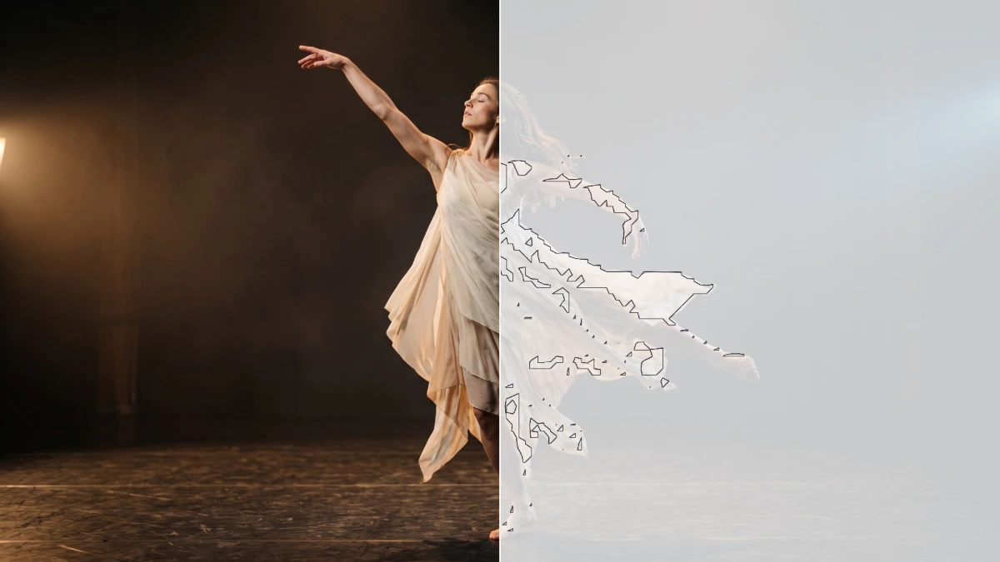

# Contour

<!-- effect-docs: basic page sha=c478c94f028c, written by scripts/effect-docs.mjs. Delete this line to write the page by hand (template B in Documentation-Site.md). -->

Draws iso-contour lines where brightness crosses Iso Level, in Line color on Paper; Cell Size sets the line resolution.

Group: [Lines & Engraving](../Effects-Lines.md) · [How to add an effect](../Effects.md#add-an-effect)

<figure class="docs-shot">

<figcaption>Left: the original. Right: Contour at its default settings.</figcaption>
</figure>

*A short page made from the editor’s effect catalog: what the effect does and its controls. Tips and its node setup will follow.*

## Controls

<!-- generated:controls start -->
| Control | Range | Default |
|---|---|---|
| **Structure** | | |
| Cell Size | 4 to 48 | 12 |
| Iso Level | 0 to 1 | 0.5 |
| **Style** | | |
| Amount | 0 to 1 | 0.8 |
| **Color** | | |
| Line | a colour | `#111827` |
| Paper | a colour | `#f8fafc` |
<!-- generated:controls end -->

## Technical details

It runs as a GPU compute effect. How effects are stored, rendered and exported: [Effect system](../Effect-System.md). Its building blocks: [Node Catalog](../Node-Catalog.md).
