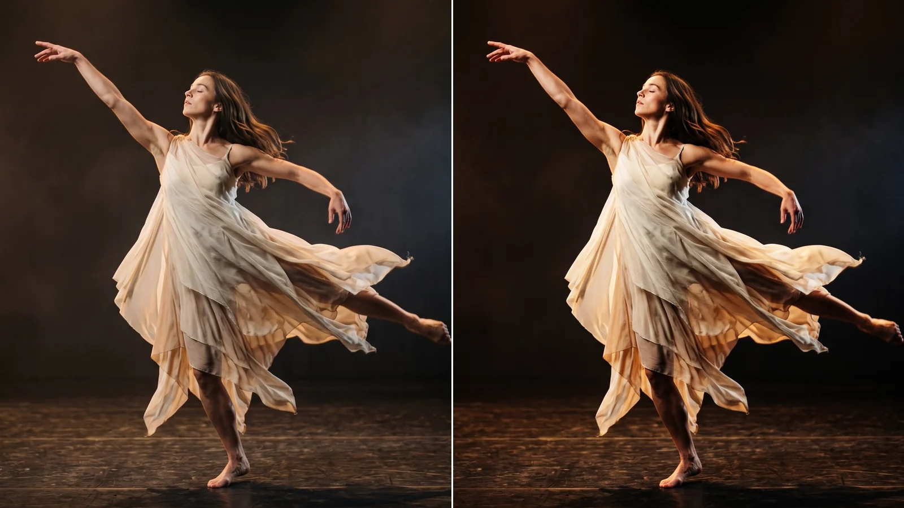
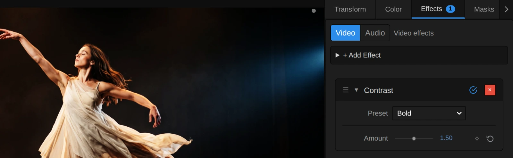
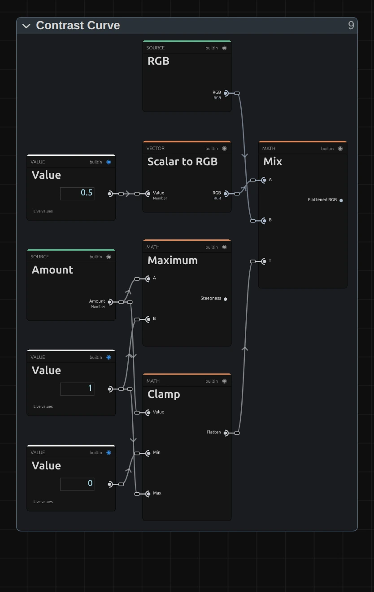

# Contrast

Adds punch: deeper shadows and brighter highlights on a soft S-curve that never burns out. Turned down, it lays a faded, misty veil over the picture.

Group: [Color & Tone](../Effects-Color.md) · [How to add an effect](../Effects.md#add-an-effect)

<figure class="docs-shot docs-compare">

<figcaption>Left: original. Right: Amount 1.5 (the Bold preset).</figcaption>
</figure>

**Use it for:** flat or hazy footage · a projection that has to read from the back row · a faded, old-print look · a scene seen through a gauze.

- **Amount** – above 1 punchier, below 1 flatter.

**Tip:** strong Contrast makes warm light more orange. If skin tones go too far, lower [Saturation](./saturation.md) a little after it. To lift or lower the picture as a whole, use [Brightness](./brightness.md) instead: Contrast always pivots around mid-grey.

## Presets

<figure class="docs-shot docs-shot--detail">

<figcaption>The four presets on the dancer.</figcaption>
</figure>

Pick one in the **Preset** row of the effect card. It sets Amount in one undo step, and the row then shows its name until you change the value. A keyframed Amount keeps its keyframes, and the card says so.

**Gentle Punch** – a little more depth for flat or slightly hazy footage. It looks like better footage, not like an effect.

**Bold** – the haze and the set sink into black while costumes and skin step forward. For a projection that has to hold up against stage light.

**Faded Print** – blacks lift into a soft brown-grey and whites calm down, like an old photograph or a memory scene.

**Gauze** – flat and pale, as if the scene were seen through a scrim or thick haze. Keyframe Amount from here up to 1 to let the picture come out of the mist.

## Controls

<figure class="docs-shot">

<svg class="docs-shot-overlay" viewBox="0 0 1017 393" aria-hidden="true" focusable="false">
<defs><marker id="contrast-inspector-arrow" viewBox="0 0 10 10" refX="8" refY="5" markerWidth="5" markerHeight="5" orient="auto-start-reverse"><path d="M 0 0 L 10 5 L 0 10 Z" fill="#ffd54a" /></marker></defs>
<path class="docs-shot-arrow" d="M565 282 L649 282" marker-end="url(#contrast-inspector-arrow)" />
<circle class="docs-shot-number" cx="565" cy="282" r="18" /><text x="565" y="282" class="docs-shot-number-text">1</text>
<path class="docs-shot-arrow" d="M555 344 L639 344" marker-end="url(#contrast-inspector-arrow)" />
<circle class="docs-shot-number" cx="555" cy="344" r="18" /><text x="555" y="344" class="docs-shot-number-text">2</text>
</svg>

<figcaption>Contrast with the Bold preset. 1 — Preset: pick a starting point. 2 — Amount: flatter or punchier.</figcaption>
</figure>

**Preset** – one of the four starting points above; it sets Amount.

<figure class="docs-shot docs-clip docs-shot--float-right">
<video src="../assets/effects/clips/contrast-amount.mp4" poster="../assets/effects/clips/contrast-amount.webp" width="720" height="540" autoplay muted loop playsinline preload="none" aria-label="The dancer turning on a dark stage with Contrast while Amount runs from 0.4 to 1.8 and back: at first the whole stage is a pale, misty grey, then the haze sinks into black while the dress and skin glow brighter and warmer, and back to the grey veil; the current value is shown at the bottom left"></video>
<figcaption>Amount from 0.4 to 1.8 and back.</figcaption>
</figure>

**Amount** – how steep the tones are around mid-grey. 1 leaves the picture as it is. Above 1 shadows get deeper and highlights brighter on a soft S-curve: black and white stay where they are, so bright details roll off instead of burning out. 1.2 adds depth, 1.5 is bold, 2 and more turns the picture graphic. Below 1 everything moves evenly toward mid-grey: blacks lift, whites soften, 0.75 is a faded print and 0 plain grey. Strong values also make colours stronger and warm light more orange. 0 to 3, default 1. In the number field you can type up to 10, for a hard, almost posterised cut where each colour channel snaps toward dark or bright.

## Node setup

<figure class="docs-shot docs-shot--graph">

<svg class="docs-shot-overlay" viewBox="0 0 1017 529" aria-hidden="true" focusable="false">
<defs><marker id="contrast-arrow" viewBox="0 0 10 10" refX="8" refY="5" markerWidth="5" markerHeight="5" orient="auto-start-reverse"><path d="M 0 0 L 10 5 L 0 10 Z" fill="#ffd54a" /></marker></defs>
<path class="docs-shot-arrow" d="M264 507 L264 423" marker-end="url(#contrast-arrow)" />
<circle class="docs-shot-number" cx="264" cy="507" r="18" /><text x="264" y="507" class="docs-shot-number-text">1</text>
<path class="docs-shot-arrow" d="M427 22 L427 83" marker-end="url(#contrast-arrow)" />
<circle class="docs-shot-number" cx="427" cy="22" r="18" /><text x="427" y="22" class="docs-shot-number-text">2</text>
<path class="docs-shot-arrow" d="M589 43 L589 127" marker-end="url(#contrast-arrow)" />
<circle class="docs-shot-number" cx="589" cy="43" r="18" /><text x="589" y="43" class="docs-shot-number-text">3</text>
</svg>

<figcaption>Contrast opened in the Nodes tab (the Constants folder left out). 1 — Parameters: splits Amount into Flatten and Steepness. 2 — Flatten: moves the picture toward mid-grey. 3 — Contrast Curve: the S-curve that adds punch.</figcaption>
</figure>

Contrast works in three stages, one folder each in the Nodes tab: **Parameters** keeps Amount within its range and splits it in two, **Flatten** handles everything below 1 and **Contrast Curve** everything above. Only one of them acts at a time; the other passes the picture on unchanged. **Split RGB + Alpha** takes the transparency aside first and **Combine RGB + Alpha** puts it back untouched, as in every colour effect ([Color & Tone](../Effects-Color.md#the-shared-idea)). Click a folder's header to open it; the sections below show what is inside.

### Parameters

<figure class="docs-shot docs-shot--graph">

<svg class="docs-shot-overlay" viewBox="0 0 1017 906" aria-hidden="true" focusable="false">
<defs><marker id="contrast-parameters-arrow" viewBox="0 0 10 10" refX="8" refY="5" markerWidth="5" markerHeight="5" orient="auto-start-reverse"><path d="M 0 0 L 10 5 L 0 10 Z" fill="#ffd54a" /></marker></defs>
<path class="docs-shot-arrow" d="M508 23 L508 107" marker-end="url(#contrast-parameters-arrow)" />
<circle class="docs-shot-number" cx="508" cy="23" r="18" /><text x="508" y="23" class="docs-shot-number-text">1</text>
<path class="docs-shot-arrow" d="M836 23 L836 107" marker-end="url(#contrast-parameters-arrow)" />
<circle class="docs-shot-number" cx="836" cy="23" r="18" /><text x="836" y="23" class="docs-shot-number-text">2</text>
<path class="docs-shot-arrow" d="M836 883 L836 799" marker-end="url(#contrast-parameters-arrow)" />
<circle class="docs-shot-number" cx="836" cy="883" r="18" /><text x="836" y="883" class="docs-shot-number-text">3</text>
</svg>

<figcaption>Inside Parameters. 1 — Clamp: keeps Amount between 0 and 10. 2 — Minimum: the Flatten share, at most 1. 3 — Maximum: the Steepness, at least 1.</figcaption>
</figure>

**Clamp** – keeps Amount between 0 and 10, the values in **Amount Render Min** and **Amount Render Max**. A keyframe, a node or the AI agent may send more; the picture then uses the limit, and the card and the tool result say so.

**Minimum** – the smaller of Amount and 1: how much of the picture's spread Flatten keeps. From Amount 1 up it stays 1, so Flatten does nothing.

**Maximum** – the larger of Amount and 1: the Steepness of the curve. Below Amount 1 it stays 1, so the curve does nothing.

### Flatten

<figure class="docs-shot docs-shot--graph docs-shot--float-right">

<svg class="docs-shot-overlay" viewBox="0 0 590 534" aria-hidden="true" focusable="false">
<defs><marker id="contrast-flatten-arrow" viewBox="0 0 10 10" refX="8" refY="5" markerWidth="5" markerHeight="5" orient="auto-start-reverse"><path d="M 0 0 L 10 5 L 0 10 Z" fill="#ffd54a" /></marker></defs>
<path class="docs-shot-arrow" d="M478 386 L478 302" marker-end="url(#contrast-flatten-arrow)" />
<circle class="docs-shot-number" cx="478" cy="386" r="18" /><text x="478" y="386" class="docs-shot-number-text">1</text>
</svg>

<figcaption>Inside Flatten. 1 — Mix: between mid-grey and the picture.</figcaption>
</figure>

**Mix** – blends mid-grey (**Flatten Grey**, 0.5) with the picture by the Flatten share: 1 is the picture as it is, 0.5 halfway to grey, 0 plain grey. Every tone moves the same way, so the shadows get no extra push and their noise stays as fine as it was.

**Remix:** set **Flatten Grey** to 0.2 and the flattened picture sinks toward a dark grey instead, like a dim old film; 0.8 makes it a pale, overexposed fade.

### Contrast Curve

<figure class="docs-shot docs-shot--graph">

<svg class="docs-shot-overlay" viewBox="0 0 1017 593" aria-hidden="true" focusable="false">
<defs><marker id="contrast-curve-arrow" viewBox="0 0 10 10" refX="8" refY="5" markerWidth="5" markerHeight="5" orient="auto-start-reverse"><path d="M 0 0 L 10 5 L 0 10 Z" fill="#ffd54a" /></marker></defs>
<path class="docs-shot-arrow" d="M589 571 L589 487" marker-end="url(#contrast-curve-arrow)" />
<circle class="docs-shot-number" cx="589" cy="571" r="18" /><text x="589" y="571" class="docs-shot-number-text">1</text>
<path class="docs-shot-arrow" d="M589 53 L589 137" marker-end="url(#contrast-curve-arrow)" />
<circle class="docs-shot-number" cx="589" cy="53" r="18" /><text x="589" y="53" class="docs-shot-number-text">2</text>
<path class="docs-shot-arrow" d="M914 53 L914 137" marker-end="url(#contrast-curve-arrow)" />
<circle class="docs-shot-number" cx="914" cy="53" r="18" /><text x="914" y="53" class="docs-shot-number-text">3</text>
</svg>

<figcaption>Inside Contrast Curve (Clamp's limits and the minimum slope are left out). 1 — Power: the shadow side. 2 — Power: the highlight side. 3 — Divide: sets one against the other.</figcaption>
</figure>

**Power** (lower) – raises each colour channel to the Slope, the Steepness from Parameters. A higher Slope pushes dark tones down.

**Power** (upper) – does the same for the channel's distance to white (**Subtract**: 1 minus the channel). A higher Slope pushes bright tones up.

**Divide** – divides the shadow side by the sum of both sides (**Add**). Black stays 0, white stays 1, mid-grey stays mid-grey, and the tones in between bend into an S. That is why Contrast never clips.

**Remix:** to deepen only the shadows, drag a cable from the **Scalar to RGB** of the Value 1 into input B of the upper **Power**, in place of the Slope. Dark and middle tones get darker, the highlights stay almost as they are.

## Technical details

- **Formula.** From Amount 1 up `y = x^c / (x^c + (1 − x)^c)` on each colour channel, with `c` = Amount; below 1 `y = 0.5 + (x − 0.5) · c`. Either way the slope at mid-grey is the Amount.
- **Range.** The slider covers 0 to 3; typed values, keyframes and nodes render up to 10. Beyond that the picture uses the limit, and the inspector and the tool result say so.
- **Colour.** It works per channel, so strong values also raise the saturation and push warm lights toward red-orange; flattening softens colours in the same way.
- **Transparency.** Only the colour is changed; the transparency passes through untouched.
- **Saved projects.** Until 22 October 2026 Contrast ran its S-curve below 1 too. That stretched the darkest shadows so far that their grain turned into coloured blotches. Saved effects with that recipe now flatten evenly below 1; from 1 up they look exactly as before.
- What all colour effects share (8-bit range, saved projects, adjustment layers): [Color & Tone](../Effect-System.md#color--tone-notes). Formulas: [Effect system](../Effect-System.md#editable-color-effect-graphs); blocks: [Node Catalog](../Node-Catalog.md) · [Styles and presets](../Effects.md#styles-and-presets).
