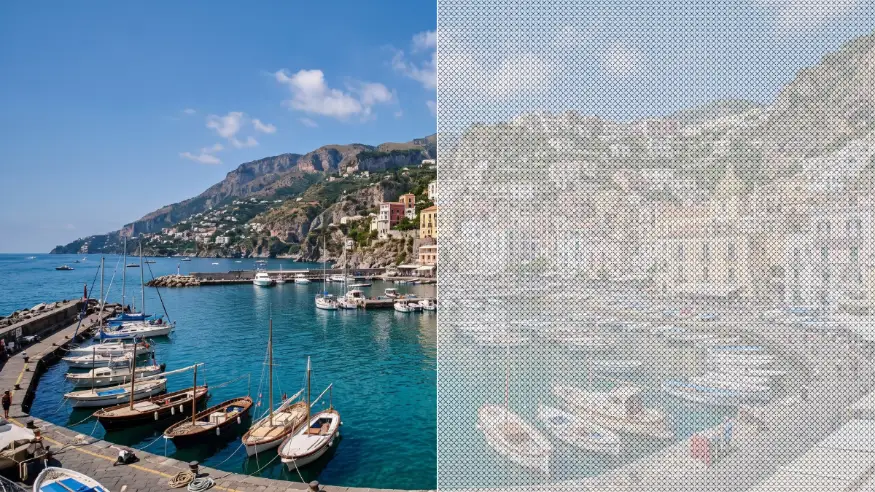

# Cross Stitch

<!-- effect-docs: basic page sha=8f35f22adb7b, written by scripts/effect-docs.mjs. Delete this line to write the page by hand (template B in Documentation-Site.md). -->

Renders the image as X-shaped cross stitches on Paper-colored fabric; Stitch Size sets the stitch grid, Ink tints the thread.

Group: [Textile & Craft](../Effects-Textile.md) · [How to add an effect](../Effects.md#add-an-effect)

<figure class="docs-shot">

<figcaption>Left: the original. Right: Cross Stitch at its default settings.</figcaption>
</figure>

*A short page made from the editor’s effect catalog: what the effect does and its controls. Tips and its node setup will follow.*

## Controls

<!-- generated:controls start -->
| Control | Range | Default |
|---|---|---|
| **Pattern** | | |
| Stitch Size | 4 to 40 | 12 |
| **Mix** | | |
| Amount | 0 to 1 | 0.75 |
| **Color** | | |
| Ink | a colour | `#111827` |
| Paper | a colour | `#f8fafc` |
<!-- generated:controls end -->

**Styles:** the **Style** menu in the effect card switches to another look of the same engine. Controls you changed keep their values and keyframes when the new look has the same control, also under another name; the others start at the new look's defaults. Looks of Textile & Craft: [Embroidery](./embroidery.md), [Kilim Carpet](./kilim.md). Further looks under [Lens & Distort](../Effects-Distort.md) (4), [Pixel & Mosaic](../Effects-Pixel.md) (2), [Print & Halftone](../Effects-Print.md) (8), [Lines & Engraving](../Effects-Lines.md) (6), [Analog & Glitch](../Effects-Analog.md) (4), [3D & Particles](../Effects-3D-Particles.md) (1).

## Technical details

Cross Stitch is one look of the pattern engine; its looks share one node setup. How effects are stored, rendered and exported: [Effect system](../Effect-System.md). Its building blocks: [Node Catalog](../Node-Catalog.md).
