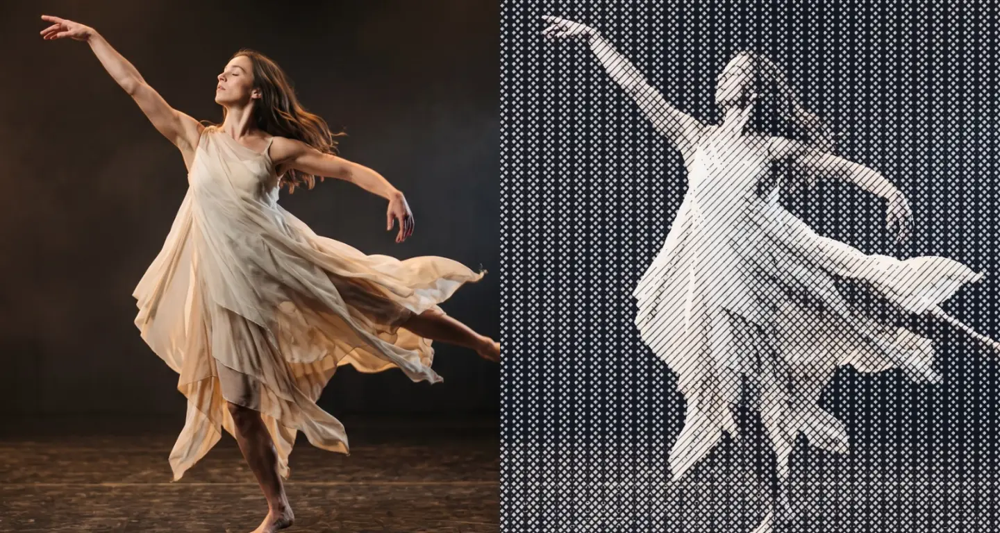

# Crosshatch

<!-- effect-docs: basic page sha=94f6d925e783, written by scripts/effect-docs.mjs. Delete this line to write the page by hand (template B in Documentation-Site.md). -->

Renders tones as layered pen crosshatching with more line directions in darker areas, in Ink on Paper; Scale sets line spacing.

Group: [Lines & Engraving](../Effects-Lines.md) · [How to add an effect](../Effects.md#add-an-effect)

<figure class="docs-shot">

<figcaption>Left: the original. Right: Crosshatch at its default settings.</figcaption>
</figure>

*A short page made from the editor’s effect catalog: what the effect does and its controls. Tips and its node setup will follow.*

## Controls

<!-- generated:controls start -->
| Control | Range | Default |
|---|---|---|
| **Pattern** | | |
| Scale | 2 to 80 | 14 |
| **Style** | | |
| Amount | 0 to 1 | 0.75 |
| **Color** | | |
| Ink | a colour | `#111827` |
| Paper | a colour | `#f8fafc` |
<!-- generated:controls end -->

**Styles:** the **Style** menu in the effect card switches to another look of the same engine and keeps the shared values and keyframes: [Drift Lines](./drift-lines.md), [Wave Lines](./wave-lines.md), [Outline](./outline.md), [Contour Map](./contour-map.md), [Vector Engraving](./vector-tiling.md), and 22 more looks from other groups.

## Technical details

Crosshatch is one look of the pattern engine; its looks share one node setup. How effects are stored, rendered and exported: [Effect system](../Effect-System.md). Its building blocks: [Node Catalog](../Node-Catalog.md).
