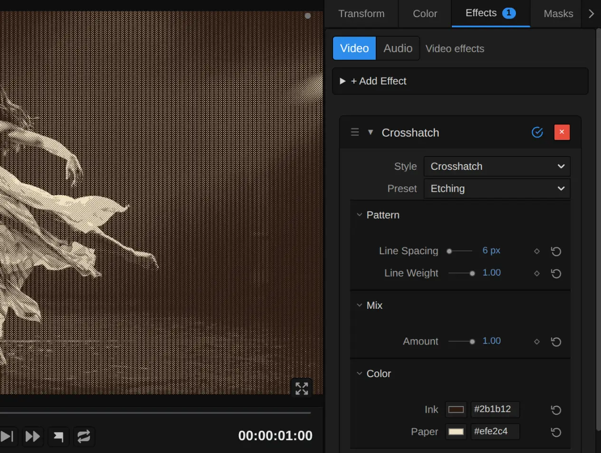
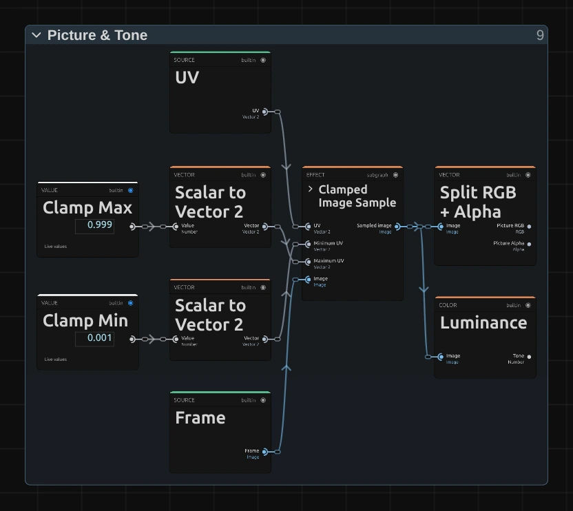
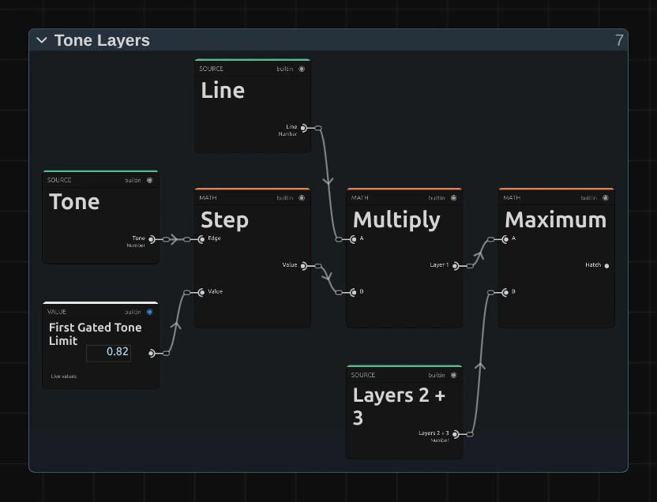
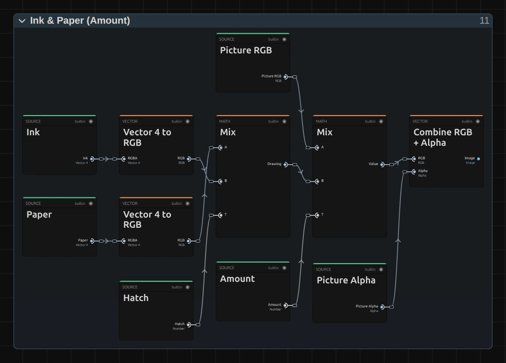

# Crosshatch

Draws the picture with crossing pen lines: more directions and heavier strokes where it is darker. For drawings, etchings and engravings on stage.

Group: [Lines & Engraving](../Effects-Lines.md) · [How to add an effect](../Effects.md#add-an-effect)

<figure class="docs-shot docs-compare docs-shot--float-left">

<figcaption>Left: original. Right: Crosshatch at its default settings.</figcaption>
</figure>

**Use it for:** a scene that turns into a drawing · an old engraving or etching for a memory or a document · a graphic texture on a gauze in which the figure still reads.

- **Line Spacing** – how fine the drawing is.
- **Line Weight** – how heavy the lines get in the shadows.
- **Ink** and **Paper** – the two colours of the drawing.

**Tip:** keyframe **Amount** from 0 to 1 to let the drawing grow over the picture on a cue, and back to 0 to let the picture return.

## Presets

<figure class="docs-shot docs-shot--detail">

<figcaption>The five presets on the whole figure.</figcaption>
</figure>

Pick one in the **Preset** row of the effect card. It sets all controls at once, in one undo step, and the row then shows its name until you change something. A control with keyframes keeps them, and the card says so.

**Pen Sketch** – black pen lines of one medium weight on white: a quick drawing in a sketchbook. The dark parts become an even grey net, so the figure stays light and airy.

**Etching** – fine, heavy lines of brown ink on cream, like an old copper-plate print. The shadows fill almost solid while the light stays clean: strong for a memory or a historical scene.

**Ballpoint** – blue ballpoint on white, with a trace of the picture's own colours under the lines. A private, notebook feeling: letters, diaries, a drawing in the margin.

**Woodcut** – wide, bold strokes in black on off-white. The figure turns into a graphic print that still reads from the back of a large hall.

**Coloured Sketch** – fine hatching over the picture's own colours, half and half: the picture stays and a drawing lies over it. The quietest preset.

## Controls

<figure class="docs-shot">

<svg class="docs-shot-overlay" viewBox="0 0 1017 768" aria-hidden="true" focusable="false">
<defs><marker id="crosshatch-inspector-arrow" viewBox="0 0 10 10" refX="8" refY="5" markerWidth="5" markerHeight="5" orient="auto-start-reverse"><path d="M 0 0 L 10 5 L 0 10 Z" fill="#ffd54a" /></marker></defs>
<path class="docs-shot-arrow" d="M565 319 L649 319" marker-end="url(#crosshatch-inspector-arrow)" />
<circle class="docs-shot-number" cx="565" cy="319" r="18" /><text x="565" y="319" class="docs-shot-number-text">1</text>
<path class="docs-shot-arrow" d="M551 425 L635 425" marker-end="url(#crosshatch-inspector-arrow)" />
<circle class="docs-shot-number" cx="551" cy="425" r="18" /><text x="551" y="425" class="docs-shot-number-text">2</text>
<path class="docs-shot-arrow" d="M560 462 L644 462" marker-end="url(#crosshatch-inspector-arrow)" />
<circle class="docs-shot-number" cx="560" cy="462" r="18" /><text x="560" y="462" class="docs-shot-number-text">3</text>
<path class="docs-shot-arrow" d="M592 578 L676 578" marker-end="url(#crosshatch-inspector-arrow)" />
<circle class="docs-shot-number" cx="592" cy="578" r="18" /><text x="592" y="578" class="docs-shot-number-text">4</text>
<path class="docs-shot-arrow" d="M628 694 L712 694" marker-end="url(#crosshatch-inspector-arrow)" />
<circle class="docs-shot-number" cx="628" cy="694" r="18" /><text x="628" y="694" class="docs-shot-number-text">5</text>
</svg>

<figcaption>Crosshatch with the Etching preset. 1 — Preset: pick a starting point. 2 — Line Spacing. 3 — Line Weight: how heavy the lines get in the shadows. 4 — Amount. 5 — Ink.</figcaption>
</figure>

**Preset** – sets every control at once to one of the five starting points above.

**Style** – switches to another look of the same engine, for example [Halftone](./halftone.md), [Vector Engraving](./vector-tiling.md) or [Contour Map](./contour-map.md). **Line Spacing**, **Amount**, **Ink** and **Paper** keep the values and keyframes you set in looks that have the same control, also under another name (Halftone's Dot Size). A control that means something else in the new look starts at that look's default, and the row under the menu says so: Contour Map's Band Density counts bands, and Drift Lines' Drift is a slide, not a mix. **Line Weight** belongs to Crosshatch alone. **Undo** brings the old value back.

### Pattern

**Line Spacing** – how far apart the lines sit, and so how fine the drawing is. 4–8 px gives a fine engraving that reads as a photo from a few metres away, 14 a clear pen drawing, 30 and more bold strokes like a woodcut; detail smaller than the spacing disappears. The upright lines of the darkest layer sit twice as far apart. It counts pixels of a 1080p picture, so a 4K export shows the same drawing as the preview, only sharper. Below 2 px (from keyframes or a tool) it renders 2 px, and the card says so. 2 to 80 px, default 14 px.

**Line Weight** – how heavy the lines get in the shadows. At 0 every line keeps one thin, even width, as in a quick pen sketch, and black stays a grey net; 0.5 thickens the strokes in the dark parts; at 1 each line starts as a hairline where its layer begins and swells until the deepest shadows are almost solid ink, like an etching. Values outside 0 to 1 (from keyframes or a tool) render as 0 or 1, and the card says so. 0 to 1, default 0.6.

### Mix

**Amount** – how much of the drawing covers the picture. At 1 there are only ink and paper; 0.5 lays the lines over the picture's own colours, like a coloured drawing; 0 switches the drawing off. Keyframe it to let the drawing appear on a cue. 0 to 1, default 0.75.

### Color

**Ink** – the colour of the lines. Black or a dark brown reads like pen and etching ink, a deep blue like ballpoint. With an ink lighter than the paper the drawing turns into a negative: the dark parts fill with light lines. It takes a colour, default `#111827`.

**Paper** – the colour between the lines, which fills the light parts of the picture. A warm cream looks like old paper, pure white like a sketchbook, a pale grey like newsprint. It takes a colour, default `#f8fafc`.

## Node setup

<figure class="docs-shot docs-shot--graph">

<svg class="docs-shot-overlay" viewBox="0 0 1017 796" aria-hidden="true" focusable="false">
<defs><marker id="crosshatch-arrow" viewBox="0 0 10 10" refX="8" refY="5" markerWidth="5" markerHeight="5" orient="auto-start-reverse"><path d="M 0 0 L 10 5 L 0 10 Z" fill="#ffd54a" /></marker></defs>
<path class="docs-shot-arrow" d="M314 773 L314 689" marker-end="url(#crosshatch-arrow)" />
<circle class="docs-shot-number" cx="314" cy="773" r="18" /><text x="314" y="773" class="docs-shot-number-text">1</text>
<path class="docs-shot-arrow" d="M314 410 L314 326" marker-end="url(#crosshatch-arrow)" />
<circle class="docs-shot-number" cx="314" cy="410" r="18" /><text x="314" y="410" class="docs-shot-number-text">2</text>
<path class="docs-shot-arrow" d="M509 330 L509 414" marker-end="url(#crosshatch-arrow)" />
<circle class="docs-shot-number" cx="509" cy="330" r="18" /><text x="509" y="330" class="docs-shot-number-text">3</text>
<path class="docs-shot-arrow" d="M703 239 L703 323" marker-end="url(#crosshatch-arrow)" />
<circle class="docs-shot-number" cx="703" cy="239" r="18" /><text x="703" y="239" class="docs-shot-number-text">4</text>
<path class="docs-shot-arrow" d="M897 22 L897 96" marker-end="url(#crosshatch-arrow)" />
<circle class="docs-shot-number" cx="897" cy="22" r="18" /><text x="897" y="22" class="docs-shot-number-text">5</text>
</svg>

<figcaption>Crosshatch opened in the Nodes tab (input frame and output left out). 1 — Line Grid: three sets of parallel lines. 2 — Picture & Tone: the picture and its brightness. 3 — Line Width: how wide each line is drawn. 4 — Tone Layers: which sets the tone lets through. 5 — Ink & Paper: the colours and the mix.</figcaption>
</figure>

Crosshatch works in five stages, one folder each in the Nodes tab: **Line Grid** lays three sets of parallel lines over the frame, **Picture & Tone** reads the picture and its brightness, **Line Width** works out how wide each line is drawn at that brightness, **Tone Layers** lets a set of lines through only where the picture is dark enough, and **Ink & Paper** colours the result and mixes it with the picture. Click a folder's header to open it; the sections below show what is inside. Crosshatch is one look of the pattern engine that the [Lines & Engraving](../Effects-Lines.md#the-shared-idea) looks share; its **Style** menu switches between them.

### Line Grid

<figure class="docs-shot docs-shot--graph">

<svg class="docs-shot-overlay" viewBox="0 0 1017 525" aria-hidden="true" focusable="false">
<defs><marker id="crosshatch-line-grid-arrow" viewBox="0 0 10 10" refX="8" refY="5" markerWidth="5" markerHeight="5" orient="auto-start-reverse"><path d="M 0 0 L 10 5 L 0 10 Z" fill="#ffd54a" /></marker></defs>
<path class="docs-shot-arrow" d="M204 438 L204 354" marker-end="url(#crosshatch-line-grid-arrow)" />
<circle class="docs-shot-number" cx="204" cy="438" r="18" /><text x="204" y="438" class="docs-shot-number-text">1</text>
<path class="docs-shot-arrow" d="M326 22 L326 89" marker-end="url(#crosshatch-line-grid-arrow)" />
<circle class="docs-shot-number" cx="326" cy="22" r="18" /><text x="326" y="22" class="docs-shot-number-text">2</text>
<path class="docs-shot-arrow" d="M569 438 L569 354" marker-end="url(#crosshatch-line-grid-arrow)" />
<circle class="docs-shot-number" cx="569" cy="438" r="18" /><text x="569" y="438" class="docs-shot-number-text">3</text>
<path class="docs-shot-arrow" d="M935 22 L935 89" marker-end="url(#crosshatch-line-grid-arrow)" />
<circle class="docs-shot-number" cx="935" cy="22" r="18" /><text x="935" y="22" class="docs-shot-number-text">4</text>
</svg>

<figcaption>Inside Line Grid (Line Spacing), for the first set of lines. 1 — Maximum: the line spacing in pixels. 2 — Divide: the position in line spacings. 3 — Subtract: one of the three directions. 4 — Absolute: the distance to the nearest line.</figcaption>
</figure>

**Maximum** – the line spacing in pixels of this frame: Line Spacing times the frame's size compared with 1080p (the Multiply card), and never less than one pixel.

**Divide** – the pixel's place (UV times Resolution) divided by that spacing: its position counted in line spacings. Split Vector hands on the part across (x) and the part down (y).

**Subtract** – x minus y. Together with Add (x plus y) and Multiply (x times Third Half Scale, 0.5) it gives the three line directions: the first set rises to the right, the second falls, the third stands upright at twice the spacing.

**Absolute** – Fraction keeps what is after the point and Subtract takes First Half (0.5) off, so the line runs where the result is 0. Absolute turns it into the distance to that line, from 0 on the line to 0.5 midway to the next. The picture shows the first set; the other two are built the same way.

### Picture & Tone

<figure class="docs-shot docs-shot--float-right">

<svg class="docs-shot-overlay" viewBox="0 0 590 527" aria-hidden="true" focusable="false">
<defs><marker id="crosshatch-picture-tone-arrow" viewBox="0 0 10 10" refX="8" refY="5" markerWidth="5" markerHeight="5" orient="auto-start-reverse"><path d="M 0 0 L 10 5 L 0 10 Z" fill="#ffd54a" /></marker></defs>
<path class="docs-shot-arrow" d="M363 400 L363 316" marker-end="url(#crosshatch-picture-tone-arrow)" />
<circle class="docs-shot-number" cx="363" cy="400" r="18" /><text x="363" y="400" class="docs-shot-number-text">1</text>
<path class="docs-shot-arrow" d="M500 81 L500 165" marker-end="url(#crosshatch-picture-tone-arrow)" />
<circle class="docs-shot-number" cx="500" cy="81" r="18" /><text x="500" y="81" class="docs-shot-number-text">2</text>
<path class="docs-shot-arrow" d="M500 480 L500 396" marker-end="url(#crosshatch-picture-tone-arrow)" />
<circle class="docs-shot-number" cx="500" cy="480" r="18" /><text x="500" y="480" class="docs-shot-number-text">3</text>
</svg>

<figcaption>Inside Picture & Tone. 1 — Clamped Image Sample: reads the picture. 2 — Split RGB + Alpha: its colour and transparency. 3 — Luminance: its brightness.</figcaption>
</figure>

**Clamped Image Sample** – reads the input picture at the pixel, kept just inside the frame (Clamp Min 0.001 and Clamp Max 0.999, as a share of the frame). It holds a small node setup of its own; its › opens it.

**Split RGB + Alpha** – splits the picture into its colour, which **Amount** mixes back in at the end, and its transparency, which the result keeps.

**Luminance** – the brightness of the pixel, from 0 for black to 1 for white. It decides which line sets appear and how wide they are drawn.

### Line Width

<figure class="docs-shot docs-shot--graph">

<svg class="docs-shot-overlay" viewBox="0 0 1017 765" aria-hidden="true" focusable="false">
<defs><marker id="crosshatch-line-width-arrow" viewBox="0 0 10 10" refX="8" refY="5" markerWidth="5" markerHeight="5" orient="auto-start-reverse"><path d="M 0 0 L 10 5 L 0 10 Z" fill="#ffd54a" /></marker></defs>
<path class="docs-shot-arrow" d="M326 413 L326 329" marker-end="url(#crosshatch-line-width-arrow)" />
<circle class="docs-shot-number" cx="326" cy="413" r="18" /><text x="326" y="413" class="docs-shot-number-text">1</text>
<path class="docs-shot-arrow" d="M448 121 L448 205" marker-end="url(#crosshatch-line-width-arrow)" />
<circle class="docs-shot-number" cx="448" cy="121" r="18" /><text x="448" y="121" class="docs-shot-number-text">2</text>
<path class="docs-shot-arrow" d="M569 455 L569 371" marker-end="url(#crosshatch-line-width-arrow)" />
<circle class="docs-shot-number" cx="569" cy="455" r="18" /><text x="569" y="455" class="docs-shot-number-text">3</text>
<path class="docs-shot-arrow" d="M813 121 L813 205" marker-end="url(#crosshatch-line-width-arrow)" />
<circle class="docs-shot-number" cx="813" cy="121" r="18" /><text x="813" y="121" class="docs-shot-number-text">4</text>
</svg>

<figcaption>Inside Line Width (Line Weight), for the first set of lines. 1 — Multiply: how far below the set's tone limit the pixel is. 2 — Clamp: the heavy width. 3 — Mix: the width Line Weight picks. 4 — Smoothstep: the line with a soft edge.</figcaption>
</figure>

**Multiply** – the layer's tone limit (First Gated Tone Limit, 0.82) minus the pixel's Tone (Subtract), times First Swell 0.439: how much darker the pixel is than the point where this line set begins, scaled so that black gives 0.36.

**Clamp** – keeps that between First Hairline 0.03 and First Heavy Max 0.36: the half width a line has at Line Weight 1, a hairline where the set begins and 0.36 of the spacing in black, where neighbouring lines almost touch.

**Mix** – blends First Fixed Width 0.105, the even width of Line Weight 0, with that heavy width, by Line Weight (the other Clamp keeps it between 0 and 1): the half width of the line at this pixel.

**Smoothstep** – compares the Distance to Line with that half width, softened by First Soft 0.045 on each side (Subtract and Add): 0 inside the line, 1 outside, with a soft edge. Subtract from One turns it round, so Line is 1 on the line.

**Remix:** open the **Constants** folder and set **First Swell** from **0.439** to **1**: the rising lines reach their full weight already in the mid-tones, and the drawing turns darker and bolder.

### Tone Layers

<figure class="docs-shot docs-shot--float-right">

<svg class="docs-shot-overlay" viewBox="0 0 590 451" aria-hidden="true" focusable="false">
<defs><marker id="crosshatch-tone-layers-arrow" viewBox="0 0 10 10" refX="8" refY="5" markerWidth="5" markerHeight="5" orient="auto-start-reverse"><path d="M 0 0 L 10 5 L 0 10 Z" fill="#ffd54a" /></marker></defs>
<path class="docs-shot-arrow" d="M227 385 L227 301" marker-end="url(#crosshatch-tone-layers-arrow)" />
<circle class="docs-shot-number" cx="227" cy="385" r="18" /><text x="227" y="385" class="docs-shot-number-text">1</text>
<path class="docs-shot-arrow" d="M363 79 L363 163" marker-end="url(#crosshatch-tone-layers-arrow)" />
<circle class="docs-shot-number" cx="363" cy="79" r="18" /><text x="363" y="79" class="docs-shot-number-text">2</text>
<path class="docs-shot-arrow" d="M500 385 L500 301" marker-end="url(#crosshatch-tone-layers-arrow)" />
<circle class="docs-shot-number" cx="500" cy="385" r="18" /><text x="500" y="385" class="docs-shot-number-text">3</text>
</svg>

<figcaption>Inside Tone Layers, for the first set of lines. 1 — Step: is the pixel dark enough. 2 — Multiply: the line only there. 3 — Maximum: all three sets together.</figcaption>
</figure>

**Step** – 1 where the pixel's Tone is at or below First Gated Tone Limit (0.82), else 0. The other two sets begin at 0.58 and 0.32: the light parts get one line direction, the mid-tones two, the shadows all three.

**Multiply** – the Line times that step: the first set of lines, only where the picture is dark enough (Layer 1).

**Maximum** – the stronger of Layer 1 and Layers 2 + 3 (another Maximum joins those two): the Hatch, 1 on any line and 0 on bare paper.

### Ink & Paper

<figure class="docs-shot docs-shot--graph">

<svg class="docs-shot-overlay" viewBox="0 0 1017 731" aria-hidden="true" focusable="false">
<defs><marker id="crosshatch-ink-paper-arrow" viewBox="0 0 10 10" refX="8" refY="5" markerWidth="5" markerHeight="5" orient="auto-start-reverse"><path d="M 0 0 L 10 5 L 0 10 Z" fill="#ffd54a" /></marker></defs>
<path class="docs-shot-arrow" d="M509 569 L509 485" marker-end="url(#crosshatch-ink-paper-arrow)" />
<circle class="docs-shot-number" cx="509" cy="569" r="18" /><text x="509" y="569" class="docs-shot-number-text">1</text>
<path class="docs-shot-arrow" d="M897 467 L897 383" marker-end="url(#crosshatch-ink-paper-arrow)" />
<circle class="docs-shot-number" cx="897" cy="467" r="18" /><text x="897" y="467" class="docs-shot-number-text">2</text>
</svg>

<figcaption>Inside Ink & Paper (Amount). 1 — Mix: ink or paper. 2 — Combine RGB + Alpha: the transparency back on.</figcaption>
</figure>

**Mix** – Paper where the Hatch is 0, Ink where it is 1, in between on the soft edges: the drawing. The second Mix blends the picture's own colour (Picture RGB) with the drawing by Amount.

**Combine RGB + Alpha** – joins the result with the picture's own transparency (Picture Alpha), so a cut-out figure keeps its outline.

## Technical details

- **Size.** Line Spacing counts pixels of a frame whose shorter side is 1080: a 4K export, a portrait 1080 × 1920 frame, a lower Preview Quality and the thumbnails show the same drawing. A spacing is never thinner than one pixel of the frame; below 2 px Line Spacing renders as 2. The card says when either happens.
- **Lines.** The edges of a line are a share of the spacing soft, so very wide spacings draw slightly soft strokes. Each pixel reads its own brightness: the three sets begin at brightness 0.82, 0.58 and 0.32.
- **Transparency.** The drawing keeps the picture's transparency, so a cut-out figure keeps clean edges and transparent parts stay transparent. The preview and the export match; the look does not move by itself.
- **Saved projects.** A Crosshatch saved before Line Weight existed opens with Line Weight 0 and keeps its thin, even lines. **Line Spacing** was called Scale; the value is the same.
- **More:** [Effect system](../Effect-System.md) · [Node Catalog](../Node-Catalog.md) · [Styles and presets](../Effects.md#styles-and-presets).
