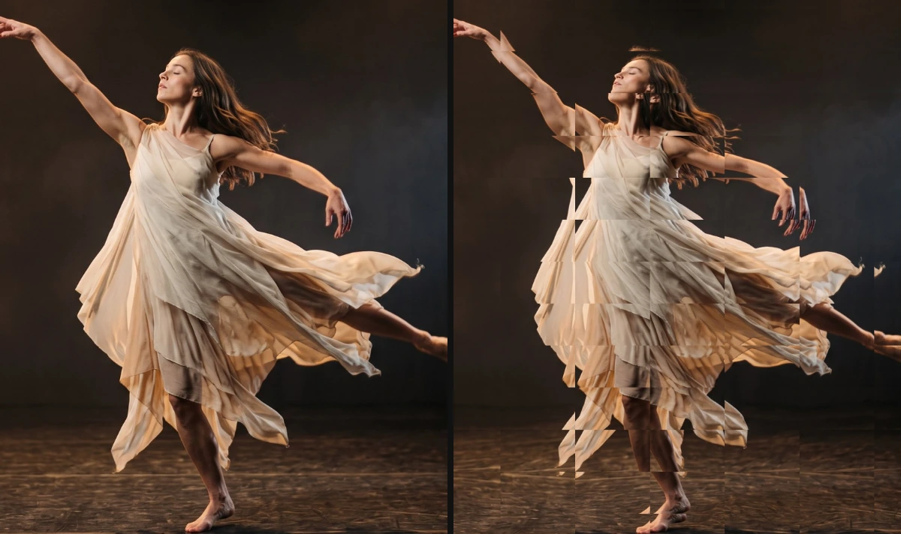

# Crystal Glass

Looks at the picture through cut glass: a grid of facets that each bend it a little. The facets shimmer over time. Marked *Experimental*: start with low values.

Group: [Lens & Distort](../Effects-Distort.md) · [How to add an effect](../Effects.md#add-an-effect)

<figure class="docs-shot">

<figcaption>Left: original. Right: default settings (Facets 14, Refraction 0.3).</figcaption>
</figure>

**Use it for:** a view through a glass block or a shop window · a fractured memory · a stylised transition (animate Refraction from 0).

- **Facets** – how many facets run across the frame, the same number in both directions.
- **Refraction** – how far each facet bends the picture.
- **Shimmer Speed** – how fast the facets shimmer; 0 holds them still.

**Experimental:** facets are squares of the frame, so they stretch with its shape and have hard seams, and strong Refraction doubles edges into ghost copies.

## Controls

<!-- generated:controls start -->
| Control | Range | Default |
|---|---|---|
| **Pattern** | | |
| Facets | 4 to 80 | 14 |
| **Style** | | |
| Refraction | 0 to 1 | 0.3 |
| **Motion** | | |
| Shimmer Speed | 0 to 5 | 1 |
<!-- generated:controls end -->

## Node setup

Crystal Glass is one look of the pattern engine: its card has a **Style** menu that switches to other looks with the same controls, such as [Glitch Grid](./glitch-grid.md) ([Styles and presets](../Effects.md#styles-and-presets)). Its own graph gives every facet a random tilt and moves the read position inside the facet along it, by Refraction × the **Value** 0.08, plus a small shimmer of 0.003.

**Remix:** for bending beyond the slider, select the **Value** of 0.08 and set it to 0.16.

## Technical details

- **Units.** Facets is the number of facets across each axis of the frame (at least 4, so a 16:9 frame has wide facets). At Refraction 1 a read moves by at most about 5.7 % of the frame (at a facet corner); the shimmer adds up to 0.3 %.
- **Time.** The shimmer follows timeline time, so the preview, scrubbing and the export match.
- **Experimental.** The effect list adds "(Experimental)"; the inspector and agent tool results give the reason above. Values below a control's floor are reported, not silently raised.

Implementation note (shared with Wave Lines and Glass Dispersion): [Effect system: Wave Lines](../Effect-System.md#wave-lines). Nodes: [Node Catalog](../Node-Catalog.md).
