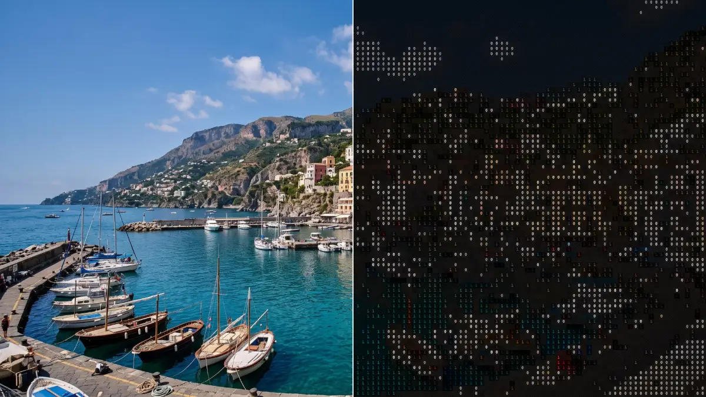

# Data Hatching

<!-- effect-docs: basic page sha=ef2af27b2e85, written by scripts/effect-docs.mjs. Delete this line to write the page by hand (template B in Documentation-Site.md). -->

Mixes cycling characters with diagonal hatching that thickens in darker areas; Cell Size sets character size, Speed the cycling.

Group: [Text & Glyph](../Effects-Glyph.md) · [How to add an effect](../Effects.md#add-an-effect)

<figure class="docs-shot">

<figcaption>Left: the original. Right: Data Hatching at its default settings, one frame of its movement. An enlarged detail, so the characters can be read.</figcaption>
</figure>

*A short page made from the editor’s effect catalog: what the effect does and its controls. Tips and its node setup will follow.*

## Controls

<!-- generated:controls start -->
| Control | Range | Default |
|---|---|---|
| **Grid** | | |
| Cell Size | 4 to 72 | 14 |
| **Style** | | |
| Amount | 0 to 1 | 1 |
| Invert Ramp | on or off | off |
| **Glyphs** | | |
| Ramp | standard, detailed, blocks, binary, numeric, symbols | binary |
| Custom Ramp | text | empty |
| Font | Monospace, Serif, Sans Serif | Monospace |
| Weight | 200 to 900 | 600 |
| **Color** | | |
| Color Source | Source, Duotone | Source |
| Dark | a colour | `#081018` |
| Light | a colour | `#e8fff5` |
| **Motion** | | |
| Speed | 0 to 5 | 1 |
<!-- generated:controls end -->

**Styles:** the **Style** menu in the effect card switches to another look of the same engine. Controls you changed keep their values and keyframes when the new look has the same control, also under another name; the others start at the new look's defaults. Looks of Text & Glyph: [ASCII](./ascii.md), [Brand Generator](./brand-generator.md), [Contour Type](./contour-type.md), [Creative UI Collage](./ui-collage.md), [Dither Glow](./pixel-dither.md), [Dither Text](./dither-text.md), [Glyph Matrix](./glyph-matrix.md), [Grid Glyph](./grid-glyph.md), [Inscribe](./inscribe.md), [Matrix Rain](./matrix.md), [Number Field](./number-field.md), [Pixel Code](./pixel-code.md), [Retro Matrix](./retro-matrix.md), [Symbol Matrix](./symbol-matrix.md), [Tag Pills](./capsule-cloud.md), [Word Mosaic](./word-mosaic.md). Also: [Stitch Poster](./stitch-poster.md) ([Textile & Craft](../Effects-Textile.md)).

## Technical details

Data Hatching is one look of the glyph engine; its looks share one node setup. It keeps moving while the playhead stands still. How effects are stored, rendered and exported: [Effect system](../Effect-System.md). Its building blocks: [Node Catalog](../Node-Catalog.md).
