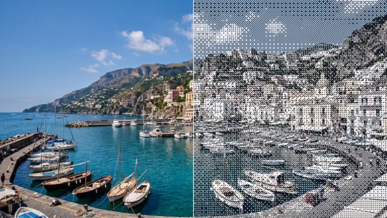

# Dither Studio

<!-- effect-docs: basic page sha=42c72ede92a1, written by scripts/effect-docs.mjs. Delete this line to write the page by hand (template B in Documentation-Site.md). -->

Reduces the image to two ink colors using a selectable dither pattern (Bayer 2, Bayer 4 or Checker); Kernel picks the pattern, Scale its size.

Group: [Print & Halftone](../Effects-Print.md) · [How to add an effect](../Effects.md#add-an-effect)

<figure class="docs-shot">

<figcaption>Left: the original. Right: Dither Studio at its default settings.</figcaption>
</figure>

*A short page made from the editor’s effect catalog: what the effect does and its controls. Tips and its node setup will follow.*

## Controls

<!-- generated:controls start -->
| Control | Range | Default |
|---|---|---|
| **Pattern** | | |
| Scale | 2 to 80 | 14 |
| Kernel | bayer 2, bayer 4, checker | bayer 4 |
| **Style** | | |
| Amount | 0 to 1 | 0.75 |
| **Color** | | |
| Ink | a colour | `#111827` |
| Paper | a colour | `#f8fafc` |
<!-- generated:controls end -->

**Styles:** the **Style** menu in the effect card switches to another look of the same engine and keeps the shared values and keyframes: [Riso Glow](./riso-glow.md), [Dithering](./dither.md), [Halftone](./halftone.md), [Paper Print](./paper-print.md), [Riso](./riso.md), [Pattern Halftone](./pattern-halftone.md), [Tone Geometry](./tone-geometry.md), and 20 more looks from other groups.

## Technical details

Dither Studio is one look of the pattern engine; its looks share one node setup. How effects are stored, rendered and exported: [Effect system](../Effect-System.md). Its building blocks: [Node Catalog](../Node-Catalog.md).
