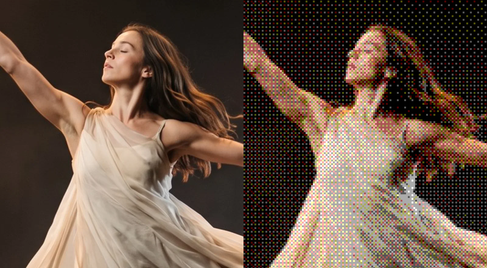
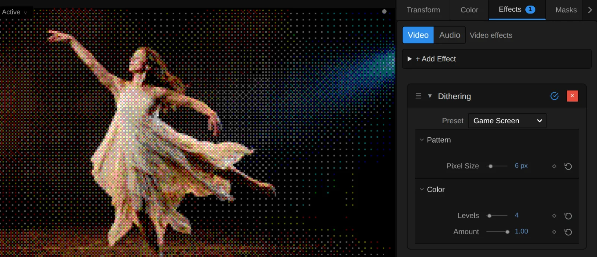
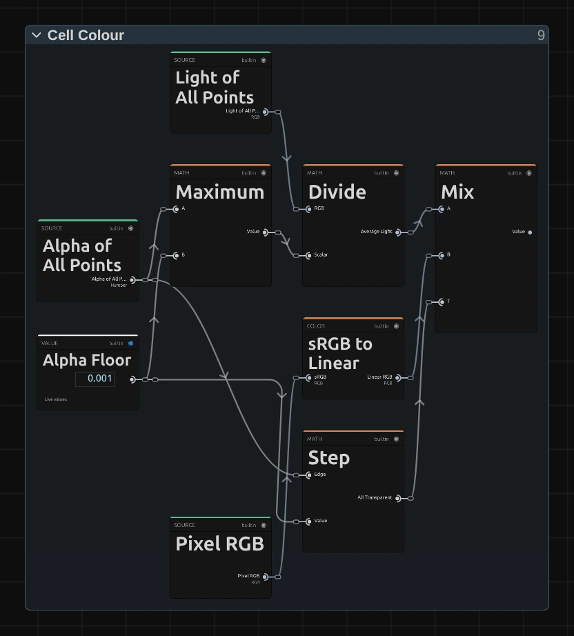
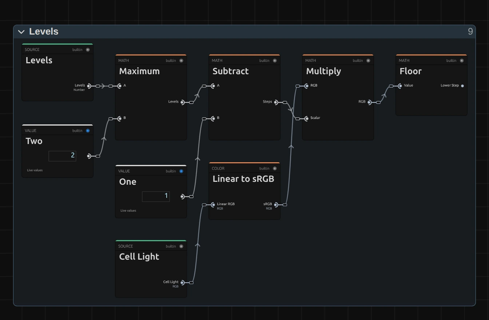
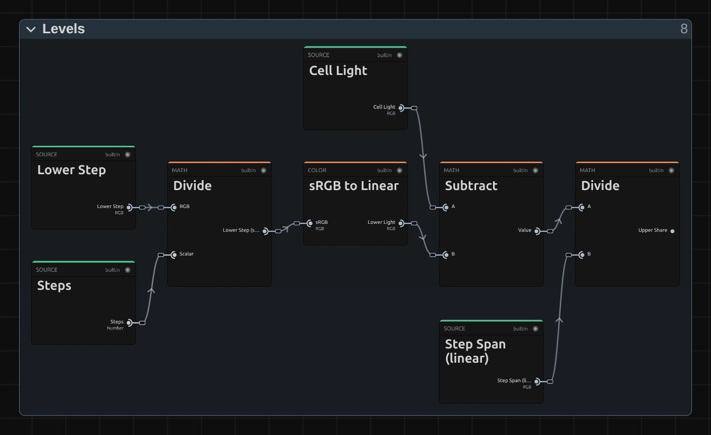
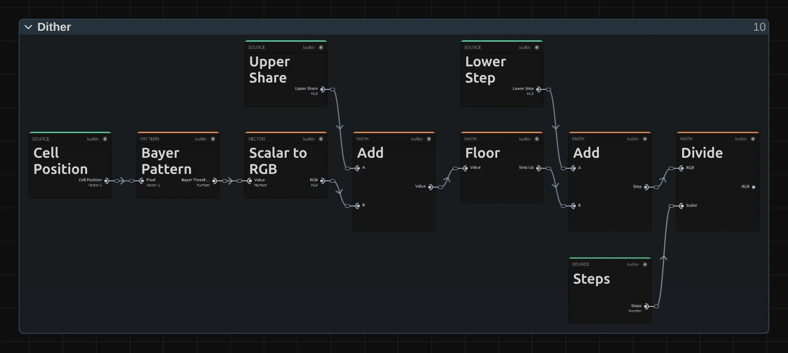
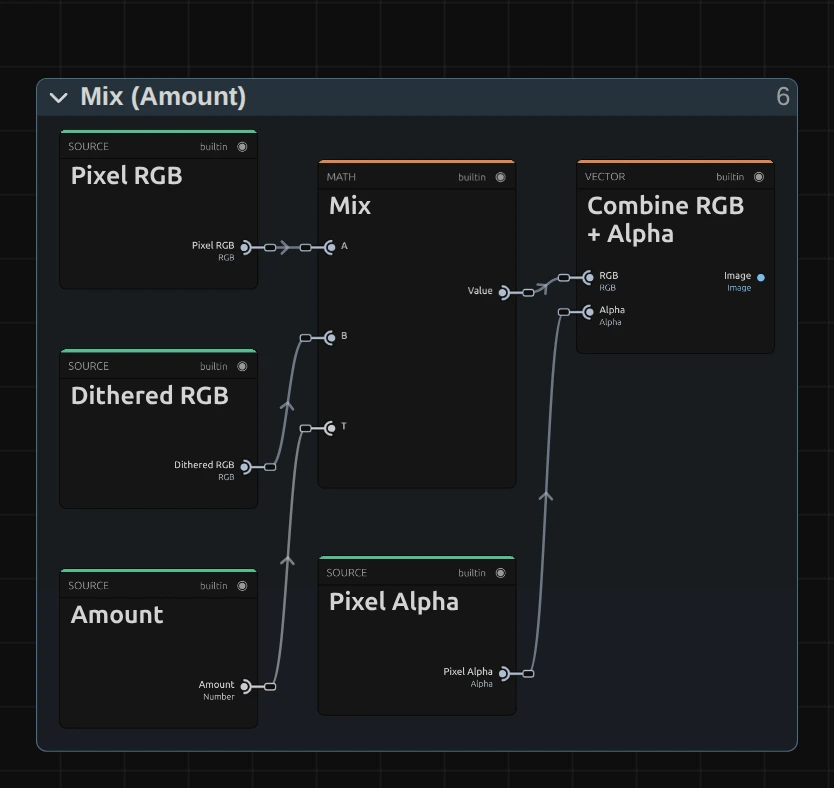

# Dithering

Turns the picture into big pixels of a few flat colours in a checked pattern, like an early computer screen.

Group: [Print & Halftone](../Effects-Print.md) · [How to add an effect](../Effects.md#add-an-effect)

<figure class="docs-shot docs-compare docs-shot--float-left">

<figcaption>Left: original. Right: Dithering at its default settings, a detail at twice the size.</figcaption>
</figure>

**Use it for:** a retro computer or game look · a memory, a dream or a digital world · a graphic texture on a projection that still reads from the back row.

- **Pixel Size** – how large the pixels are.
- **Levels** – how many colours there are.
- **Amount** – how much of the effect covers the picture.

**Tip:** keyframe **Pixel Size** from 1 to 12 px to let a scene fall apart into ever coarser pixels, or **Levels** from 16 down to 2 so its colours drain away. For two inks, like a one-bit screen, use [Dither Studio](./dither-studio.md); for large flat blocks, [Blockify](./blockify.md).

## Presets

<figure class="docs-shot docs-shot--detail">

<figcaption>The four presets on the upper body, at full size: one pixel of a 1080p frame per screen pixel.</figcaption>
</figure>

Pick one in the **Preset** row of the effect card. It sets all controls at once, in one undo step, and the row then shows its name until you change something. A control with keyframes keeps them, and the card says so.

**Eight Colours** – fine two-pixel dots in just black, white and the six pure colours, like an early colour printer. Loud and graphic; a light figure on a dark stage glows out of the black.

**Poster** – three steps per channel (27 colours) on 4 px pixels: a flat, posterised print with hard colour steps. The dark stage turns into a coarse coloured checker, the figure into a few flat tones.

**Game Screen** – chunky pixels in 64 colours: a game console screen. The figure stays easy to read, its details turn into blocks.

**Big Pixels** – very large pixels in 125 colours: the figure becomes a mosaic that reads from the back row. Made for large projection surfaces.

## Controls

<figure class="docs-shot">

<svg class="docs-shot-overlay" viewBox="0 0 1017 438" aria-hidden="true" focusable="false">
<defs><marker id="dither-inspector-arrow" viewBox="0 0 10 10" refX="8" refY="5" markerWidth="5" markerHeight="5" orient="auto-start-reverse"><path d="M 0 0 L 10 5 L 0 10 Z" fill="#ffd54a" /></marker></defs>
<path class="docs-shot-arrow" d="M663 206 L747 206" marker-end="url(#dither-inspector-arrow)" />
<circle class="docs-shot-number" cx="663" cy="206" r="18" /><text x="663" y="206" class="docs-shot-number-text">1</text>
<path class="docs-shot-arrow" d="M670 283 L754 283" marker-end="url(#dither-inspector-arrow)" />
<circle class="docs-shot-number" cx="670" cy="283" r="18" /><text x="670" y="283" class="docs-shot-number-text">2</text>
<path class="docs-shot-arrow" d="M689 367 L773 367" marker-end="url(#dither-inspector-arrow)" />
<circle class="docs-shot-number" cx="689" cy="367" r="18" /><text x="689" y="367" class="docs-shot-number-text">3</text>
<path class="docs-shot-arrow" d="M682 395 L766 395" marker-end="url(#dither-inspector-arrow)" />
<circle class="docs-shot-number" cx="682" cy="395" r="18" /><text x="682" y="395" class="docs-shot-number-text">4</text>
</svg>

<figcaption>Dithering with the Game Screen preset. 1 — Preset: pick a starting point. 2 — Pixel Size. 3 — Levels: steps per colour channel. 4 — Amount.</figcaption>
</figure>

### Pattern

**Pixel Size** – how large the pixels are. Each pixel shows one colour of the picture, and its neighbours form the checked pattern, so the pattern grows with it. 1 px gives a fine grain that blends into a photo from a few metres away, 3 to 6 px a clear retro screen, 12 and more turns a figure into a mosaic. It counts pixels of a 1080p picture, so a 4K export shows the same pattern as the preview, and it always draws whole pixels: where a size does not fit the frame, the card says what renders. Below 1 px (from keyframes or a tool) it renders 1 px, and the card says so. 1 to 24 px, default 3 px.

### Color

**Levels** – how many steps each colour channel has, and so how many colours the picture may use: 2 gives black, white and six pure colours, 4 gives 64 colours, 6 the 216 of the early web. Few levels look loud and graphic, many levels quiet and close to the picture. The pattern mixes neighbouring steps so that, from a distance, every part keeps its brightness. A dark stage that is not quite black turns into a visible checker of grey and coloured pixels over the whole backdrop, the most visible thing on a projection. More Levels make it finer and calmer; grading the stage to true black before Dithering removes it. Below 2 it renders 2, and the card says so. 2 to 16, default 4.

**Amount** – how much of the dithered picture covers the original. At 1 there are only the few colours; 0.5 lays the pattern softly over the picture's own colours; 0 switches it off. Keyframe it to let a scene turn into pixels on a cue. 0 to 1, default 1.

## Node setup

<figure class="docs-shot docs-shot--graph">

<svg class="docs-shot-overlay" viewBox="0 0 1017 710" aria-hidden="true" focusable="false">
<defs><marker id="dither-arrow" viewBox="0 0 10 10" refX="8" refY="5" markerWidth="5" markerHeight="5" orient="auto-start-reverse"><path d="M 0 0 L 10 5 L 0 10 Z" fill="#ffd54a" /></marker></defs>
<path class="docs-shot-arrow" d="M230 660 L230 576" marker-end="url(#dither-arrow)" />
<circle class="docs-shot-number" cx="230" cy="660" r="18" /><text x="230" y="660" class="docs-shot-number-text">1</text>
<path class="docs-shot-arrow" d="M369 241 L369 325" marker-end="url(#dither-arrow)" />
<circle class="docs-shot-number" cx="369" cy="241" r="18" /><text x="369" y="241" class="docs-shot-number-text">2</text>
<path class="docs-shot-arrow" d="M508 688 L508 604" marker-end="url(#dither-arrow)" />
<circle class="docs-shot-number" cx="508" cy="688" r="18" /><text x="508" y="688" class="docs-shot-number-text">3</text>
<path class="docs-shot-arrow" d="M648 265 L648 181" marker-end="url(#dither-arrow)" />
<circle class="docs-shot-number" cx="648" cy="265" r="18" /><text x="648" y="265" class="docs-shot-number-text">4</text>
<path class="docs-shot-arrow" d="M787 167 L787 251" marker-end="url(#dither-arrow)" />
<circle class="docs-shot-number" cx="787" cy="167" r="18" /><text x="787" y="167" class="docs-shot-number-text">5</text>
<path class="docs-shot-arrow" d="M926 572 L926 488" marker-end="url(#dither-arrow)" />
<circle class="docs-shot-number" cx="926" cy="572" r="18" /><text x="926" y="572" class="docs-shot-number-text">6</text>
</svg>

<figcaption>Dithering opened in the Nodes tab (input frame and output left out). 1 — Pixel Grid: the cells of Pixel Size. 2 — Cell Filter: the picture averaged over half a cell. 3 — Cell Colour: one colour per cell. 4 — Levels: the two nearest steps. 5 — Dither: the pattern picks one. 6 — Mix: over the picture by Amount.</figcaption>
</figure>

Dithering works in six stages, one folder each in the Nodes tab: **Pixel Grid** cuts the frame into cells of Pixel Size, **Cell Filter** averages the picture over boxes of half a cell, **Cell Colour** reads one colour for each cell from four points of that average, **Levels** finds the two steps of Levels that colour lies between, **Dither** lets the cell's place in a 4 × 4 pattern decide which of the two it shows, and **Mix** lays the result over the picture by Amount. Click a folder's header to open it; the sections below show what is inside.

### Pixel Grid

<figure class="docs-shot docs-shot--graph">

<svg class="docs-shot-overlay" viewBox="0 0 1017 517" aria-hidden="true" focusable="false">
<defs><marker id="dither-pixel-grid-arrow" viewBox="0 0 10 10" refX="8" refY="5" markerWidth="5" markerHeight="5" orient="auto-start-reverse"><path d="M 0 0 L 10 5 L 0 10 Z" fill="#ffd54a" /></marker></defs>
<path class="docs-shot-arrow" d="M292 22 L292 85" marker-end="url(#dither-pixel-grid-arrow)" />
<circle class="docs-shot-number" cx="292" cy="22" r="18" /><text x="292" y="22" class="docs-shot-number-text">1</text>
<path class="docs-shot-arrow" d="M617 281 L617 197" marker-end="url(#dither-pixel-grid-arrow)" />
<circle class="docs-shot-number" cx="617" cy="281" r="18" /><text x="617" y="281" class="docs-shot-number-text">2</text>
<path class="docs-shot-arrow" d="M725 22 L725 85" marker-end="url(#dither-pixel-grid-arrow)" />
<circle class="docs-shot-number" cx="725" cy="22" r="18" /><text x="725" y="22" class="docs-shot-number-text">3</text>
<path class="docs-shot-arrow" d="M941 493 L941 409" marker-end="url(#dither-pixel-grid-arrow)" />
<circle class="docs-shot-number" cx="941" cy="493" r="18" /><text x="941" y="493" class="docs-shot-number-text">4</text>
</svg>

<figcaption>Inside Pixel Grid (Pixel Size). 1 — Round: the size in whole pixels. 2 — Divide: the cell position. 3 — Floor: which cell. 4 — Multiply: the cell's centre in pixels.</figcaption>
</figure>

**Round** – Pixel Size times the frame's scale (Multiply; 1 on a 1080p frame, 2 on 4K) is the size in pixels of this frame, rounded to whole pixels: a cell of one and a half pixels cannot be drawn and would beat into a plaid. Maximum keeps it at one pixel or more.

**Divide** – the pixel's place (UV times Resolution) divided by that size: the Cell Position, counted in cells. The Dither stage reads it for the pattern.

**Floor** – drops what is after the point: the number of the cell, the same for every pixel in it.

**Multiply** – Add moves to the middle of the cell (Half), and Multiply turns it back into pixels: the Cell Centre, where Cell Colour reads the picture.

### Cell Filter

The picture averaged over boxes of half a cell, in linear light and weighted by alpha. The four reads of Cell Colour lie in the middle of four such boxes, which together cover the cell, so each cell shows the average colour of all its pixels and changes smoothly on moving footage. The same as [Halftone › Cell Filter](./halftone.md#cell-filter), sized by Pixel Size instead of Dot Size.

### Cell Colour

<figure class="docs-shot docs-shot--graph">

<svg class="docs-shot-overlay" viewBox="0 0 1017 1011" aria-hidden="true" focusable="false">
<defs><marker id="dither-cell-colour-arrow" viewBox="0 0 10 10" refX="8" refY="5" markerWidth="5" markerHeight="5" orient="auto-start-reverse"><path d="M 0 0 L 10 5 L 0 10 Z" fill="#ffd54a" /></marker></defs>
<path class="docs-shot-arrow" d="M322 132 L322 216" marker-end="url(#dither-cell-colour-arrow)" />
<circle class="docs-shot-number" cx="322" cy="132" r="18" /><text x="322" y="132" class="docs-shot-number-text">1</text>
<path class="docs-shot-arrow" d="M695 132 L695 216" marker-end="url(#dither-cell-colour-arrow)" />
<circle class="docs-shot-number" cx="695" cy="132" r="18" /><text x="695" y="132" class="docs-shot-number-text">2</text>
<path class="docs-shot-arrow" d="M509 989 L509 905" marker-end="url(#dither-cell-colour-arrow)" />
<circle class="docs-shot-number" cx="509" cy="989" r="18" /><text x="509" y="989" class="docs-shot-number-text">3</text>
<path class="docs-shot-arrow" d="M695 887 L695 803" marker-end="url(#dither-cell-colour-arrow)" />
<circle class="docs-shot-number" cx="695" cy="887" r="18" /><text x="695" y="887" class="docs-shot-number-text">4</text>
</svg>

<figcaption>Inside Cell Colour, with one of its four reading points. 1 — Minimum: how far from the centre to read. 2 — Subtract: one reading point. 3 — sRGB to Linear: colour as light. 4 — Multiply: weighted by alpha.</figcaption>
</figure>

**Minimum** – how far from the centre the four points lie: a quarter cell, but never further than the cell's own pixels reach (Inside the Cell), so a one-pixel cell reads exactly its pixel. Each point reads the Cell Filter, the average of a quarter of the cell, so the four together give the average of the whole cell.

**Subtract** – one reading point: the Cell Centre minus the Diagonal, divided by Resolution. The other three points, in the folder, sit on the other corners of the same square.

**sRGB to Linear** – turns the colour the Cell Filter holds there into light as it adds up on a screen, so the average of a cell is as bright as its pixels together.

**Multiply** – weights that light with the point's alpha, so a transparent point does not darken the cell. Add sums the four points (Light of All Points) and their alpha (Alpha of All Points).

<figure class="docs-shot docs-shot--float-right">

<svg class="docs-shot-overlay" viewBox="0 0 590 654" aria-hidden="true" focusable="false">
<defs><marker id="dither-cell-average-arrow" viewBox="0 0 10 10" refX="8" refY="5" markerWidth="5" markerHeight="5" orient="auto-start-reverse"><path d="M 0 0 L 10 5 L 0 10 Z" fill="#ffd54a" /></marker></defs>
<path class="docs-shot-arrow" d="M363 79 L363 163" marker-end="url(#dither-cell-average-arrow)" />
<circle class="docs-shot-number" cx="363" cy="79" r="18" /><text x="363" y="79" class="docs-shot-number-text">1</text>
<path class="docs-shot-arrow" d="M500 432 L500 348" marker-end="url(#dither-cell-average-arrow)" />
<circle class="docs-shot-number" cx="500" cy="432" r="18" /><text x="500" y="432" class="docs-shot-number-text">2</text>
</svg>

<figcaption>The average. 1 — Divide: the cell's light. 2 — Mix: the pixel's own colour where all points are transparent.</figcaption>
</figure>

**Divide** – the light of all four points divided by their alpha: the cell's average colour, in light. Every pixel of a cell reads the same four points, so the whole cell gets one colour.

**Mix** – where all four points are transparent (Step: their alpha is at most the Alpha Floor of 0.001), a thin opaque line between them would turn black; Mix then takes the pixel's own colour instead. A Clamp keeps the result between 0 and 1.

### Levels

<figure class="docs-shot docs-shot--graph">

<svg class="docs-shot-overlay" viewBox="0 0 1017 666" aria-hidden="true" focusable="false">
<defs><marker id="dither-levels-arrow" viewBox="0 0 10 10" refX="8" refY="5" markerWidth="5" markerHeight="5" orient="auto-start-reverse"><path d="M 0 0 L 10 5 L 0 10 Z" fill="#ffd54a" /></marker></defs>
<path class="docs-shot-arrow" d="M314 23 L314 107" marker-end="url(#dither-levels-arrow)" />
<circle class="docs-shot-number" cx="314" cy="23" r="18" /><text x="314" y="23" class="docs-shot-number-text">1</text>
<path class="docs-shot-arrow" d="M703 382 L703 298" marker-end="url(#dither-levels-arrow)" />
<circle class="docs-shot-number" cx="703" cy="382" r="18" /><text x="703" y="382" class="docs-shot-number-text">2</text>
<path class="docs-shot-arrow" d="M897 23 L897 107" marker-end="url(#dither-levels-arrow)" />
<circle class="docs-shot-number" cx="897" cy="23" r="18" /><text x="897" y="23" class="docs-shot-number-text">3</text>
</svg>

<figcaption>Inside Levels, the lower step. 1 — Maximum: at least two levels. 2 — Multiply: the colour counted in steps. 3 — Floor: the step below it.</figcaption>
</figure>

**Maximum** – keeps Levels at two or more; below that the card says what renders. Subtract takes one off: four levels have three steps between black and white.

**Multiply** – Linear to sRGB turns the cell's light back into a screen value from 0 to 1, and Multiply counts it in steps: 0.5 with three steps is 1.5.

**Floor** – the step just below: the Lower Step of each channel. The steps are even in screen values, as on an old computer: 0, ⅓, ⅔ and 1 for four levels.

<figure class="docs-shot docs-shot--graph">

<svg class="docs-shot-overlay" viewBox="0 0 1017 624" aria-hidden="true" focusable="false">
<defs><marker id="dither-levels-share-arrow" viewBox="0 0 10 10" refX="8" refY="5" markerWidth="5" markerHeight="5" orient="auto-start-reverse"><path d="M 0 0 L 10 5 L 0 10 Z" fill="#ffd54a" /></marker></defs>
<path class="docs-shot-arrow" d="M509 441 L509 357" marker-end="url(#dither-levels-share-arrow)" />
<circle class="docs-shot-number" cx="509" cy="441" r="18" /><text x="509" y="441" class="docs-shot-number-text">1</text>
<path class="docs-shot-arrow" d="M897 141 L897 225" marker-end="url(#dither-levels-share-arrow)" />
<circle class="docs-shot-number" cx="897" cy="141" r="18" /><text x="897" y="141" class="docs-shot-number-text">2</text>
</svg>

<figcaption>Inside Levels, the share. 1 — sRGB to Linear: the lower step as light. 2 — Divide: how much of the upper step the cell needs.</figcaption>
</figure>

**sRGB to Linear** – the lower step (Divide by the Steps) as light; the upper step is built the same way, in the folder.

**Divide** – the cell's light above the lower step, divided by the light between the two steps (Step Span): the Upper Share, from 0 to 1. Measured in light, not in screen values, so the pattern keeps the picture's brightness. Because the steps are equal in screen values, the first step above black is already fairly bright in light: a dark, not quite black stage becomes a visible checker of grey and coloured pixels instead of a flat dark tone.

### Dither

<figure class="docs-shot docs-shot--graph">

<svg class="docs-shot-overlay" viewBox="0 0 1017 457" aria-hidden="true" focusable="false">
<defs><marker id="dither-dither-arrow" viewBox="0 0 10 10" refX="8" refY="5" markerWidth="5" markerHeight="5" orient="auto-start-reverse"><path d="M 0 0 L 10 5 L 0 10 Z" fill="#ffd54a" /></marker></defs>
<path class="docs-shot-arrow" d="M230 81 L230 165" marker-end="url(#dither-dither-arrow)" />
<circle class="docs-shot-number" cx="230" cy="81" r="18" /><text x="230" y="81" class="docs-shot-number-text">1</text>
<path class="docs-shot-arrow" d="M508 389 L508 305" marker-end="url(#dither-dither-arrow)" />
<circle class="docs-shot-number" cx="508" cy="389" r="18" /><text x="508" y="389" class="docs-shot-number-text">2</text>
<path class="docs-shot-arrow" d="M648 352 L648 268" marker-end="url(#dither-dither-arrow)" />
<circle class="docs-shot-number" cx="648" cy="352" r="18" /><text x="648" y="352" class="docs-shot-number-text">3</text>
<path class="docs-shot-arrow" d="M926 81 L926 165" marker-end="url(#dither-dither-arrow)" />
<circle class="docs-shot-number" cx="926" cy="81" r="18" /><text x="926" y="81" class="docs-shot-number-text">4</text>
</svg>

<figcaption>Inside Dither. 1 — Bayer Pattern: a threshold for every cell. 2 — Add: share plus threshold. 3 — Floor: step up or not. 4 — Divide: back to a colour.</figcaption>
</figure>

**Bayer Pattern** – gives every cell one of 16 thresholds from a 4 × 4 pattern, spread so that neighbouring cells differ as much as possible. That spread is the checked look of dithering.

**Add** – the Upper Share of each channel plus the cell's threshold.

**Floor** – 1 where the two reach 1, else 0: a share of 0.25 steps up in 4 of every 16 cells. Seen from a distance, those cells mix to the right brightness.

**Divide** – the lower step plus that step up (Add), divided by the Steps: the colour of the cell, one of Levels steps in each channel. A Clamp keeps it between 0 and 1.

**Remix:** add a **Value** node set to **0.5** and plug it into **Scalar to RGB** instead of the Bayer Pattern: every cell now rounds to its nearest step, and the picture turns into flat, posterized bands without a pattern.

### Mix

<figure class="docs-shot docs-shot--float-right">

<svg class="docs-shot-overlay" viewBox="0 0 590 558" aria-hidden="true" focusable="false">
<defs><marker id="dither-mix-arrow" viewBox="0 0 10 10" refX="8" refY="5" markerWidth="5" markerHeight="5" orient="auto-start-reverse"><path d="M 0 0 L 10 5 L 0 10 Z" fill="#ffd54a" /></marker></defs>
<path class="docs-shot-arrow" d="M295 23 L295 107" marker-end="url(#dither-mix-arrow)" />
<circle class="docs-shot-number" cx="295" cy="23" r="18" /><text x="295" y="23" class="docs-shot-number-text">1</text>
<path class="docs-shot-arrow" d="M478 340 L478 256" marker-end="url(#dither-mix-arrow)" />
<circle class="docs-shot-number" cx="478" cy="340" r="18" /><text x="478" y="340" class="docs-shot-number-text">2</text>
</svg>

<figcaption>Inside Mix (Amount). 1 — Mix: over the picture by Amount. 2 — Combine RGB + Alpha: the transparency back on.</figcaption>
</figure>

**Mix** – lays the dithered colour over the pixel's own colour by Amount: 0 keeps the picture, 1 shows only the dithered one.

**Combine RGB + Alpha** – puts the pixel's own transparency back on, so a cut-out figure keeps clean edges and empty areas stay empty.

## Technical details

- **Size.** Pixel Size counts pixels of a frame whose shorter side is 1080, rounded to whole pixels of the frame being drawn: a 4K export shows the same pattern twice as large in pixels, a portrait 1080 × 1920 frame the same as a landscape one. On a frame where the size is not whole (3 px at half Preview Quality are 1.5 pixels), it renders the nearest whole size and the card says so.
- **Tone.** Each cell's colour is the average of all its pixels in linear light (four reads of the Cell Filter), and the share of the upper step is measured in light: over one 4 × 4 tile of cells, the dithered light matches the cell's light to a 32nd of a step. Black stays black and white stays white at every Levels.
- **Colour reads.** Every cell is averaged over all its pixels: four reads of the Cell Filter, each the average of a box half a cell wide (up to 32 reads per row and column, spread evenly in wider boxes). On moving footage a cell's colour changes smoothly as an edge crosses it.
- **Transparency.** Transparent reads do not count towards a cell's colour, so a cut-out figure gets no dark rim; every pixel keeps its own alpha.
- **Time.** Dithering does not move by itself: a paused picture needs no extra rendering. On moving footage the grid stays in place and the cells change colour with the picture.
- **Saved projects.** A project stores each effect's node setup, so a saved Dithering keeps the look it was saved with. One saved before Levels existed, without a node setup, keeps its earlier look exactly (Pixel Size in pixels of the frame): the pattern stepped each pixel's own colour, black areas showed a few grey pixels. Its card hides Levels and says so; add the effect again for the version described here. A custom Look keeps the node setup it was saved with in the same way.
- **More:** [Effect system](../Effect-System.md#dithering) · [Node Catalog](../Node-Catalog.md) · [Styles and presets](../Effects.md#styles-and-presets).
