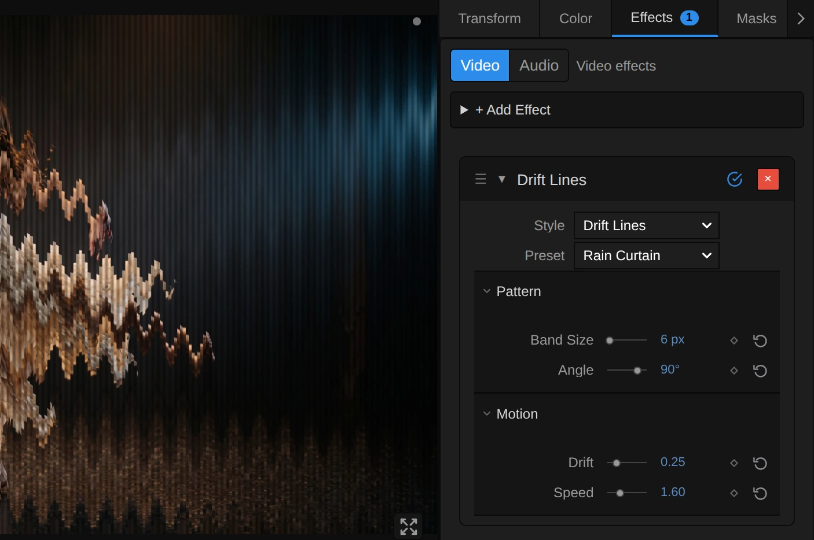
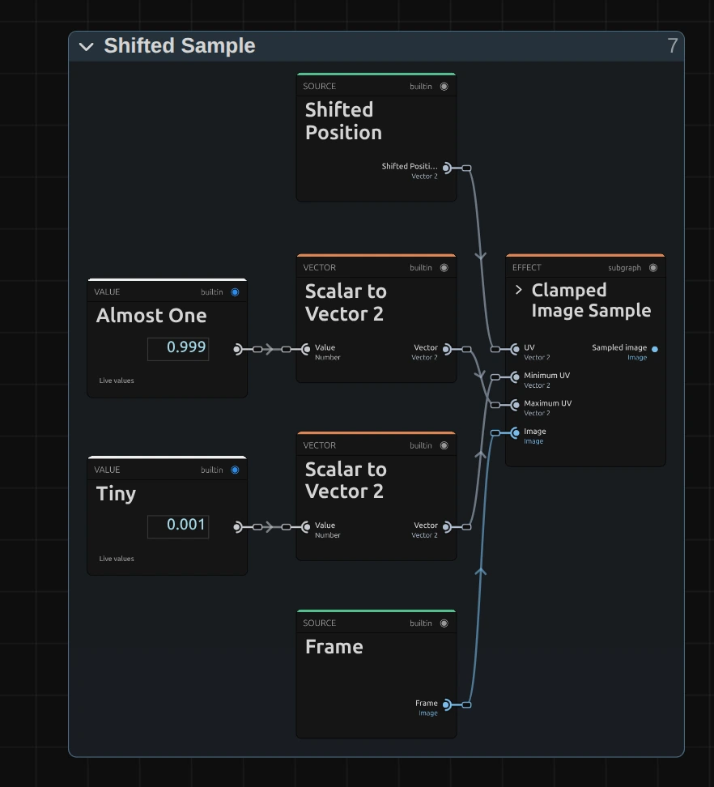

# Drift Lines

Cuts the picture into thin bands that slide back and forth in a slow wave. For dreamlike, unstable images: water, heat, a breaking signal.

Group: [Lines & Engraving](../Effects-Lines.md) · [How to add an effect](../Effects.md#add-an-effect)

<figure class="docs-shot docs-clip docs-compare docs-shot--float-left">
<video src="../assets/effects/clips/drift-lines.mp4" poster="../assets/effects/clips/drift-lines.webp" width="960" height="460" autoplay muted loop playsinline preload="none" aria-label="The dancer turning on a dark stage, original left and with Drift Lines right: the picture is cut into thin horizontal bands that slide left and right in a slow wave, so her dress and arms break into a rippling staircase, with faint dark lines between the bands"></video>
<figcaption>Left: original. Right: Drift Lines at its default settings.</figcaption>
</figure>

**Use it for:** a dream or a memory · shimmering water or heat on a projection · a picture that breaks apart on a cue.

- **Band Size** – how thick the bands are.
- **Angle** – which way they run: 0° across, 90° upright.
- **Drift** – how far they slide.
- **Speed** – how fast the wave moves.

**Tip:** keyframe **Drift** from 0 up to 0.75 to let a still picture come apart on a cue, and back to 0 to pull it together again.

## Presets

<figure class="docs-shot docs-clip">
<video src="../assets/effects/clips/drift-lines-presets.mp4" poster="../assets/effects/clips/drift-lines-presets.webp" width="962" height="938" autoplay muted loop playsinline preload="none" aria-label="The dancer four times in a grid, moving in sync, each with one preset: Heat Haze top left with fine rippling rows, Venetian Blinds top right with broad shaded bands, Rain Curtain bottom left with thin upright columns sliding up and down, Torn Signal bottom right with fine rows torn far apart"></video>
<figcaption>The four presets on the moving dancer, in sync.</figcaption>
</figure>

Pick one in the **Preset** row of the effect card. It sets all controls at once, in one undo step, and the row then shows its name until you change something. A control with keyframes keeps them, and the card says so.

**Heat Haze** – fine rows and a small drift: the picture shimmers like air over a hot stage floor and stays easy to read. Good under text or for a quiet unease.

**Venetian Blinds** – broad bands that slide slowly, shaded like half-open blinds. A calm, graphic look for large surfaces.

**Rain Curtain** – thin upright columns that run up and down. A figure turns into falling streaks; strong on tall gauzes and portrait screens.

**Torn Signal** – fine rows torn across the whole width, fast. For a breakdown, a lost transmission or the moment a scene cracks.

## Controls

<figure class="docs-shot">

<svg class="docs-shot-overlay" viewBox="0 0 1017 675" aria-hidden="true" focusable="false">
<defs><marker id="drift-lines-inspector-arrow" viewBox="0 0 10 10" refX="8" refY="5" markerWidth="5" markerHeight="5" orient="auto-start-reverse"><path d="M 0 0 L 10 5 L 0 10 Z" fill="#ffd54a" /></marker></defs>
<path class="docs-shot-arrow" d="M565 319 L649 319" marker-end="url(#drift-lines-inspector-arrow)" />
<circle class="docs-shot-number" cx="565" cy="319" r="18" /><text x="565" y="319" class="docs-shot-number-text">1</text>
<path class="docs-shot-arrow" d="M572 425 L656 425" marker-end="url(#drift-lines-inspector-arrow)" />
<circle class="docs-shot-number" cx="572" cy="425" r="18" /><text x="572" y="425" class="docs-shot-number-text">2</text>
<path class="docs-shot-arrow" d="M607 462 L691 462" marker-end="url(#drift-lines-inspector-arrow)" />
<circle class="docs-shot-number" cx="607" cy="462" r="18" /><text x="607" y="462" class="docs-shot-number-text">3</text>
<path class="docs-shot-arrow" d="M620 578 L704 578" marker-end="url(#drift-lines-inspector-arrow)" />
<circle class="docs-shot-number" cx="620" cy="578" r="18" /><text x="620" y="578" class="docs-shot-number-text">4</text>
</svg>

<figcaption>Drift Lines with the Rain Curtain preset. 1 — Preset: pick a starting point. 2 — Band Size. 3 — Angle: 90° stands the bands upright. 4 — Drift.</figcaption>
</figure>

**Style** – switches to another look of the same engine; controls with the same name keep their values and keyframes, for example [Glitch Grid](./glitch-grid.md), [Scatter Mosaic](./scatter-mosaic.md) or [Wave Lines](./wave-lines.md).

### Pattern

<figure class="docs-shot docs-clip docs-shot--float-right">
<video src="../assets/effects/clips/drift-lines-band-size.mp4" poster="../assets/effects/clips/drift-lines-band-size.webp" width="720" height="540" autoplay muted loop playsinline preload="none" aria-label="The dancer with Drift Lines while Band Size runs from 4 to 40 px and back: fine rippling rows grow into broad sliding strips and shrink again; the current value is shown at the bottom left"></video>
<figcaption>Band Size from 4 to 40 px and back.</figcaption>
</figure>

**Band Size** – how thick each band is. 2–4 gives a fine ripple like water, 10–20 clear strips, 40 and more broad blinds; thicker bands also make the dark lines between them wider. It counts pixels of a 1080p picture, so a 4K picture shows the same bands, only sharper. 2 to 80 px, default 14 px.

<figure class="docs-shot docs-clip docs-shot--float-right">
<video src="../assets/effects/clips/drift-lines-angle.mp4" poster="../assets/effects/clips/drift-lines-angle.webp" width="720" height="540" autoplay muted loop playsinline preload="none" aria-label="The dancer with Drift Lines while Angle turns from 0° to 90° and back: the bands tilt from lying flat, sliding sideways, to standing upright, sliding up and down; the current angle is shown at the bottom left"></video>
<figcaption>Angle from 0° to 90° and back.</figcaption>
</figure>

**Angle** – which way the bands run, turned counter-clockwise. At 0° they lie flat and slide sideways; at 90° they stand upright and slide up and down; 30° tilts them so they rise to the right. Animate it slowly for a picture that seems to turn in the wind. −180 to 180°, default 0°.

### Motion

<figure class="docs-shot docs-clip docs-shot--float-right">
<video src="../assets/effects/clips/drift-lines-drift.mp4" poster="../assets/effects/clips/drift-lines-drift.webp" width="720" height="540" autoplay muted loop playsinline preload="none" aria-label="The dancer with Drift Lines while Drift runs from 0 to 1 and back: at 0 only fine dark lines cross the picture, then the bands slide further and further apart until the figure breaks into steps, and close again; the current value is shown at the bottom left"></video>
<figcaption>Drift from 0 to 1 and back.</figcaption>
</figure>

**Drift** – how far the bands slide. At 0 the picture holds together and only the fine lines remain; 0.05 already makes edges ripple, 0.3 breaks a figure into steps, and at 1 a band travels about a sixteenth of the picture width each way. 0 to 1, default 0.75.

<figure class="docs-shot docs-clip docs-shot--float-right">
<video src="../assets/effects/clips/drift-lines-speed.mp4" poster="../assets/effects/clips/drift-lines-speed.webp" width="720" height="540" autoplay muted loop playsinline preload="none" aria-label="The dancer with Drift Lines at three speeds, about two seconds each: at Speed 0 the bands hold still while she moves, at 1 they sway slowly, at 3 they flicker; the speed is shown at the bottom left"></video>
<figcaption>Speed 0, 1 and 3, about two seconds each.</figcaption>
</figure>

**Speed** – how fast the wave runs through the bands. 0 freezes the drift where it is; at 1 the wave comes round about every three seconds; 3 and more flickers. It follows the playhead, so a paused picture stands still and the export matches the preview. 0 to 5, default 1.

## Node setup

<figure class="docs-shot docs-shot--graph">

<svg class="docs-shot-overlay" viewBox="0 0 1017 561" aria-hidden="true" focusable="false">
<defs><marker id="drift-lines-arrow" viewBox="0 0 10 10" refX="8" refY="5" markerWidth="5" markerHeight="5" orient="auto-start-reverse"><path d="M 0 0 L 10 5 L 0 10 Z" fill="#ffd54a" /></marker></defs>
<path class="docs-shot-arrow" d="M314 539 L314 455" marker-end="url(#drift-lines-arrow)" />
<circle class="docs-shot-number" cx="314" cy="539" r="18" /><text x="314" y="539" class="docs-shot-number-text">1</text>
<path class="docs-shot-arrow" d="M509 390 L509 306" marker-end="url(#drift-lines-arrow)" />
<circle class="docs-shot-number" cx="509" cy="390" r="18" /><text x="509" y="390" class="docs-shot-number-text">2</text>
<path class="docs-shot-arrow" d="M703 22 L703 96" marker-end="url(#drift-lines-arrow)" />
<circle class="docs-shot-number" cx="703" cy="22" r="18" /><text x="703" y="22" class="docs-shot-number-text">3</text>
<path class="docs-shot-arrow" d="M897 71 L897 155" marker-end="url(#drift-lines-arrow)" />
<circle class="docs-shot-number" cx="897" cy="71" r="18" /><text x="897" y="71" class="docs-shot-number-text">4</text>
</svg>

<figcaption>Drift Lines opened in the Nodes tab (input frame and output left out). 1 — Bands: which band a pixel lies in. 2 — Drift Wave: how far that band slides now. 3 — Shifted Sample: reads the picture there. 4 — Line Shading: the dark lines between the bands.</figcaption>
</figure>

Drift Lines works in four stages, one folder each in the Nodes tab: **Bands** finds the band a pixel lies in, **Drift Wave** works out how far that band slides right now, **Shifted Sample** reads the picture there, and **Line Shading** darkens the bands into lines. Click a folder's header to open it; the sections below show what is inside. Drift Lines is one look of the pattern engine that the [Lines & Engraving](../Effects-Lines.md#the-shared-idea) looks share; its **Style** menu switches between them.

### Bands

<figure class="docs-shot docs-shot--graph">

<svg class="docs-shot-overlay" viewBox="0 0 1017 809" aria-hidden="true" focusable="false">
<defs><marker id="drift-lines-bands-arrow" viewBox="0 0 10 10" refX="8" refY="5" markerWidth="5" markerHeight="5" orient="auto-start-reverse"><path d="M 0 0 L 10 5 L 0 10 Z" fill="#ffd54a" /></marker></defs>
<path class="docs-shot-arrow" d="M189 431 L273 431" marker-end="url(#drift-lines-bands-arrow)" />
<circle class="docs-shot-number" cx="189" cy="431" r="18" /><text x="189" y="431" class="docs-shot-number-text">1</text>
<path class="docs-shot-arrow" d="M691 596 L691 512" marker-end="url(#drift-lines-bands-arrow)" />
<circle class="docs-shot-number" cx="691" cy="596" r="18" /><text x="691" y="596" class="docs-shot-number-text">2</text>
<path class="docs-shot-arrow" d="M448 22 L448 106" marker-end="url(#drift-lines-bands-arrow)" />
<circle class="docs-shot-number" cx="448" cy="22" r="18" /><text x="448" y="22" class="docs-shot-number-text">3</text>
<path class="docs-shot-arrow" d="M935 22 L935 106" marker-end="url(#drift-lines-bands-arrow)" />
<circle class="docs-shot-number" cx="935" cy="22" r="18" /><text x="935" y="22" class="docs-shot-number-text">4</text>
</svg>

<figcaption>Inside Bands (Band Size, Angle). The number cards are values from the Constants folder, shown where they plug in. 1 — Smallest Component: the shorter side of the frame. 2 — Maximum: the band height in pixels. 3 — Rotate UV: turns the picture by Angle. 4 — Floor: the band number.</figcaption>
</figure>

**Smallest Component** – the shorter side of the frame. Divided by 1080, it says how much larger or smaller this frame is than a 1080p one, so Band Size looks the same on a 4K export, a portrait frame and a thumbnail.

**Maximum** – the band height in pixels of this frame: Band Size times that scale, and never thinner than one pixel. The other Maximum, to its left, first keeps Band Size at 2 or more.

**Rotate UV** – turns the position of every pixel around the middle of the frame by Angle (Multiply turns degrees into radians). The bands are cut across this turned picture, which is why they can run at any angle.

**Floor** – which band the pixel lies in. Add gives its distance across the turned bands in pixels, Divide splits that into band heights, and Floor drops the fraction: every pixel of a band gets the same band number, so the whole band slides as one.

### Drift Wave

<figure class="docs-shot docs-shot--graph">

<svg class="docs-shot-overlay" viewBox="0 0 1017 728" aria-hidden="true" focusable="false">
<defs><marker id="drift-lines-drift-wave-arrow" viewBox="0 0 10 10" refX="8" refY="5" markerWidth="5" markerHeight="5" orient="auto-start-reverse"><path d="M 0 0 L 10 5 L 0 10 Z" fill="#ffd54a" /></marker></defs>
<path class="docs-shot-arrow" d="M155 705 L155 621" marker-end="url(#drift-lines-drift-wave-arrow)" />
<circle class="docs-shot-number" cx="155" cy="705" r="18" /><text x="155" y="705" class="docs-shot-number-text">1</text>
<path class="docs-shot-arrow" d="M420 434 L420 374" marker-end="url(#drift-lines-drift-wave-arrow)" />
<circle class="docs-shot-number" cx="420" cy="434" r="18" /><text x="420" y="434" class="docs-shot-number-text">2</text>
<path class="docs-shot-arrow" d="M420 696 L420 612" marker-end="url(#drift-lines-drift-wave-arrow)" />
<circle class="docs-shot-number" cx="420" cy="696" r="18" /><text x="420" y="696" class="docs-shot-number-text">3</text>
<path class="docs-shot-arrow" d="M774 220 L774 304" marker-end="url(#drift-lines-drift-wave-arrow)" />
<circle class="docs-shot-number" cx="774" cy="220" r="18" /><text x="774" y="220" class="docs-shot-number-text">4</text>
</svg>

<figcaption>Inside Drift Wave (Drift, Speed). 1 — Row Rate: how far the wave moves on from band to band. 2 — Sine: one smooth wave. 3 — Shift Scale: the widest slide. 4 — Rotate UV: turns the slide along the band.</figcaption>
</figure>

**Row Rate** – 0.71. Multiplied by the band number, it gives every band its own place on the wave, so neighbouring bands slide by different amounts. Seconds × Speed × 2 is added to it, so the wave runs on with the playhead.

**Sine** – turns that place into a smooth swing between −1 and 1: one way, back, the other way, back.

**Shift Scale** – 0.06, so a band slides at most 6 % of the frame width. Sine × Drift × this width is the slide in pixels.

**Rotate UV** – turns the slide by minus Angle, from across the bands to along them, so upright bands slide up and down. Divide by Resolution and Add the pixel's own place (UV): that is the Shifted Position the next stage reads.

**Remix:** open the **Constants** folder and set the value **0.71** (the Row Rate card above) to **0.1**: neighbouring bands now slide almost together, and the picture sways in long, slow waves.

### Shifted Sample

<figure class="docs-shot docs-shot--float-right">

<svg class="docs-shot-overlay" viewBox="0 0 590 651" aria-hidden="true" focusable="false">
<defs><marker id="drift-lines-shifted-sample-arrow" viewBox="0 0 10 10" refX="8" refY="5" markerWidth="5" markerHeight="5" orient="auto-start-reverse"><path d="M 0 0 L 10 5 L 0 10 Z" fill="#ffd54a" /></marker></defs>
<path class="docs-shot-arrow" d="M484 476 L484 392" marker-end="url(#drift-lines-shifted-sample-arrow)" />
<circle class="docs-shot-number" cx="484" cy="476" r="18" /><text x="484" y="476" class="docs-shot-number-text">1</text>
<path class="docs-shot-arrow" d="M22 279 L66 279" marker-end="url(#drift-lines-shifted-sample-arrow)" />
<circle class="docs-shot-number" cx="22" cy="279" r="18" /><text x="22" y="279" class="docs-shot-number-text">2</text>
<path class="docs-shot-arrow" d="M22 426 L66 426" marker-end="url(#drift-lines-shifted-sample-arrow)" />
<circle class="docs-shot-number" cx="22" cy="426" r="18" /><text x="22" y="426" class="docs-shot-number-text">3</text>
</svg>

<figcaption>Inside Shifted Sample. 1 — Clamped Image Sample: reads the picture at the shifted place. 2 — Almost One: 0.999. 3 — Tiny: 0.001.</figcaption>
</figure>

**Clamped Image Sample** – reads the input picture at the Shifted Position, but never outside the frame. It holds a small node setup of its own; its › opens it.

**Almost One** and **Tiny** – 0.999 and 0.001: the farthest and nearest place it may read, as a share of the frame (Scalar to Vector 2 uses each for both directions). Where a band slides in from beyond the edge, the edge pixels stretch into the gap instead of leaving it empty.

### Line Shading & Alpha

<figure class="docs-shot docs-shot--graph">

<svg class="docs-shot-overlay" viewBox="0 0 1017 418" aria-hidden="true" focusable="false">
<defs><marker id="drift-lines-line-shading-arrow" viewBox="0 0 10 10" refX="8" refY="5" markerWidth="5" markerHeight="5" orient="auto-start-reverse"><path d="M 0 0 L 10 5 L 0 10 Z" fill="#ffd54a" /></marker></defs>
<path class="docs-shot-arrow" d="M448 60 L448 144" marker-end="url(#drift-lines-line-shading-arrow)" />
<circle class="docs-shot-number" cx="448" cy="60" r="18" /><text x="448" y="60" class="docs-shot-number-text">1</text>
<path class="docs-shot-arrow" d="M691 60 L691 144" marker-end="url(#drift-lines-line-shading-arrow)" />
<circle class="docs-shot-number" cx="691" cy="60" r="18" /><text x="691" y="60" class="docs-shot-number-text">2</text>
<path class="docs-shot-arrow" d="M813 316 L813 232" marker-end="url(#drift-lines-line-shading-arrow)" />
<circle class="docs-shot-number" cx="813" cy="316" r="18" /><text x="813" y="316" class="docs-shot-number-text">3</text>
<path class="docs-shot-arrow" d="M935 332 L935 248" marker-end="url(#drift-lines-line-shading-arrow)" />
<circle class="docs-shot-number" cx="935" cy="332" r="18" /><text x="935" y="332" class="docs-shot-number-text">4</text>
</svg>

<figcaption>Inside Line Shading & Alpha. 1 — Sine: half a wave per band. 2 — Add: the shade. 3 — Multiply: darkens the colour. 4 — Combine RGB + Alpha: the transparency back on.</figcaption>
</figure>

**Sine** – the distance across the bands times π, divided by the band height, rises and falls once per band: up in one band, down in the next.

**Add** – Line Base 0.82 plus Line Range 0.18 times that sine: the shade, from 0.64 in the middle of every second band to 1 in the middle of the others.

**Multiply** – multiplies the colour of the sampled picture by the shade, so every second band carries a dark line through its middle.

**Combine RGB + Alpha** – joins the shaded colour with the sampled transparency, so a cut-out figure keeps clean edges.

## Technical details

- **Size.** Band Size counts pixels of a frame whose shorter side is 1080: a 4K export, a portrait 1080 × 1920 frame, a lower Preview Quality and the thumbnails show the same bands. A band is never thinner than one pixel of the frame; below 2 px Band Size renders as 2. The card says when either happens.
- **Time.** The wave follows the timeline time: scrubbing, playback and export give the same frame for the same moment, and a paused picture needs no extra rendering. Speed multiplies that time, so a keyframed Speed makes the wave jump, the further into the clip the more. To start the motion on a cue, keyframe Drift instead.
- **Transparency.** Bands carry their transparency with them, so a cut-out figure keeps clean edges. Where a band slides in from the frame edge, the edge pixels stretch.
- **Saved projects.** A Drift Lines whose node setup you edited keeps its own recipe: its bands count output pixels and its card hides Angle.
- **More:** [Effect system](../Effect-System.md#drift-lines) · [Node Catalog](../Node-Catalog.md) · [Styles and presets](../Effects.md#styles-and-presets).
