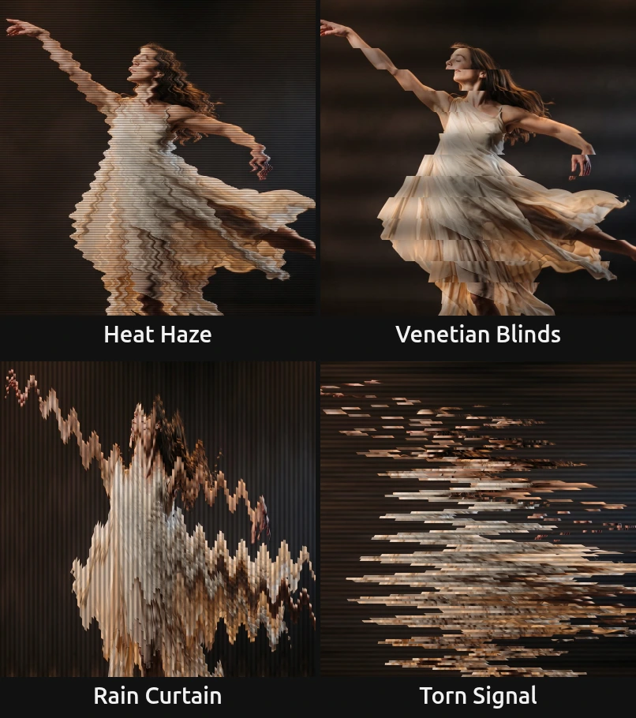

# Drift Lines

Cuts the picture into thin bands that slide back and forth in a slow wave. For dreamlike, unstable images: water, heat, a breaking signal.

Group: [Lines & Engraving](../Effects-Lines.md) · [How to add an effect](../Effects.md#add-an-effect)

<figure class="docs-shot docs-clip docs-shot--float-left">
<video src="../assets/effects/clips/drift-lines.mp4" poster="../assets/effects/clips/drift-lines.webp" width="962" height="458" autoplay muted loop playsinline preload="none" aria-label="The dancer turning on a dark stage, original left and with Drift Lines right: the picture is cut into thin horizontal bands that slide left and right in a slow wave, so her dress and arms break into a rippling staircase, with faint dark lines between the bands"></video>
<figcaption>Left: original. Right: Drift Lines at its default settings.</figcaption>
</figure>

**Use it for:** a dream or a memory · shimmering water or heat on a projection · a picture that breaks apart on a cue.

- **Band Size** – how thick the bands are.
- **Angle** – which way they run: 0° across, 90° upright.
- **Drift** – how far they slide.
- **Speed** – how fast the wave moves.

**Tip:** keyframe **Drift** from 0 up to 0.75 to let a still picture come apart on a cue, and back to 0 to pull it together again.

## Presets

<figure class="docs-shot docs-shot--detail">

<figcaption>The four presets on the dancer, one frame each.</figcaption>
</figure>

Pick one in the **Preset** row of the effect card. It sets all controls at once, in one undo step, and the row then shows its name until you change something. A control with keyframes keeps them, and the card says so.

**Heat Haze** – fine rows and a small drift: the picture shimmers like air over a hot stage floor and stays easy to read. Good under text or for a quiet unease.

**Venetian Blinds** – broad bands that slide slowly, shaded like half-open blinds. A calm, graphic look for large surfaces.

**Rain Curtain** – thin upright columns that run up and down. A figure turns into falling streaks; strong on tall gauzes and portrait screens.

**Torn Signal** – fine rows torn across the whole width, fast. For a breakdown, a lost transmission or the moment a scene cracks.

## Controls

<figure class="docs-shot">

<svg class="docs-shot-overlay" viewBox="0 0 1017 675" aria-hidden="true" focusable="false">
<defs><marker id="drift-lines-inspector-arrow" viewBox="0 0 10 10" refX="8" refY="5" markerWidth="5" markerHeight="5" orient="auto-start-reverse"><path d="M 0 0 L 10 5 L 0 10 Z" fill="#ffd54a" /></marker></defs>
<path class="docs-shot-arrow" d="M565 319 L649 319" marker-end="url(#drift-lines-inspector-arrow)" />
<circle class="docs-shot-number" cx="565" cy="319" r="18" /><text x="565" y="319" class="docs-shot-number-text">1</text>
<path class="docs-shot-arrow" d="M572 425 L656 425" marker-end="url(#drift-lines-inspector-arrow)" />
<circle class="docs-shot-number" cx="572" cy="425" r="18" /><text x="572" y="425" class="docs-shot-number-text">2</text>
<path class="docs-shot-arrow" d="M607 462 L691 462" marker-end="url(#drift-lines-inspector-arrow)" />
<circle class="docs-shot-number" cx="607" cy="462" r="18" /><text x="607" y="462" class="docs-shot-number-text">3</text>
<path class="docs-shot-arrow" d="M620 578 L704 578" marker-end="url(#drift-lines-inspector-arrow)" />
<circle class="docs-shot-number" cx="620" cy="578" r="18" /><text x="620" y="578" class="docs-shot-number-text">4</text>
</svg>

<figcaption>Drift Lines with the Rain Curtain preset. 1 — Preset: pick a starting point. 2 — Band Size. 3 — Angle: 90° stands the bands upright. 4 — Drift.</figcaption>
</figure>

**Style** – switches to another look of the same engine and keeps your values and keyframes, for example [Glitch Grid](./glitch-grid.md), [Scatter Mosaic](./scatter-mosaic.md) or [Wave Lines](./wave-lines.md).

### Pattern

**Band Size** – how thick each band is. 2–4 gives a fine ripple like water, 10–20 clear strips, 40 and more broad blinds; thicker bands also make the dark lines between them wider. It counts pixels of a 1080p picture, so a 4K picture shows the same bands, only sharper. 2 to 80 px, default 14 px.

**Angle** – which way the bands run, turned counter-clockwise. At 0° they lie flat and slide sideways; at 90° they stand upright and slide up and down; 30° tilts them so they rise to the right. Animate it slowly for a picture that seems to turn in the wind. −180 to 180°, default 0°.

### Motion

**Drift** – how far the bands slide. At 0 the picture holds together and only the fine lines remain; 0.05 already makes edges ripple, 0.3 breaks a figure into steps, and at 1 a band travels about a sixteenth of the picture width each way. 0 to 1, default 0.75.

**Speed** – how fast the wave runs through the bands. 0 freezes the drift where it is; at 1 the wave comes round about every three seconds; 3 and more flickers. It follows the playhead, so a paused picture stands still and the export matches the preview. 0 to 5, default 1.

## Node setup

<figure class="docs-shot docs-shot--graph">

<svg class="docs-shot-overlay" viewBox="0 0 1017 561" aria-hidden="true" focusable="false">
<defs><marker id="drift-lines-arrow" viewBox="0 0 10 10" refX="8" refY="5" markerWidth="5" markerHeight="5" orient="auto-start-reverse"><path d="M 0 0 L 10 5 L 0 10 Z" fill="#ffd54a" /></marker></defs>
<path class="docs-shot-arrow" d="M314 539 L314 455" marker-end="url(#drift-lines-arrow)" />
<circle class="docs-shot-number" cx="314" cy="539" r="18" /><text x="314" y="539" class="docs-shot-number-text">1</text>
<path class="docs-shot-arrow" d="M509 390 L509 306" marker-end="url(#drift-lines-arrow)" />
<circle class="docs-shot-number" cx="509" cy="390" r="18" /><text x="509" y="390" class="docs-shot-number-text">2</text>
<path class="docs-shot-arrow" d="M703 22 L703 96" marker-end="url(#drift-lines-arrow)" />
<circle class="docs-shot-number" cx="703" cy="22" r="18" /><text x="703" y="22" class="docs-shot-number-text">3</text>
<path class="docs-shot-arrow" d="M897 71 L897 155" marker-end="url(#drift-lines-arrow)" />
<circle class="docs-shot-number" cx="897" cy="71" r="18" /><text x="897" y="71" class="docs-shot-number-text">4</text>
</svg>

<figcaption>Drift Lines opened in the Nodes tab (input frame and output left out). 1 — Bands: which band a pixel lies in. 2 — Drift Wave: how far that band slides now. 3 — Shifted Sample: reads the picture there. 4 — Line Shading: the dark lines between the bands.</figcaption>
</figure>

**Bands** turns each pixel into a band number across the turned bands. **Drift Wave** gives every band its own point on one sine wave, moved on by the playhead, and slides the band along its own direction. **Shifted Sample** reads the picture at the new place, and **Line Shading** darkens every second band into a line. Drift Lines is one look of the pattern engine that the [Lines & Engraving](../Effects-Lines.md#the-shared-idea) looks share; its **Style** menu switches between them.

**Remix:** open the **Constants** folder and set the value **0.71** (how far the wave moves on from one band to the next) to **0.1**: neighbouring bands now slide almost together, and the picture sways in long, slow waves.

## Technical details

- **Size.** Band Size counts pixels of a frame whose shorter side is 1080: a 4K export, a portrait 1080 × 1920 frame, a lower Preview Quality and the thumbnails show the same bands. A band is never thinner than one pixel of the frame; below 2 px Band Size renders as 2. The card says when either happens.
- **Time.** The wave follows the timeline time: scrubbing, playback and export give the same frame for the same moment, and a paused picture needs no extra rendering.
- **Transparency.** Bands carry their transparency with them, so a cut-out figure keeps clean edges. Where a band slides in from the frame edge, the edge pixels stretch.
- **Saved projects.** A Drift Lines whose node setup you edited keeps its own recipe: its bands count output pixels and its card hides Angle.
- **More:** [Effect system](../Effect-System.md#drift-lines) · [Node Catalog](../Node-Catalog.md) · [Styles and presets](../Effects.md#styles-and-presets).
