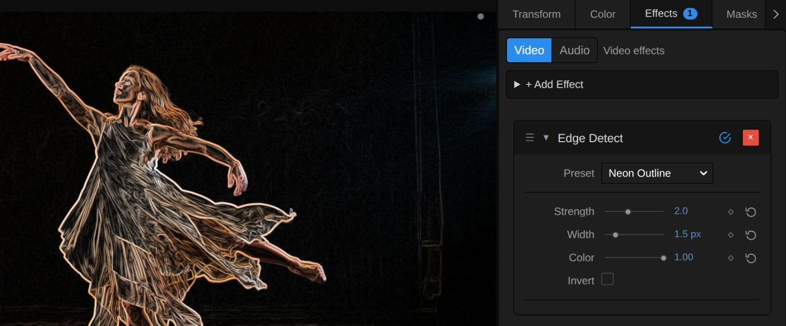
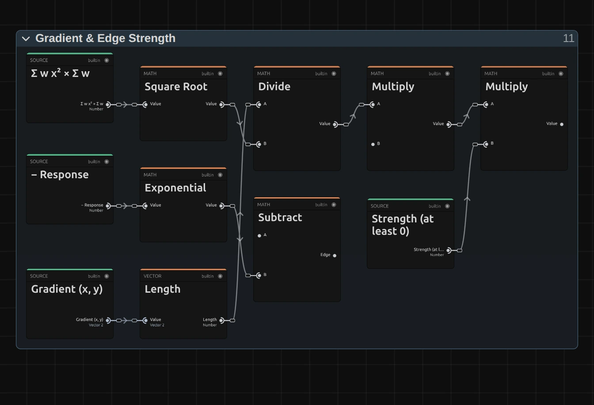

# Edge Detect

Turns the picture into its outlines: bright lines where things meet, dark everywhere else. With Invert it looks like a pencil drawing.

Group: [Light & Stylize](../Effects-Stylize.md) · [How to add an effect](../Effects.md#add-an-effect)

<figure class="docs-shot docs-compare docs-shot--float-left">

<figcaption>Left: original. Right: the default values (Strength 1, Width 1 px, Color 0, Invert off).</figcaption>
</figure>

**Use it for:** a drawn or neon-outline look · glowing contours on black for projection · an outline around a title or a cut-out.

- **Strength** – how bright and how many lines.
- **Width** – how thick the lines are; it stays the same at any resolution.
- **Color** – white lines, or lines in the picture's own colours.
- **Invert** – dark lines on white, like a pencil drawing.

**Tip:** on a title or a cut-out on a transparent layer, the outline is drawn just outside it too. Add [Glow](./glow.md) after Edge Detect for neon tubes.

## Presets

<figure class="docs-shot docs-shot--detail">

<figcaption>The four presets on the dancer.</figcaption>
</figure>

Pick one in the **Preset** row of the effect card. It sets all four controls in one undo step, and the row shows its name until you change something. A control with keyframes keeps them, and the card says so.

**Neon Outline** – glowing contours in the picture's own colours on black. Strong on stage footage with a dark background, and a good start for projection; add Glow after it for neon tubes.

**Pencil Sketch** – fine dark grey lines on white paper, like a quick drawing. Works best on a sharp picture with clear shapes.

**Coloured Pencil** – lines in the picture's colours on white, like a drawing with coloured pencils. It reads best on colourful pictures; on pale skin and white costumes the lines stay light.

**Bold Contours** – thick white lines that keep only the big shapes, like chalk or a cartoon. Fine detail and noise disappear.

## Controls

<figure class="docs-shot">

<svg class="docs-shot-overlay" viewBox="0 0 1017 422" aria-hidden="true" focusable="false">
<defs><marker id="edge-detect-inspector-arrow" viewBox="0 0 10 10" refX="8" refY="5" markerWidth="5" markerHeight="5" orient="auto-start-reverse"><path d="M 0 0 L 10 5 L 0 10 Z" fill="#ffd54a" /></marker></defs>
<path class="docs-shot-arrow" d="M639 224 L723 224" marker-end="url(#edge-detect-inspector-arrow)" />
<circle class="docs-shot-number" cx="639" cy="224" r="18" /><text x="639" y="224" class="docs-shot-number-text">1</text>
<path class="docs-shot-arrow" d="M627 274 L711 274" marker-end="url(#edge-detect-inspector-arrow)" />
<circle class="docs-shot-number" cx="627" cy="274" r="18" /><text x="627" y="274" class="docs-shot-number-text">2</text>
<path class="docs-shot-arrow" d="M643 304 L727 304" marker-end="url(#edge-detect-inspector-arrow)" />
<circle class="docs-shot-number" cx="643" cy="304" r="18" /><text x="643" y="304" class="docs-shot-number-text">3</text>
<path class="docs-shot-arrow" d="M646 334 L730 334" marker-end="url(#edge-detect-inspector-arrow)" />
<circle class="docs-shot-number" cx="646" cy="334" r="18" /><text x="646" y="334" class="docs-shot-number-text">4</text>
<path class="docs-shot-arrow" d="M644 364 L728 364" marker-end="url(#edge-detect-inspector-arrow)" />
<circle class="docs-shot-number" cx="644" cy="364" r="18" /><text x="644" y="364" class="docs-shot-number-text">5</text>
</svg>

<figcaption>Edge Detect with the Neon Outline preset. 1 — Preset: pick a starting point. 2 — Strength: how bright and how many lines. 3 — Width: how thick. 4 — Color: white or the picture's colours. 5 — Invert: dark lines on white.</figcaption>
</figure>

**Preset** – a starting point for all four controls; see [Presets](#presets).

**Strength** – how bright the lines get, and with that how many show. Around 0.3 only the strongest outlines remain; the default 1 draws clear outlines and a soft web of fine detail; 2–3 brings out texture such as hair, fabric and a stage floor. Strong edges never clip to a flat white: they approach it softly, so busy detail keeps its structure even at 5. 0 draws no lines at all. 0 to 5, default 1.

<figure class="docs-shot docs-compare docs-shot--float-right" data-before="Width 1 px" data-after="Width 4 px">

<figcaption>Left: Width 1 px, every fine detail. Right: Width 4 px, only the big shapes.</figcaption>
</figure>

**Width** – how thick the lines are, and how big a detail has to be to get one. At 1 every hair and fold gets a line; at 3–4 fine texture fades and thick, soft lines follow only the big shapes. It is measured in pixels of a 1080p frame, so a half-size preview, the 1080p export and a 4K export draw the same line. A 1080p frame cannot show lines thinner than about 0.7 px, so the lowest values look alike there (the card says so). Animating Width changes the lines smoothly. 0.5 to 6 px, default 1 px.

**Color** – the colour of the lines. At 0 they are white (with Invert: black); at 1 each line takes the colour of the picture next to it, at full brightness, so a dark red stays a clear red line. Values between mix the two. 0 to 1, default 0.

**Invert** – swaps line and background: dark lines on white, like a pencil drawing. With Color the lines take the picture's colours on white. A switch: on or off, default off.

## Node setup

<figure class="docs-shot docs-shot--graph">

<svg class="docs-shot-overlay" viewBox="0 0 1017 928" aria-hidden="true" focusable="false">
<defs><marker id="edge-detect-arrow" viewBox="0 0 10 10" refX="8" refY="5" markerWidth="5" markerHeight="5" orient="auto-start-reverse"><path d="M 0 0 L 10 5 L 0 10 Z" fill="#ffd54a" /></marker></defs>
<path class="docs-shot-arrow" d="M314 905 L314 821" marker-end="url(#edge-detect-arrow)" />
<circle class="docs-shot-number" cx="314" cy="905" r="18" /><text x="314" y="905" class="docs-shot-number-text">1</text>
<path class="docs-shot-arrow" d="M509 406 L509 322" marker-end="url(#edge-detect-arrow)" />
<circle class="docs-shot-number" cx="509" cy="406" r="18" /><text x="509" y="406" class="docs-shot-number-text">2</text>
<path class="docs-shot-arrow" d="M703 404 L703 488" marker-end="url(#edge-detect-arrow)" />
<circle class="docs-shot-number" cx="703" cy="404" r="18" /><text x="703" y="404" class="docs-shot-number-text">3</text>
<path class="docs-shot-arrow" d="M897 535 L897 451" marker-end="url(#edge-detect-arrow)" />
<circle class="docs-shot-number" cx="897" cy="535" r="18" /><text x="897" y="535" class="docs-shot-number-text">4</text>
</svg>

<figcaption>Edge Detect opened in the Nodes tab (Constants, Coordinates and the Output card left out). 1 — Line Width (sigma & window): how wide a line is in pixels. 2 — Window Taps (premultiplied brightness): the brightness around each pixel. 3 — Gradient & Edge Strength: how strongly it changes. 4 — Line Color & Alpha: the line over the background.</figcaption>
</figure>

Edge Detect is one pass over the picture. **Line Width (sigma & window)** turns Width into a blur size in pixels and the size of the window it reads around each pixel. **Window Taps (premultiplied brightness)** reads the brightness in that window and sums it up, weighted by distance and direction. **Gradient & Edge Strength** works out from those sums how strongly the brightness changes across the pixel, and turns that into a line strength from 0 to 1. **Line Color & Alpha** draws the line in white, black or the picture's colour over the background. Click a folder's header to open it.

### Line Width (sigma & window)

<figure class="docs-shot docs-shot--graph">

<svg class="docs-shot-overlay" viewBox="0 0 1017 782" aria-hidden="true" focusable="false">
<defs><marker id="edge-detect-width-arrow" viewBox="0 0 10 10" refX="8" refY="5" markerWidth="5" markerHeight="5" orient="auto-start-reverse"><path d="M 0 0 L 10 5 L 0 10 Z" fill="#ffd54a" /></marker></defs>
<path class="docs-shot-arrow" d="M314 296 L314 274" marker-end="url(#edge-detect-width-arrow)" />
<circle class="docs-shot-number" cx="314" cy="296" r="18" /><text x="314" y="296" class="docs-shot-number-text">1</text>
<path class="docs-shot-arrow" d="M509 296 L509 274" marker-end="url(#edge-detect-width-arrow)" />
<circle class="docs-shot-number" cx="509" cy="296" r="18" /><text x="509" y="296" class="docs-shot-number-text">2</text>
<path class="docs-shot-arrow" d="M897 223 L897 307" marker-end="url(#edge-detect-width-arrow)" />
<circle class="docs-shot-number" cx="897" cy="223" r="18" /><text x="897" y="223" class="docs-shot-number-text">3</text>
<path class="docs-shot-arrow" d="M897 760 L897 676" marker-end="url(#edge-detect-width-arrow)" />
<circle class="docs-shot-number" cx="897" cy="760" r="18" /><text x="897" y="760" class="docs-shot-number-text">4</text>
<path class="docs-shot-arrow" d="M314 520 L314 498" marker-end="url(#edge-detect-width-arrow)" />
<circle class="docs-shot-number" cx="314" cy="520" r="18" /><text x="314" y="520" class="docs-shot-number-text">5</text>
</svg>

<figcaption>Inside Line Width, reduced to its recipe (the window size the Ceiling feeds is left out). 1 — Multiply: Width in pixels of this frame. 2 — Maximum: never finer than 0.7 px. 3 — Ceiling: whole taps. 4 — Minimum: at most 8 taps. 5 — Divide: how far apart the taps sit.</figcaption>
</figure>

**Multiply** – Width times the frame's short side divided by 1080: the line's blur size (sigma) in pixels of this frame. That is why a line looks the same in a 1080p preview and a 4K export.

**Maximum** – keeps sigma at 0.7 px or more. A pixel grid cannot show a finer line; it would only fade.

**Ceiling** – two sigma rounded up to whole pixels: how many taps the window reaches to each side. A Minimum after it limits that to 8, so a window has at most 17 × 17 taps.

**Minimum** – the Covered Reach: two sigma counted in taps, also limited to 8, but not rounded. Window Taps uses it to count the outermost taps only with the share of them the reach covers.

**Divide** – the Tap Spacing, how far apart the taps sit: two sigma, at least 8 px, divided by 8. That is 1 px until two sigma passes 8 px, then more. A wide window keeps its 8 taps per side and spreads them out, reading between pixels, so it always reaches two sigma. That is why Width 3 draws the same line at 4K as at 1080p.

### Window Taps (premultiplied brightness)

<figure class="docs-shot docs-shot--graph">

<svg class="docs-shot-overlay" viewBox="0 0 1017 1090" aria-hidden="true" focusable="false">
<defs><marker id="edge-detect-window-arrow" viewBox="0 0 10 10" refX="8" refY="5" markerWidth="5" markerHeight="5" orient="auto-start-reverse"><path d="M 0 0 L 10 5 L 0 10 Z" fill="#ffd54a" /></marker></defs>
<path class="docs-shot-arrow" d="M344 156 L428 156" marker-end="url(#edge-detect-window-arrow)" />
<circle class="docs-shot-number" cx="344" cy="156" r="18" /><text x="344" y="156" class="docs-shot-number-text">1</text>
<path class="docs-shot-arrow" d="M314 205 L314 289" marker-end="url(#edge-detect-window-arrow)" />
<circle class="docs-shot-number" cx="314" cy="205" r="18" /><text x="314" y="205" class="docs-shot-number-text">2</text>
<path class="docs-shot-arrow" d="M509 564 L509 480" marker-end="url(#edge-detect-window-arrow)" />
<circle class="docs-shot-number" cx="509" cy="564" r="18" /><text x="509" y="564" class="docs-shot-number-text">3</text>
<path class="docs-shot-arrow" d="M314 559 L314 581" marker-end="url(#edge-detect-window-arrow)" />
<circle class="docs-shot-number" cx="314" cy="559" r="18" /><text x="314" y="559" class="docs-shot-number-text">4</text>
<path class="docs-shot-arrow" d="M897 582 L897 498" marker-end="url(#edge-detect-window-arrow)" />
<circle class="docs-shot-number" cx="897" cy="582" r="18" /><text x="897" y="582" class="docs-shot-number-text">5</text>
</svg>

<figcaption>Inside Window Taps, reduced to its recipe (the tap offsets and how the Moments are put together are left out). 1 — Gaussian Falloff: near taps count more. 2 — Clamp: the share of an outer tap. 3 — Multiply: the Tap Share. 4 — Luminance: the brightness of a tap. 5 — Kernel Sum (Rect): the whole window at once.</figcaption>
</figure>

**Gaussian Falloff** – the weight of each tap: 1 at the pixel itself, falling off smoothly with the distance, at the speed sigma sets.

**Clamp** – the share of a tap that lies inside the Covered Reach: 1 for every tap inside it, a part for the outermost ring. When an animated Width makes the window one tap wider, the new taps fade in instead of appearing at once, so the lines do not jump.

**Multiply** – the share across times the share down: the Tap Share. The Multiply after it scales the Gaussian weight by it, the Tap Weight.

**Luminance** – the brightness of the tap. The Multiply after it weighs it by the tap's alpha (premultiplied brightness), so the outline of a title on a transparent layer is an edge too.

**Kernel Sum (Rect)** – reads every tap of the window and adds up four sums at once (the Moments): brightness times the offset across, brightness times the offset down, the offset squared, and the weights themselves.

### Gradient & Edge Strength

<figure class="docs-shot docs-shot--graph">

<svg class="docs-shot-overlay" viewBox="0 0 1017 693" aria-hidden="true" focusable="false">
<defs><marker id="edge-detect-gradient-arrow" viewBox="0 0 10 10" refX="8" refY="5" markerWidth="5" markerHeight="5" orient="auto-start-reverse"><path d="M 0 0 L 10 5 L 0 10 Z" fill="#ffd54a" /></marker></defs>
<path class="docs-shot-arrow" d="M314 23 L314 107" marker-end="url(#edge-detect-gradient-arrow)" />
<circle class="docs-shot-number" cx="314" cy="23" r="18" /><text x="314" y="23" class="docs-shot-number-text">1</text>
<path class="docs-shot-arrow" d="M314 670 L314 586" marker-end="url(#edge-detect-gradient-arrow)" />
<circle class="docs-shot-number" cx="314" cy="670" r="18" /><text x="314" y="670" class="docs-shot-number-text">2</text>
<path class="docs-shot-arrow" d="M509 23 L509 107" marker-end="url(#edge-detect-gradient-arrow)" />
<circle class="docs-shot-number" cx="509" cy="23" r="18" /><text x="509" y="23" class="docs-shot-number-text">3</text>
<path class="docs-shot-arrow" d="M509 607 L509 523" marker-end="url(#edge-detect-gradient-arrow)" />
<circle class="docs-shot-number" cx="509" cy="607" r="18" /><text x="509" y="607" class="docs-shot-number-text">4</text>
</svg>

<figcaption>Inside Gradient & Edge Strength, reduced to its recipe (the Step Scale 10.03 and the One are left out). 1 — Square Root: the window's own spread. 2 — Length: how steep. 3 — Divide: the same at any Width. 4 — Subtract: the soft roll-off.</figcaption>
</figure>

**Square Root** – the spread of the window: the root of its squared offsets times its weights. It is the yardstick the gradient is measured with.

**Length** – how steep the brightness rises across the pixel, in any direction: the length of the summed brightness times offset, across and down.

**Divide** – the steepness divided by the spread. A step of the same contrast therefore gives the same line strength at every Width and every resolution. The two Multiply cards after it scale it (Step Scale 10.03, so a step of contrast 0.25 gives a response of about 1) and by Strength.

**Subtract** – 1 minus the Exponential of minus the response. Faint edges grow almost in proportion; strong ones approach 1 softly instead of clipping, which keeps dense detail readable.

### Line Color & Alpha

<figure class="docs-shot docs-shot--graph">

<svg class="docs-shot-overlay" viewBox="0 0 1017 2003" aria-hidden="true" focusable="false">
<defs><marker id="edge-detect-color-arrow" viewBox="0 0 10 10" refX="8" refY="5" markerWidth="5" markerHeight="5" orient="auto-start-reverse"><path d="M 0 0 L 10 5 L 0 10 Z" fill="#ffd54a" /></marker></defs>
<path class="docs-shot-arrow" d="M507 703 L507 725" marker-end="url(#edge-detect-color-arrow)" />
<circle class="docs-shot-number" cx="507" cy="703" r="18" /><text x="507" y="703" class="docs-shot-number-text">1</text>
<path class="docs-shot-arrow" d="M823 641 L823 725" marker-end="url(#edge-detect-color-arrow)" />
<circle class="docs-shot-number" cx="823" cy="641" r="18" /><text x="823" y="641" class="docs-shot-number-text">2</text>
<path class="docs-shot-arrow" d="M507 351 L507 373" marker-end="url(#edge-detect-color-arrow)" />
<circle class="docs-shot-number" cx="507" cy="351" r="18" /><text x="507" y="351" class="docs-shot-number-text">3</text>
<path class="docs-shot-arrow" d="M507 1413 L507 1391" marker-end="url(#edge-detect-color-arrow)" />
<circle class="docs-shot-number" cx="507" cy="1413" r="18" /><text x="507" y="1413" class="docs-shot-number-text">4</text>
<path class="docs-shot-arrow" d="M823 1585 L823 1501" marker-end="url(#edge-detect-color-arrow)" />
<circle class="docs-shot-number" cx="823" cy="1585" r="18" /><text x="823" y="1585" class="docs-shot-number-text">5</text>
</svg>

<figcaption>Inside Line Color & Alpha, reduced to its recipe (the Zero and One the Switch reads, and the colour taps, are left out). 1 — Divide: the picture's colour at full brightness. 2 — Mix: the line colour. 3 — Switch: black or white background. 4 — Multiply: how much background shows. 5 — Add: the alpha.</figcaption>
</figure>

**Divide** – the colour of the picture beside the line, divided by its brightest channel, so it comes out at full brightness. Edge Detect takes that colour from this pixel and two taps towards the brighter side of the edge, so an outline just outside a layer takes the layer's colour.

**Mix** – blends the plain line colour (white, with Invert black) towards that picture colour by **Color**: the Line Color.

**Switch** – the background: Zero (black) while Invert is off, One (white) while it is on.

**Multiply** – how much background shows: the source alpha times 1 minus the Edge. Where the layer is transparent no background is drawn, so surroundings stay transparent.

**Add** – the alpha of the result: the Edge plus that background share. The line therefore shows in its full colour even outside a transparent layer, where it is drawn over nothing.

**Remix:** for chalk on a slate, open **Line Color & Alpha** and find the **Switch**. Plug a **Value** of 0.15 into its False input, in place of Zero: with Invert off, the background turns dark grey.

## Technical details

- **Lines.** A derivative of a Gaussian on premultiplied brightness (Rec. 709), in one Kernel Sum (Rect) over a window of ±2 sigma, normalized by the window's own second moment; line strength `1 − exp(−4 · contrast · Strength)`.
- **Width** is sigma in pixels of a 1080p frame (at least 0.7 px). The window keeps at most 8 taps to each side, up to 289 reads per pixel plus two for Color: one pixel apart up to 2 sigma = 8 px, and 2 sigma / 8 px apart beyond, with bilinear reads, so a Width covers the same share of the frame at every size. The outermost taps count with the share 2 sigma covers, so an animated Width changes smoothly. A Width finer than a pixel, a negative Strength and a Color outside 0–1 are reported in the effect card and the tool result. Wide lines cost more render time.
- **Transparency.** Lines are composited premultiplied (alpha = edge + source alpha × (1 − edge)), so transparent surroundings stay transparent and a layer's outline shows in its full line colour.
- **Saved projects.** An Edge Detect saved before 2026-10-21 keeps its earlier one-pixel Sobel (Width and Color have no effect on it); one saved with version 3.2.7 keeps whole taps out to 2 sigma, whose lines can jump a step while Width is animated, and a window that ends at 8 px, so its wide lines come out thinner in large frames (at 4K above Width 2; the card says so). The card of both offers **Use the new Edge Detect**.
- Shared notes: [Light & Stylize](../Effect-System.md#light--stylize-notes). Formulas: [Effect system](../Effect-System.md#editable-blur-kernels); blocks: [Node Catalog](../Node-Catalog.md).
