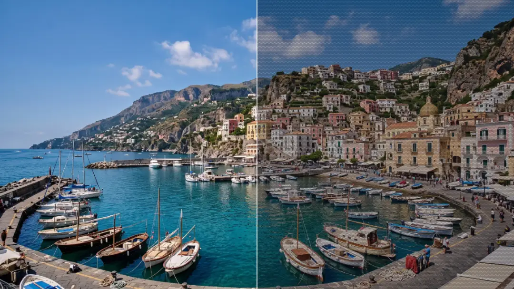

# Embroidery

<!-- effect-docs: basic page, written by scripts/effect-docs.mjs. Delete this line to write the page by hand (template B in Documentation-Site.md). -->

Covers the image in wavy animated thread rows tinted with the Ink color for a knitted fabric look; Scale sets the stitch size.

Group: [Textile & Craft](./index.md#textile--craft) · [How to add an effect](../Effects.md#add-an-effect)

<figure class="docs-shot">

<figcaption>Left: the original. Right: Embroidery at its default settings.</figcaption>
</figure>

*A short page made from the editor’s effect catalog: what the effect does and its controls. Tips and its node setup will follow.*

## Controls

<!-- generated:controls start -->
| Control | Range | Default |
|---|---|---|
| **Pattern** | | |
| Scale | 2 to 80 | 14 |
| Angle | −180 to 180 | 0 |
| **Style** | | |
| Amount | 0 to 1 | 0.75 |
| **Color** | | |
| Ink | a colour | `#111827` |
| Paper | a colour | `#f8fafc` |
| **Motion** | | |
| Speed | 0 to 5 | 1 |
<!-- generated:controls end -->

**Styles:** the **Style** menu in the effect card switches to another look with the same controls and keyframes: [Drift Lines](./drift-lines.md), [Glitch Grid](./glitch-grid.md), [Riso Glow](./riso-glow.md), [Scatter Mosaic](./scatter-mosaic.md), [Crystal Glass](./crystal.md), [Glass Dispersion](./glass-dispersion.md), [Wave Lines](./wave-lines.md), [Toy Bricks](./bricks.md), [Outline](./outline.md).

## Technical details

Embroidery is one look of the pattern engine; its looks share one node setup. How effects are stored, rendered and exported: [Effect system](../Effect-System.md). Its building blocks: [Node Catalog](../Node-Catalog.md).
